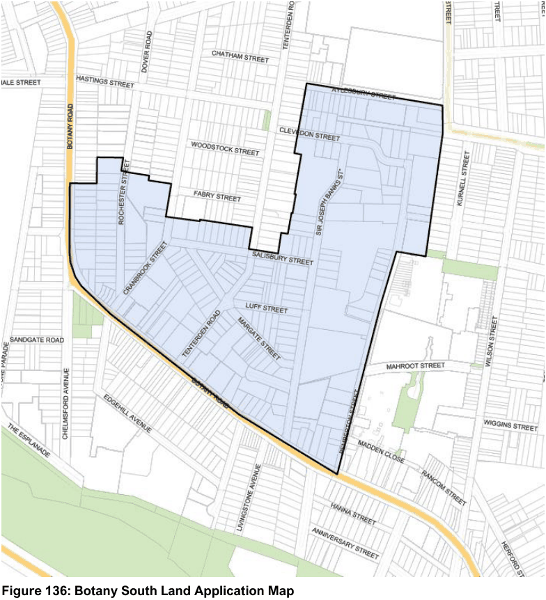

#### 7.13.1 Description

The Botany South Precinct is bounded by Botany Road to the south and west, Pemberton Street to the east and parts of Rochester, Cranbrook, Tenterden and Aylesbury Streets to the north. The Precinct is zoned predominantly B7 Business Park, with a B4 Mixed Zoned around the periphery of the Precinct. The Precinct is surrounded by land zoned for residential purposes.

The intention of the B4 zone within the Precinct is to act as a buffer between the B7 area and low density residential area and to enhance and protect the amenity of existing residential dwellings while encouraging the centre of the Precinct to be redeveloped with uses including creative industries, light industrial, warehouses and associated offices.

This Part is broken down into the following:

• Provisions applying to land only in the B7 Business Park Zone

• Provisions applying to land only in the B4 Mixed Use Zone

> [Picture on page 216: a picture, saved as a picture (images/section-07-specific-places-page-216-1.gif, 150 dpi).]

#### Figure 136: Botany South Land Application Map
