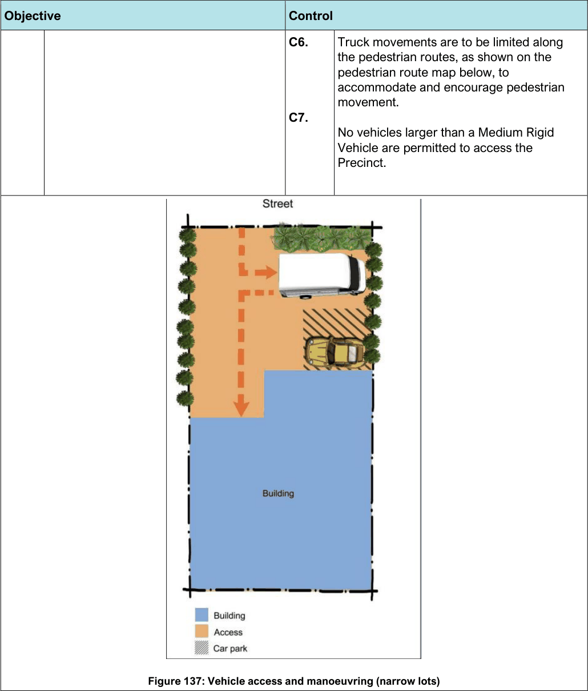
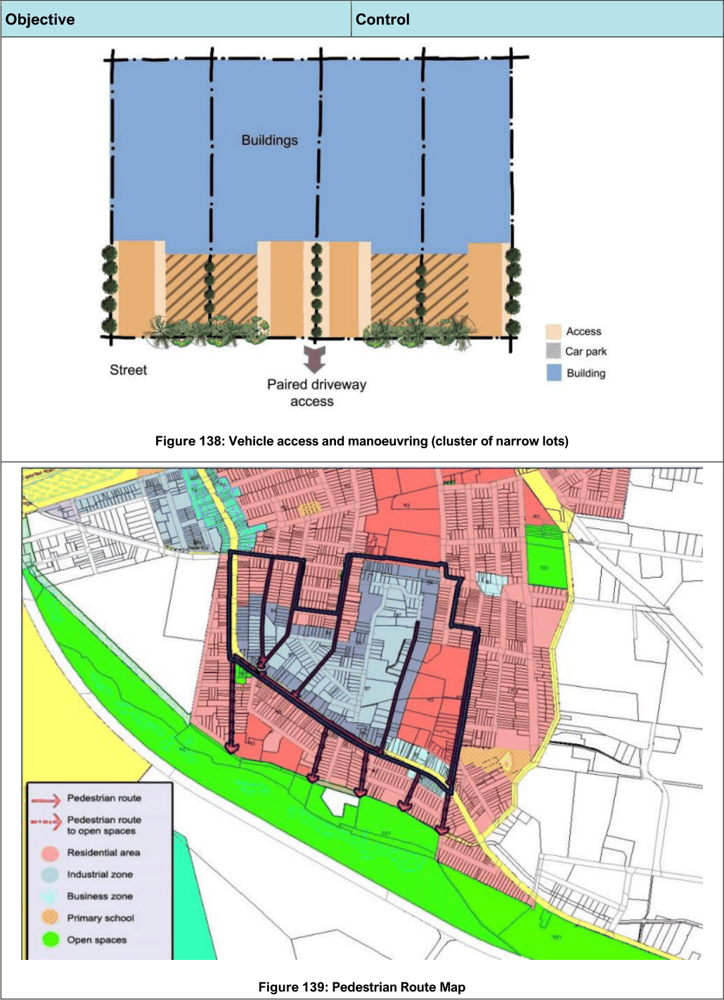
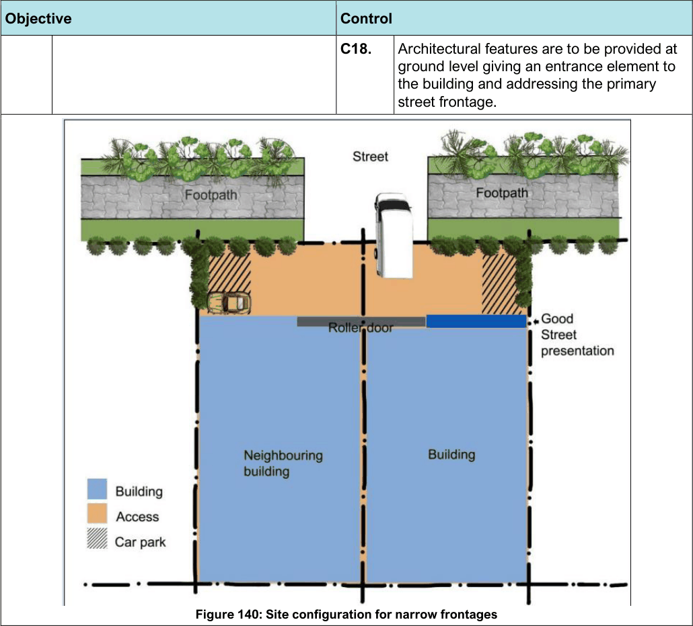
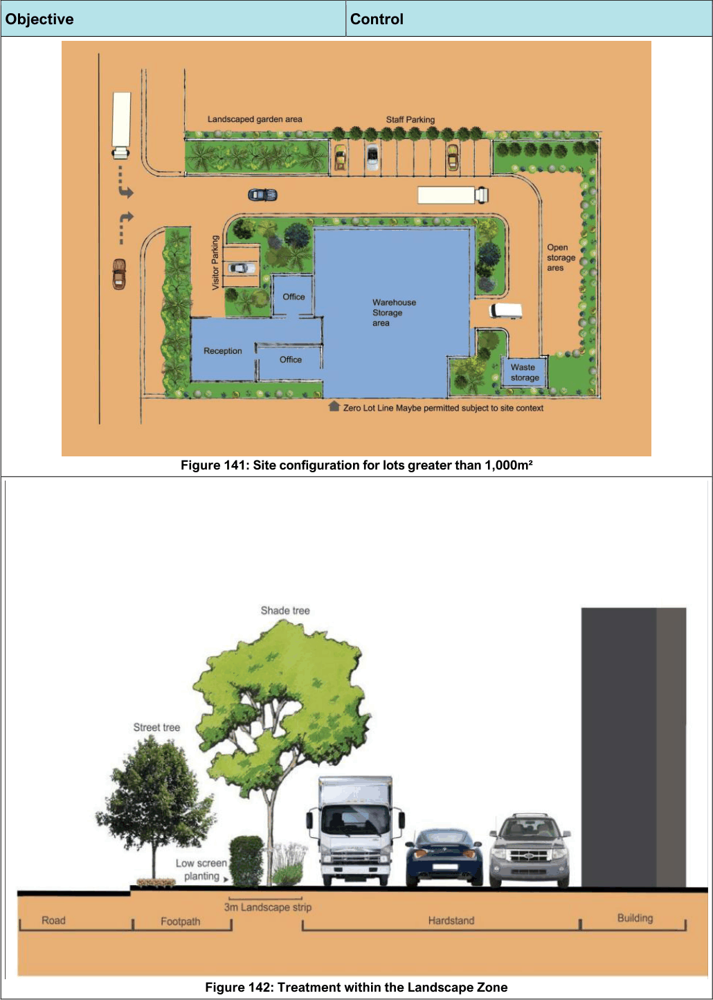

#### 7.13.2 Part A - Land in the B7 Business Park Zone

#### Desired Future Character

The B7 zone within the Botany South Precinct is anticipated to develop into a high quality business area with a mix of light industrial, creative industries, commercial and business premises, and warehouses. It is anticipated that larger sites will contain business parks with a mix of uses and associated offices. New works in the public domain will be required such as landscaping and pedestrian corridors to improve the amenity of the Precinct and encourage pedestrian movement.

The redevelopment of this area is to provide services and employment for the surrounding residential and maintain smaller lots which are characteristic of the Precinct and required for particular uses. While maintaining some small lots is integral to the future redevelopment of the area, site consolidation may be required to occur to enable improvement of the public domain, increased public car parking and traffic management and the creation of pedestrian links.

#### Controls

| Objective |  |
|---|---|
| Land Use |  |
| O1. | To encourage new light industrial, business park and commercial development and associated offices in the Precinct which are compatible with the capacity of the road network in the area. |
| O2. | To retain an employment base in the area which provides flexibility and encourages initiatives to create a unique and innovative working environment. |
| O3. | To ensure no new residential development occurs other than development which maintains or enhances existing residential development, to a commensurate scale. |
| O4. | To facilitate amalgamation and subdivision that results in some small lots, lot boundaries consistent with existing linear pattern and amalgamation where appropriate. |
| Vehicle Access and Parking |  |
| O5. | To provide adequate off-street parking and vehicle access that does not visually dominate the streetscape. |
| O6. | To encourage developments which do not require large transport vehicles. |

| Control |  |
|---|---|
| C1. | No new residential dwelling houses are permitted within the B7 Zone though existing residential uses may be maintained and enhanced. Any residential alterations and additions must: i. Improve the appearance of buildings; and ii. Improve the interface and amenity with non-residential uses. Note: Caretaker Dwellings which are ancillary to an approved business or industrial use on the site are permitted. |
| C2. | Developments within the precinct shall submit a detailed Flood Study/Assessment for 1 in 100-year average recurrence interval (ARI) design storm events and probable maximum flood (PMF). The Flood Study/Assessment is to be prepared by a suitably qualified and experienced civil engineer. |
| C3. | Visitor parking shall be located convenient to administration and office areas. |
| C4. | For narrow and small lots an area for delivery vehicle access/manoeuvring may be provided within the front setback in order to allow such vehicles to enter and leave in a forward direction provided the minimum landscape requirements are met. Note: Refer to the below vehicle access and manoeuvring (narrow lots) diagram for an illustration of the desired outcome. |
| C5. | Where there is a cluster of narrow lots, access driveways should be paired so that adjacent properties locate driveways side by side. Note: Refer to the below vehicle access and manoeuvring (cluster of narrow lots) diagram for an illustration of the desired outcome. |

> [Picture on page 218: a picture, saved as a picture (images/section-07-specific-places-page-218-1.gif, 150 dpi).]
> Words printed on the picture (title and legend, copied from the PDF):
> C6.
> C7.

Figure 137: Vehicle access and manoeuvring (narrow lots)

#### Objective

#### Control

Truck movements are to be limited along the pedestrian routes, as shown on the pedestrian route map below, to accommodate and encourage pedestrian movement.

No vehicles larger than a Medium Rigid Vehicle are permitted to access the Precinct.

> [Picture on page 219: a picture, saved as a picture (images/section-07-specific-places-page-219-1.gif, 150 dpi).]

Figure 138: Vehicle access and manoeuvring (cluster of narrow lots)

Figure 139: Pedestrian Route Map

#### Objective

#### Control

| Objective |  |
|---|---|
| Built Form: Building Heights and Density |  |
| O7. | To ensure the scale of new buildings is consistent with the Local Character Statement of the street. |
| Design |  |
| O8. | To ensure that future development contributes to the creation of a high- quality landscape environment in the Precinct. |

| Control |  |
|---|---|
| C8. | Floor space is to be distributed on the site to ensure the scale of the building reinforces the role of the street. |
| C9. | Setbacks are in accordance with the below table. Boundary Landscaping Building setback setback Front 3m Merit (Min 6m and 9m for large lots) Side Nil to 3m Nil to 3m Side – 3m 3m adjoining a residential use Rear 3m 3m Rear – Nil Nil small narrow sites Rear – 3m 3m adjoining a residential use Table 23: Development Setbacks |
| C10. | Front setbacks on narrow lots will be considered on merit with consideration of: a. access and parking b. appropriate landscaping c. location of non-industrial uses i.e. office sections d. presentation to the street |
| C11. | On small frontage sites, buildings (including alterations and additions) may align to the side boundary in all locations except where a residential use is adjoining. Note: Refer to the below site configuration for narrow frontages diagram for an illustration of the desired outcome. |
| C12. | Narrow frontage sites may locate driveways and loading areas along one boundary but |

| Objective | Control |  |
|---|---|---|
|  |  | only if the boundary does not adjoin a residential use. Note: Refer to the below site configuration for narrow frontages diagram for an illustration of the desired outcome. |
|  | C13. | The layout and orientation of buildings on lots greater than 1,000m² shall be in a manner that minimises lengthy or deep areas of car parking along the street frontage. Note: Refer to the below site configuration for lots greater than 1,000m² diagram for an illustration of the desired outcome. |
|  | C14. | Offices are to be located to address the street and provide an active street presentation. |
|  | C15. | A Landscape Zone is to be provided adjacent to the front property boundary of no less than 3 m in width. The zone is to accommodate canopy trees to screen and soften buildings and shade parking areas, underplanted with screen planting/hedging up to 1.2 m in height, as per the treatment within the landscape zone diagram. These areas are to be mass planted areas of screen or buffer landscaping using a layered planting design. |
|  | C16. | Existing trees, including Council street trees and trees on neighbouring properties, are to be retained and adequate provision allowed for protection of the primary root zone and canopy when locating new buildings, driveways and parking areas. |
|  | C17. | For existing and new buildings, Council may require landscape improvement or enhancement of existing landscaping or the public domain through provision of: a. street trees b. planter tubs/pots c. new paving d. street furniture e. a specific streetscape planting scheme f. maintenance of the existing streetscape g. reinstatement of landscaping on site in accordance with a previously approved landscape plan |

> [Picture on page 222: a picture, saved as a picture (images/section-07-specific-places-page-222-1.gif, 150 dpi).]

Figure 140: Site configuration for narrow frontages

#### Objective

#### Control

C18. Architectural features are to be provided at ground level giving an entrance element to the building and addressing the primary street frontage.

> [Picture on page 223: a picture, saved as a picture (images/section-07-specific-places-page-223-1.gif, 150 dpi).]

Figure 141: Site configuration for lots greater than 1,000m²

Figure 142: Treatment within the Landscape Zone

#### Objective

#### Control

| Objective |  |
|---|---|
| Operations |  |
| O9. | To mitigate the visual and environmental impacts, including noise, air quality and odour impacts, to nearby residential development. |

| Control |  |
|---|---|
| C19. | Hours of operation are limited from 7AM to 7PM, Monday to Friday. |
| C20. | New non-residential development is to be designed so that noise producing activities are remote from any residential boundary. |
| C21. | Any levels of noise generated from the operations or vehicles associated with the development is to be compatible with adjoining non-residential uses and the requirements of the NSW EPA Environmental Criteria for Road Traffic Noise and Council’s adopted noise criteria. |
| C22. | Where non-residential development adjoins any land zoned for residential purposes or any premises used for residential purposes, the external walls abutting such development must be constructed in 230mm or 280mm cavity brickwork. Where such walls adjoin land zoned for residential purposes, construction must be in face brickwork. |
| C23. | New buildings and alterations and additions, within close proximity to residential uses are to be designed to minimise any adverse effects on the amenity of residential areas by way of overshadowing, overlooking, lighting, dust, noise or fumes. |
