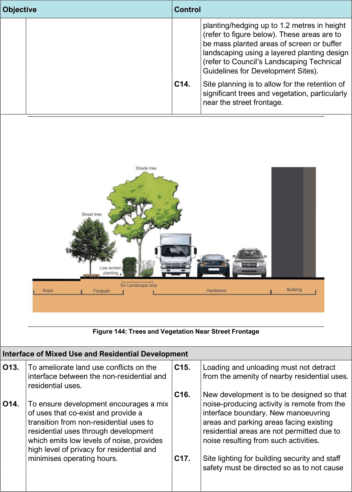

#### 7.13.3 Part B – Land in the B4 Mixed Use Zone

#### Desired Future Character

The B4 zone within the Botany South Precinct is anticipated to develop into a high quality area of mixed uses featuring medium density housing, low impact commercial and business uses and creative industries. New works in the public domain will be required such as landscaping and pedestrian corridors to improve the amenity of the Precinct and encourage pedestrian movement and live/work opportunities. The redevelopment of this area is to provide a transition from non-residential to surrounding residential uses with the intention of buffering any adverse amenity issues created within the B7 zone.

New residential uses within the B4 – Mixed Use zone need to ensure that through site layout and building design, any impacts from the B7 zone are adequately mitigated. This Area is affected by 20 to 25 and 25 to 30 ANEF Contours and road traffic noise which must be considered through development.

The Mixed-Use Zone area has three distinct areas (Areas 1, 2 and 3) with varying interfaces and Desired Future Characters. Controls for all development, as well as development specifically within Areas 1, 2, and 3, are provided in this Section.

#### Controls – All Areas

| Objective |  |
|---|---|
| O1. | To encourage residential development that co-exists and provides a transition from non-residential uses to low scale residential and provides a safe and liveable environment. |
| O2. | To encourage live/work opportunities which will emit low level of noise and minimises operating hours. |
| O3. | To ensure there are no land use conflicts on the interface between the non-residential and residential uses. |

| Control |  |
|---|---|
| C1. | Where development adjoins or is adjacent to residential uses the development must not detrimentally affect the amenity of residential uses by way of: a. Scale and size; b. Floorspace ratio; c. The size and number of vehicle movements; d. Noise; e. Air and water pollution; and f. Any other negative environmental impact. |
| C2. | Residential development shall be designed and demonstrate that it will not be detrimentally impacted by any non-residential uses in the vicinity. |
| C3. | Internal habitable rooms of dwellings within the B4 Mixed Use Zone which are affected by high levels of external noise are to be designed to achieve internal noise levels of 50dBA maximum. Development Applications which contain residential accommodation are to be accompanied by a noise assessment prepared by a qualified acoustic consultant addressing the following: a. the noise requirements of the NSW Infrastructure SEPP in terms of road traffic noise b. the noise and vibration requirements of the residential accommodation (refer to Part 4.3.3 of this DCP) c. conduct detailed site attended audits during the day, evening and night periods to identify and assess noise from activities associated with the B7 Zone d. assess noise from ground activities including aircraft take-off's and landing's at Sydney Airport referenced to each floor of the proposed building e. where the height of the proposed development is higher than the existing height of the localised building stock (and the proposed development has a direct line of sight to the seaport) the acoustical assessment is to take into account noise from the operations of Port Botany f. confirm noise exposure levels for each floor of the proposed residential building g. confirm building noise controls for internal noise levels to satisfy the recommended noise criteria |

| Objective | Control |  |
|---|---|---|
|  | C4. | New residential buildings which adjoin the B7 zone should be designed to accommodate and minimise any adverse effects on the amenity of residential areas by way of overlooking, lighting, dust, noise, or fumes. |

#### Controls - Area 1 – Botany Road

Area 1 fronts Botany Road to the south, adjoins land within the B7 zone to the north and low density residential dwellings to the south. In Area 1 residential is not permitted at ground floor. The ground floor of development must contain a complementary non-residential use that is permissible within the B4 Zone (see the Bayside Local Environmental Plan 2021 Active Street Frontages Map).

The compatibility of mixing certain uses together must be considered, in conjunction with the design of such development, to ensure acceptable amenity for different uses and to ensure that development provides a transition from the B7 zone to low scale residential uses.

| Objective |  |
|---|---|
| General |  |
| O1. | To encourage live/work opportunities. |
| O2. | To encourage low scale mixed use development with residential at first floor and a range of compatible vibrant uses such as shops, professional offices, and studio/workshops at ground floor, which are not impacted by adjoining industrial and commercial uses and that do not impact on adjoining and adjacent residential amenity. |
| O3. | To promote the amalgamation of small sites to deliver better quality development and adequate on-site parking. |
| O4. | To create a focus for a wide variety of businesses that offer employees and visitors a lively and attractive environment, becoming more than just a ‘place of work’ but one that compliments and connects business activities with each other. |

| Control |  |
|---|---|
| C1. | The ground floor of development must contain complementary non-residential uses permissible in the B4 zone. Residential uses are only permitted at first floor and above. |
| C2. | Residential alterations and additions must: a. improve the appearance of buildings b. improve the interface and amenity with non-residential uses |
| C3. | The ground floor level of a mixed use development that relates to the active street frontage must be predominantly used for commercial uses or other street activating uses. |
| C4. | Amalgamation of sites is encouraged to reduce the number of access points from Botany Road. |
| C5. | A change of use must not result in a significant impact on adjoining or nearby properties, in particular adjoining residential uses or on traffic movements within the locality. |
| C6. | Fences are not encouraged within the Area as fencing is not a typical characteristic of the area. However, if required, fencing shall not be: • Higher than 1m for residential uses • Higher than 1.5m (with over 50% to be transparent) for non-residential uses. |

| Objective |  |
|---|---|
| Building and Site Layout |  |
| O5. | To promote and encourage a high design quality of buildings. |
| Parking and Access |  |

| Control |  |
|---|---|
| C7. | Car parking, landscaping and non-residential uses are to be located at the rear of the property to provide a buffer between the B4 and B7 zones. |
| C8. | On small frontage sites, buildings may align to the rear and side boundary in all locations except where a residential use or zone adjoins. |
| C9. | Setbacks are in accordance with the below table. Boundary Landscaping Building setback setback Front 4m 7m Side Nil to 1.5m Nil to 1.5m Side – 3m 3m adjoining a residential use / zone Rear Nil to 3m Nil to 3m Rear – 3m 6m adjoining a residential use / zone Table 24: Boundary Setbacks |
| C10. | Building setbacks must form a continuous and consistent alignment. Note: Awnings and verandas along classified roads should be set back a minimum of 1.5m from the kerb. Awnings and verandas along local roads that intersect with classified roads should be set back a minimum of 1.5m from the kerb for a distance of up to 100m from the intersection with the classified road. At any signalised intersections (on local roads or classified roads), awnings and verandas should be set back a minimum of 1.5m from the kerb for a distance of up to 100m from the signalised intersection. |

| Objective |  |
|---|---|
| O6. | To limit access points from Botany Road. |
| O7. | To encourage the provision of parking, vehicular access and servicing areas that provide a buffer between residential and non-residential uses and pleasant, safe and provide a shared working environment. |
| Landscaping |  |
| O8. | To retain existing trees both inside and outside the site and provide suitably proportioned areas of well-designed landscaping on each development site. |
| Residential Interface |  |
| O9. | To ensure non-residential development is sympathetic with the streetscape character and maintains the amenity of surrounding residential development. |
| O10. | To ensure that the proposed development is designed to minimise the impact of noise and vibration from uses within the B7 zone and external sources. To ameliorate conflicts on the interface |
| O11. | between the non-residential and residential uses. To provide a buffer between residential |
| O12. | and non-residential uses and zones in the form of building design and through high quality landscaping. |

| Control |  |
|---|---|
| C11. | Access driveways should be paired so that adjacent properties locate driveways side by side to reduce the number of access points. |
| C12. | Loading and unloading must not detract from the amenity of nearby residential uses. |
| C13. | New manoeuvring areas and parking areas facing existing residential areas are not permitted due to noise resulting from such activities. |
| C14. | Any commercial car parking must be conveniently located and identified. |
| C15. | A suitable area of dense landscape planting is required in the rear setback to provide a buffer between the B4 and B7 zones including landscaping of car park areas to achieve a high level of amenity which will screen the development from residential areas. |
| C16. | Where existing landscaping is below the standard identified in the DCP, the existing area of landscaping shall where possible be upgraded to the standard specified in the DCP. |
| C17. | Where a site contains or adjoins a residential use or property, Council shall require the applicant to provide shadow diagrams prepared by a suitably qualified person. These shadow diagrams shall: a. show the shading effects of a proposal on adjoining residential properties or the public domain b. be based on a survey of the site and adjoining development c. be prepared at 9.00AM, 12.00PM and 3.00PM at 21st June (winter solstice) |
| C18. | Site lighting for building security and staff safety must be directed so as to not cause annoyance to neighbours, residents or glare to passing motorists. |
| C19. | Walls of buildings adjacent to residential uses are to make use of non-reflective colours and materials to avoid glare on residential areas (especially balconies). The walls are to be treated aesthetically as well as acoustically. Window placement and/or tall trees should be |

| Objective |  | Control |  |
|---|---|---|---|
|  |  |  | considered as ways to protect privacy, reduce |
|  |  |  | noise, and light pollution. |
|  |  | C20. | On small frontage sites, buildings may align to the rear and side boundary in all locations |
|  |  |  | except where a residential use or zone adjoins. |
|  |  |  | Where the windows of habitable rooms and the private open space of adjoining dwellings already receive sunlight, they shall receive a |
|  |  |  | minimum of 2 hours of sunlight between 9.00AM and 3.00PM during 21st June. |
|  |  | C21. | New development is to be designed so that |
|  |  |  | noise-producing activity is remote from the interface boundary. |
|  | Controls - Area 2 |  |  |
| Objective |  | Control |  |
| General |  |  |  |
| O1. | To encourage live/work opportunities. | C1. | The ground floor of development must |
| O2. | To encourage improvements to the Public Domain. |  | contain complementary non-residential uses permissible in the B4 zone. Residential uses and live/work are only permitted at first floor and above. |
| O3. | To ensure development is environmentally compatible and respects the non- residential and residential uses. | C2. | Where residential development is proposed to adjoin the B7 zone, the proposed development must be designed and |
| O4. | To ensure proposed development is designed to minimise the impact of noise and vibration from uses with the B7 zone. |  | demonstrate that it will not be detrimentally impacted by any non-residential uses in the vicinity. |
| O5. | To ensure the protection and viability of the Botany Local Centre and Banksmeadow Neighbourhood Centre. | C3. | Residential alterations and additions must improve the appearance of buildings and the interface and amenity with non- residential uses. |
|  |  | C4. | If required, fencing shall not be: • Higher than 1m for residential uses; • Higher than 1.5m (and over 50% must be transparent) for non- residential uses. |
| Building and Site Layout |  |  |  |
| O6. | To ensure building setbacks achieve a comfortable street environment through | C5. | On small frontage sites, buildings may align to the rear and side boundary in all |

| Objective |  |
|---|---|
|  | the provision of sunlight, scale, sense of enclosure and landscaping. |
| O7. | To ensure that future development contributes to the creation of a high- quality landscape environment in the Precinct. |
| O8. | To manage the transition in building use and scale from low-scale residential, multi- use areas and business park uses. |
| O9. | To maintain the scale of streets as incremental change occurs. |
| Parking and Vehicular Access |  |
| O10. | To encourage the provision of parking, vehicular access and servicing areas that provide a buffer between residential and non-residential uses are pleasant, safe and provide a shared working environment. |

| Control |  |
|---|---|
|  | locations except where a residential use or zone adjoins. |
| C6. | Development shall avoid long blank walls facing the street and adjoining residential uses. |
| C7. | Floor space is to be distributed on the site to ensure the scale of the building reinforces the role of the street and buildings are arranged and aligned to create a pleasant working environment. |
| C8. | Setbacks are to be in accordance with the below table. Boundary Landscaping Building setback setback Front 3m Merit (Min 6m and 9m for large lots) Side 1m to 1.5m 1m to 1.5m Side – 3m 3m adjoining a residential use / zone Rear Nil to 3m Nil to 3m Rear – 3m 3m adjoining a residential use / zone Table 25: Boundary Setbacks |
| C9. | For delivery vehicle access/manoeuvring on narrow and small lots in the area, car parking may be provided within the front setback in order to allow such vehicles to enter and leave in a forward direction (refer below) provided minimum landscape requirements are met. |
| C10. | Any commercial car parking must be conveniently located and identified. |

| Objective |  |
|---|---|
| Figure 143: Parking and Vehicular Access |  |
| Storage |  |
| O11. | To provide a high level of pedestrian amenity and create a vibrant and safe precinct. |
| Landscaped Area |  |
| O12. | To retain existing trees both inside and outside the site and provide suitably proportioned areas of well-designed landscaping on each development site. |

| Control |  |
|---|---|
| C11. | Any open storage areas shall be effectively screened and shall harmonise with existing or proposed landscaping to prevent the storage area being viewed from a public road, nearby public reserve or adjoining residential property. Specific details of the materials to be stored external to the building shall be lodged with the Application. |
| C12. | Storage areas are not permitted to be located within the landscaped setbacks or areas. |
| C13. | The landscaped setback zone is to accommodate canopy trees to screen and soften buildings and to shade parking areas, underplanted with screen |

> [Picture on page 232: a picture, saved as a picture (images/section-07-specific-places-page-232-1.gif, 150 dpi).]

Figure 144: Trees and Vegetation Near Street Frontage

| Objective | Control |  |
|---|---|---|
|  |  | planting/hedging up to 1.2 metres in height (refer to figure below). These areas are to be mass planted areas of screen or buffer landscaping using a layered planting design (refer to Council’s Landscaping Technical Guidelines for Development Sites). |
|  | C14. | Site planning is to allow for the retention of significant trees and vegetation, particularly near the street frontage. |

| Interface of Mixed Use and Residential Development |  |  |  |
|---|---|---|---|
| O13. | To ameliorate land use conflicts on the interface between the non-residential and residential uses. | C15. | Loading and unloading must not detract from the amenity of nearby residential uses. |
| O14. | To ensure development encourages a mix of uses that co-exist and provide a transition from non-residential uses to residential uses through development which emits low levels of noise, provides | C16. | New development is to be designed so that noise-producing activity is remote from the interface boundary. New manoeuvring areas and parking areas facing existing residential areas are not permitted due to noise resulting from such activities. |
|  | high level of privacy for residential and minimises operating hours. | C17. | Site lighting for building security and staff safety must be directed so as to not cause |

| Objective | Control |  |
|---|---|---|
|  |  | annoyance to neighbours, residents or glare to passing motorists. |
|  | C18. | Walls of buildings adjacent to residential uses are to make use of non-reflective colours and materials to avoid glare on residential areas (especially balconies). The walls are to be treated aesthetically as well as acoustically. Window placement and/or tall trees should be considered as ways to protect privacy, reduce noise and light pollution. |
|  | C19. | Windows of habitable rooms and the private open space of adjoining dwellings shall not have sunlight reduced to less than 2 hours between 9.00AM and 3.00PM at 21st June as a result of development. Note: Council will refer a contentious Development Application or one that involves an extension to the trading hours of a licensed premises to a Resident Consultative Committee or where there have been a significant number of objections received as a result of exhibition and/or notification of the Application. Both the Applicant and the Objectors will be invited to attend. The purpose of the Committee is to address the issues raised by residents in an open forum. |

#### Controls - Area 3 – Aylesbury Street

| Objective |  |
|---|---|
| General |  |
| O1. | To encourage residential development that co-exists and provides a transition from non-residential uses to low scale residential and provides a safe and liveable environment. |
| O2. | To encourage live/work opportunities which will emit low level of noise and minimises operating hours. |
| O3. | To ensure there are no land use conflicts on the interface between the non- residential and residential uses. |

| Control |  |
|---|---|
| C1. | Development in this area is to be for residential purposes. Live/work opportunities are encouraged that can co- exist with residential uses. |
| C2. | Residential development shall be designed and demonstrate that it will not be detrimentally impacted by any non- residential uses in the adjoining B7 Zone. |

#### Page Street Neighbourhood Centre
