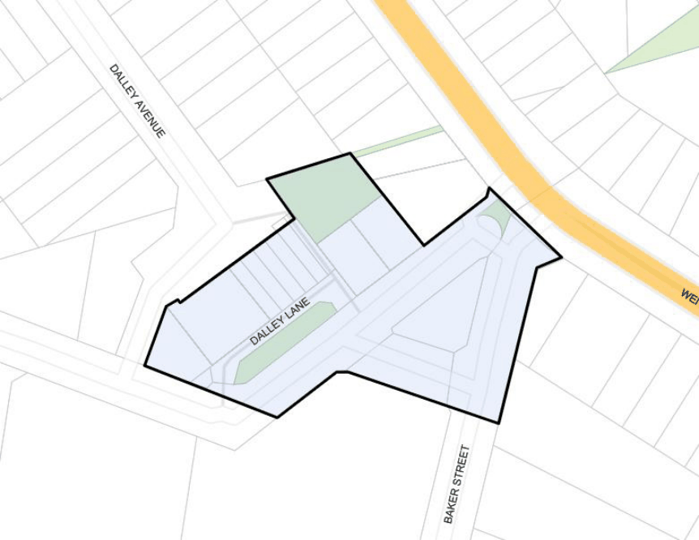

#### 7.14.1 Centre Description

The Page Street Neighbourhood Centre is located on a level section of Dalley Ave, Pagewood. It currently consists of a red brick two storey development with five ground floor shops and residential dwellings on the first floor (refer to Figure 145). The Centre is located across the road from Pagewood Primary School.

Other development in the vicinity consists of single-family dwelling houses and a variety of older style three storey residential flat buildings and is also located on the edge of an industrial zone. The centre currently services the local residents, the school community and factory workers.

> [Picture on page 234: a picture, saved as a picture (images/section-07-specific-places-page-234-10.gif, 150 dpi).]

#### Figure 145: Page Street Neighbourhood Centre Land Application Map
