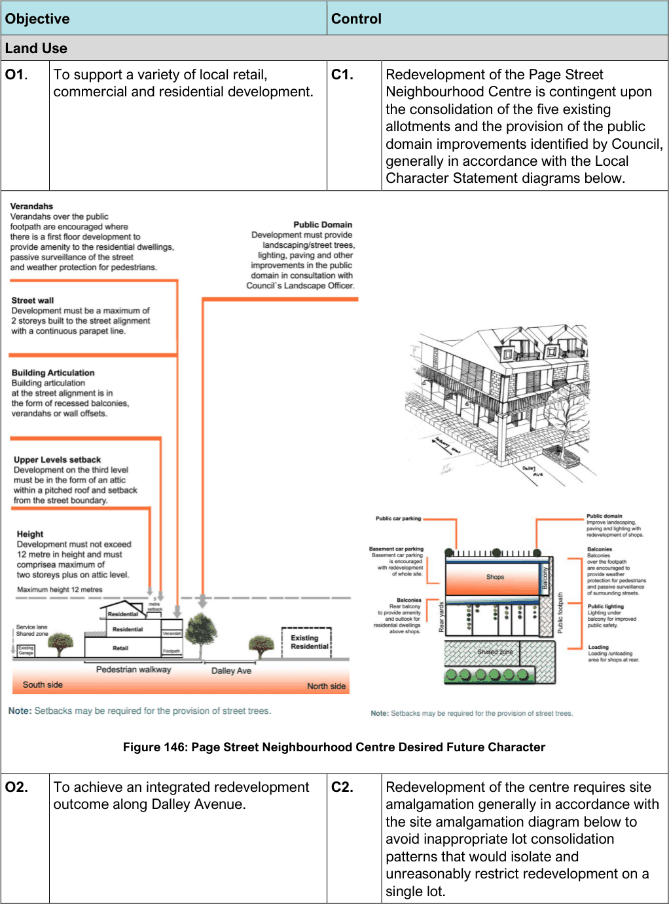

#### 7.14.3 Controls

> [Picture on page 235: a picture, saved as a picture (images/section-07-specific-places-page-235-2.gif, 150 dpi).]
> Words printed on the picture (title and legend, copied from the PDF):
> outcome along Dalley Avenue.

Figure 146: Page Street Neighbourhood Centre Desired Future Character

| Objective |  | Control |  |
|---|---|---|---|
| Land Use |  |  |  |
| O1. | To support a variety of local retail, commercial and residential development. | C1. | Redevelopment of the Page Street Neighbourhood Centre is contingent upon the consolidation of the five existing allotments and the provision of the public domain improvements identified by Council, generally in accordance with the Local Character Statement diagrams below. |

O2. To achieve an integrated redevelopment

C2. Redevelopment of the centre requires site amalgamation generally in accordance with the site amalgamation diagram below to avoid inappropriate lot consolidation patterns that would isolate and unreasonably restrict redevelopment on a single lot.

| Objective |  |
|---|---|
| Figure 147: Redevelopment of the centre |  |
| Road Network and Vehicular Access |  |
| O3. | To minimise the visual impact of vehicular access and servicing from the street and prioritise pedestrian connections. |
| Built Form: Building Heights and Density |  |
| O4. | To ensure building height is compatible with that prevailing in the centre through alignment of the street wall. |
| Street Character and Development Setbacks |  |

| Control |  |
|---|---|
| C3. | Vehicular access must be from the rear laneway and not from Dalley Avenue. If the five allotments (where the shops are currently located) are redeveloped as a consolidated site, basement parking is required to be provided. |
| C4. | Where a rear laneway exists loading and unloading must occur from the laneway. |
| C5. | Development must maintain the pedestrian links to Holloway St and Wentworth Ave. |
| C6. | A paved shared zone is to be provided in the rear laneway to create a safer environment for pedestrians and create a better connection with the park at the rear of the centre. |
| C7. | Notwithstanding the 12m height limit, buildings are to have a maximum street wall height of 2 storeys, with a third attic level permitted where it is within a pitched roof form. |

| Objective |  |
|---|---|
| O5. | To retain and conserve the shopping strip and encourage a viable and attractive neighbourhood centre with an improved and safer public domain. |
| O6. | To allow sympathetic redevelopment and to improve the architectural quality of building stock. |
| O7. | To encourage footpath dining. |
| O8. | To encourage development of awnings as balconies for dwellings above shops (to improve dwelling access to private open space and promote passive surveillance). |

| Control |  |
|---|---|
| C8. | Pedestrian amenity and connectivity must be enhanced in conjunction with new development. Lighting above the existing walkway to Holloway Street and provision of a verandah over the footpath is encouraged to provide weather protection and passive surveillance of the street. A new pedestrian crossing in Holloway Street is to be provided in the redevelopment. |
| C9. | All development must address the street frontage. |
| C10. | The design must encourage active street life while providing a high residential amenity and small scale shops that will serve the local community. |
| C11. | The design of development must be generally consistent with the Local Character Statement of the centre identified in the Local Character Statement diagrams above. |
| C12. | Footpath dining is allowed where it is safe (generally 2m from the kerb). Development where possible is to provide connections to the open space area at No. 2a Baker Street. |
| C13. | Maintain limited advertisements and business signage to minimise visual impact on the residential area. |
| C14. | Restrict signage to the awning fascia, under the awning or behind the shop window at street level. |

#### Banksmeadow Industrial Precinct
