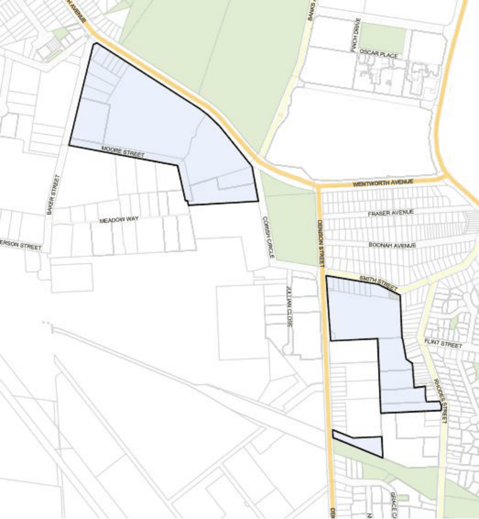

#### 7.15.1 Description

The Banksmeadow Industrial Precinct is located in the eastern portion of the LGA, and as indicated below only the following parts are zoned under the Bayside Local Environmental Plan 2021:

• Area zoned IN2 Light Industrial bounded by Wentworth Avenue, Baker Street, Moore Street, Wight Street, & Corish Circle;

• B7 Business Park area at 81 Holloway Street, Banksmeadow; and

• B5 Business Development and B7 Business Park along Denison, Smith and Rhodes Streets Hillsdale.

The nature of uses, large allotment sizes and consolidated ownership of industrial landholdings in the Precinct are significant on a local government area and sub-regional basis. This Precinct is largely bordered by residential uses, and apart from hazard, risk and environmental conflicts, the visual impact of

any development is a major consideration. Conflicts between the industrial and residential uses (including industrial traffic in residential streets) are considered a significant problem in the area.

Part of the suburb is within the zone of influence of the High Pressure Gas Pipeline that follows the ARTC Rail Corridor to the Qenos Site at the Botany Industrial Park, Denison Street, Banksmeadow. Development Applications, planning proposals and rezoning of land received by Council for land within the Zone of Influence will be referred to the APA Group for consideration and comment.

> [Picture on page 238: a picture, saved as a picture (images/section-07-specific-places-page-238-7.gif, 150 dpi).]

#### Figure 148: Banksmeadow Precinct Land Application Map
