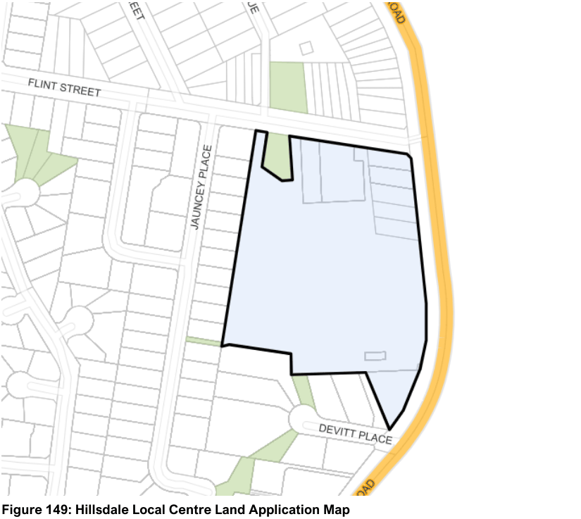

#### 7.16.1 Description

The Hillsdale Local Centre is occupied by the multi storey Southpoint Shopping Centre, residential tower and associated car parking areas; and a mix of one, two and three storey commercial and residential buildings. The building stock around the Hillsdale Local Centre is represented by predominantly three storey residential flat buildings to the west and south and dwelling houses to the north.

The Hillsdale Local Centre is already substantially developed, with Southpoint Shopping Centre occupying a majority of the Centre. Development of the remaining allotments in Bunnerong Road and Flint Street can only occur if the parcels are amalgamated in accordance with Figure 150 and vehicular access is from either the right of way at the rear of the Bunnerong Road properties or from Flint Street.

> [Picture on page 241: a picture, saved as a picture (images/section-07-specific-places-page-241-11.gif, 150 dpi).]

#### Figure 149: Hillsdale Local Centre Land Application Map
