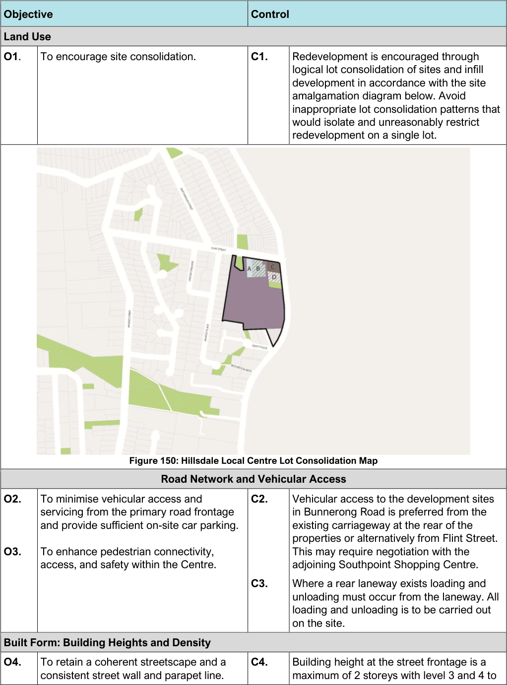
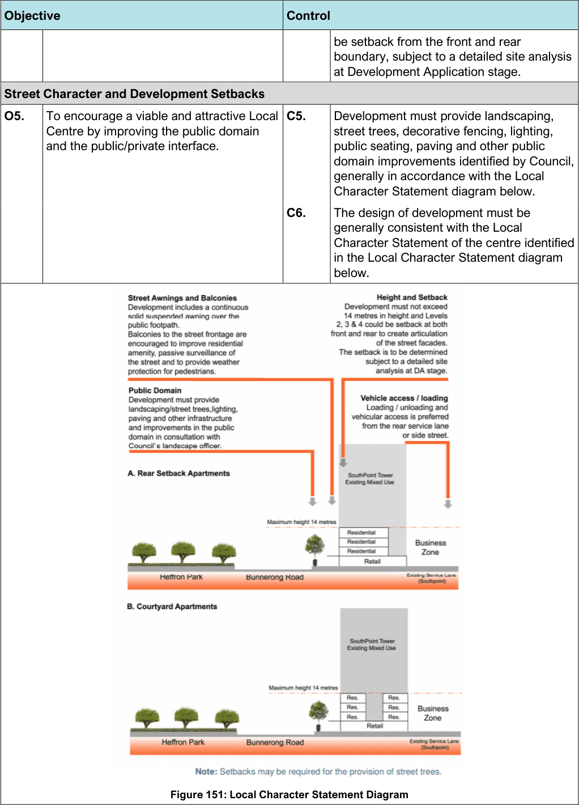

#### 7.16.3 Controls

> [Picture on page 242: a picture, saved as a picture (images/section-07-specific-places-page-242-2.gif, 150 dpi).]

Figure 150: Hillsdale Local Centre Lot Consolidation Map

| Objective |  | Control |  |
|---|---|---|---|
| Land Use |  |  |  |
| O1. | To encourage site consolidation. | C1. | Redevelopment is encouraged through logical lot consolidation of sites and infill development in accordance with the site amalgamation diagram below. Avoid inappropriate lot consolidation patterns that would isolate and unreasonably restrict redevelopment on a single lot. |

|  | Road Network and Vehicular Access |  |  |
|---|---|---|---|
| O2. | To minimise vehicular access and servicing from the primary road frontage and provide sufficient on-site car parking. | C2. | Vehicular access to the development sites in Bunnerong Road is preferred from the existing carriageway at the rear of the |
| O3. | To enhance pedestrian connectivity, access, and safety within the Centre. |  | properties or alternatively from Flint Street. This may require negotiation with the adjoining Southpoint Shopping Centre. |
|  |  | C3. | Where a rear laneway exists loading and unloading must occur from the laneway. All loading and unloading is to be carried out on the site. |
| Built Form: Building Heights and Density |  |  |  |
| O4. | To retain a coherent streetscape and a consistent street wall and parapet line. | C4. | Building height at the street frontage is a maximum of 2 storeys with level 3 and 4 to |

> [Picture on page 243: a picture, saved as a picture (images/section-07-specific-places-page-243-1.gif, 150 dpi).]

Figure 151: Local Character Statement Diagram

| Objective |  | Control |  |
|---|---|---|---|
|  |  |  | be setback from the front and rear boundary, subject to a detailed site analysis at Development Application stage. |
| Street | Character and Development Setbacks |  |  |
| O5. | To encourage a viable and attractive Local Centre by improving the public domain and the public/private interface. | C5. | Development must provide landscaping, street trees, decorative fencing, lighting, public seating, paving and other public domain improvements identified by Council, generally in accordance with the Local Character Statement diagram below. |
|  |  | C6. | The design of development must be generally consistent with the Local Character Statement of the centre identified in the Local Character Statement diagram below. |

| Objective |  |
|---|---|
| O6. | To retain existing trees and provide additional landscaping within the streetscape. |
| O7. | To allow reasonable redevelopment and to improve the architectural quality of building stock. |
| O8. | To ensure that dwellings within a mixed- use development provides passive surveillance, resident interaction and amenity and addresses the street. |
| O9. | To improve and extend the pedestrian environment and to encourage appropriate active outdoor uses that address the street, such as retail and outdoor dining. |

| Control |  |
|---|---|
| C7. | Existing street trees must be retained and supplemented with new planting where required by Council’s Landscape Officer. |
| C8. | Contemporary architectural design solutions are encouraged; however, designs will need to demonstrate that they will not lead to a replacement or diminution of a street’s existing character. Council encourages diversity in building designs provided that development outcomes complement the existing character of the suburb. |
| C9. | A building setback along Flint Street is required to provide landscape planting along the front boundary, paving of the footpath and passive surveillance of the street to improve the visual amenity and safety of the low-density residential area opposite. This planting could also provide an attractive outlook for active uses such as outdoor dining which could adjoin the landscaped frontage. |
| C10. | Developments must be designed to: a. promote uses that attract pedestrian traffic along the ground floor street frontages b. provide an active street edge c. provide opportunities for active uses such as outdoor dining d. improve the safety and amenity of the Business Centre |
| C11. | Developments on sites with two or more frontages must address both frontages, to promote, add prominence and diversify the streetscape. |

#### Daceyville
