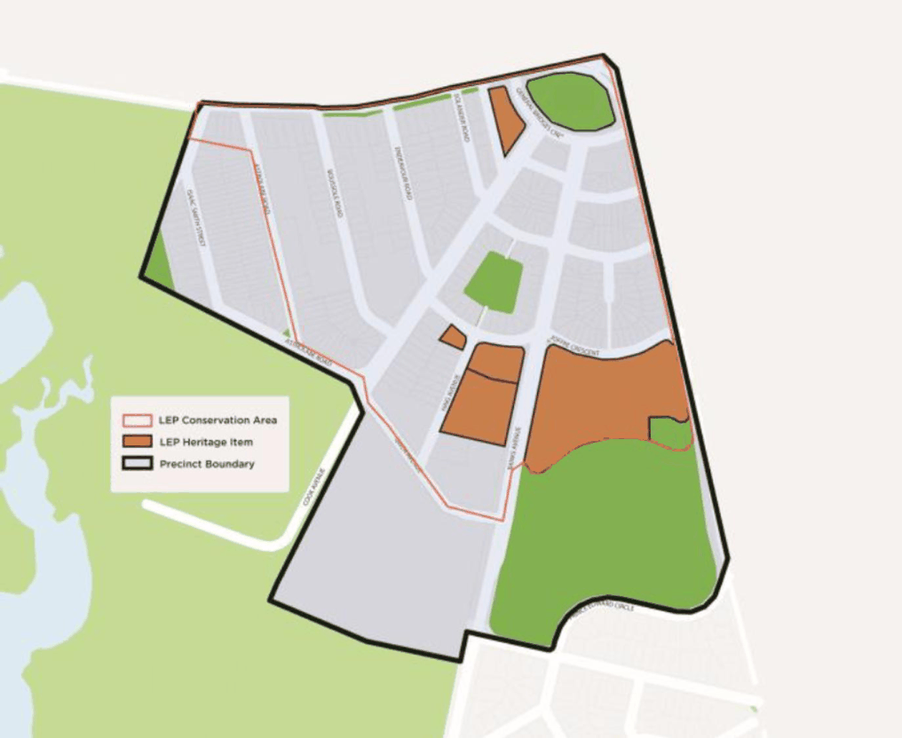

#### 7.17.1 Description

Daceyville, or Dacey Garden Suburb as it was known originally, is historically, aesthetically, and socially significant, and significant for its historical associations to the former City of Botany Bay, the current Bayside LGA, the state of New South Wales, Australia and potentially internationally.

At the national and international level, the Dacey Garden Suburb manifests the physical and social values that marked the understandings of a model settlement in the earliest years of the international town planning movement. This movement is strongly associated both with the maturity of the Industrial Age and the recognition of its concomitant social impacts caused by pollution and overcrowding; and then by the significant social, economic and political ramifications following WW1.

Dacey Garden Suburb demonstrates a very high level of significance as a model suburb designed by a series of Australia’s leading architects, including several of its pioneering town planners, in response to the need for a healthy living environment for the working classes. It is the international prototype of its type, being the first example in Australia of the translation of the principles of the ‘Garden City’ into the lower density and suburban context of the ‘Garden Suburb’.

The physical manifestation of the earliest principles of town planning remain clearly legible in the disciplined and cohesive form of the suburb; including its clearly defined radial street pattern which has established streetscapes of both grand and intimate scale with both axial and evolutionary elements.

The design of Daceyville's housing represents a sophisticated interpretation of stylistic consistency through a ‘pattern book’ approach to the individual design of buildings within the suburb regardless of purpose which is made notable through the templates being the work of skilled architects; in a setting that continues to provide evidence of the importance placed on the provision of open space in both public and private domains through building setbacks and controls over development including both alterations and additions. The consistency of built forms and detailing has survived and resulted in a precinct with a notable physical, spatial and landscape integrity. Later layers of change, including the recent introduction of infill development, has respected these original town planning principles, which illustrates their ongoing relevance and validity to contemporary town planning.

The ongoing purpose of Dacey Garden Suburb as a place for public housing continues to demonstrate the community’s commitment following WW1 to provide quality accommodation in a healthy environment for the less fortunate in the community. Dacey Garden Suburb is the earliest model suburb in the world to have been built for this purpose and to have remained managed and occupied as social housing.

The more recent infill development by the Department of Housing has largely retained the integrity of the historic cultural landscape and now makes a valid contribution to the contemporary heritage values of the

area. It not only provides demonstrable evidence of the ongoing community need for housing for low-income earners, but the form and density of this infill development is the result of the esteem in which both the subdivision and original housing is held by local residents the wider community, including significant community groups such as the National Trust (who had recorded the suburb as a historically significant precinct as early as 1978) and professional bodies of urban planners and architects; who together protested successfully against the original proposal for extensive demolition of the original fabric and its replacement by high density housing in the 1980s.

#### Character Statement

The character of the Daceyville HCA is made up of Federation Arts and Crafts cottages constructed between 1910 and 1920, with some commercial buildings. Existing housing stock is a combination of single-storey cottages, semi- detached dwellings, and town houses.

This character should be preserved and retained through the retention of contributory buildings, public open space, the existing subdivision pattern and typical Garden Suburb layout, and large street trees. Characteristic elements to be preserved include:

• Original Federation Arts and Crafts detached and semi-detached single and two-storey buildings, with styles of dwellings often repeated throughout the precinct.

• The dominant material palette of brick, painted brick, fibro and rendered brick in a variety of period colours including peach, apricot, pink, brown, green and red.

• The relationship between the public and private domain with open landscaped theme created by generous front setbacks, large landscaped areas surrounding buildings with established gardens, low scale fences, and a lack of boundary fences abutting public roads and open space.

• Wide streets and wide verges with mature street plantings.

• Radial avenues centred on Dacey Gardens Reserve.

#### Classification of Items in the Daceyville HCA

All properties within Daceyville Garden Suburb Heritage Conservation Area are contributory unless listed as heritage items in the Bayside LEP.

> [Picture on page 246: a picture, saved as a picture (images/section-07-specific-places-page-246-4.gif, 150 dpi).]

Figure 152: Daceyville Precinct (Top) and Garden Suburb HCA/Heritage Items (Bottom)
