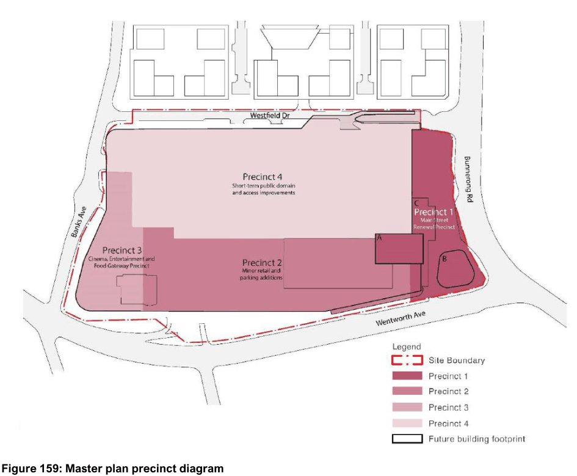
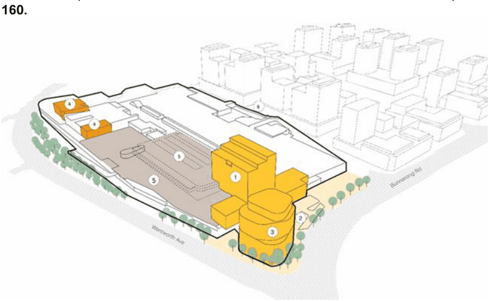

#### 7.22.1 Description

This chapter applies to land at 152 Bunnerong Road (Lot 1 DP 1058663), Eastgardens, as outlined in red at Figure 159 below. The site has been divided into four precincts with directions for each precinct detailed later in this chapter.

This chapter should be read in conjunction with other relevant parts of this DCP including (but not limited

to) Part 3 General Development Provisions and relevant sections in Part 6 Non-residential Development, Part 8 Managing Risk and Environmental Conditions, Part 9 Schedules and Technical Specifications. For any build-to-rent development, please refer to relevant controls within other Parts of the DCP as well as the Apartment Design Guide. In the event of any inconsistency between this chapter and other Parts of the DCP, this chapter will prevail to the extent of the inconsistency.

> [Picture on page 260: a picture, saved as a picture (images/section-07-specific-places-page-260-1.gif, 150 dpi).]

#### Figure 159: Master plan precinct diagram

#### Vision for the Eastgardens Centre

Westfield Eastgardens will transform over time into a vibrant, centre with an improved retail and entertainment offering and a focus on enhancing customer visitation to the centre on foot and by public transport.  New commercial office towers will be integrated into an active civic plaza connected to the bus interchange at the eastern end of the site. The transformation of Westfield Eastgardens is an opportunity to improve accessibility, better connect with the community, create jobs and strengthen the important strategic and economic role of the centre.

Westfield Eastgardens will transcend its role as a traditional shopping centre and become a morning to evening community hub where people can fulfil more of their daily needs.

A new active publicly accessible civic plaza fronting Bunnerong Rd, will ensure the centre integrates with the surrounding neighbourhood and delivers an improved arrival experience for visitors travelling on foot, by car or by public transport.

The key objectives to achieve this vision are:

• To expand and redevelop the shopping centre to deliver a mix of new uses to meet the needs of the local community.

• To accommodate future employment growth and promote job creation at the centre, consistent with the role of the Eastgardens-Maroubra Junction Strategic Centre.

• To accommodate health, retail, wellbeing and civic service and lifestyle uses to support the day-to-day needs of the community and builds on the strategic retail importance of the centre.

• To improve pedestrian accessibility, amenity, safety and permeability.

• To improve the external interface and quality of the streetscape around the centre.

• To create a welcoming civic entry from the east by upgrading the bus interchange and enhancing the public domain.

• To deliver public domain upgrades with the renewal of the precincts.

The redevelopment of the site should be consistent with the indicative master plan illustrated at Figure

#### 160.

> [Picture on page 261: a picture, saved as a picture (images/section-07-specific-places-page-261-10.gif, 150 dpi).]

|  | Key Features |
|---|---|
| 1 | A new commercial building |
| 2 | A new publicly accessible plaza and upgraded bus interchange fronting Bunnerong Road |
| 3 | A new commercial building |
| 4 | Desired location for minor retail expansion, including outdoor food and beverage terrace and additional cinemas |
| 5 | Desired car park extension as required |
| 6 | Public domain improvements to Westfield Drive and a new pedestrian crossing to the Pagewood Green site to the north. |

#### Figure 160: Master Plan - Key Features
