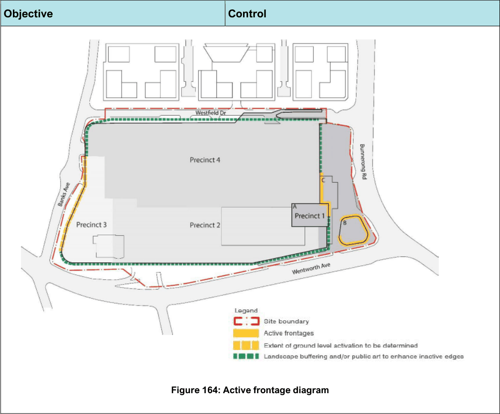

#### 7.22.2 Built Form and Amenity

| Objective | Control |
|---|---|
| Building Heights – All Precincts |  |

| Objective |  |
|---|---|
| O1. | Ensure building heights reinforce the strategic importance of the centre but are also appropriate for their context. |
| O2. | Development on the site should minimise solar impact on adjoining properties and the public domain. |

| Control |  |
|---|---|
| C1. | The height of buildings in storeys as shown in the preferred building heights strategy in Figure 161 should not exceed that corresponding the maximum height of buildings (in metres) specified in Bayside LEP 2021. Any variation to the building heights in storeys and footprints must demonstrate that the changes would achieve: A diversity of building heights, with the tallest buildings appropriately set back from Bunnerong Road. An appropriate street wall height that creates a high-quality public domain and pedestrian environment along Bunnerong Road. Variation in building height and form to reduce bulk and scale and provide a sense of openness from the street, landscaped areas and the new publicly accessible plaza. |
| C2. | Building height in storeys is to be a maximum of 10 storeys on the corner of Bunnerong Road and Wentworth Avenue to promote the prominence of the site whilst providing a transition to surrounding development. |
| C3. | Whilst some overshadowing impact is anticipated at an interface between a strategic centre with E2 Commercial Centre zoning and the relatively low- density residential area, development on the site is to minimise overshadowing impacts on the dwellings to the south. Development shall: Maintain approximately 2 hours of solar access between 9am and 3pm on 21 June to 50% of the primary private open space areas of the dwellings to the south of Wentworth Avenue. Where the primary private open space of the adjacent development currently receives less than the required amount of sunlight on 21 June (50% coverage for a minimum of 2 hours), development is to not create additional overshadowing to the primary private open space of the adjacent development. In addition, where the primary private open space of the adjacent development currently receives less than the required amount of sunlight on 21 June (50% coverage for a minimum of 2 hours), development is to ensure that 50% of each front yard receives a minimum of 1 hour of |

| Objective |  |
|---|---|
| Figure 161: Preferred building height strategy plan |  |
| Street Wall Heights – All Precincts |  |
| O1. | Establish an appropriate street wall height along Bunnerong Road to provide an appropriate transition to surrounding development. Street wall heights refer to the height of a building that addresses the street frontage from the ground level up to the first building setback. |
| O2. | Ensure buildings are appropriately setback above the street wall height and ensure towers provide an |

| Control |  |
|---|---|
|  | solar access between 9am and 3pm on 21 June. |
| C1. | Street wall heights are to be in accordance with the street wall plan in Figure 162. |
| C2. | The new tower (Building B) on the south-eastern corner of the site is to have a maximum street wall height of 8 storeys. |
| C3. | Development on the existing main building is to have a maximum 22m street-edge character. |
| C4. | Taller built form above the existing building is to be set back on the podium behind the street wall. Additional podium levels above the street edge |

| Objective |  | Control |  |
|---|---|---|---|
|  | appropriate scale transition to the street. |  | should be setback a minimum of 6m from the street wall. See Figure 161. |
| Figure 162: Street wall heights |  |  |  |
| Building Form |  |  |  |
| O1. | Ensure the built form is complementary to the character of the existing and future centre and amenity impacts on surrounding uses are minimised. | All Precincts |  |
| O2. | Apply design measures and vegetation to minimise the visual impacts of buildings to streetscapes. |  |  |
| O3. | Encourage renewable energy initiatives such as the installation and use of renewable energy technologies to reduce greenhouse emissions and reduce the energy demand of developments. |  |  |
|  |  | C1. | Building expression through façade modulation, roof silhouette and the use of a variety of contemporary materials and finishes is required to achieve buildings that are of architectural merit, innovation, variety and attractiveness. |
|  |  | C2. | A Schedule of Finishes is required for new buildings and any additions to existing buildings, such as additional floors. |
|  |  | C3. | Buildings addressing the corner shall include an accentuated form to the corner. |
|  |  | C4. | New servicing is to be concealed and not visible from the public domain. |
|  |  | C5. | Blank walls and facades are to be suitably articulated and minimised. |

| Objective |  |
|---|---|
| O4. | Apply principles and processes that contribute to ecologically sustainable development (ESD) and reduce the impacts of development on the environment. |
| Setbacks |  |
| O1. | Allow for the existing site landscaped areas to be retained and enhanced. Ensure the overall landscaped area is not less than existing. |
| O2. | Ensure building separation and setbacks result in reasonable amenity for neighbours and the public domain, in terms of daylight, human scaled streets, sense of openness, and wind mitigation. |
| O3. | The intent of the future ground setback strategy is to create a pleasant pedestrian environment and provide for high quality landscaped areas and tree canopy on all frontages. |

| Control |  |
|---|---|
| C6. | Roof forms are to be designed to support sustainable functions by orienting surfaces so they are suitable for solar panels and battery storage, green roofs and rainwater tanks for water conservation. |
| C7. | For new non-residential development and eligible alterations / refurbishments and additions with an estimated development cost of $5 million or more, the development is to achieve a minimum 4 Star Green Star Certified Rating from the Green Building Council of Australia (GBCA). |
| C8. | For non-residential development with an estimated development cost of $5 million or more, an Environmentally Sustainable Design (ESD) Report is to be submitted with the development application. The report is to address any ESD requirements set out in an Environmental Planning Instrument or in this Development Control Plan. |
| Precinct 1 |  |
| C9. | The maximum floorplate for Building A is not to exceed 1,550sqm GFA. |
| C10. | The maximum floorplate for Building B is not to exceed 1,150 sqm GFA. |
| C11. | Buildings are to be well-designed to define corners and activate the ground plane. |
| Precinct 1 |  |
| C1. | Ground floor setbacks are to be provided generally in accordance with Figure 163. |
| C2. | New development is to have front and side setbacks which maximise the retention of the existing green vegetation buffer, retain and protect the existing mature trees. |
| C3. | The minimum separation distance between Building B and Building C is to be 16m. |
| C4. | The upper levels of any tower form are to have a greater southern setback to minimise overshadowing to adjacent dwellings. |
| C5. | Building A is to be setback onto a podium and be setback a minimum of 35m from the southern boundary to minimise overshadowing. |
| C6. | A Wind Effects Report including results of a wind tunnel test is to be submitted with the DA for all buildings greater than 35m in height. The controls |

| Objective | Control |  |
|---|---|---|
|  |  | in Part 3 relating to maximum gust speeds shall also be addressed. |
|  | Precinct 2, 3 and 4 |  |
|  | C7. | If a Precinct is to be staged, a Ground Floor Setback Strategy is to be submitted with the Concept / Stage 1 development application or first development application lodged for that precinct. |
|  | C8. | Setbacks must be generally in accordance with Figure 163. |
|  | C9. | Any future car park additions are to be setback from the existing building edge. |
| Figure 163: Setbacks diagram |  |  |

| Objective |  | Control |  |
|---|---|---|---|
| Active Street Frontages and Preferred Land Uses |  |  |  |
| O1. | Ensure that the centre develops to be more outward-facing at the eastern and western activity hubs and have an improved relationship with the street. | All Precincts |  |
| O2. | Create a vibrant integrated precinct that is activated at all times of the day and into the night, with retail, commercial and community spaces. |  |  |
| O3. | Encourage new office uses that will support the centre’s economic function and reinforce the centre’s strategic employment role. |  |  |
| O4. | Prioritise pedestrian amenity and safety. |  |  |
| O5. | Minimise blank façades, basement access and servicing along Bunnerong Road and the Wentworth Avenue corner at Bunnerong Road. |  |  |
| O6. | Ensure the activation of busy pedestrian entries, such as the publicly accessible plaza and transport interchange area on Bunnerong Road. |  |  |
|  |  | C1. | Active frontages must be provided generally in accordance with Figure 164. |
|  |  | C2. | Two active hubs are to be created at the eastern and western end of the centre to enhance the arrival experience to the centre. A new plaza at the eastern end will connect to the existing central spine. |
|  |  | C3. | Development should be generally in accordance with the preferred land use strategy provided in Figure 165. |
|  |  | C4. | Active frontages are to be developed for entertainment, retail or commercial uses that interface with the public domain. |
|  |  | C5. | The number of building entries and active tenancies is to be maximised in activate frontage areas. |
|  |  | C6. | Glazing, outdoor dining and operable windows are to be maximised in the active frontage zones. Blank walls are to be avoided in active frontage areas, and if necessary, must be architecturally treated. |
|  |  | C7. | Where outdoor dining is proposed, the Outdoor Dining controls in Part 6 of the DCP are to be addressed. |
|  |  | Precincts 2 and 3 |  |
|  |  | C8. | If a Precinct is to be staged, an Active Frontage Strategy is to be submitted with the Concept / Stage 1 development application or first development application lodged for that precinct. The Active Frontage Strategy is to be integrated with any Landscape and Access strategies for the precinct and wider site. |
|  |  | C9. | The activation of the western Banks Avenue precinct for pedestrians to meet, gather and enter the site is a priority for future development of Precinct 3. |

> [Picture on page 268: a picture, saved as a picture (images/section-07-specific-places-page-268-1.gif, 150 dpi).]

Figure 164: Active frontage diagram

#### Objective

#### Control

| Objective |  |
|---|---|
| Figure 165: Preferred land use plan |  |
| Awnings and Entries – All Precincts |  |
| O1. | Ensure all development is easy to find and accessible for customers, employees, visitors and transport users. |
| O2. | Ensure that all new buildings have clearly visible entries from ground- level or the public domain. |
| O3. | Encourage entrances that are designed to clearly guide visitors to access points and define the transition between public and private spaces. |
| O4. | Provide weather protection and shading for pedestrians and shop fronts. |

| Control |  |
|---|---|
| C1. | All new buildings must have clearly visible entries at ground level from the public domain, or publicly accessible plaza. |
| C2. | Lobbies and entrances to new buildings are to have clear and legible street address or activate the public plaza. |
| C3. | Provide awnings or building overhangs (minimum 3m depth) at street or ground-level commercial and retail developments for weather protection and pedestrian amenity. These elements must integrate with the building’s architectural character and use materials suitable for local climatic conditions. |
| C4. | A continuous awning strategy is to be provided along open pedestrian routes. |

| Objective |  | Control |  |
|---|---|---|---|
|  |  | C5. | Disabled access must be provided in accordance with Part 3.6.1 – Accessibility and the Disability Discrimination Act 1992. |
| Hours of Access and Operation – All Precincts |  |  |  |
| O1. | Ensure the operation of commercial or retail uses does not cause undue disturbance to the amenity of surrounding residential areas. | C1. | Where late night trading is proposed, the controls in Part 3.15 are to be addressed. |
| O2. | To minimise the abandonment of shopping trolleys. | C2. | For any development that will provide shopping trolleys for customers, a Shopping Trolley Management Plan is to be submitted with the development application which outlines in detail how shopping trolleys will be managed on and off the site. The Plan is to include all aspects of trolley management including: a. How trolleys will be returned to the trolley bays; b. Methods for identifying shopping trolleys that belong to a specific business (e.g. serial numbers, company logo, tracking device etc.); c. Details of a trolley containment system, or alternative trolley control system, which restricts the removal of trolleys from the premises; d. How the operator will restrict the movement of shopping trolleys outside the development; e. How it is proposed to manage any shopping trolleys that are taken off site; f. Measures to ensure that any trolleys reported as posing a risk or nuisance, are collected immediately upon notification (this may require an “after hours” collection service); and g. A site plan of the premises showing the location of trolley bays and exit points. |
