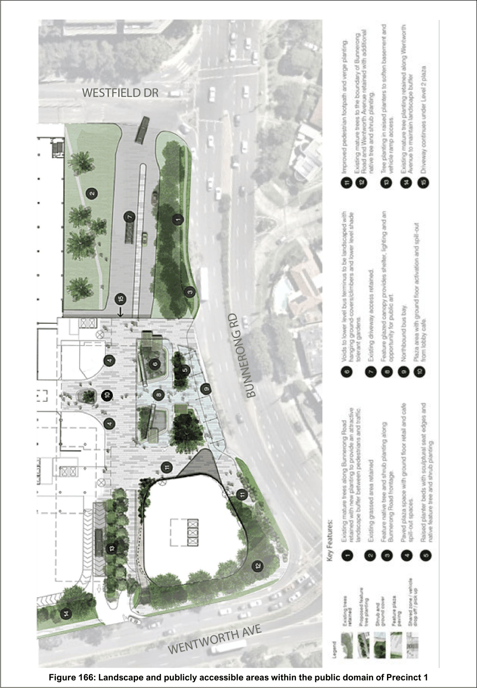

#### 7.22.3 Landscaping and Public Domain

| Objective |  | Control |  |
|---|---|---|---|
| General |  | All Precincts |  |
| O1. | Deliver a high-quality, pedestrian- focused public domain that is attractive, accessible, and encourages social interaction, shopping, and dining. | C1. | Retain existing mature trees along Bunnerong Road, Wentworth Avenue, and in street setbacks wherever possible, augmenting these with additional plantings. |

| Objective |  |
|---|---|
| O2. | Integrate landscaping and vegetation, including the retention of significant existing trees, to create a green buffer and enhance the public realm. |
| O3. | Promote ‘green buildings’ and encourage the inclusion of green walls, green façades, green roofs, and rooftop gardens to enhance building aesthetics, improve the streetscape, and help mitigate the urban heat island effect. |
| O4. | Ensure safe and convenient pedestrian access from the residential area north of the Westfield site, while maintaining essential loading operations on Westfield Drive. |
| O5. | Prioritise upgrades to Westfield Drive that improve conditions for pedestrians and cyclists to support the long-term renewal of Precincts 2 to 4. |
| O6. | Ensure that future development of Precincts 2 and 3 deliver improved landscape, design and access conditions. |

| Control |  |
|---|---|
| C2. | Future development shall increase overall tree canopy cover on site and ensuring landscape buffer widths support the growth of large, mature trees without the need for excessive pruning. |
| C3. | Prioritise planting of native trees or locally inspired species with minimum 200L pot size, particularly along Wentworth Avenue, to reduce the visual impact of built form and complement the streetscape. If new street trees are proposed, the proposed tree species are to be consistent with Council’s Street Tree Masterplan. |
| C4. | Maintain or increase deep soil and landscaping areas on site to support healthy vegetation growth and ecological function. |
| C5. | New developments and major alterations and additions are to incorporate green walls / façades, green roofs, and / or rooftop gardens as part of their building design and be designed to be integrated with the overall architectural and landscape strategy of the development. These landscape elements should be designed in accordance with Bayside's Landscape Technical Specification. |
| C6. | If a Precinct is to be staged, a detailed staged Public Domain and Landscape Strategy is to be submitted with the Concept / Stage 1 development application or first development application lodged for that precinct. For non- staged Precincts, a detailed landscape plan is to be submitted with the development application. |

| Objective | Control |  |
|---|---|---|
|  | C7. | A Public Domain and Landscape Strategy is to be prepared in consultation with Council and is to address, but not limited to the following: Bayside Landscape Technical Specification requirements; Tree Assessment Report of existing trees; Tree and landscape retention details; Planting strategy, typologies and maintenance / on-going management details; Water sensitive urban design principles; Integration of soft landscaping with built form; Streetscape design (materials, kerb and pavement design, furniture, pedestrian access); Clearly defined useable public spaces and pedestrian amenity; Design and location of active and public transport connections; Signage, wayfinding, lighting and materials palette; Any outdoor dining seating arrangements; and Public art strategy. |
|  | C8. | Street furniture (e.g., bins, bollards, signage, lighting) is to be designed to minimise visual clutter, reduce environmental impacts on neighbours, and maintain clear pedestrian pathways. |
|  | C9. | Development must address Crime Prevention through Environmental Design (CPTED) controls in Part 3.1.3. |
|  | Precinct 1 and 4 |  |
|  | C10. | A new active civic plaza is to be delivered along Bunnerong Road, generally in accordance with Figure 166. |
|  | C11. | The design of the new publicly accessible plaza must: a. Improve pedestrian access to the retail centre and buildings A, B, and C; b. Be activated by uses such as retail, cafés, outdoor dining, or community spaces. c. Maximise openness to air and sky, with natural ventilation and daylight and where it is covered, employ architectural |

| Objective | Control |  |
|---|---|---|
|  |  | mechanisms that feel open and publicly accessible. d. Include high-quality landscaping and landscaped light-wells providing natural ventilation and daylight to the below- ground bus terminus. e. Integrate the retail interface at the upper level plaza with the public transport connections through direct access . f. Include appropriate lighting for safety and security. |
|  | C12. | A Public Domain and Landscape Strategy for Precinct 1 is to be submitted and consistent with the public domain design shown in Figure 166. |
|  | C13. | The Public Domain and Landscape Strategy for Precinct 1 is to be prepared concurrently with public domain and pedestrian access improvements for Precinct 4 at Westfield Drive and must include, but is not limited to: Precinct improvements shown on any of the figures in this Part; Pedestrian access enhancements to Westfield Drive and improved footpath connections to the northern residential area; Clear, safe, and legible pedestrian routes prioritising desire lines to the shopping centre and public transport; Public art to screen ramps and cantilevers; Visual treatments to reduce the impact of loading docks, blank walls, storage areas, and car ramps whilst maintaining passive surveillance and improve presentation; Lighting upgrades for pedestrian safety without emphasising existing structures; CPTED improvements for pedestrian areas between the building and existing carpark ramps. Traffic calming measures to maximise pedestrian safety to protect pedestrian networks; Streetscape enhancements with landscaping that maintain safety and security; Wayfinding measures; and Public art with relevant local context. |

| Objective | Control |
|---|---|
|  | All works in Precinct 4 are to be designed in consultation with Council with upgrades to Westfield Drive to be completed to Council’s satisfaction prior to the occupancy or operation of any development in Precinct 1. |

> [Picture on page 275: a picture, saved as a picture (images/section-07-specific-places-page-275-1.gif, 150 dpi).]

Figure 166: Landscape and publicly accessible areas within the public domain of Precinct 1

| Objective |  |
|---|---|
| Public Art Strategy – All Precincts |  |
| O1. | To integrate engaging and purpose- built public art into the urban landscape to support increased activation and place-making. |
| O2. | To create public spaces that are engaging and fit for purpose to support increased activation and place-making. |

| Control |  |
|---|---|
| C1. | A detailed Public Art Strategy is to be submitted for each of the Precincts. The Strategy for each Precinct is to be submitted with the Concept / Stage 1 development application or first development application lodged for that precinct. |
| C2. | The Public Art Strategy should draw on inspiration from either the Indigenous heritage, the botanical heritage of Botany Bay, the coastal location or the industrial heritage of the port precinct. |
| C3. | The Public Art Strategy is to comply with the requirements of the Bayside Public Art Policy 2022 and public art selection panels are to include a Bayside Council Arts and Culture Specialist. |
