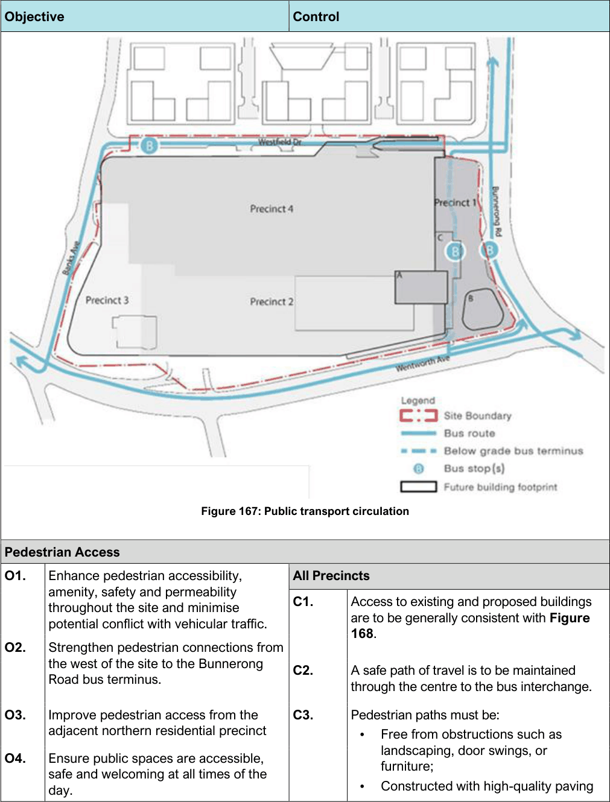
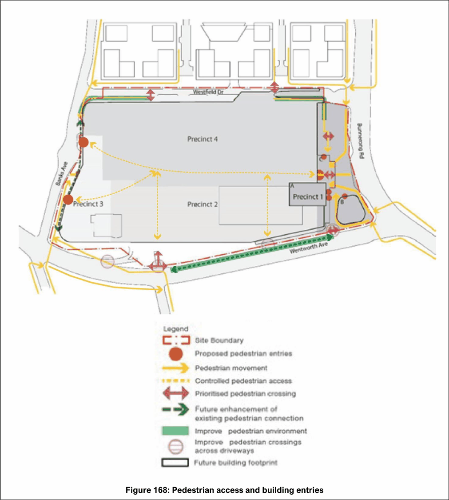
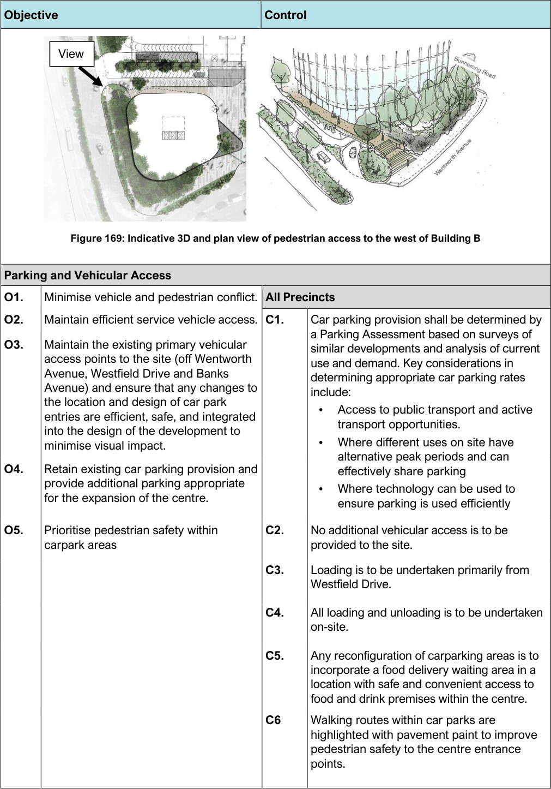

#### 7.22.4 Transport, Access and Movement

| Objective |  | Control |  |
|---|---|---|---|
| Public and Active Transport |  |  |  |
| O1. | To establish Bunnerong Road as the main public transport and active transport interface. | All Precincts |  |
| O2. | To provide clear and safe links to public transport and active transport routes and increase pedestrian traffic. |  |  |
| O3. | Provide an upgraded public bus interchange and facilities to encourage active or alternative transport and public transport use. |  |  |
|  |  | C1. | Public transport circulation around the site is to be generally in accordance with Figure 167 and any Transport for NSW (TfNSW) requirements. |
|  |  | C2. | Clear links to public transport shall be provided from building entries. |
|  |  | C3. | Works adjoining street frontages on routes identified in the Bayside Priority Cycleway Network in Bayside’s Bike Plan 2024 and in Randwick’s Cycling Network Plan in Randwick City Council’s Active Transport Plan (June 2024), shall support and complement the cycleways by incorporating safe bicycle access into the centre. |
|  |  | C4. | Facilities for active and public transport, are to be provided in and around the site. |
|  |  | C5. | Adequate active transport wayfinding and signage are to be provided around the site. |

| Objective | Control Precinct 1 |  |
|---|---|---|
|  | C6. | An upgraded bus interchange must be included with any future development application for Precinct 1. The upgraded bus interchange must be included within the Bunnerong Road plaza and be designed to meet TfNSW requirements, including bus driver facilities, bus parking / layover spaces and have potential for expanded capacity to accommodate future service increases. |
|  | C7. | The bus interchange is to be arranged over two levels with north-bound buses accessed via a kerbside stop, off Bunnerong Rd whilst south-bound buses are located within the sunken bus terminus below the plaza within Precinct 1, generally as shown in Figure 167. |
|  | C8. | Pull-in bays for north-bound buses shall be provided on the western edge of Bunnerong Road. |
|  | C9. | Consultation is to be undertaken with TfNSW regarding whether a Bus Interchange Operations and Safety Plan (BIOSP) is required to be prepared and submitted with the Development Application. If a BIOSP is required, the applicant is to prepare the plan in consultation with TfNSW and relevant operators and demonstrate compliance with applicable standards. |
|  | C10. | A shared drop-off / pick-up zone for shared mobility, taxi, ride share, kiss and ride are to be accommodated within the below grade bus terminus. |
|  | Precinct 3 |  |
|  | C11. | A second shared drop-off / pick-up zone for shared mobility, taxi, ride share, kiss and ride are to be accommodated on the ground level near the Banks Avenue entrance. |

> [Picture on page 278: a picture, saved as a picture (images/section-07-specific-places-page-278-1.gif, 150 dpi).]
> [Picture text on page 278 is stored in the PDF without readable letters (no character map), so it could not be copied; see the original PDF.]

Figure 167: Public transport circulation

#### Objective

#### Control

| Pedestrian Access |  |  |  |
|---|---|---|---|
| O1. | Enhance pedestrian accessibility, | All Precincts |  |
|  | amenity, safety and permeability throughout the site and minimise potential conflict with vehicular traffic. | C1. | Access to existing and proposed buildings are to be generally consistent with Figure 168. |
| O2. | Strengthen pedestrian connections from the west of the site to the Bunnerong Road bus terminus. | C2. | A safe path of travel is to be maintained through the centre to the bus interchange. |
| O3. | Improve pedestrian access from the adjacent northern residential precinct | C3. | Pedestrian paths must be: Free from obstructions such as |
| O4. | Ensure public spaces are accessible, safe and welcoming at all times of the day. |  | landscaping, door swings, or furniture; Constructed with high-quality paving |

| Objective |  |
|---|---|
| O5. | Provide safe and permeable access through the site during operational hours. |

| Control |  |
|---|---|
|  | materials that support intuitive wayfinding; Integrated with the Bunnerong Road plaza design where applicable. |
| C4. | Vehicular crossovers on designated pedestrian routes must be minimized to ensure pedestrian safety and ease of movement. Development should not restrict the potential for new pedestrian connections or reduce site permeability. |
| C5. | Pedestrian paths surrounding the centre are to be upgraded with tree canopy provided to shelter paths where feasible. |
| C6. | Escalators must be designed to be clearly visible, easy to navigate, and seamlessly connected to pedestrian pathways. |
| C7. | Pedestrian areas are to be well lit, especially at night. |
| C8. | Disabled access must be provided in accordance with the Disability Discrimination Act 1992 and Accessibility requirements in Part 3 of the DCP. |
| Precinct 1 |  |
| C9. | The plaza is to be privately owned and maintained and must be subject to a positive covenant on title ensuring unlimited, unimpeded access by the general public at all times. |
| C10. | The plaza is to be a safe and welcoming space for users at all times through the provision of lighting and design considerations whilst protecting surrounding residential amenity. |
| C11. | Pedestrian access is to be generally provided in accordance with the locations and design requirements in Figure 168 and Figure 169. |
| C12. | Further pedestrian and traffic studies are to be undertaken to determine and design safe pedestrian movement between Precinct 1 and 4. Consideration should be given to enhancing Westfield Drive with traffic calming and improved pedestrian crossing facilities to reduce pedestrian conflict with the bus and vehicular dominance at the T- junction of Westfield Drive and Bunnerong |

| Objective | Control |  |
|---|---|---|
|  |  | Road. This is to be submitted with the Concept / Stage 1 development application or first development application lodged for either precinct. |
|  | Precincts 2, 3 and 4 |  |
|  | C13. | A detailed Access Strategy is to be submitted for Precincts 2 to 4. The Strategy for each Precinct is to be submitted with the Concept / Stage 1 development application or first development application lodged for that precinct. An Access Strategy must demonstrate how pedestrian access within these precincts can be improved by: Incorporating pedestrian movement and connections in and around the site as shown in Figure 168. Upgrading all pedestrian access points along Wentworth Ave and include dedicated pedestrian / active transport access corridor through the car park to centre entrances. Refer to Figure 168. Promoting accessibility by foot, bicycle and public transport; Facilitating north-south movement through the centre and consider new entrances from Westfield Drive along desire lines; Minimise vehicle and pedestrian conflict areas; Create an improved town centre environment with a focus on pedestrian amenity and safety; and Prioritise pedestrian and landscape improvements along Banks Avenue, reducing car park dominance and supporting shared mobility access. |
|  | Precinct 4 |  |
|  | C14. | Any significant additional development in Precinct 4 in the future would need to be accompanied by a strategy for: Rationalisation of loading and service areas to improve pedestrian environment. Investigation of a new north-south through site link into the shopping centre with activated openings to Westfield Drive |

| Objective | Control |
|---|---|
|  | Investigation into the rationalisation of the loading and car ramps to Level 3 and 4 loading and parking facilities. |

> [Picture on page 282: a picture, saved as a picture (images/section-07-specific-places-page-282-1.gif, 150 dpi).]

Figure 168: Pedestrian access and building entries

> [Picture on page 283: a picture, saved as a picture (images/section-07-specific-places-page-283-1.gif, 150 dpi).]
> [Picture text on page 283 is stored in the PDF without readable letters (no character map), so it could not be copied; see the original PDF.]
> Words printed on the picture (title and legend, copied from the PDF):
> View
> carpark areas
> provided to the site.
> Westfield Drive.
> on-site.

Figure 169: Indicative 3D and plan view of pedestrian access to the west of Building B

#### Objective

#### Control

#### Parking and Vehicular Access

O1. Minimise vehicle and pedestrian conflict. All Precincts O2. Maintain efficient service vehicle access. C1. Car parking provision shall be determined by

a Parking Assessment based on surveys of similar developments and analysis of current use and demand. Key considerations in determining appropriate car parking rates include: Access to public transport and active transport opportunities.

O3. Maintain the existing primary vehicular access points to the site (off Wentworth Avenue, Westfield Drive and Banks Avenue) and ensure that any changes to the location and design of car park entries are efficient, safe, and integrated into the design of the development to minimise visual impact.

Where different uses on site have alternative peak periods and can effectively share parking

O4. Retain existing car parking provision and provide additional parking appropriate for the expansion of the centre.

Where technology can be used to ensure parking is used efficiently

O5. Prioritise pedestrian safety within

C2. No additional vehicular access is to be

C3. Loading is to be undertaken primarily from

C4. All loading and unloading is to be undertaken

C5. Any reconfiguration of carparking areas is to incorporate a food delivery waiting area in a location with safe and convenient access to food and drink premises within the centre.

C6 Walking routes within car parks are highlighted with pavement paint to improve pedestrian safety to the centre entrance points.

| Objective |  | Control |  |
|---|---|---|---|
|  |  | C7. | Landscape and planting design at car park entries shall be configured to provide a visually welcoming experience, while maintaining clear sightlines to ensure safety for both vehicles and pedestrians. |
|  |  | C8. | Any new above ground car parking areas are to be screened from publicly accessible streets and spaces with façade treatments that allow natural ventilation but minimise the visibility of cars within the car park |
|  |  | Precinct 1 |  |
|  |  | C9. | No additional car access is to be provided directly off Bunnerong Road. |
|  |  | C10. | An updated traffic management plan for the whole site is to be submitted with the Concept / Stage 1 development application or first development application lodged for that precinct. |
|  |  | Precincts 2, 3 and 4 |  |
|  |  | C11. | Any changes to vehicle access to the site should seek to improve accessibility to and through the site for pedestrians, cyclists and public transport. |
|  |  | C12. | An updated traffic management plan for the site is to be submitted with the Concept / Stage 1 development application or first development application lodged for each precinct. |
| Road Network – All Precincts |  |  |  |
| O1. | Accommodate increased traffic movement around the development. | C1. | Upgrades to surrounding intersections and new pedestrian connections are to be undertaken in consultation with, and to the satisfaction of TfNSW and Council. |
| O2. | Upgrade surrounding road network to improve pedestrian and vehicular safety and connectivity. | C2. | A signalised pedestrian crossing at the T- junction of Wentworth Ave and Denison Street shall be provided in consultation with TfNSW. |
