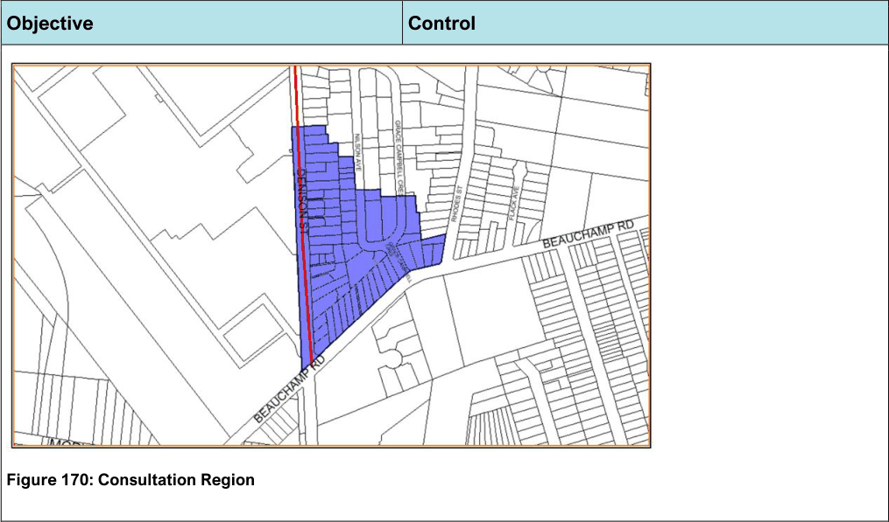
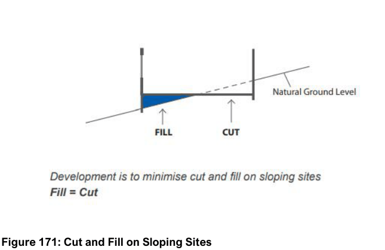

# Bayside Development Control Plan 2022 - Section 8 Managing Risk and Environmental Conditions

Source PDF: [26 102612  Bayside Development Control Plan 2022 - Amendment 2 - Section 8 Managing Risk and Environmental Conditions.pdf](26%20102612%20%20Bayside%20Development%20Control%20Plan%202022%20-%20Amendment%202%20-%20Section%208%20Managing%20Risk%20and%20Environmental%20Conditions.pdf)

### Managing Risk and Environmental Conditions

## 8 Managing Risk and Environmental Conditions

#### Hazardous development and Risk Overview

Certain industrial lands within Bayside LGA may support activities that involve handling, storing or processing a range of substances which in the absence of locational, technical or operational controls could create an off-site risk or offence to people, property or the environment. These activities would be defined as potentially hazardous or potentially offensive.

State Environmental Planning Policy (Resilience and Hazards) 2021 (Resilience and Hazards SEPP) provides a systematic approach to planning and assessing proposals for potentially hazardous and offensive development for the purpose of industry or storage. Through the Resilience and Hazards SEPP, the permissibility of a proposal to which the policy applies is linked to its safety and pollution control performance.

Development proposals are to consider land use safety risks for proposals near high-pressure gas transmission pipelines consistent with Hazardous Industry Planning Advisory Paper (HIPAP) 6 – Guidelines for Hazard Analysis (Planning NSW, 1992) and compared against HIPAP 4 – Risk Criteria for Land Use Safety Planning (Planning NSW, 1992).

#### Botany / Randwick Industrial Area

The Botany / Randwick industrial area forms a significant industrial complex of State and National significance. The location of the industrial area, within the vicinity of residential areas, has required that safety studies into the cumulative risk of industrial activity be undertaken to quantify and measure hazard risk associated with such activities. The Department of Planning & Environment has released three studies that investigate industrial operations and make land use planning recommendations. Studies released to date include the ‘Risk Assessment Study for the Botany / Randwick Industrial Complex and Port Botany’ (1985), the ‘Port Botany Land Use Safety Study’ (1996) and the ‘Botany / Randwick Industrial Area Land Use Safety Study’ (2001).

The key findings of the Botany / Randwick Industrial Area Land Use Safety Study has been a significant improvement in the cumulative risk areas that result from the industrial operations located within the Botany / Randwick industrial area. Recommendations that resulted from the study were:

1\. Future developments in the Botany / Randwick industrial area should be subject to early risk assessment and comprehensive environmental impact processes to conclusively demonstrate they will not contribute to risk impacts outside the industrial area that are inappropriate for surrounding land uses.

2\. Effective land use safety planning should be implemented to allow future developments in the area, and to reconcile any potential land use planning conflicts.

3\. A process of regular reviews and updates for site safety management systems should be undertaken.

4\. Emergency plans and procedures, and fire prevention and protection systems should be kept up-to-date.

5\. Industrial facilities should adopt community right-to-know principles to ensure the community is adequately informed about activities, associated risks and safety management measures adopted within the Botany / Randwick industrial area.

Implementation of recommendations 1, 3, 4, and 5 listed above are the responsibility of State, Local Governments and industry to administer through consultation and development approvals. Implementation of recommendation 2 is achieved by Bayside Council through the preparation of this

Development Control Plan to give the Study status under the Environmental Planning and Assessment Act 1979.

#### Definitions

Dangerous Goods Routes means identified within the Botany/Randwick Industrial Area Land Use Safety Study. The Botany / Randwick Industrial Area Land Use Safety Study does not include an assessment of the risk implications of dangerous goods transport, but does identify some routes as having a significant likelihood of carrying such goods. The routes identified within the Botany / Randwick Industrial Area Land Use Safety Study form a wider local and regional road network that may also carry traffic containing dangerous goods. The consideration of risk arising from the transportation of dangerous goods on this local and regional road network and the impacts this may have on residential and sensitive use development within the Study area needs to be considered as part of the assessment process for future development activity.

Residential intensification means an increase in the number of dwellings or an increase in the number of rooms providing temporary or permanent accommodation.

Residential land uses considered incompatible with residential fatality risk, injury or irritation risk (as defined in Hazardous Industry Planning Advisory Paper No.4 – Risk Criteria for Land Use Safety Planning

- Planning NSW, 1992) resulting from operations within the Botany / Randwick industrial area under this plan include dwelling houses, hotels, motels, and caretakers residences resulting from any of the following:

• The alteration and / or addition of an existing building;

• The conversion and / or utilisation of an existing building or vacant land;

• The subdivision of land to create a new allotment; and

• The rezoning of land.

Sensitive use intensification means the establishment of a sensitive use or an increase in the gross operational floor space of an existing building that is occupied by a sensitive land use.

Sensitive land uses that are considered incompatible with fatality risk, injury or irritation risk (as defined in Hazardous Industry Planning Advisory Paper No.4 – Risk Criteria for Land Use Safety Planning

- Planning NSW, 1992) resulting from operations within the Botany / Randwick industrial area under this plan include:- child care centres, nursing homes, educational establishments, hospitals and units for aged persons. Site means land comprising one or more allotments that forms an area to which a development consent or application for consent, applies under the provisions of the Environmental Planning and Assessment Act 1979.

Additional information: A number of HIPAPs and other guidelines have been issued by the Department of Planning & Environment to assist stakeholders in implementing an integrated risk assessment process and can be found at http://www.planning.nsw.gov.au/planning-guidelines-for-hazardous-development

| Objective |  |
|---|---|
| O1. | To ensure that any risk to human health, property or the natural environment arising from the hazardous or potentially offensive development is minimised and addressed. |
| O2. | To ensure that the potential risk associated with certain industrial |

| Control |  |
|---|---|
| C1. | Should a proposed use involve the storage and/or transport hazardous substances, Council will require an assessment of the Development Application under State Environmental Planning Policy (Resilience and Hazards) 2021. Note: All applications to carry out potentially hazardous or potentially offensive development will have to be advertised. |

| Objective | Control |  |
|---|---|---|
| developments is appropriately considered and mitigated. | C2. | Development Applications to carry out potentially hazardous development are required to be supported by a Preliminary Hazard Analysis (PHA). Note: Applicants are to refer to the applicable HIPAPs and other guidelines such as applying SEPP 33 and Multi-level Risk Assessment found on the NSW Department of Planning, Industry and Environment’s website at https://www.planning.nsw.gov.au/Policy-and- Legislation/Hazards |
|  | C3. | Development adjacent or adjoining sites/uses/pipelines that involve the storage and/or transport of hazardous substances are to: a. Prepare a risk assessment in accordance with the HIPAPs, and b. Comply with provisions under State Environmental Planning Policy (Transport and Infrastructure) 2021, Division 12A, Subdivision 2, Development adjacent to pipeline corridors. Note: Banksmeadow Industrial Precinct and Denison Street have specific risk related controls that have to be complied with (refer to Chapter 7.15 of this DCP). |
| Botany / Randwick Industrial Area |  |  |
|  | C4. | Development within the ‘Consultation Region’ identified in the below figure that will result in ‘residential intensification’ or ‘sensitive use intensification’ will require the concurrence of the Department of Planning & Environment. |
|  | C5. | Development for ‘residential intensification’, ‘sensitive use intensification’, and development that will result in increased traffic volumes or access points onto Denison Street, Hillsdale, Stephen Road, Botany, (being a designated Dangerous Goods Route) must: a. Consider a transport risk assessment report. The contents and outcomes of a transport risk assessment report are to be in general accordance with the principles outlined in HIPAP 6, HIPAP 4, HIPAP 10 – Land Use Safety Planning (NSW Department of Planning, 2011) |

| Objective | Control |  |
|---|---|---|
|  |  | and HIPAP 11 – Route Selection (NSW Department of Planning, 2011), and b. Receive development concurrence for the application from the Department of Planning & Environment. |
|  | C6. | Any other applications for development adjacent to / or within the vicinity of routes designated as ‘Dangerous Goods Routes’ will be assessed under the relevant Council planning instruments and controls. |
|  | C7. | Where a site is considered by Council to be located partly within any region or adjacent to a dangerous goods route defined in this plan, any development on the site will be assessed and viewed as though it was located within the area with the more stringent risk-related development controls specified in this development control plan. Note: Council in 2012 commissioned a traffic count for Denison Street (in both directions, north and south); which includes a separate count for dangerous goods traffic as Council wanted to compare the overall traffic to the dangerous goods traffic. Whilst this data is available to applicants who are required to prepare a Transport Risk Assessment Report, the data is over 12 months old and depending on the proposed development Council may require a new Transport Risk Survey to be conducted at the applicant’s costs. Please contact Council for more information. |
|  | C8. | Parts of Pagewood, Botany, Mascot, and Banksmeadow are within the zone of influence of the High Pressure Gas Pipeline that follows the ARTC Rail Corridor to the Qenos Site at the Botany Industrial Park, Denison Street, Banksmeadow. Development Applications, planning proposals and rezoning of land received by Council for land within the Zone of Influence will be referred to the APA Group for consideration and comment. |

> [Picture on page 6: a picture, saved as a picture (images/section-08-managing-risk-and-environmental-conditions-page-6-1.gif, 150 dpi).]

Figure 170: Consultation Region

#### Objective

#### Control

#### Soil Management

The scale of development in Bayside and its close proximity to Botany Bay and other waterways means that there is the potential for sediment to be washed into waterways. Planning in advance and using simple control measures will reduce this impact.

| Objective |  |
|---|---|
| O1. | To protect the environmental quality of waterways. |
| O2. | To reduce erosion hazard and prevent soil, building material and pollutants leaving the site and entering waterways. |
| O3. | To prevent reduction in the hydraulic capacity of drainage systems. |

| Control |  |
|---|---|
| C1. | Development must minimise any soil loss from the site to reduce impacts of sedimentation on waterways. |
| C2. | Development that involves site disturbance is to provide an erosion and sediment control plan which details the proposed method of soil management and its implementation. Such details are to be in accordance with The Blue Book - Managing Urban Stormwater: Soils & Construction by Landcom. |
| C3. | Development is to minimise site disturbance, including impacts on vegetation and significant trees and the need for cut and fill. |

#### Development on Sloping Sites

Site excavation and filling should be minimised so as not to affect the ecology of the site and to minimise excessive stormwater runoff. Building form should generally be stepped in accordance with the slope of the land to minimise these environmental impacts and the amenity impacts on adjoining neighbours.

| Objective |  |
|---|---|
| O1. | To limit site excavation and minimise cut and fill to ensure that building form relates to topography. |
| O2. | To protect the amenity of adjoining properties. |

| Control |  |
|---|---|
| C1. | The building footprint is designed to minimise cut and fill by allowing the building mass to step in accordance with the slope of the land. |
| C2. | To minimise cut and fill on sloping sites and to encourage good quality internal environments, any habitable room of a dwelling must have at least one external wall entirely above existing ground level. |

> [Picture on page 7: a picture, saved as a picture (images/section-08-managing-risk-and-environmental-conditions-page-7-7.gif, 150 dpi).]

#### Figure 171: Cut and Fill on Sloping Sites
