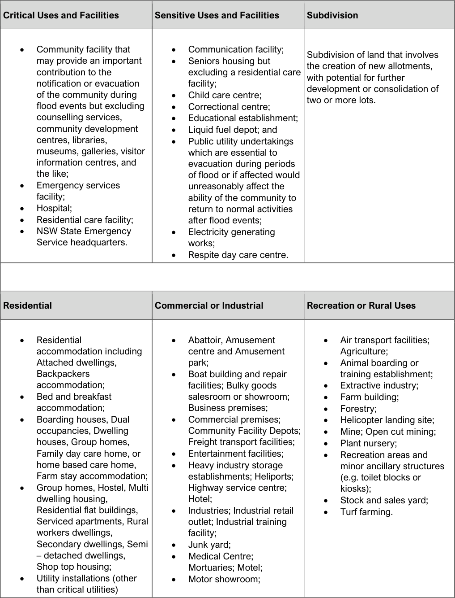

#### 9.5.1 Land Use Categories

> [Picture on page 18: a picture, saved as a picture (images/section-09-schedules-page-18-3.gif, 150 dpi).]

| Critical Uses and Facilities | Sensitive Uses and Facilities |  | Subdivision |
|---|---|---|---|
| • Community facility that may provide an important contribution to the notification or evacuation of the community during flood events but excluding | • • • • | Communication facility; Seniors housing but excluding a residential care facility; Child care centre; Correctional centre; | Subdivision of land that involves the creation of new allotments, with potential for further development or consolidation of two or more lots. |
| counselling services, | • | Educational establishment; |  |
| community development | • | Liquid fuel depot; and |  |
| centres, libraries, | • | Public utility undertakings |  |
| museums, galleries, visitor |  | which are essential to |  |
| information centres, and |  | evacuation during periods |  |
| the like; |  | of flood or if affected would |  |
| • Emergency services facility; |  | unreasonably affect the ability of the community to |  |
| • Hospital; |  | return to normal activities |  |
| • Residential care facility; |  | after flood events; |  |
| • NSW State Emergency Service headquarters. | • • | Electricity generating works; Respite day care centre. |  |

| Residential |  | Commercial or Industrial |  | Recreation or Rural Uses |  |
|---|---|---|---|---|---|
| • | Residential accommodation including Attached dwellings, Backpackers accommodation; | • • | Abattoir, Amusement centre and Amusement park; Boat building and repair facilities; Bulky goods | • • • | Air transport facilities; Agriculture; Animal boarding or training establishment; Extractive industry; |
| • | Bed and breakfast accommodation; |  | salesroom or showroom; Business premises; | • • | Farm building; Forestry; |
| • | Boarding houses, Dual occupancies, Dwelling houses, Group homes, Family day care home, or home based care home, Farm stay accommodation; | • • • | Commercial premises; Community Facility Depots; Freight transport facilities; Entertainment facilities; Heavy industry storage establishments; Heliports; | • • • • | Helicopter landing site; Mine; Open cut mining; Plant nursery; Recreation areas and minor ancillary structures (e.g. toilet blocks or |
| • | Group homes, Hostel, Multi |  | Highway service centre; |  | kiosks); |
|  | dwelling housing, |  | Hotel; | • | Stock and sales yard; |
|  | Residential flat buildings, | • | Industries; Industrial retail | • | Turf farming. |
|  | Serviced apartments, Rural workers dwellings, |  | outlet; Industrial training facility; |  |  |
|  | Secondary dwellings, Semi | • | Junk yard; |  |  |
|  | – detached dwellings, | • | Medical Centre; |  |  |
|  | Shop top housing; |  | Mortuaries; Motel; |  |  |
| • | Utility installations (other than critical utilities) | • | Motor showroom; |  |  |

| • | Camping ground/caravan park site – long-term sites only(1); | • | Passenger transport facilities; Place of public worship; Plant hire; |
|---|---|---|---|
| • | Health consulting rooms; |  | Recreation facility( indoor, |
| • | Home business. |  | major or outdoor); |
|  |  | • | Registered club; |
|  |  |  | Restaurant; Restricted |
|  |  |  | premises; Roadside stall; |
|  |  |  | Rural industry; |
|  |  | • | Sawmill; Service station; Sex services premises; Shop; Storage premises; |
|  |  | • | Transport depot; Truck |
|  |  |  | depots; |
|  |  | • | Vehicle body repair |
|  |  |  | workshop; Vehicle repair |
|  |  |  | station; Veterinary hospital; |
|  |  |  | and Warehouse or Distribution centre; |
|  |  | • | Waste or resource management facilities. |

(1) As defined by the Local Government (Caravan Park and Camping Grounds) Transitional Regulation 1993
