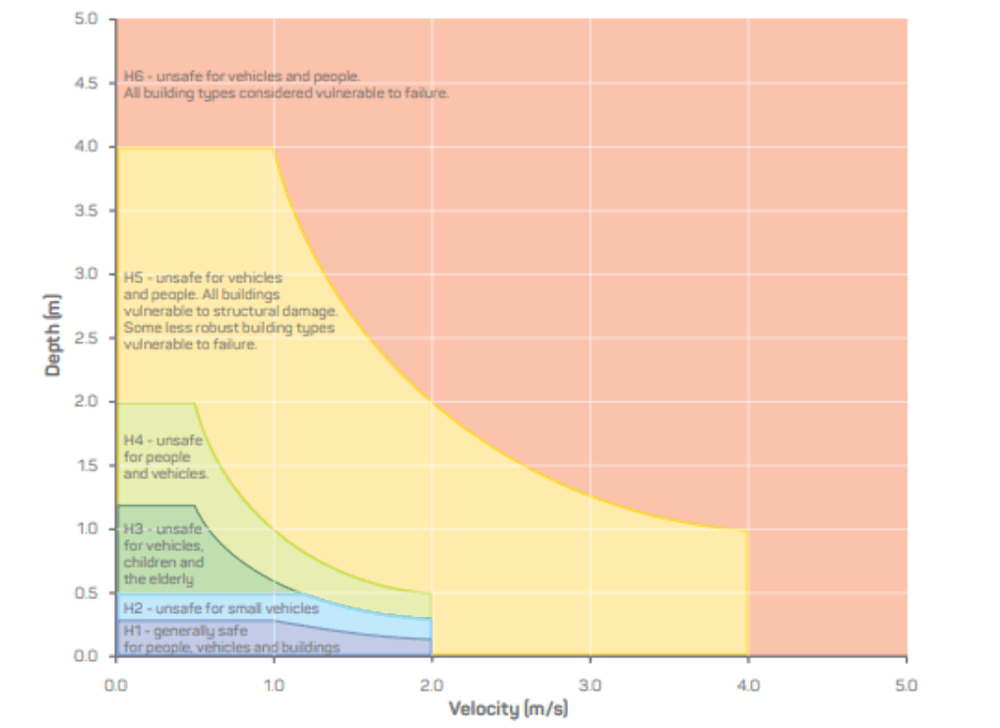

#### 9.5.2 Flood Hazard Category

A Flood Hazard Map (for 1% AEP Flood Event) has been prepared for flood prone land based on the flood behaviour derived by flood modelling prepared by Council for each catchment.

The Flood Hazard Map is available at: https://maps.bayside.nsw.gov.au/Intramaps98/?module=Flood

These hazard categories have been grouped into high and low hazards as follows.

▪ High Flood Hazard - This is defined as the area of land affected by the 1% AEP flood that is subject to hazard category H3 to H6. An area identified as high flood hazard is likely to have high flood damages and high risk to life or evacuation difficulties. In this area, there would be a significant risk of flood damage without strict compliance with flood-related development controls.

▪ Low Flood Hazard - This has been defined as the area of land affected by the 1% AEP flood that is categorised as having H1 and H2 hazard category.  In this area, the risk to life and flood damage to the building is low, however it is unsafe for small vehicles.

The combined flood hazard curves presented in Figure 172 set hazard thresholds that relate to the vulnerability of the community when interacting with floodwaters. The combined curves are divided into hazard classifications that relate to specific vulnerability thresholds as described in Table 27.

> [Picture on page 20: a picture, saved as a picture (images/section-09-schedules-page-20-1.gif, 150 dpi).]

Figure 172: General Flood Hazard Vulnerability Curves (source: Australian Disaster Resilience Guideline).

#### Table 27: Combined Hazard Curves - Vulnerability Thresholds

| Hazard vulnerability classification | Description |
|---|---|
| H1 | Generally safe for vehicles, people and buildings |
| H2 | Unsafe for small vehicles |
| H3 | Unsafe for vehicles, children and the elderly |
| H4 | Unsafe for vehicles and people |
| H5 | Unsafe for vehicles and people. All buildings vulnerable to structural damage. Some less robust buildings subject to failure |
| H6 | Unsafe for vehicles and people. All building types considered vulnerable to failure |
