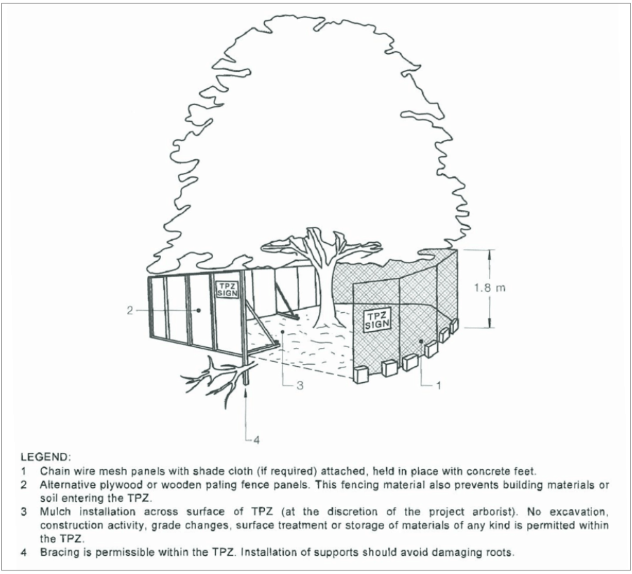

#### 2. LANDSCAPE REQUIREMENT

### 2.1.	 Site Planning

Site planning is the process of analysing existing conditions and arranging built and unbuilt elements on a site to accommodate a chosen function, program and design outcome. Landscape Design must be considered during the initial site planning and feasibility phase of the design process to ensure integration with the proposed developments.

Well planned landscape spaces can help contribute to the overall functionality, safety, security and visual appearance of development.

#### 2.1.1.  Tree removal approval

With increasing urbanisation and the development construction process, the protection of trees is an important objective for Bayside Council. Consideration must be given to existing trees early during site planning to incorporate existing trees into a development and ensure that the health of trees to be retained is not compromised by the proposed construction work. Council expects the retention of healthy and/or functional trees and requires that development proposals be designed to minimize tree removal or impact on existing trees.

When assessing whether existing trees should be retained, Council will consider various factors such as location, amenity (visual, environmental), function, health, form and structure, useful life, wildlife habitat, visual and heritage significance of the tree as well as impact on the development if retained and whether alternative site layouts need to be considered (Refer To AS 4970-2009: Protection of trees on development sites for further information).

It is the developer’s responsibility to ensure that new buildings or structures are located to achieve the required distances from existing trees as per an arborist assessment. Council will generally not permit the removal of healthy trees nor the pruning of tree canopies to accommodate a new building or the increase in height of a building. Council will only approve removal of a tree if the tree is in poor or declining condition, is hazardous or has a minimal safe useful life expectancy or if it can be shown that it is not possible to provide an alternative layout or design to allow retention of the tree as it would render the development economically unviable.

Council may require an independent arborist’s report prior to the determination of a development application.

Where council grants consent for the removal of an existing tree on land identified on the Bayside LEP Biodiversity Map  the replacement of the tree(s) on the subject land or off site is required at the ratios outlined in Council’s Tree Offset Policy.

#### 2.1.2.  Tree protection on construction site

Protective measures both before and during construction are required of all existing trees to be

retained on a development site. A site management plan is required to show all existing trees to be retained and identify the location of tree protection fence.

Civil and in particular stormwater management designs must account for existing trees to be retained on any site to ensure protection of the root system. Sub-surface storage tanks, infiltration trenches, sediment fencing, dish drains and stormwater pits and pipes are not permitted within the drip-line of any existing tree or within approved tree protection zone.

At site establishment, and prior to any works commencing including demolition, trees are to be physically protected with a tree protection fence located under the drip-line (see figure 1).

> [Picture on page 7: a picture, saved as a picture (images/landscape-technical-page-7-9.gif, 150 dpi).]

Figure 1.  Tree protection zone (TPZ) and tree protection fence (Source from AS 4709 Protection of trees on construction sites)

The fence is to remain in place until practical completion of all construction work. For trees where fencing under the drip-line is not possible, tree trunks and lower branches are to be protected with carpet underlay or similar and lengths of timber secured by wire. Notices are to be posted on the protective fencing indicating that it is a tree protection area and a notice placed in the site manager’s office with contact details for the Arborist.

•  The tree protection zone (TPZ) is to be mulch covered to a depth of 100mm at all time and regularly watered. Any exposed tree roots shall be protected by hessian and a layer of mulch.

•  There is to be no activity within the fenced TPZ. Site sheds, stockpiles, storage, cleaning of tools, parking of vehicle and machinery shall be located remotely from all protected trees.

•  Natural ground levels shall be maintained within TPZ. Retaining walls or changes in level are not permitted near existing trees.

•  Where a masonry boundary fence may impact or conflict with tree roots, a pier and beam or bridged footing will be required. Strip or trench footings will not be permitted.

•  Trenching for underground services is generally not permitted nor overhead electrical service wires.

•  Where building work or trenching is unavoidable within the fenced tree protection zone work shall be undertaken manually and supervised by an Arborist.

•  Areas of new paving should be kept away from tree protection zones to prevent root compaction and loss of aeration and water penetration to tree roots, as well as minimise later pavement damage.

Refer To AS 4970-2009: Protection of trees on development sites for further information and Part

2.3 Tree Preservation and Vegetation Management of the Bayside DCP 2022 for further Council requirements.

#### 2.1.3.  Exempt tree works

The following tree removal or pruning works do not require Council approval:

•  Trees that meet criteria under SEPP (Exempt & Complying Development Codes) 2008 (Clause 3.6A and Clause 3A.7);

•  Removal of noxious weed species/exempt species in the Bayside Local Government Area under the Noxious Weeds Act 1993 (as listed in Part 4.4);

•  Pruning near domestic power or telecommunications lines to maintain line distance clearance where the work is a maximum distance clearance of 500mm of branches up to 50mm diameter at the nearest branch collar (Branch collar is the point of attachment to another branch/trunk). Work must be carried out by an experienced Arborist or Tree Surgeon AQF Level 5 in accordance with AS 4373-2007: Pruning of amenity trees;

•  Minor pruning work at a maximum distance clearance of 2 metres measured from the surface of the structural component (wall/ roof) of the building’s edge and of branches up to 50mm in diameter at the nearest branch collar. (Branch collar is the point of attachment to another branch/trunk for branches overhanging the roof only);

•  Tree works authorised under the Electricity Supply Act 1995 or the Roads Act 1993;

•  Emergency work carried out by Council, State Emergency Services, Fire Services or a public authority;

•  Removal or pruning works undertaken by Council or a contractor acting on behalf of Council on Council owned or controlled land; and

•  Where Council is satisfied the tree is dying or dead or poses a risk to human health or safety.

#### 2.1.4.  Earthworks

Earth mounds and embankments shall be set-out and constructed in accordance with approved landscape and/or civil plans and constructed to ensure minimal slumping and post-construction settling.

General earthworks:

•  All imported fill to be certified clean fill, re-use of existing site soil (unless contaminated) is preferable;

•  Fill layers to be 100-150mm thick and compacted to at least 90% of the dry density ratio of the surrounding soil, as specified by AS1289.0-2000: Methods of soil testing for Engineering Purposes, to minimise slumping and further compaction/settling post-construction;

•  Ensure a gradual, rounded finished profile at corners and intersections of planes unless retaining walls or edging are incorporated;

•  There should be a minimum 500mm wide shoulder between surrounding levels and commencement of grading;

•  Grade to ensure water is directed away from buildings and there are no low points that would result in ponding of stormwater.

Earthwork for landscaped area:

•  Maximum grade 1 in 4 for turfed area (however, council prefers 1 in 6 for safest operation) and maximum grade 1 in 3 for planted embankments;

•  A settling period is required prior to turfing / plantings for imported soil area;

•  Imported soil for landscape areas is not to be compacted;

•  Refer to 2.2.4 Soil improvement and fertilisers for other soil preparation requirements.

Embankments are to be stabilized where necessary to prevent erosion or soil movement by using approved bank stabilisation techniques such as erosion control matting, fibrous matting, rock stabilisation, edges and retaining walls. The use of seeding is unacceptable.

A Dial-Before-You-Dig enquiry is to be undertaken prior to any excavation or digging to prevent damage to Council infrastructure or underground services/utilities.

#### 2.1.5.  Stormwater management and water sensitive urban design

Water management is the responsible treatment of on-site storm water and runoff generated across a site. It aims to minimise stormwater runoff, reduce the impact on local water systems, increase natural infiltration and reduce water consumption through landscape design.

In relation to landscape practices, Council requires the following:

•  Reduced amounts or expanses of impervious pavements and surfaces

•  Permeable pavements are to be used where possible. E.g. decks, pebbles, spaced pavers, specialised permeable pavers.

•  Directing runoff to garden beds rather than to the street or stormwater systems through grading of paved areas

•  Harvesting roof rainwater in tanks for irrigation re-use

•  Minimising underground drainage by using bio-swales, wetlands, infiltration trenches or subsoil collection for stormwater disposal and re-use; and

•  Optimising deep soil zones for stormwater and runoff water infiltration, thereby irrigating planted areas and recharging the groundwater aquifer.

•  Water Sensitive Urban Design (WSUD) is required to be incorporated in all larger scale developments and may include such elements as bio-swales and rain gardens. (Refer to Part 3.8 Stormwater of the Bayside DCP 2022).
