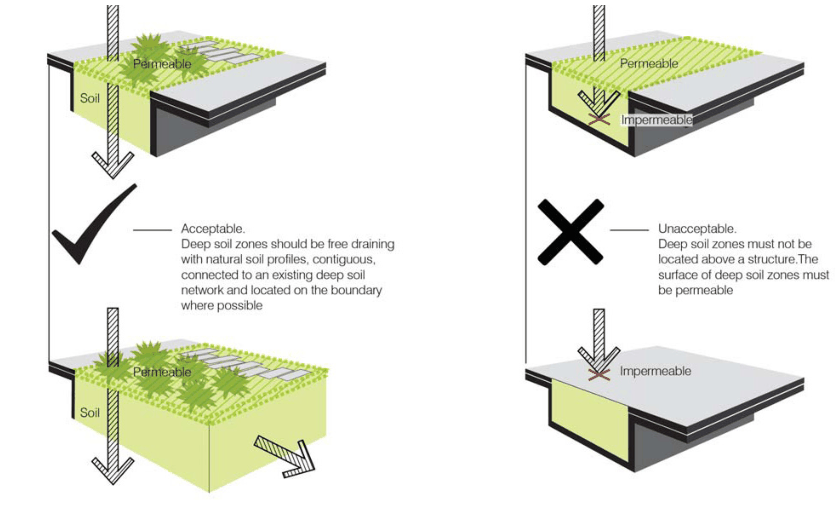
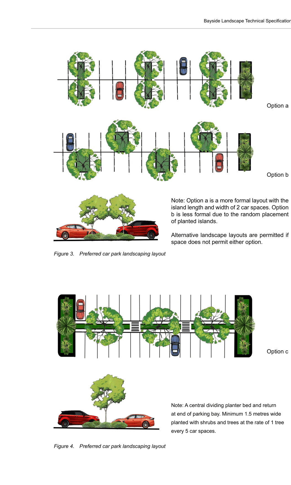

### 2.2.	 Work in Development Site

#### 2.2.1.  Retaining walls

(I) Material and finish

•  Treated pine or hardwood sleeper retaining walls are only suitable for detached residential dwellings and are generally not permissible in industrial and commercial sites or where visible from the street or where there are other visual considerations from adjacent properties.

•  For all other development, retaining walls must be suitably designed and adequately constructed using masonry, blocks or concrete with suitable robust render or a decorative finish (e.g. natural stone or other approved masonry products).

(II) Safe Structures

•  Retaining walls must comply with relevant standards.

Masonry walls must comply with: AS 3700-2018: Masonry code, AS 3600-2018: Concrete structures, AS 1170-2007: Structural design actions Set.

Timber walls must comply with: AS 1720.1-2010: Timber structures AS 1170-2007: Structural design actions Set.

•  Large retaining walls greater than 600mm in height are required to be designed by a qualified structural engineer and indicated in the landscape documentation.

•  Council requires construction details for all retaining walls proposed as part of a development. This shall include full structural drawings indicating layouts, sections and details of all structural and other associated components. These design and construction details shall form part of the Development Application.

#### 2.2.2.  Front fence and gate

Fences form the boundary of the property and are the interface between public and private space. Fence design should respond to the context of the built form, the street and neighbouring properties. Along with the design of the front yard, the front fence can complement and enhance the appearance of a property. Fence design must comply with the Bayside DCP 2022 and other statutory requirements.

Front fence requirements apply to boundary fences that face the public domain. New front fences must be:

•  Complementary in style and materials to the character of the area of the property and give

consideration to heritage significance where applicable. Consider how different materials can allow for privacy and screening for the property while maintaining a clear line of sight between the private area and the footpath.

•  A consistent height with neighbouring fences and the slope of the street

For corner lots, The maximum height of a fence along a road is:

•  1.2m along a road other than a classified road

•  1.5m along a classified road

•  1.8m where at least 30% transparent along a classified road

#### 2.2.3.  Pavement

Paver selection shall be specified in the landscape documentation, including sectional construction details, and included in the Schedule of Finishes. Unit pavers or tiles are the preferred finish in large scale residential and commercial developments. A limited amount of concrete paving may be incorporated however large expanses or lengths of concrete should be alleviated through the use of paver banding/headers, cobbles and the like particularly to delineate pedestrian zones, entries, transition zones or other special use areas. The use of contrasting finishes to break up large areas of concrete is also applicable to industrial developments. Paving and tiling shall comply with the following Australian Standard for slip resistance:

•  AS 4663-2013: Slip resistance measurement of existing pedestrian surfaces, and

•  AS 4586-2013: Slip resistance classification of new pedestrian surface materials.

Asphalt or bituminous pavements are generally not permitted except for vehicular loading, manoeuvring and parking areas in industrial and commercial developments. However the external at-grade parking areas can be paved in a contrasting finish to enhance the appearance of these areas.

Stencilled/stamped concrete is permitted only in the private driveways of detached residential dwellings due to its propensity for surface wear through continued use. Requirements are that there are no services or utilities underneath the area to be paved, the surface be sealed (and regular re-sealing) and that a header course be included along edges.

Pre-cast concrete stepping stones in utility areas shall have a joint of no more than 50mm, backfilled with gravel, if used for foot traffic.

Industrial and commercial developments may be required to use concrete interlocking pavers in parking and vehicular use areas.

Permeable pavements are encouraged as part of an overall Water Sensitive Urban Design (WSUD) approach for the re-use of surface stormwater and runoff on a development site. Permeable pavements allow water and air exchange to plant roots and the soil, reduce the amount of runoff entering the stormwater system, provide visual and textural relief to paved areas and allow natural infiltration of stormwater in large areas of paving.

Permeable paving may help to protect large, established trees where their root systems are extensive and some paving is unavoidable.

Suitable permeable pavements include:

•  Crushed granite and gravels; and

•  Resin bound aggregates (usually tree pit applications only)

•  Pre-fabricated permeable paving units (laid over the recommended aggregate). A small amount of cement in loose mixtures (3-5%) aids compaction and stability while allowing water infiltration. All loose surfaces shall be suitably graded, retained at edges and drained to prevent loose surface materials entering the stormwater system or spilling onto other pavements or garden beds during heavy rainfall.

#### 2.2.4.  Soil Improvement and Fertilisers (I) Soil Improvement

Soil used for landscape should comply with AS 4419-2018: Soils for landscaping and garden use, and AS 4454-2012: Composts, soil conditioners & mulches.

A soil test conducted by the Sydney Environmental & Soil Laboratory or approved equal shall be prepared for all commercial, industrial and multi-unit residential sites. Tests shall be taken in several areas where planting is proposed. Site soil shall be given a pH test prior to modifying to ensure conditions are appropriate for planting as stated above. Landscape contractors shall implement the recommendations of the soil test.

General requirements:

•  Aerate compacted soils and correct the pH of soils affected by construction activities or prior land uses.

•  Remove builder’s debris, concrete, cement and other deleterious matter from areas to be landscaped prior to planting.

•  Where possible all site topsoil is to be stockpiled for re-use on site. The removal of site topsoil is to be carried out only following the approval of Council.

•  Site top soil may be improved using a proprietary compost mix. Recycled and organic composts and soil conditioners are recommended.

•  Imported soils for landscaped areas shall be in accordance with AS4419-2018: Soils for landscaping and garden use. Recycled soils and garden mixes are recommended.

•  When growing locally native species it is recommended the natural soil be unaltered or improved with suitable additives only.

(II) Fertilisers

The use of fertilisers are to be minimised to reduce nutrient loadings on the stormwater system. Most natives do not require fertiliser. Organic fertilisers are recommended. Water retention additives are recommended to enhance the water holding properties of the soil during plant establishment.

(III) Contaminated soil

Prior to proposing any work on land that classified as soil contaminated, the applicants must engage a specialist to prepare the Contaminated Soil Assessment and follow the methods suggested by the specialist.

#### 2.2.5.  Deep soil area

Deep soil zones are areas within a development of natural ground with no obstructions above or below and relatively natural soil profiles (see figure 2). Deep soil zones help promote healthy growth of large trees, protect existing mature trees and allow infiltration of rain water into the water table to reduce storm water runoff.

> [Picture on page 14: a picture, saved as a picture (images/landscape-technical-page-14-6.gif, 150 dpi).]

Figure 2.  Description of acceptable deep soil arrangements  (Source: City of Sydney Landscape Code Volume 2)

New development applications should demonstrate that appropriately sized and located deep soil areas are proposed within the development. Deep soil zones exclude areas on structures, pools and non-permeable paved areas. Where possible, deep soil zones should be consolidated, contiguous and connected to other deep soil systems. They should be located so that large trees provide useful shade and amenity to achieve privacy between facing units in courtyards, or to mitigate the scale of high density development.

Methods and considerations for the provision of deep soil zones within a development include:

•  Designing car parking so it does not cover the whole site, providing zones for deep soil and where possible containing underground car parking beneath the building footprint

•  Locating deep soil in areas connected to existing deep soil systems such as on site boundaries or within setbacks

•  Utilising permeable paving materials where paving is required in deep soil zones

•  Utilising deep soil areas to retain existing trees and planting new large trees to support the urban tree canopy, biodiversity and urban wildlife linkages.

Council encourages new designs to include deep soil areas in the setback treatment of the development to create an attractive visual outlook and to improve the environmental impact of developments. The minimum width for planter beds in all developments is 1 metre, except where otherwise stipulated in boundary setbacks for each development type.

#### 2.2.6.  Planting in deep soil

Sufficient trees and landscaped areas are to be incorporated into a planting design. Plant selection shall:

•  Be appropriate and suitable for the landscape design intent;

•  Suit the soils and micro climatic conditions on the site i.e. shade, exposure, irrigation etc.

•  Be site responsive - enhance and embellish open spaces, setbacks and pedestrian areas, provide screening and shade where needed, alleviate large car park and paving expanses, subdue buildings and so on.

| PLANTING TYPE | MINIMUM POT SIZE |
|---|---|
| Trees in development site (As entry statements) | 100L - 400L |
| Trees in development site (Front setback) | 100L at least 2.2 metres in height and with a calliper of 40mm at 300mm above ground level |
| Trees in development site (Behind building line) | 45L |
| Shrubs/hedge required for screening or feature specimens | 300mm |
| Shrubs | 200mm |
| NOTE: 1: Larger pot size might required for privacy, amenity or to replace trees removed. 2: For street trees refer to Public Domain 2.3.3: Street tree and planting |  |

Mass planted areas of native grasses or indigenous species may include tube stock. Supply plants to the quality and standards recommended in Specifying Trees - A guide to assessment of tree quality by Ross Clark. Ensure plant material is hardened off and ready for planting.

Recommended planting densities/ratios per square metre for shrubs and groundcovers are provided in the table below. Native or decorative grasses in virocells or tubes should be spaced according to the recommendations of the supplier.

| Recommended Plant Centres/ Spacing (mm) | Number of Plants per Square Metre (rounded) |
|---|---|
| 100 | 100 |
| 150 | 45 |
| 200 | 25 |
| 250 | 16 |
| 300 | 11 |
| 350 | 8 |
| 400 | 6 |
| 500 | 4 |
| 750 | 2 |
| 1000 | 1 |

Trees should be planted densely whilst ensuring the mature canopies are not overcrowded. Use the features and form of individual species to reduce the scale, height and bulk of buildings and for screening and softening of buildings and other site elements.

#### 2.2.7.  Landscaping in ground car parks

•  Landscaping, including broad canopy trees will be used to effectively and adequately screen and soften parking areas, vehicle circulation areas and ancillary and utility areas and enhance shading, ameliorate the effects of micro-climate and provide glare reduction.

•  Landscaped areas will be planted densely using layered plantings of trees, feature plants and groundcovers while meeting Crime Prevention Through Environmental Design (CPTED) principles.

•  Internal landscaping must allow for pedestrian visibility of traffic, maintaining open sightlines. This can be achieved utilising clear trunked trees and low level shrub plantings.

•  All car parking spaces adjoining planter beds or trees shall be designed so that overhang of cars does not damage landscaped areas.

•  The car park design must comply with AS/NZS 1428.4.1-2009: Design for access and mobility.

•  Figure 3, 4 and 5 Indicates acceptable car park arrangements with respect to planting.

•  Planter beds must be of an adequate dimension to cater for tree roots and future tree growth and to provide adequate moisture penetration and aeration of the root zone. (Figure 6 indicates an unacceptable layout).

•  Planting areas and selection of plant species must be designed with consideration of sub-surface utilities and lighting when mature.

•  Selection of trees must consider the potential for excessive fruit or leaf drop and large root systems. High maintenance species are not encouraged as removal of trees at a later date should be avoided.

•  Tree root barriers are encouraged for certain tree species.

Option a

> [Picture on page 17: a picture, saved as a picture (images/landscape-technical-page-17-2.gif, 150 dpi).]
> [Picture text on page 17 is stored in the PDF without readable letters (no character map), so it could not be copied; see the original PDF.]
> Words printed on the picture (copied from the PDF):
> o cater for tree roots and future tree growth and to provide adequate moisture
> and aeration of the root zone.
> rriers are encouraged for certain tree species. Trees with excessive fruit or leaf drop,
> stems or high maintenance needs are not encouraged to avoid applications for
> ees at a later date. Trees with broad, leafy canopies however are required.
> m pot size at installation for trees is 100 litres.
> stances from sub-surface utilities and lighting are required.
> Option 2
> of planted islands.
> cape layouts are permitted if space does not permit either option.
> re formal layout with the island length and width of 2 car spaces.
> ormal due to the random placement of planted islands.
> Tree Management                                   Botany Bay Development Control Plan 2013 (Amendment 8)
> Enforced 05/09/2017
> Note: A central dividing planter bed and return
> at end of parking bay. Minimum 1.5 metres wide
> planted with shrubs and trees at the rate of 1 tree
> every 5 car spaces.
> Note: A central dividing planter bed and return and end of parking bay. Minimum 1.5 metres wide planted
> with shrubs and trees at the rate of 1 tree every 5 car spaces.

Figure  1 - Preferred Car Park Landscaping Layout

Figure 3.  Preferred car park landscaping layout

Figure  2 - Preferred Car Park Landscaping Layout

Figure 4.  Preferred car park landscaping layout

### Option 1

### Option 2

Option b

Note: Option a is a more formal layout with the

island length and width of 2 car spaces. Option

b is less formal due to the random placement

Alternative landscape layouts are permitted if

space does not permit either option.

Option c
