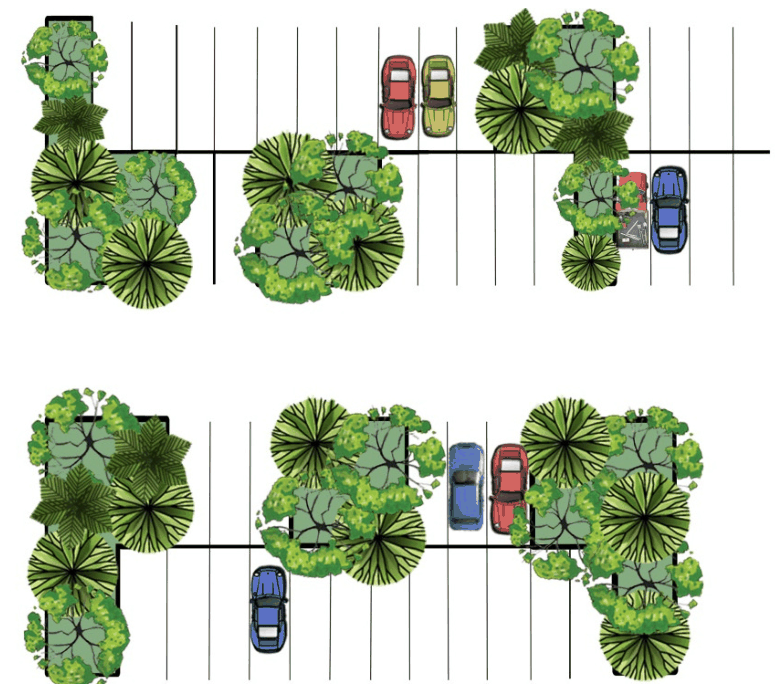
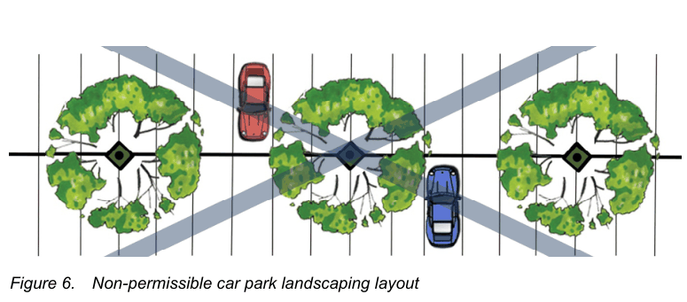

### C11 The minimum pot size at installation for trees is 100 litres.

### C12 Adequate distances from sub-surface utilities and lighting are required.

### Figure  1 - Preferred Car Park Landscaping Layout

### Note: Alternative landscape layouts are permitted if space does not permit either option.

### Note: Option 1 is a more formal layout with the island length and width of 2 car spaces.

Note: A central dividing planter bed and return and end of parking bay. Minimum 1.5 metres wide planted

> [Picture on page 18: a picture, saved as a picture (images/landscape-technical-page-18-1.gif, 150 dpi).]

Figure 3 -  An Informal Alternative for Car Park Landscaping  Layout

Figure 5.  An informal alternative car park landscaping layout

### Figure  4 - Non -Permissible Car Park Landscaping Layout

#### Figure  4 - Non -Permissible Car Park Landscaping Layout

> [Picture on page 18: a picture, saved as a picture (images/landscape-technical-page-18-5.gif, 150 dpi).]

Figure 6.  Non-permissible car park landscaping layout

### Figure 3 -  An Informal Alternative for Car Park Landscaping  Layout

#### P a g e | 31

## Part 3L – Landscaping and Tree Management                                   Botany Bay Development Control Plan 2013 (Amendment 8)

#### Enforced 05/09/2017

#### 2.2.8.  Landscapes on structures

When space becomes constrained, podium landscape, green roofs and walls are an efficient way to insulate the building from heat and noise, create habitat to provide social benefits, support urban ecology and add beauty to a building. Developments should ensure the creation of quality usable social podiums and rooftop spaces for residents of medium and high density residential developments that support thriving sustainable plantings.

All green roofs and living green walls are to be designed by a landscape architect or landscape consultant specialising and experienced in this type of landscape design. This is to ensure the landscape areas are suitably constructed to be integrated with the building and supportive of plant life, to incorporate appropriate plant selection, to ensure useful and site responsive design and to ensure the long term survival of the landscaping.

(I) Structural Safety

Appropriate structural design of green roofs, green walls, raised planters and rooftop gardens in accordance with the SEPP 65 Apartment Design Guide (4P-Planting on Structures, objectives 4P-1, 4P-2 and 4P-3 )

Elevated planter boxes and landscaped areas on suspended slabs are to be designed by structural engineers to determine appropriate design for weight loadings and drainage.

This table provides a general guide to the saturated weights of green roofs compared to other materials. A qualified structural engineer must assess the design and weight of any green roof design.

| Material | Depth | Approximate weight |
|---|---|---|
| Soil | 100mm | 120 kg / m2 |
| Soil | 500mm | 600 kg / m2 |
| Gravel | 100mm | 150-180 kg / m2 |
| Pavers | 45-50mm | 70-150 kg / m2 |

(II) Stormwater and drainage

All paved and planted areas on slab are to be waterproofed and drained effectively and linked to the stormwater drainage system of the development.

•  The base of the planter on slab must be screeded to drain all parts to a piped internal drainage outlet connected to the stormwater system.

•  Planters on slab are to be fully waterproofed and sealed internally.  All sealed finishes are to be sound and installed to manufacturer’s directions.

•  Drainage cells must be applied to the base and sides of the planter. Apply filter fabric to the base and sides prior to backfilling with an imported lightweight soil suitable for planter boxes and that is compliant with: AS 4419-2018: Soils for landscaping and garden use and AS 3743-2003: Potting mixes.

•  Turf areas require a min. 5% cross fall.

•  Internal drainage within the structure is required and is to be designed by a hydraulics engineer. External drainage weep holes are not permitted.

(III) Planting on slab

Where landscaping is provided on elevated areas over concrete slabs the landscape design must include adequate medium and large canopy trees to provide suitable privacy screening and softening of the built form.

Trees grown in these situations are subject to a broad range of environmental stresses that affect their health, vigour and ultimate size and survival. Where planting is to be carried out on a suspended concrete slab (roof gardens, balconies, over car parks) there must be sufficient soil depth and volume.

Landscape sectional details are required to ensure the planter bed/box are designed in accordance with the soil depth requirement below:

| PLANTING TYPE | MINIMUM SOIL REQUIREMENTS |
|---|---|
| Large canopy trees (8-10 metres in height) | Min. soil depth 1300mm, planter dimensions 10 x 10 metres |
| Medium canopy trees (5-8 metre in height) | min. soil depth 1000mm, planter dimensions 6 x 6 metres; |
| Small trees (3-4 metre in height) | Min. soil depth 800mm, planter dimensions 4 x 4 metres; |
| Shrubs - min. soil depth 500mm | Min. soil depth 500mm |
| Groundcovers | Min. soil depth 300- 450mm |
| Lawns | Min. soil depth 300mm. |

Provide a decorative exterior finish to co-ordinate with building finishes and indicate in the landscape documentation.

(IV) Green walls

Green walls are either free standing or part of a building that is partially or completely covered with vegetation. The wall may incorporate soil and/or inorganic material as the growing medium.

There are two main types of green walls: green façades and living walls. Green façades are made up of climbing plants either growing directly on a wall or on specially designed supporting structures. The plant’s shoot system grows up the side of the building while being rooted in the ground. With a living wall, modular panels are affixed to the wall and geotextiles, irrigation and a growing medium combine to support a dense network of plants.

(V) Irrigation and maintenance schedule

Fully automatic irrigation systems are required due to limited soil depths and the free draining nature of on-slab planters. The irrigation design must be submitted for approval. The irrigation drawings and specification are to be signed for approval by a person holding a Diploma of Irrigation, or with equivalent experience.

The irrigation design must include devices and techniques that contribute to efficient water use include but are not limited to the list below and use of stored rainwater or grey water from the development is encouraged.

•  Automatic controllers incorporating multiple start times, rain delay programming, and ET (evapotranspiration) programming

•  Automatic shut-off devices such as rain and moisture sensors

•  Low volume irrigation delivery through systems such as drippers, bubblers and micro-jets

•  Pressure regulating devices

•  High efficiency nozzles

•  Deficit watering programs that irrigate to achieve 80% field capacity when available water reaches 40-45% of field capacity

•  Stationing of sprinkler systems to match the hydro-zones of the site.

A maintenance schedule is required to ensure the long term viability of these elements (this needs to detail support for green walls and roofs if required).

Other resources include: North Sydney Council Green Roof and Wall Resource Manual City of Sydney Green Roofs and Walls facts

#### 2.2.9.  On-site Stormwater Detention (OSD)

Sub-surface concrete stormwater tanks and infiltration trenches are not to be located in areas to be landscaped, including the boundary setbacks of a development. Where this is unavoidable due to drainage invert levels they are to be located underneath driveway/vehicle circulation areas to maximise the area available for deep soil tree planting and landscaping on the site.

On-site Stormwater Detention (OSD) or infiltration trenches shall not be located under the canopy drip-line of existing trees or within tree protection zone (TPZ).

Above-ground rainwater tanks shall are not be located within the front setback of a property or visible from the public domain.

Refer to Council’s Stormwater Management Technical Guidelines.

#### 2.2.10.  Services / Utilities Items

Electrical kiosk or substation shall be located in an unobtrusive location away from vehicle and pedestrian entrances to the property and preferably toward a side boundary and/or setback off the street boundary to enable screening (planting or structures) and maintenance of streetscape amenity. The location of and screening treatment surrounding the utility must be approved by Council’s Landscape Architect prior to installation.

Fire booster valve assemblies shall be housed within the external face of the building structure, otherwise screened from view from public domain such as located near side boundaries, behind boundary walls, within an enclosure or screened by landscaping.

Letter Boxes:

•  Letterboxes should be located at the front of the property next to the entry gate, and provide adequate security. Letterboxes and locks must meet Australia Post requirements.

•  Letterboxes must clearly display the property number.

•  Letterboxes can be integrated into front fences to minimise visual clutter.
