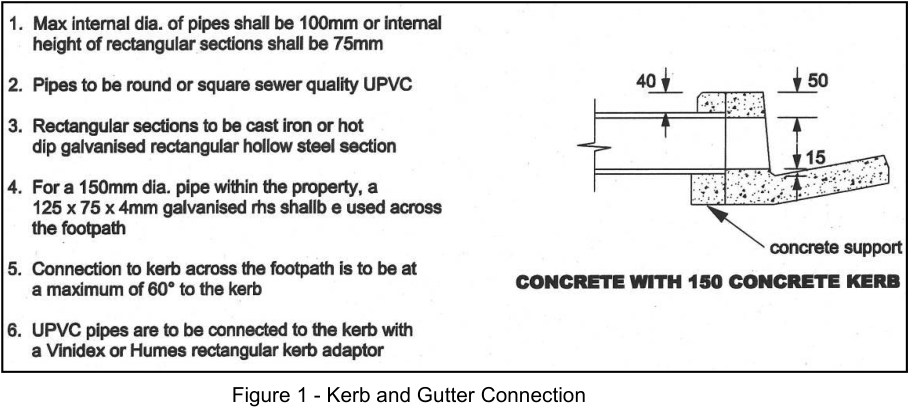
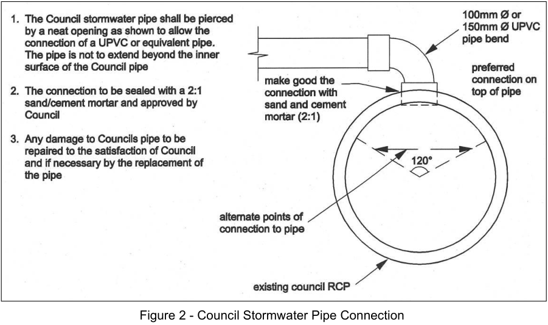

### 3.2 Connections

This section details the design and installation of discharge connections from a stormwater drainage system to

the point of connection, with reference to Australian Standard AS/NZS3500.3.

#### 3.2.1 Silt/litter arrestor pit

All developments in low absorption areas require a silt/litter arrestor pit fitted with a maximesh screen prior to

discharge to the connection (kerb and gutter, Council pipe/pit or interallotment drainage scheme) in accordance

with Figure SK001 of Appendix D. The maximesh screen should have an area 40 times the area of the discharge

pipe. A silt/litter arrestor is not required where a detention system includes a maximesh screen at orifice control.

The minimum size for an individual pit is 350 mm square. As the area draining through the silt/litter arrestor pit

increases so does the size of the silt/litter arrestor pit.

#### 3.2.2 Connection Design and Installation

The design and installation of connections shall comply with Australian Standard AS/NZS3500.3 except where

specified below in sections 3.2.3 – 3.2.6.

#### 3.2.3 Kerb and Gutter Connections

Connection to the kerb and gutter must be within 15 m of the property boundary and the discharge must be

less than 50 l/s for the combined discharge of the entire development site for the 1% AEP storm event. For

discharges greater than 50 l/s, the connection must be made to an underground stormwater system. Where

multiple conduits are required across the footpath, the conduits shall be separated by a minimum of 150 mm at

the kerb and provide a 150 mm gap at each end to ensure an integral concrete unit. The new kerb over the

multiple openings shall be strengthened by a 10 or 12 mm galvanised reinforcing bar across the top of the

openings centrally located. The discharge line is to be set at an angle of 45° to the kerbline for a minimum of 0.5

m from the kerb. Where the line extends in front of an adjoining property the line is to be within 0.5 m of and

parallel to the kerb and access for cleaning (screw cap) provided at any bend greater than 40°. The use of sewer

grade PVC is restricted to low density residential developments (single dwelling houses, secondary dwellings,

and dual occupancies). Concrete restorations over the conduits in brick or sandstone kerbs are to be coloured

to match the adjoining material. Size of conduits is as follows:

a. 150mm High Concrete Kerb and all Brick/Sandstone Kerbs. Drainage conduits across the footpath areas

discharging to the kerb shall be:

(i) sewer grade PVC pipe, maximum diameter 100 mm, The kerb outlet from the 100 mm PVC pipe shall

have a plastic Kerb Adaptor Socket, either 150 mm wide by 55 mm high, or 130 mm wide by 60 mm

high inserted in the kerb; or

(ii) galvanised Rectangular Hollow Section (RHS), maximum 75 high, typically 125 x 75 (min 5mm thick).

> [Picture on page 10: a picture, saved as a picture (images/stormwater-management-page-10-20.gif, 150 dpi).]

Figure 1 - Kerb and Gutter Connection

b. 200mm High Concrete Kerb. Drainage conduits across the footpath areas discharging to the kerb shall be:

(i) sewer grade PVC pipe, maximum diameter 100 mm, directly connected to the kerb; or

(ii) sewer grade PVC pipe, maximum diameter 150 mm. The kerb outlet from the 150 mm PVC pipe shall

have a plastic Kerb Adaptor Socket, 150 mm wide by 100 mm high; or

(iii) galvanised Rectangular Hollow Section (RHS), maximum 100 high (minimum 5 mm thick).

#### 3.2.4 Council Stormwater Pipe Connections

This refers to direct connection to a Council pipe within the property, or a Council pipe in the street, and is

referred to in Australian Standard AS/NZS3500.3 as a junction or cut-in. Direct connection into the Council pipe

is only permitted where:

a. The diameter of the connecting pipe is 150 mm or less, and

b. Only one connection per property is permitted, and

c. The connection is made in accordance with Figure 2.

> [Picture on page 11: a picture, saved as a picture (images/stormwater-management-page-11-1.gif, 150 dpi).]

Figure 2 - Council Stormwater Pipe Connection

Where the diameter of the connecting pipe is greater than 150 mm diameter, or the connection cannot be made

in accordance with Figure 2, a stormwater pit will be required to be constructed over the existing pipe to facilitate

the connection.

#### 3.2.5 Council Stormwater Pit Connections

This refers to connection to a Council pit located within the Council road reserve, or on public land. A Direct

Connection to a Council stormwater pit is permitted except where:

a. The Council pit is further than 5 m away from the subject property boundary (1), or

b. The new inflow pipe flow exceeds 1/3 capacity of the existing Council pipe (2), or Notes:

(1) Where connection to an existing pit greater than 5m away is necessary this requires an extension of the existing Council

pipe system to outside the subject property and the construction of a Double Grated Gully Pit and lintel (typically 2.4 m

overall, or as directed by Council) to connect the discharge pipe from the development into it.

(2) These connections may still be permitted; however, they require more detailed investigation to determine the impacts,

or optimum pipe configuration. In some instances, the solution may require upgrading the Council pipes further downstream.

#### 3.2.6 Inter-allotment Drainage System Connections

Connections to an inter-allotment drainage system require the construction of a junction pit over the inter-

allotment drainage system pipe to facilitate the connection.
