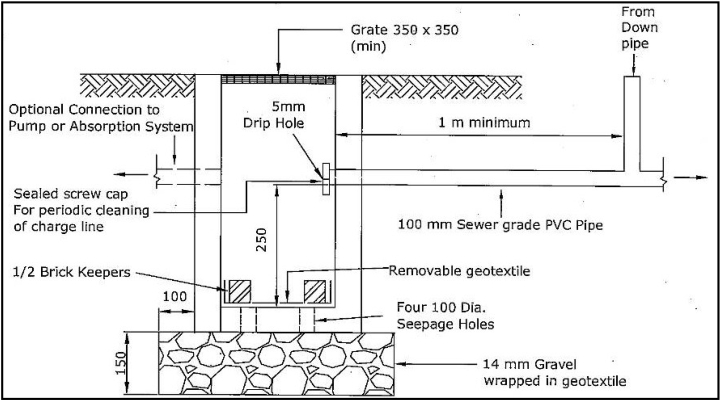

### 3.4 Surface Drainage Systems

This section details the design and installation of surface drainage systems. The design and installation of the

surface drainage system shall be in accordance with AS/NZS3500.3, except as specified below.

#### 3.4.1 Pits

a. Child proof J-Locks or similar shall be fitted to all pits deeper than 1 m and larger than 600 mm x 600 mm,

and locks are encouraged to be fitted to the grates of the smaller size pits as well. Where the pit type does

allow the use of J-Locks the grate is to be bolted down with removable elements that still allow reasonable

access for maintenance. Step irons (synthetic preferred) are to be provided for pits deeper than 1.2 m.

b. The minimum internal dimensions for stormwater and inlet pits shall comply with Table 1.

| Minimum Pit Size (mm) | Allowable Depth for Pit (m) |
|---|---|
| 350 x 350 | 0.45 |
| 450 x 450 | 0.6 |
| 600 x 600 | 0.9 |
| 600 x 900 | 1.2 |
| 900 x 900 | 2 |
| 1200 x 1200 | > 2 |

Table 1 - Minimum Internal Dimensions for Stormwater and Inlet Pits

c. Blocking factor (bf) shall be 0.5 for the design of sag pits and 0.3 for the design of on-grade pits.

d. For podium areas exposed to rain the 250 mm x 250 mm Flo-way Gully top is recommended with the

allowable minimum being the 150 mm diameter grate. Calculations are required to justify the size and

spacing of all inflow grates in podiums allowing for a blocking factor of 0.5.

e. Trench grates shall comply with the following:

(i) Where the site falls to the street a trench grate is to be provided at the boundary across the driveway

and any pedestrian paths.

(ii) To provide greater protection to low level garages, carports, or car parks the trench grate is to be a

minimum of 300mm wide at the entrance to the structure.

(iii) Additional trench grates are to be provided for long driveways at maximum 20m intervals.

(iv) The trench grate style in areas subject to high pedestrian movements shall be designed to minimise

tripping or conflicts with high heels. Where the available inlet area is reduced because of safety

requirements the trench grate width is to be increased beyond the minimum to compensate.

(v) Trench grates in major residential, commercial, and industrial applications are to be bolted down and

modified as necessary to reduce noise levels.

(vi) Pits located in roadways or on Council pipes shall be in accordance with Section 8.4. Pits located

on Inter-allotment Drainage Schemes shall be in accordance with Section 8.5.

(vii) For a driveway with a maximum width of 5 m and a maximum driveway slope of 10%, the trench

grate width shall be determined by Table 2. Smaller grate widths may be achievable in some

circumstances however more detailed calculations would need to be supplied to account for inflow

capacity and capacity of the trench to convey the flows. In addition, this table assumes uniform

distribution of flows against the trench. Where driveway slope concentrates the flow at a particular

location a larger inlet pit may be required to capture the flow in addition to the trench Grate.

| Trench Grate Width (mm) | Maximum Contributing Area per m Length of Trench Grate (m2) |
|---|---|
| 100 | 9 |
| 150 | 14 |
| 200 | 21 |
| 300 | 30 |

Table 2 – Trench Grate Widths

#### 3.4.2 Pipe Drains - General

a. Pipes shall be designed to convey the 5 minute 20 year ARI (5% AEP) design rainfall.

b. The minimum pipe size for single dwellings and residential buildings shall be DN 100. For all other

development the minimum pipe size shall be DN 150.

c. Internal drainage system design for sites less than 3,000m2 can be based on “pipes running full but not

under pressure” unless there are backwater issues. Sites greater than 3000m2 are to use Hydraulic Grade

Line Analysis (HGL) for the internal drainage system.

d. The nominal method specified in AS/NZS3500.3 may be used for single dwelling developments but shall

not be used for the design of pipe drains for all other developments.

#### 3.4.3 Charged Pipe Systems

Charged pipe systems are a permitted method of stormwater discharge for low density development in areas

that fall away from the street and are not suitable for absorption. General Requirements for Charged Pipe Systems:

a. Where the boundary level is above any kerb within 15 m of the site or a Council pipe is available, the roof

water is to drain by gravity from the boundary to the Council system via a silt/litter arrestor pit. Where a

gravity discharge to the Council system is not viable the charged pipe may connect directly to the kerb.

b. Flap (reflux) valves are to be installed on the outlet pipes from the charge system that discharge to the

silt/litter arrestor pit to minimise mosquito nuisance.

c. The lowest level of the charged system shall drain by gravity to a small inspection pit (350 x 350 mm min)

with sump for cleaning. There shall be a minimum of one metre of pipe from the last downpipe to the

inspection pit. The connection to the pit is to have a sealed screw cap to allow for periodic cleaning and

removal of rubbish. The cap is to have a 5 mm dribble hole to allow trapped water to discharge slowly. See

Figure 3.

d. Only sewer grade PVC or pressure pipes are to be used to convey charged flows.

e. All pipes and downpipes are to be sealed to a minimum of 0.5 m above the maximum water level in the

system. The system shall be pressure tested prior to backfilling. The use of exposed pipeline shall be

minimised.

f. All gutters must have leaf gutter guards installed and undertake regularly cleaning of the downpipes to

ensure effectiveness of the system. Requirements for Charged Pipe Systems for Roof Systems:

g. The eave gutter level shall be a minimum of 0.8 m and preferably 1.5m above the higher of the top of the

kerb outlet or the top storage level (e.g., Rainwater Tank). Where the height is between 0.5m and 1.5m an

analysis of head losses shall be provided. Requirements for Charged Pipe Systems for Aboveground Rainwater Tanks:

h. The overflow from the rainwater tank is to be a minimum of 0.5m and preferably 1.5m above the top of the

kerb outlet. Where the height is between 0.5m and 1.5m an analysis of head losses shall be provided.

i. The inlet pipes from the roof system to the rainwater tank may enter directly, or through a charge system.

Where a charge system is used each line will have a cleanout pit.

j. Flap valves are to be installed on the inlet pipes to the rainwater tank from the charge system to minimise

mosquito nuisance.

k. The design and installation shall comply with HB 230 - Rainwater Tank Design and Installation Handbook.

> [Picture on page 13: a picture, saved as a picture (images/stormwater-management-page-13-33.gif, 150 dpi).]

Figure 3 – Charged Pipe Cleanout Pit

#### 3.4.4 Internal Overland Flow

This section applies to flows generated from within the site and does not apply where the site is subject to

external overland flows (e.g., flooding). Particular attention is to be directed to ‘L’ or ‘U’ shaped developments

that may trap surface flows. An overland flow path is required to convey flows in excess of the pipe systems

design standard, or where the pipe drains are blocked. Development is required to comply with the BCA/NCC

regarding prevention of stormwater entering a building. To assist in achieving this requirement, all habitable

floor levels are to be a minimum of 200 mm above the ground level. Design of flow routes is to ensure that:

a. The route that the flow takes is to be designed to cater for the 1% AEP flow, either through pipes, or as

surface flows, or a combination of both. The water level of surface flow routes and ponding at sag pits shall

be at least 100 mm below the floor level of any adjacent building.

b. The applicant shall not concentrate or divert overland flow onto, nor increase the hazard on a neighbouring

property.

c. Provision shall be made for the harmless escape of overflows from on-site detention and on-site retention

(absorption) systems, in the case of malfunction of the system, such as blockage of the outlet, or the

exceedance of the design storm rainfall.

d. The design of flow routes and open channels to convey internal overland flows shall be checked for

hydraulic capacity using the Equation 1 - Manning Equation. Q = 1000 x (A / n) x R2/3 x S1/2

Where A = area of cross section (m2)

R = Hydraulic radius (m) = A / WP

WP = wetted perimeter (m)

S = gradient (m/m)

n = manning roughness coefficient (1)

Notes:

(1) For the Manning Roughness Coefficient refer to Table 5.4.9 of Australian Standard AS/NZS3500.3:2018.

Equation 1 - Manning Equation

e. Where overland flows are directed towards private property the escape route for overland flow at

boundaries shall be over a level weir to provide sheet flow. The length of weir shall be the downstream

easement width (if available), or a minimum of 5m where there is no easement.

f. Equation 2 - Weir Equation is to be used to check emergency overflows and overland flow. Q = 1.67 x L x H1.5

Where Q = discharge (m3/sec)

L = length of the weir (m)

H = depth of water flowing over the weir (m)

Equation 2 – Weir Equation

#### 3.4.5 Overland Flow from Rear, or Side Neighbours

This Section applies to minor flows that enter a property from adjoining property. The extent of flow can only

be determined by a catchment assessment and contour plan and an inspection of the drainage system on the

adjoining properties. The requirements, in addition to the requirements specified in Section 2.4.4, are as follows:

a. Where there are minor surface flows from neighbouring properties these can be accepted into a properly

designed internal drainage system and conveyed to the discharge point. It is essential however that these

upstream flows are assessed, and the proposed development is protected from them. The storage or PSD

requirements of an OSD system do not need to be increased due to minor upstream flows.

b. The habitable floor levels shall be the greater of 200 mm above finished ground level or 100 mm above the

water surface level.

#### 3.4.6 Installations near Buildings

This Section applies equally to the installation of pipe drains near / under buildings, and to the construction of

buildings near / over existing pipe drain installations. Where the installation is a domestic pipe drain the

installation shall comply with Australian Standard AS/NZS3500.3, or as specified by the Building Code of

Australia. Where the installation is a Council or inter-allotment stormwater drainage pipe refer to Section 8.
