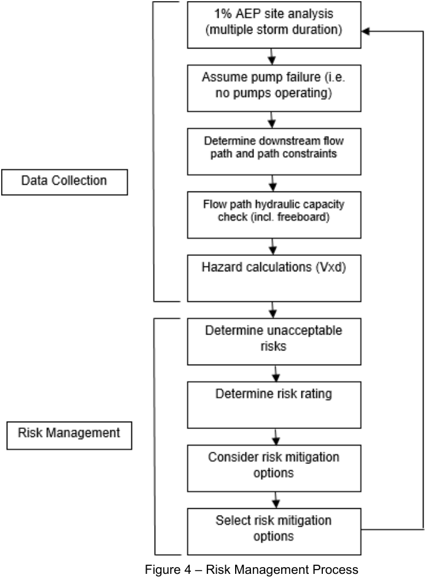

### 4.4 General Pump Requirements

For pump systems that are approved through section 4.2.1, the design shall be in accordance with AS/NZS

3500.3 except as follows:

a) The pump rate is to be determined by the design engineer for a wide range of storm durations.

b) The minimum clear internal height of the tank is to be 1 m.

c) A minimum of 100% of the required pump storage is to be below ground.

d) The rising main shall connect to a stormwater pit to achieve a gravity feed to the gutter. Where a gravity

feed to the gutter is physically impossible the rising main shall connect to the gutter and be angled at 45

degrees to the gutter and the pipe enlarged across the footpath to a 100 mm diameter to minimise velocity

and spray.

e) A positive covenant and restriction on use of land is required over the pump system to ensure long term

maintenance.

f) The storage in the pump system shall be provided at the minimum rate of 3.6 m3 per 100 m2 of site area

being drained.

g) The pump tank has sump (200mm to 500mm deep) and low-level outlet to a ground water recharge trench.

h) The impervious area (roof and surface) catchment draining to a pump-out system is to be limited to 200m2.

i) Submission of a risk assessment in accordance with section 4.4.1.

#### 4.4.1 Risk Assessment

Where pumps are to be used in accordance with section 4.2.1, a risk assessment must be undertaken by a

suitably qualified and experienced person. Figure 4 outlines a suggested process for risk management.

> [Picture on page 22: a picture, saved as a picture (images/stormwater-management-page-22-11.gif, 150 dpi).]

Figure 4 – Risk Management Process

This assessment shall assume pump failure and be based on the 1% AEP event with freeboard. The aim of the

assessment is to identify properties that may be particularly vulnerable to even small local surface flows. This

could include a lack of downstream escape routes or where natural or man-made features direct flows into

dwellings or outbuildings. The applicable standard for risk assessment and management is ISO 31000: Risk

Management-Principles and Guidelines. The risk assessment is to be in a report form and must accompany the

drainage plans submitted to Council.
