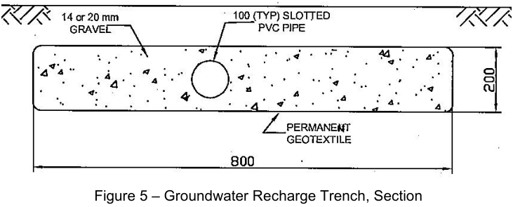
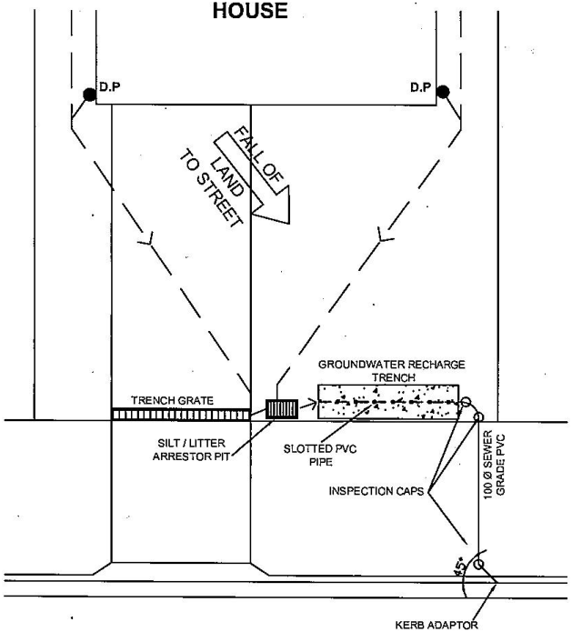
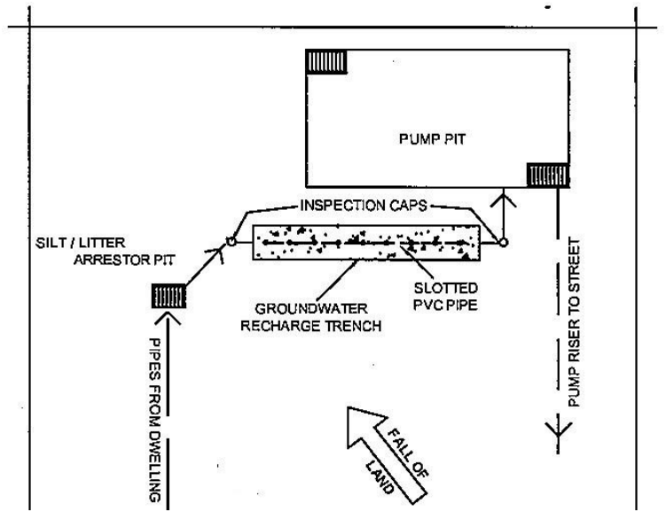

### 7.3 Groundwater

Groundwater, in a broad sense, is all water that occurs below the land surface. It is an integral part of the

water/hydrologic cycle and interacts directly with surface water. It provides significant contributions to rivers

and other water bodies and maintains the dynamics of the estuarine and near-shore marine water bodies,

contributing inflows of fresh water to otherwise saline environments. It is an invaluable resource. A significant

proportion of the bayside local government area is impacted by shallow groundwater flows and sandy soils. Evidence from historical projects shows that groundwater dewatering can critically impact nearby buildings,

structures, and infrastructure when the magnitude and duration of induced drawdown exceeds natural

occurrences. There is the potential to induce the compaction of unconsolidated layers beneath neighbouring

land particularly in areas of sandy soils, this may result in damage to other properties. Constructing buildings with basements that require excavation is aquifer interference activity. Therefore, it is

subject to the Water Management Act 2000, relevant water sharing plans and the NSW Aquifer Interference

Policy. These apply even if the excavation is unlikely to intersect groundwater at the time of construction. The assessment of groundwater impacts during development assessment is shared responsibility of council and

the state government agency administering the Water Act 1912, Water Management Act 2000, relevant water

sharing plans and the NSW Aquifer Interference Policy. The management of groundwater is further detailed in

the Sydney Coastal Councils Group Groundwater Management Handbook.

#### 7.3.1 Groundwater Management

The majority of the Bayside Council LGA lies in an area of a relatively shallow groundwater table, or aquifer. The

Construction within 1m of the groundwater table level is prone to groundwater seepage. The impacts to the

groundwater regime resulting from development must be minimised to protect the aquifer and surrounding

property/infrastructure, as follows:

a) All developments with a below ground structure (e.g., basement) are required to establish the actual

water table level to Australian Height Datum (AHD). This will require the submission of a geotechnical

assessment report for the site with the Development Application that includes accurate confirmation,

over multiple groundwater monitoring events, the groundwater levels for the site. Where the

development intercepts (or is within 1m of) the groundwater table, the geotechnical assessment must

address, but not limited to, the following matters:

i. The existing groundwater table levels,

ii. The method of dewatering,

iii. The amount the local water table is proposed to be lowered,

iv. An estimate of the volume of groundwater to be pumped from the site, the maximum pump rate

and duration of dewatering,

v. An assessment of impacts on surrounding structures,

vi. A plan showing the extent and depth of all excavations,

vii. An assessment on the quality of groundwater, and how it will be treated prior to discharge.

viii. Environmental site assessment report identifying the contamination status of the property and

the general quality characteristics of the groundwater beneath the site.

ix. Architectural plans illustrating accurate design dimensions of the proposed basement and

sections (oriented approximately at right angles) illustrating the design depth of the proposed

basement(s).

x. Acid sulfate soils assessment and management report identifying the nature, extent, and

management of acid sulfate soils (where present).

Further requirements for geotechnical investigation reports are detailed in the following documents:

• Minimum requirements for building site groundwater investigations and reporting published by

the NSW Department of Planning, Industry and Environment (DPIE) in January 2021

• Fact Sheet Geotechnical Investigation Reports Minimum Requirements published by Water

NSW or their most recent versions.

b) All development that requires dewatering (either temporary or otherwise) or intrudes into the water table

(e.g., basements) requires, in addition to development consent, parallel approval by the NSW State

Government agency administering the Water Act 1912 and the Water Management Act 2000 (Integrated

Development). Developments that intercept the groundwater table are generally considered “integrated

development” and referral for assessment and concurrence will be sent to the relevant NSW

government agency during DA assessment.

c) Proposals that require permanent or semi-permanent pumping of groundwater (after completion of the

development) are not permitted. In these locations, the construction of the below ground structure will

require a waterproof retention system (i.e., a full structural tanking and waterproofing) with an adequate

provision for future fluctuations of the water table level. Cut-off walls down to bedrock may be necessary

in certain soil and groundwater conditions. Subsoil drainage, if provided, shall be designed to allow the

free movement of groundwater around and beneath any proposed structure, but must not to be

connected to the internal drainage system. The pump-out system shall not be used to drain seepage

from the basement due to the elevated water table level, the pump-out system can only be utilized to

dispose stormwater runoff that may enter the basement carpark from the driveway access.

d) Despite the requirements of part c), the NSW State Government agency administering the Water Act

1912 and the Water Management Act 2000 may assess and approve a drained basement (permanent

dewatering) in certain circumstances where there are lower impact factors such as: site specific ground

conditions; potentially low inflows; lesser risk of impacts to neighbouring users; low potential for ground

surface settlement. This will only occur after hydrogeological modelling and assessment has been

undertaken to the satisfaction of the state government agency. The applicant must prove to both council

and the state government agency that a drained basement is acceptable in lieu of a fully tanked and

waterproofed basement. If a drained basement intercepting groundwater is approved by the state

government agency for the development (resulting in groundwater being collected, pumped, and

discharged to the council stormwater system) the following requirements apply:

i. It must be assessed, demonstrated, and certified through appropriate geotechnical/hydrogeological

modelling that the pumping of groundwater will not induce settlement and damage to surrounding

properties.

ii. Groundwater discharge must be directed into the underground stormwater system (no discharge

of groundwater to the kerb and gutter is permitted). If existing drainage infrastructure is not readily

available, the infrastructure will need to be constructed to service the development designed as per

Bayside Council specifications at the cost of the developer.

iii. The groundwater collected and pumped out of the basement will need to be permanently monitored

and treated on-site to ensure compliance with the applicable water quality standards (i.e., ANZG,

formerly known as ANZECC, water quality guidelines for fresh & marine water quality).

iv. A permanent dewatering management plan is to be prepared by a geotechnical engineer.

v. Obtain a Water Access Licence (WAL) and required groundwater share allocation (if required).

e) Some requirements (e.g., soil/groundwater contamination) can have impacts upon the proposal, such

that the project may need to be modified to include tanking and waterproofing.

#### 7.3.2 General requirements

a) All structures that are fully or significantly below ground must be fully tanked (structural tanking) and

waterproofed to the finished ground level so that, after construction is completed no groundwater

seepage is discharged from the site. A drained basement (permanent dewatering) will not be

permitted unless approved by the applicable state government agency administering the Water Act

1912 and the Water Management Act 2000.

b) All subsurface structures on sites that are currently contaminated or are formerly contaminated should

be fully tanked and waterproofed.

c) Subsoil drainage, if provided, shall be designed to allow the free movement of groundwater around and

beneath any proposed structure, but must not to be connected to the internal drainage system.

d) All subsurface structures are required to be designed with consideration of uplift due to water pressure

and “flotation” (buoyancy) effects.

e) The design of subsurface structures, tanking and waterproofing, and subsoil drainage must be

undertaken and certified by engineer(s) registered with the National Engineering Register (NER).

#### 7.3.3 Dewatering and Discharge of Groundwater to Council Systems

Council will allow temporary dewatering during construction. Council requires a permit to be obtained prior to

discharging any groundwater from temporary dewatering, or pumping out of flooded sites, into Council's

Stormwater Drainage network. A geotechnical engineering report, dewatering management plan & water quality

plan is to be submitted as part of the permit process. Any such permit will include strict conditions for water

quality standards (i.e., ANZG water quality guidelines for fresh & marine water quality) and water quality

monitoring that must be met during dewatering, any breach of the conditions will be prosecuted in accordance

with environmental protection legislation. Ponded water, particularly in clay areas, may require significant

treatment prior to discharge from the site. The pipe work associated with the temporary de-watering process

shall not be permitted to cross Council’s road reserve without the appropriate pedestrian protection. The developer needs to liaise with the applicable state government agency(s) administering the Water Act 1912

and the Water Management Act 2000 regarding construction stage groundwater management and monitoring

requirements. Certain approvals are necessary after development consent has been granted.

#### 7.3.4 Groundwater Recharge Trench

To reduce the impact of continued urbanisation and increased imperviousness for areas not generally suitable

for absorption, development needs to allow for some form of stormwater infiltration, particularly for small storms.

This is achieved through a Groundwater Recharge Trench. This trench consists of a minimum 800 mm wide by

200 mm high section of 14, or 20 mm gravel wrapped in geotextile filter fabric with a slotted PVC pipe (minimum

diameter 100 mm) running through the middle. This trench would be located downstream of the silt/litter arrestor

pit on private property, but prior to discharge to the street, pipe, or pump system. The trench is to be a minimum

of 1.0 m long for each 100 m2 of impervious site area draining to the system. Where ground levels and slopes

make positioning the Groundwater Recharge Trench downstream of the typical silt/litter arrestor pit location it

is permissible to place the Groundwater Recharge Trench along a major pipe section providing an additional

silt/litter arrestor pit is provided upstream of the Trench and the Trench is not located within 1.5 m of a

neighbour’s boundary, or 0.25 m to the front boundary. A section through the Groundwater Recharge Trench is

shown in Figure 5. Typical layouts are shown in Figures 6 (fall to the street) and Figure 7 (fall to a pump at the

rear). This trench is not required for Alterations and Additions to Single Dwellings. Alternative designs may be

used subject to meeting the intended objective.

> [Picture on page 40: a picture, saved as a picture (images/stormwater-management-page-40-16.gif, 150 dpi).]

Figure 5 – Groundwater Recharge Trench, Section

> [Picture on page 40: a picture, saved as a picture (images/stormwater-management-page-40-18.gif, 150 dpi).]

Figure 6 – Example Groundwater Recharge Trench Layout - Fall to Street

> [Picture on page 41: a picture, saved as a picture (images/stormwater-management-page-41-1.gif, 150 dpi).]

Figure 7. – Example Groundwater Recharge Trench Layout - Fall to a Pump at the Rear
