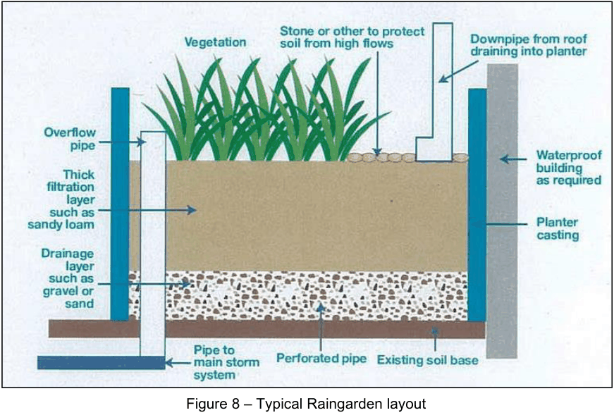

### 7.5 Landscaping

A variety of landscape measures can be used to manage stormwater flows, utilise stormwater within the site,

and minimise supplementary watering of landscaping. The careful design and placement of landscape measures

has many benefits for the water cycle, including reduced peak stormwater discharges, increased groundwater

recharge, reduced erosion and sedimentation, increased retention of soil moisture and lower water costs. This

is in addition to aesthetic & ecological benefits.

#### 7.5.1 Raingardens

Raingardens are a specific landscaping features that may be designed for stormwater quality treatment without

foregoing aesthetic or ornamental values. Stormwater runoff can be filtered, typically, through a sand/organic

mulch medium, which subsequently drains to a conventional stormwater conveyance pipe. Raingardens can

also provide some detention and/or retardation of stormwater flows reducing the risk of flooding, while providing

an aesthetic water/pond/landscape feature. Raingardens can be designed with any soil type and are typically

planted with native vegetation. Plants for raingardens should have the following qualities:

a) Tolerate short periods of inundation followed by longer dry periods,

b) Have spreading rather than clumped growth forms,

c) Are perennial rather than annual,

d) Have deep fibrous root systems.

> [Picture on page 42: a picture, saved as a picture (images/stormwater-management-page-42-18.gif, 150 dpi).]

Figure 8 – Typical Raingarden layout

Raingardens may be applicable for downpipes from isolated outbuildings, downpipes that are not connected to

rainwater tanks, or for the overflow from a rainwater tank. Raingardens are not suitable for the downpipes directly

connected to a rainwater tank due to the risk of contamination. Downpipes into rainwater gardens should

discharge a minimum of 2.5 m from most structures unless specific waterproofing techniques are used to

prevent water ponding against the structure and overflows are directed clear of the adjacent footings. Above-

ground rain gardens can be adopted, in the form of planter boxes, to treat runoff from roof areas not draining to

a rainwater tank. These typically require less space than an in-ground system.
