### 8.8 Construction Over Council Stormwater Pipes and Inter-allotment Drainage Pipes

This Section is applicable to properties where the proposed construction is directly over the stormwater pipe,

or drainage easement.

#### 8.8.1 Stormwater Pipe to be Located

This Section applies where the proposed construction is over, or in conflict with the drainage easement either

actual (existing), or nominal. It is necessary for the owner /developer to arrange for the stormwater pipe to be

physically located on site. Council has some drainage plans which give the approximate location of the

stormwater pipe which are available for a small fee, or there may be an easement over it which will assist in

locating it. Unfortunately, not all stormwater pipes have easements over them and even where there are

easements the stormwater pipes sometimes stray from them. The stormwater pipe needs to be found and

exposed. A registered surveyor needs to peg the easement (actual, or nominal from 8.4.1) including the pipe

and prepare accurate location plans. The location plans are to be supplemented with accurate photographic

evidence of the pipe. This will determine the proximity of the proposed development to the stormwater pipe

and/or drainage easement. The depth, size and accurate location of the pipe must be detailed to the satisfaction

of Bayside Council.

#### 8.8.2 Minimisation of Conflict

Concrete stormwater pipes are assets that in general have a very long service life (minimum of 80 years). The

existing stormwater pipes have usually been located in the easiest and the most direct route. In addition once

the stormwater pipes are built they are very expensive to move, or alter. Consequently, Council’s preference is

that the existing stormwater pipe remain in it’s current position and the proposed construction be modified to

be completely clear of the easement, or the alteration to be minimal. Bayside Council will consider allowing the stormwater pipe to be relocated where the owner/developer can

demonstrate there is a substantial benefit. This will not be agreed to where in Bayside Council’s view, relatively

simple modifications to the construction would reduce the impact on the pipe. Where Bayside Council agrees that the construction cannot be simply modified, an assessment will be made by

Bayside Council Officers to determine whether the pipe can be effectively routed around the proposed

development. In rare instances where the pipe cannot be relocated Bayside Council may approve building over

the pipe in certain special circumstances, see section 8.8.3.

#### 8.8.3 Development Over Council Pipes and Drainage Easements

Council’s aim is to provide continuous access to the Council pipe system for maintenance requirements and will

generally not permit new building work over Bayside Council pipes (other than detailed below).

a) General Allowable Minor Construction: Providing that existing ground levels are not raised, Council will generally permit the construction over Bayside

Council pipes and easements of:

(i) Most types of lawns and landscaping, except where raised planter beds are used,

(ii) Planting of trees, except for large trees (> 4 m in height), or invasive trees,

(iii) Paving of driveways and paths, however for villas and more intense development the driveway is

to be supported on piers for pipes with less than 1 m of cover,

(iv) Fences and gates (but not masonry fences) providing louvres or pool fencing is constructed at the

bottom of the fence, or gate to a minimum of 0.1 m above the depth of the 1% AEP flow.

b) Additions to Single Dwellings: Providing the building work has no adverse overland flow impacts, Bayside Council may approve the building

over a Bayside Council pipe where:

(i) The work only involves a steel/timber framed and skillion steel/fibreglass roofed pergola providing

the footings are outside the easement (or not within 0.5 m of the pipe), there are no solid elements

that restrict surface flows and the structure is bolted together in sections not exceeding 2 m by 3

m that weigh less than 80 kg,

(ii) The work only involves a steel/timber framed decks providing the footings are outside the easement

(or not within 0.5 m of the pipe), the overland flow is not significant and there are no solid elements

that restrict surface flows and the structure is bolted together in sections not exceeding 2 m by 3

m that weigh less than 80 kg,

(iii) The work only involves a steel/timber framed and skillion steel/fibreglass roofed carports over

existing driveways providing the footings are outside the easement (or not within 0.5 m of the pipe),

there are no solid elements that restrict surface flows and the structure is bolted together in

sections not exceeding 2 m by 3 m. (Note new carports on new driveways will not normally be

permitted because of the impact of overland flows.),

(iv) There are major practical construction problems in routing the pipe around the proposed additions

to single dwelling and the redesign of the additions to avoid the pipe is considered by Bayside

Council to be unworkable; or,

(v) The dwelling is already built over the pipe and the impact of extending the building further over the

pipe is not considered significant by Bayside Council.

In cases (iv) and (v) above an assessment is made by Bayside Council’s Asset Management Team of the

condition of the existing pipe. There may be a fee for this assessment process and this will require the

submission of a thorough condition assessment report to the satisfaction of Bayside Council. Where the pipe

condition is good, but no upgrade planned Bayside Council may allow the existing pipe to be retained and built

over with conditions, or where the pipe is in poor condition the existing pipe replaced with a similar sized pipe.

All new construction adjacent to the pipe is to be piered to protect it.

c) New Single Unit Dwellings: Providing the building work has no adverse overland flow impacts, Bayside Council may approve the building

over a Bayside Council pipe where there are major practical construction/hydraulic problems in routing the pipe

around the proposed new single dwelling and the redesign of the dwelling to avoid the pipe is considered by

Bayside Council to be unworkable. In this instance an assessment is made by Bayside Council’s Asset

Management Team of the condition of the existing pipe and whether it is intended to replace/upgrade the pipe

within the next twenty years. There may be a fee for this assessment process, and this will require the

submission of a thorough condition assessment report to the satisfaction of Bayside Council. Where the pipe

condition is good, but no upgrade planned, Bayside Council may allow the existing pipe to be retained and built

over with conditions, but an additional pipe must be laid parallel to the existing pipe with sufficient capacity to

carry the 5% AEP flow between the two pipes. Where the pipe is in poor condition the existing pipe is to be

replaced either as a two-pipe system as above, or as a single 5% AEP standard. All construction adjacent to

the pipe is to be piered to protect it and an easement provided in Bayside Council’s favour if none currently

exists or needs to be adjusted.

d) Commercial and Industrial Development: Providing the building work has no adverse overland flow impacts, Council may approve the building over a

Council pipe where:

(i) There are major practical construction/hydraulic problems in routing the pipe around the proposed

development and the redesign of the development to avoid the pipe is considered by Bayside

Council to be unworkable.

(ii) The nature of the development allows future access for Bayside Council plant and equipment. For

pipes up to 1050 mm in diameter and up to 1.7 m deep a minimum clear access 3.5 m wide and

4.0 m high is required along the full length of the pipe. Larger areas are required for bigger

diameter and deeper pipes, or if the pipe has bends. An assessment is made by Bayside Council’s

Asset Management Team of the condition of the existing pipe and whether it is intended to

replace/upgrade the pipe. There may be a fee for this assessment process, and this will require

the submission of a thorough condition assessment report to the satisfaction of Bayside Council.

Bayside Council may require the pipe to be upgraded to the 5% AEP standard as part of the

development approval.

(iii) The existing commercial, or industrial building is already built over the pipe and the impact of a

small extension over the pipe is not considered significant by Bayside Council. An assessment is

then made by Bayside Council’s Asset Management Team of the condition of the existing pipe.

There may be a fee for this assessment process, and this will require the submission of a thorough

condition assessment report to the satisfaction of Bayside Council. Where the pipe condition is

good, but no upgrade planned, Bayside Council may allow the existing pipe to be retained and built

over with conditions, or where the pipe is in poor condition the existing pipe replaced with a similar

sized pipe. All new construction adjacent to the pipe is to be piered to protect it and an easement

provided in Bayside Council’s favour if none currently exists or needs to be adjusted.

In any of the above cases, a CCTV survey is required to be undertaken (see section 8.6.4).

#### 8.8.4 Covering of Open Channels and Culverts

Council will not permit the covering of open channels as it:

a) Restricts entry of flood flows during major events;

b) Limits access for inspection with significantly greater risk to personnel leading to higher costs to satisfy

OH&S obligations with less effective assessment;

c) Increases Council’s maintenance costs for cleaning the channel due to restricted and difficult access;

d) Increases Council’s long term maintenance costs due to the additional cost of maintaining the new

concrete cover slab as well as restricted access to the channel walls and base. This is particularly true in

tidal flow areas that are subject to salt attack. These increased costs may also include the reinstatement

of surface finishes that would otherwise not exist;

e) Leads to lower environmental outcomes through reduced biodiversity and possible environmental

sterilisation.

### APPENDIX A – Botany Bay Sand Aquifer

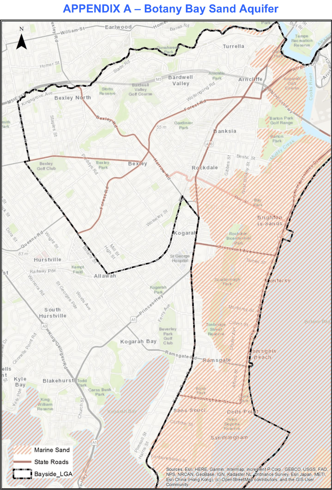

> [Picture on page 51: a picture, saved as a picture (images/stormwater-management-page-51-2.gif, 150 dpi).]

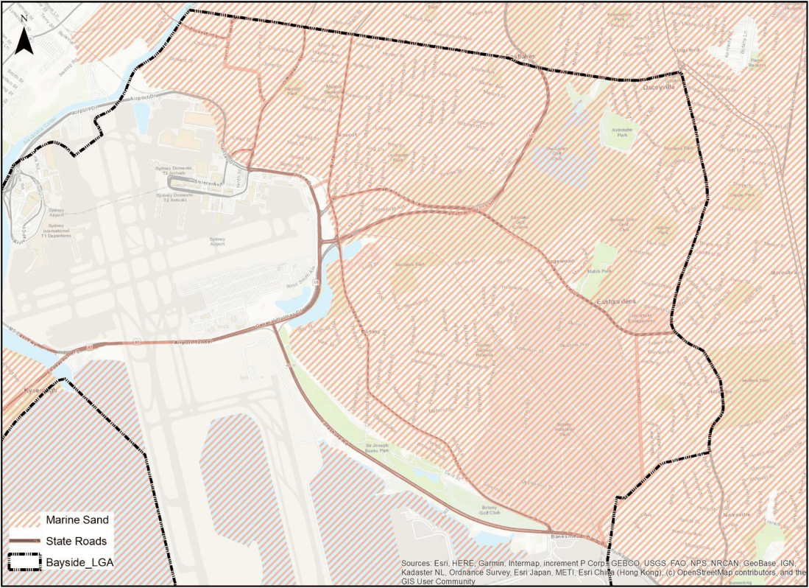

> [Picture on page 52: a picture, saved as a picture (images/stormwater-management-page-52-1.gif, 150 dpi).]

The shaded areas of Marine sand indicatively depict the location of Absorption Areas, with the remainder unshaded areas

being Low Absorption Areas. This mapping can be viewed in further detail on the public mapping software in Bayside

Council’s website. Notes:

• The above data is based upon the Sydney geological series as an indicative guide of areas with soil profiles suitable

for absorption. Further investigation may still be required based on the requirements of this technical specification

(i.e., groundwater level).

### APPENDIX B – INSTRUMENTS

#### POSITIVE COVENANT FOR ON-SITE STORMWATER MANAGEMENT SYSTEM

The registered proprietor covenants as follows with the Council in respect to the structure erected on the land

described as "on site stormwater management system" (which expression includes all infiltration units, ancillary

gutters, pipes, drains, trash screens, pits, grates, tanks, chambers, basins, rainwater tanks, pumps, walls, kerbs,

chambers, basins, orifice plates and surfaces designed to manage stormwater quantity and quality, including

the temporary detention or permanent retention of stormwater storages) shown on plans approved by the

Council (hereinafter called 'the system').

1\. The Registered Proprietor will

a) permit stormwater to be managed by the system;

b) keep the system clean and free of silt, rubbish and debris;

c) maintain, renew and repair the whole or parts of the system so that it functions in a safe and efficient

manner;

d) carry out the matters referred to in paragraphs (b) and (c) at the proprietor's expense;

e) not make any alterations to the system or elements thereof without prior consent in writing of the

Council;

f) permit the Council or its authorised agents from time to time upon giving reasonable notice (but at any

time and without notice in the case of an emergency) to enter and inspect the land for compliance with the

requirements of this clause;

g) comply with the terms of any written notice issued by the Council in respect to the requirements of this

clause within the time stated in the notice. 2 In the event of the registered proprietor failing to comply with the terms of any written notice served in

respect of the matters in Clause 1 the Council or its authorised agents may enter with all necessary equipment

and carry out any work required to ensure the safe and efficient operation of the system and recover from the

registered proprietor the cost of liaison with the proprietor and the cost of carrying out the work, and if necessary,

recover the amount due by legal proceedings (including legal costs and fees) and entry of a covenant charge

on the land under Section 88F of the Conveyancing Act 1919. In carrying out any work under this clause, the

Council shall take reasonable precautions to ensure that the land is disturbed as little as possible. Name of Authority Empowered to Release, Vary or Modify the Covenant is Bayside Council.

#### RESTRICTION ON USE OF LAND FOR ON-SITE STORMWATER MANAGEMENT SYSTEM

The registered proprietor(s) shall not make or permit or suffer the making of any alterations to any on-site

stormwater management system, which is, or shall be, constructed on the lot(s) burdened without the prior

consent in writing of Bayside Council. The expression “on-site stormwater management system” shall include all infiltration units, ancillary gutters,

pipes, drains, trash screens, pits, grates, tanks, chambers, basins, rainwater tanks, pumps, walls, kerbs,

chambers, basins, orifice plates and surfaces designed to manage stormwater quantity and quality, including

the temporary detention or permanent retention of stormwater storages. The on-site stormwater management system is detailed on the plans approved by ................................... as

Construction  Certificate  No.  ………….,  issued  on  ……………………….  under  Development  Consent No.

……………………… Any on-site stormwater management system constructed on the lot(s) burdened is hereafter referred to as “the

on-site stormwater management system”. Name of Authority having the power to release, vary or modify the Restriction on Use of Land is Bayside Council.

#### POSITIVE COVENANT FOR PUMP-OUT SYSTEMS

The registered proprietor covenants as follows with the Council in respect to the structure erected on the land

described as "onsite stormwater pump system" (which expression includes all ancillary gutters, pipes, drains,

pumps, walls, kerbs, pits, grates, tanks, rainwater tanks, chambers, basins and surfaces designed to collect and

temporarily detain stormwater) shown on plans approved by the Council (hereinafter called 'the system').

1\. The Registered Proprietor will

a) permit stormwater to be temporarily detained by the system;

b) keep the system clean and free of silt, rubbish and debris;

c) arrange for regular inspections and maintenance of the pump system, at not more than 6 monthly

intervals, by a recognised pump maintenance specialist to ensure the pump(s), associated alarms and system

generally is working effectively. The pump maintenance specialist is to prepare a written report detailing whether

the pump system is working effectively and if not what actions need to be undertaken to ensure it is working

effectively;

d) undertake the rectification works as specified by the pump maintenance specialist’s report as soon as

practical, but within 14 days of the report being prepared. Obtain a follow-up report to detail that the pump

system is now working effectively;

e) maintain written records of all reports and make available to Council such records where requested

including details of any rectification works;

f) maintain, renew and repair the whole or parts of the system so that it functions in a safe and efficient

manner;

g) carry out the matters referred to in paragraphs (b), (c), (d), (e) and (f) at the proprietor's expense;

h) not make any alterations to the system or elements thereof without prior consent in writing of the

Council;

i) permit the Council or its authorised agents from time to time upon giving reasonable notice (but at any

time and without notice in the case of an emergency) to enter and inspect the land and review the records for

compliance with the requirements of this clause;

j) comply with the terms of any written notice issued by the Council in respect to the requirements of this

clause within the time stated in the notice. 2 In the event of the registered proprietor failing to comply with the terms of any written notice served in

respect of the matters in Clause 1 the Council or its authorised agents may enter with all necessary equipment

and carry out any work required to ensure the safe and efficient operation of the system and recover from the

registered proprietor the cost of liaison with the proprietor and the cost of carrying out the work, and if necessary,

recover the amount due by legal proceedings (including legal costs and fees) and entry of a covenant charge

on the land under Section 88F of the Conveyancing Act 1919. In carrying out any work under this clause, the

Council shall take reasonable precautions to ensure that the land is disturbed as little as possible. Name of Authority Empowered to Release, Vary or Modify Covenant is Bayside Council

#### RESTRICTION ON USE OF LAND FOR PUMP-OUT SYSTEMS

The registered proprietor(s) shall not make or permit or suffer the making of any alterations to any pump-out

system, which is, or shall be, constructed on the lot(s) burdened without the prior consent in writing of Council. The expression “pump-out system” shall include all ancillary pipes, drains, kerbs, pits, grates, tanks, chambers,

and surfaces designed to temporarily detain stormwater as well as all surfaces graded to direct stormwater to

the temporary storage. The pump-out system is detailed on the plans approved by ……………………… as Construction Certificate

No.…………., issued on ………………………. under Development Consent No. ……………………… Any pump-out system constructed on the lot(s) burdened is hereafter referred to as “the pump-out system”. Name of Authority having the power to release, vary or modify the Restriction on Use of Land referred to is

Bayside Council.

#### POSITIVE COVENANT FOR OVERLAND FLOW PATHS

The registered proprietor covenants as follows with the Council in respect to the "overland flow path and flow

through fencing" (which expression includes all fences, openings, steps, lawns, gardens, paving and Council

approved structures along the overland flow route) shown on plans approved by the Council (hereinafter called

'the system'). Flow through fencing includes fences and gates that have pool fencing and/or louvres from the

base (ground) up to the 1% AEP flow depth to allow flood flows through.

1\. The Registered Proprietor will

a) permit stormwater to be temporarily conveyed across the land and through the system;

b) keep the system clean and free of silt, rubbish and debris;

c) maintain, renew and repair the whole or parts of the system so that it functions in a safe and efficient

manner;

d) not place or store items within the system, temporary or otherwise, that would block or partly block the

system;

e) not erect, or construct a fence or gate (that is not flow through fencing), raised planter garden or any

other structure within the flowpath that would block or restrict the system;

f) carry out the matters referred to in paragraphs (b), (c), (d) and (e) at the proprietor's expense;

g) not make any alterations to the system or elements thereof without prior consent in writing of the

Council;

h) permit the Council or its authorised agents from time to time upon giving reasonable notice (but at any

time and without notice in the case of an emergency) to enter and inspect the land and review the records for

compliance with the requirements of this clause;

i) comply with the terms of any written notice issued by the Council in respect to the requirements of this

clause within the time stated in the notice. 2 In the event of the registered proprietor failing to comply with the terms of any written notice served in

respect of the matters in Clause 1 the Council or its authorised agents may enter with all necessary equipment

and carry out any work required to ensure the safe and efficient operation of the system and recover from the

registered proprietor the cost of liaison with the proprietor and the cost of carrying out the work, and if necessary,

recover the amount due by legal proceedings (including legal costs and fees) and entry of a covenant charge

on the land under Section 88F of the Conveyancing Act 1919. In carrying out any work under this clause, the

Council shall take reasonable precautions to ensure that the land is disturbed as little as possible. Name of Authority Empowered to Release, Vary or Modify Covenant is Bayside Council

#### RESTRICTION ON USE OF LAND FOR OVERLAND FLOW PATHS

The registered proprietor(s) shall not make or permit or suffer the making of any alterations to the overland flow

path, which is on the lot(s) burdened and identified in the report, prepared and certified by .................................. ,

Reference   No.   ………….,   dated   ………………….   and    approved    under    Development    Consent

No. ............................... , without the prior consent in writing of Bayside Council. The expression “overland flow path” shall include all ancillary pipes, drains, walls, kerbs, pits, grates and

surfaces designed to convey the overland flow path through the site. Any overland flow path on the lot(s) burdened is hereafter referred to as “the overland flow path”. Name of Authority having the power to release, vary or modify the Restriction on Use of Land referred to is

Bayside Council.

#### POSITIVE COVENANT FOR COMPENSATORY FLOOD STORAGE

The registered proprietor covenants as follows with the Council in respect to the "overland flow path and flow

through fencing" (which expression includes all fences, openings, steps, lawns, gardens, paving and Council

approved structures along the overland flow route) shown on plans approved by the Council (hereinafter called

'the system'). Flow through fencing includes fences and gates that have pool fencing and/or louvres from the

base (ground) up to the 1% AEP flow depth to allow flood flows through.

1\. The registered proprietor of the lot(s) hereby burdened will in respect of the flood storage:

a) keep the flood storage clean and free from silt, rubbish and debris;

b) maintain the flood storage volume at the sole expense of the registered proprietors so that it functions

in a safe and efficient manner;

c) permit the Council or its authorised agents from time to time and upon giving reasonable notice (but at

any time and without notice in the case of an emergency) to enter and inspect the land for the compliance with

the requirements of this covenant; and

d) comply with the terms of any written notice issued by the Council in respect of the requirements of this

covenant within the time stated in the notice.

2\. Pursuant to Section 88F(3) of the Conveyancing Act 1919 the Council shall have the following additional

powers:

a) in the event that the registered proprietor fails to comply with the terms of any written notice issued by

the Council as set out above, the Council or its authorised agents may enter the land with all necessary materials

and equipment and carry out any work which the Council in its discretion considers reasonable to comply with

the said notice referred to in part 1(d) above; and

b) the Council may recover from the registered proprietor in a Court of competent jurisdiction:

(i) any expense reasonably incurred by it in exercising its powers under sub-paragraph (a) hereof. Such

expense shall include reasonable wages for the Council’s employees engaged in effecting the work referred to

in (a) above, supervising and administering the said work together with costs, reasonably estimated by the

Council, for the use of materials, machinery, tools and equipment in conjunction with the said work.

(ii) legal costs on an indemnity basis for issue of the said notices and recovery of the said costs and

expenses together with the costs and expenses of registration of a covenant charge pursuant to section 88F of

the Act or providing any certificate required pursuant to section 88G of the Act or obtaining any injunction

pursuant to section 88H of the Act. Name of Authority having the power to release, vary or modify the Positive Covenant referred to is Bayside

Council.

#### RESTRICTION ON USE OF LAND FOR COMPENSATORY FLOOD STORAGE

The registered proprietor shall not make or permit or suffer the making of any alterations to any compensatory

flood storage which is, or shall be, constructed on the lot(s) burdened without the prior consent in writing of

Bayside Council. The expression “compensatory flood storage” shall include all ancillary pipes, drains, walls, kerbs, pits, grates,

tanks, chambers, basins, and surfaces designed to temporarily detain floodwater as well as all surfaces graded

to direct floodwater to the temporary storage. The compensatory flood storage is detailed on the plans

approved by ……………………… as Construction Certificate No. …………., issued on ……………………….

under Development Consent No. ……………………… Any compensatory flood storage constructed on the lot(s) burdened is hereafter referred to as “the flood

storage”. Name of Authority having the power to release, vary or modify the Restriction on Use of Land referred to is

Bayside Council.

### APPENDIX C – DESIGN CALCULATION SHEET

#### EXAMPLE ABSORPTION PIT DESIGN CALCULATION SHEET (WITH WORKED EXAMPLE)

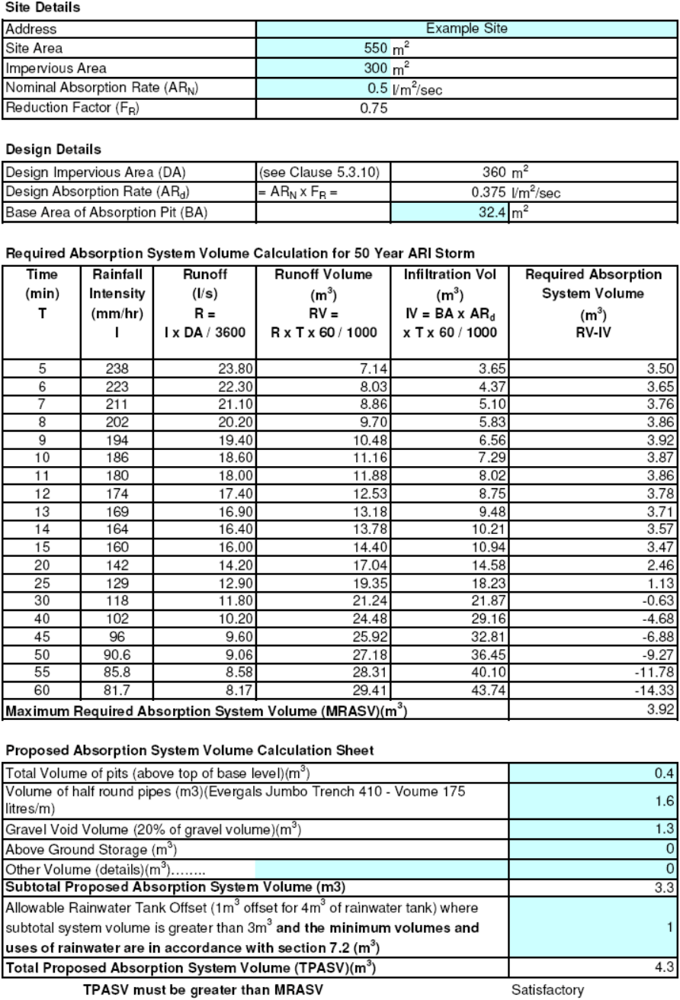

> [Picture on page 57: a picture, saved as a picture (images/stormwater-management-page-57-3.gif, 150 dpi).]

An electronic version of this calculation sheet may be obtained from Bayside Council’s website.

The worked example considers a site, area 550 m2, where a dwelling is proposed to be constructed with a roof

and surrounding paved impervious area of 300 m2. Council advised the nominal absorption rate of 0.5 l/m2/sec. The proposed absorption system has dimensions as follows: Gravel base

| Length | 9 m |
|---|---|
| Width | 3.6 m |
| Thickness | 0.2 m |

Void Type Everglas 410 “Jumbo” 0.175 l/m

End Pits 600 mm x 600 mm, 800 mm deep, with 200mm silt trap.

Rainwater tank 4,000 litres

The proposed system volume (TPASV = 4.30 m3) is greater than the required volume (MRASV = 3.92 m3) so

the design is acceptable providing the rainwater tank is connected to the appropriate uses. Further refinement

could produce a more economical design. Notes:

1\. Using the absorption pit types in drawings SK002, SK003, SK004, SK005 & SK010 will result in the critical storm usually

being fairly short, between 5 and 20 minutes, due to the limited storage available in this type of design (except where

additional above ground storage is used).

2\. When using pit configurations as Drawing C.4 with increased storage, the critical storm duration will generally increase.

3\. The designer can adjust the relative capacity of the storage and absorption area by trialing different configurations. If the

5 minute storm is critical there may be an opportunity to reduce the size of the absorption system.

### APPENDIX D – STANDARD DRAWINGS

HANDLE TO ALLOW

EASY REMOVAL

LYSAGHT GALVANISED MAXIMESH

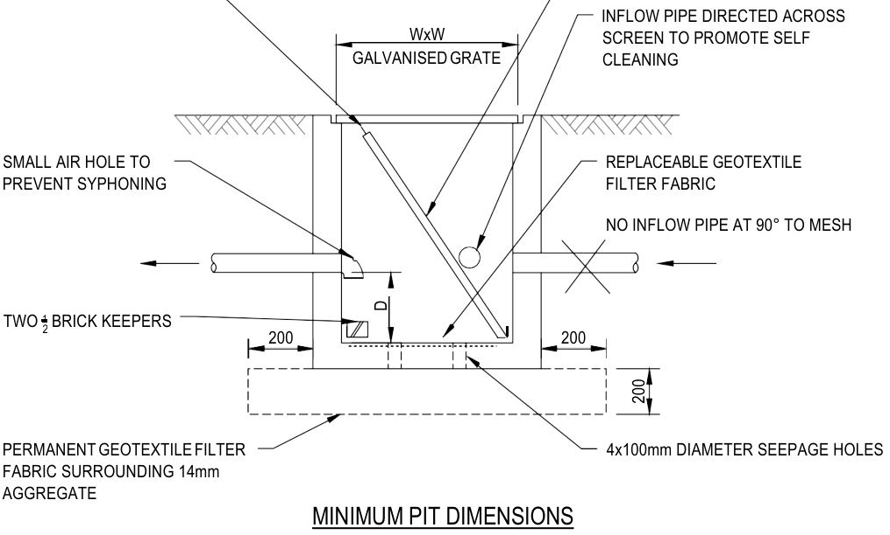

> [Picture on page 60: a picture, saved as a picture (images/stormwater-management-page-60-4.gif, 150 dpi).]
> Words printed on the picture (copied from the PDF):
> WxW
> GALVANISED GRATE
> GUIDE CHANNELS
> CLEANING
> FILTER FABRIC
> D
> 200
> 200
> 200

RH 3030 SCREEN IN GALVANIZED

INFLOW PIPE DIRECTED ACROSS

SCREEN TO PROMOTE SELF

SMALL AIR HOLE TO

PREVENT SYPHONING

REPLACEABLE GEOTEXTILE

NO INFLOW PIPE AT 90° TO MESH

TWO 1 BRICK KEEPERS

2

4x100mm DIAMETER SEEPAGE HOLES

PERMANENT GEOTEXTILE FILTER

FABRIC SURROUNDING 14mm

AGGREGATE

#### MINIMUM PIT DIMENSIONS

| SITE AREA DRAINING ( m2) | WIDTH (W) (mm) | DEPTH(D) (mm) |
|---|---|---|
| AREA < 400 | 450 | 200 |
| 400 < AREA < 800 | 600 | 250 |
| 800 < AREA < 1200 | 900 | 300 |
| 1200 < AREA < 1800 | 1200 | 350 |

#### NOTES:

1\. AREAS IN EXCESS OF 1600 m2 SHOULD HAVE THE FLOWS SPLIT AND ADDITIONAL PITS PROVIDED OR AN

ALTERNATIVE DESIGN SUBMITTED

2\. PITS MAY BE CONSTRUCTED OF BRICK OR CONCRETE (PRECAST OR CAST IN-SITU) OR CONCRETE BLOCKS OR

PLASTIC IF NOT SUBJECT TO VEHICLE LOADS

3\. IN SOLID ROCK THE WIDTH OF THE AGGREGATE BASE MAY BE REDUCED TO THE WIDTH OF THE PIT AND DEPTH(D)

REDUCED TO 100mm FOR ALL PIT SIZES

4\. FOR PITS WITH W GRATER THAN 900mm

A. THE GRATES ARE TO BE CONSTRUCTED IN COMPONENTS NOT EXCEEDING 600x600 FOR EASY LIFTING AND

PREFERABLY LIGHT DUTY WHERE POSSIBLE

B. THE MAXIMESH SCREEN IS TO BE SUPPORTED ON ITS OWN FRAME

C. INCREASE THE NUMBER OF SEEPAGE HOLES

5\. ALL DIMENSIONS ARE SHOWN IN mm UNLESS SPECIFIED OTHERWISE IN THE DIAGRAM

### SILT/LITTER ARRESTOR PIT

NTS

#### SILT/LITTER ARRESTOR PIT

DWG NO.

### SK001

| A | ISSUE FOR DCP 2020 | NTS | K ELAZAR | 22/09/2020 |
|---|---|---|---|---|
| REV | DESCRIPTION | SCALE | APP'D | DATE |

600 mm SQ.

600mm SQ.

L

100mm THICK CAST

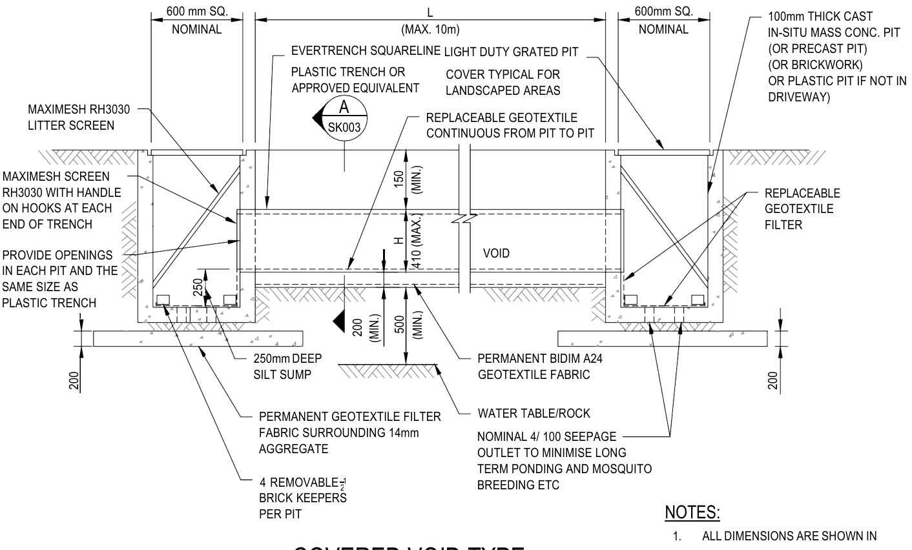

> [Picture on page 61: a map, saved as a picture (images/stormwater-management-page-61-5.gif, 150 dpi); the street names and other small labels are on the picture.]
> Labels printed on the map (copied from the PDF, in no particular order):
> NOMINAL · NOMINAL · (MAX. 10m) · EVERTRENCH SQUARELINE LIGHT DUTY GRATED PIT · PLASTIC TRENCH OR · APPROVED EQUIVALENT · COVER TYPICAL FOR · LANDSCAPED AREAS · SK003 · MAXIMESH RH3030 · LITTER SCREEN · DRIVEWAY) · REPLACEABLE · GEOTEXTILE · FILTER · REPLACEABLE GEOTEXTILE · CONTINUOUS FROM PIT TO PIT · MAXIMESH SCREEN · RH3030 WITH HANDLE · ON HOOKS AT EACH · END OF TRENCH · VOID · 410 (MAX.) · 150 · (MIN.) · 250 · PROVIDE OPENINGS · IN EACH PIT AND THE · PLASTIC TRENCH · 500 · (MIN.) · H · 200 · (MIN.) · 250mm DEEP · SILT SUMP · 200 · 200 · PERMANENT BIDIM A24 · GEOTEXTILE FABRIC · WATER TABLE/ROCK · PERMANENT GEOTEXTILE FILTER · FABRIC SURROUNDING 14mm · AGGREGATE · NOMINAL 4/ 100 SEEPAGE · OUTLET TO MINIMISE LONG · TERM PONDING AND MOSQUITO

IN-SITU MASS CONC. PIT

(OR PRECAST PIT)

#### A

(OR BRICKWORK)

OR PLASTIC PIT IF NOT IN

SAME SIZE AS

A

REV

DESCRIPTION

ISSUE FOR DCP 2020

#### COVERED VOID TYPE ABSORBTION PIT

BREEDING ETC

2

NTS

SCALE

4 REMOVABLE 1

BRICK KEEPERS

PER PIT

#### NOTES:

APP'D

1\. ALL DIMENSIONS ARE SHOWN IN

### COVERED VOID TYPE

K ELAZAR

### ABSORBTION PIT

NTS

mm UNLESS SPECIFIED

OTHERWISE IN THE DIAGRAM.

2\. THIS DRAWING MUST BE READ IN

CONJUNCTION WITH SK003 -

SECTION A.

DATE DWG NO.

22/09/2020

EVERTRENCH SQUARELINE PLASTIC

TRENCH OR APPROVED EQUIVALENT.

REPLACEABLE GEOTEXTILE

FILTER

CONSOLIDATE SAND BACKFILL

WITH WATER IN 100mm LAYERS

PERMANENT GEOTEXTILE

FABRIC

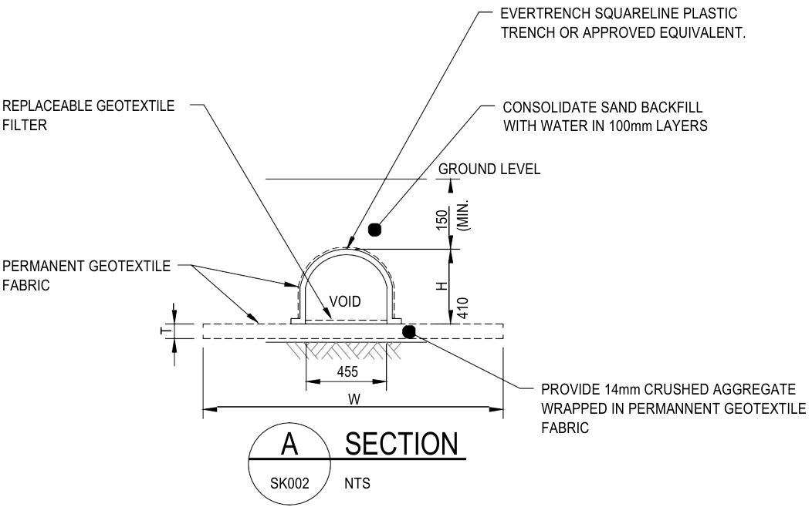

> [Picture on page 62: a picture, saved as a picture (images/stormwater-management-page-62-9.gif, 150 dpi).]
> Words printed on the picture (copied from the PDF):
> GROUND LEVEL
> H
> 150
> 410
> (MIN.
> VOID
> 455
> W
> SK002 NTS

T

PROVIDE 14mm CRUSHED AGGREGATE

WRAPPED IN PERMANNENT GEOTEXTILE

FABRIC

### A SECTION

AGGREGATE BASE THICKNESS

EVERTRENCH TYPE (H) (mm) CAPACITY (litres/m) BASE WIDTH (W) (mm) T (mm)(MIN.) 230 SMALL

70

<1700

200

350 LARGE

140

<2550

200

410 JUMBO

145

<3400 (MAX)

200

#### NOTES:

1\. WHERE PITS EXTENDS UNDER DRIVEWAYS, USE BOX CULVERTS INSTEAD OF PLASTIC TRENCH, OR INCREASE COVER

OR PROVIDE PIERS TO STRUCTURAL ENGINEER'S REQUIREMENTS.

2\. FOR TRENCH LENGTHS GREATER THAN 10m, INTERMEDIATE PITS MUST BE PROVIDED.

3\. FOR DEPTHS > 900mm DEEP USE LARGER PITS

FOR PITS < 600mm DEEP (eg WITH 230 SMALL) MAY USE 450 x 450 PIT.

4\. STORMTRENCH SC-310 864 (W) x 406 (H) AT 190 L/M PERMITTED INSTEAD OF EVERGLAS, PROVIDING A 900x600 PIT.

USED FOR MAINTENANCE ACCESS AT EACH END.

5\. DRAINAGE CELL MINIMUM 52mm THICK MAY BE PROVIDED INSTEAD OF GRAVEL BASE.

6\. ALL DIMENSIONS ARE SHOWN IN mm UNLESS SPECIFIED OTHERWISE IN DIAGRAM.

7\. THIS DRAWING MUST BE READ IN CONJUNCTION WITH SK002.

#### COVERED VOID TYPE ABSORBTION PIT

DWG NO.

#### SECTION A

A ISSUE FOR DCP 2020 NTS K ELAZAR 22/09/2020 REV DESCRIPTION SCALE APP'D DATE

LYSAGHT GALVANISED

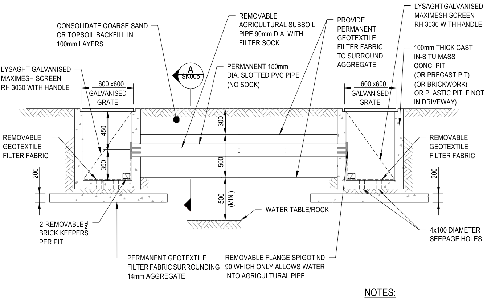

> [Picture on page 63: a map, saved as a picture (images/stormwater-management-page-63-2.gif, 150 dpi); the street names and other small labels are on the picture.]
> Labels printed on the map (copied from the PDF, in no particular order):
> MAXIMESH SCREEN · RH 3030 WITH HANDLE · REMOVABLE · AGRICULTURAL SUBSOIL · PIPE 90mm DIA. WITH · FILTER SOCK · CONSOLIDATE COARSE SAND · OR TOPSOIL BACKFILL IN · 100mm LAYERS · PROVIDE · PERMANENT · GEOTEXTILE · FILTER FABRIC · TO SURROUND · AGGREGATE · 100mm THICK CAST · IN-SITU MASS · CONC. PIT · (OR PRECAST PIT) · PERMANENT 150mm · DIA. SLOTTED PVC PIPE · SK005 · LYSAGHT GALVANISED · MAXIMESH SCREEN · 600 x600 · GALVANISED · (NO SOCK) · 600 x600 · GALVANISED · GRATE · (OR BRICKWORK) · OR PLASTIC PIT IF NOT · IN DRIVEWAY) · RH 3030 WITH HANDLE · GRATE · REMOVABLE · GEOTEXTILE · FILTER FABRIC · 350 · 450 · 200 · 200 · 500 · (MIN.) · 500 · 300 · REMOVABLE · GEOTEXTILE · FILTER FABRIC · 2 · 2 REMOVABLE 1 · BRICK KEEPERS · PER PIT · WATER TABLE/ROCK

#### A

A

REV

#### MAINTAINABLE TRENCH TYPE

#### ABSORPTION PIT

4x100 DIAMETER

SEEPAGE HOLES

DESCRIPTION

ISSUE FOR DCP 2020

REMOVABLE FLANGE SPIGOT ND

90 WHICH ONLY ALLOWS WATER

INTO AGRICULTURAL PIPE

PERMANENT GEOTEXTILE

FILTER FABRIC SURROUNDING

14mm AGGREGATE

#### NOTES:

NTS

SCALE

APP'D

K ELAZAR

### MAINTAINABLE TRENCH TYPE ABSORPTION PIT

1\. ALL DIMENSIONS ARE SHOWN

IN mm UNLESS SPECIFIED

OTHERWISE IN THE DIAGRAM.

2\. THIS DRAWING MUIST BE

READ IN CONJUNCTION WITH

SK005.

NTS

DATE DWG NO.

22/09/2020

14mm OR 20mm DIA. AGGREGATE

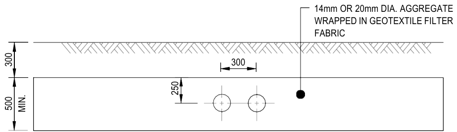

> [Picture on page 64: a picture, saved as a picture (images/stormwater-management-page-64-2.gif, 150 dpi).]
> Words printed on the picture (copied from the PDF):
> WRAPPED IN GEOTEXTILE FILTER
> FABRIC
> 250
> MIN.
> 300

500

300

3500 (MAX.)

### A SECTION

SK004 NTS

#### NOTES:

1\. 10m MAXIMUM BETWEEN PITS.

2\. FOR WIDTHS GREATER THAN 3.5m USE ADDITIONAL SUBSOIL DRAINS AND PITS.

3\. WHERE THIS STYLE OF PIT IS TO BE USED IN DRIVEWAYS, OR SUBJECT TO LOADING, THE ENGINEER IS TO CERTIFY

THAT DESIGN IS SUITABLE FOR THIS PURPOSE.

4\. PLASTIC PITS MAY ONLY BE USED IN LANDSCAPED AREAS.

5\. FOR INFLOWS GREATER THAN 15 l/sec IN EACH PIT, ADDITIONAL SUBSOIL DRAINS ARE TO BE PROVIDED.

6\. ALL DIMENSIONS ARE SHOWN IN mm UNLESS SPECIFIED OTHERWISE IN THE DIAGRAM.

7\. THIS DRAWING MUST BE READ IN CONJUNCTION WITH SK004.

#### MAINTAINABLE TRENCH TYPE ABSORPTION

DWG NO.

| A | ISSUE FOR DCP 2020 | NTS | K ELAZAR | 22/09/2020 |
|---|---|---|---|---|
| REV | DESCRIPTION | SCALE | APP'D | DATE |

#### PIT - SECTION A

GRATES (NOT CONCRETE LID(S))

#### A

SK007

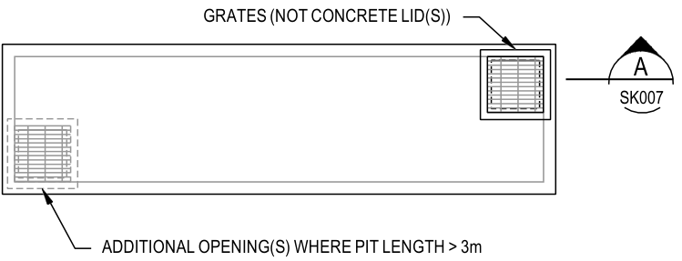

> [Picture on page 65: a picture, saved as a picture (images/stormwater-management-page-65-4.gif, 150 dpi).]

ADDITIONAL OPENING(S) WHERE PIT LENGTH > 3m

#### PLAN

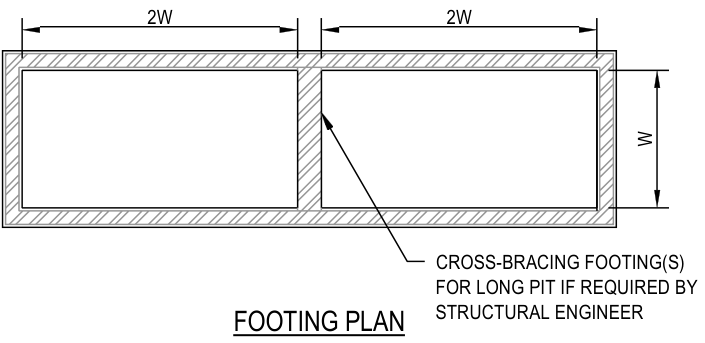

> [Picture on page 65: a picture, saved as a picture (images/stormwater-management-page-65-7.gif, 150 dpi).]
> Words printed on the picture (copied from the PDF):
> W

2W

2W

CROSS-BRACING FOOTING(S)

FOR LONG PIT IF REQUIRED BY

STRUCTURAL ENGINEER

#### FOOTING PLAN

#### NOTES:

1\. THIS PIT TYPE SUITABLE FOR LARGE SITES OR SMALLER SITES WITH MEDIUM TO POOR ABSORPTION RATES.

2\. STRUCTURAL DETAILS TO BE SUPPLIED WITH CC.

3\. LOCATE INLET PIPES WHERE POSSIBLE ADJACENT TO INSPECTION OPENINGS.

4\. INSTEAD OF BONDEK MAY USE COMPRESSED FRC SHEETING WITH TEMPORARY PROPS.

5\. ALL GRATES MUST BE 600x900. ALL GRATES TO BE FITTED WITTH CHILDPROOF 'J-LOCKS'.

6\. FOR DEPTHS GREATER THAN 1200mm PROVIDE STEP IRONS.

7\. BASE OF ABSORPTION TANK MUST BE LEVEL.

8\. ALL DIMENSIONS ARE SHOWN IN mm UNLESS SPECIFIED OTHERWISE IN THE DIAGRAM.

### COVERED TANK TYPE

### ABSORPTION PIT

NTS

#### COVERED TANK TYPE ABSORPTION PIT

DWG NO.

| A | ISSUE FOR DCP 2020 | NTS | K ELAZAR | 22/09/2020 |
|---|---|---|---|---|
| REV | DESCRIPTION | SCALE | APP'D | DATE |

TOP SLAB MAY FORM PART OF

A

REV

DESCRIPTION

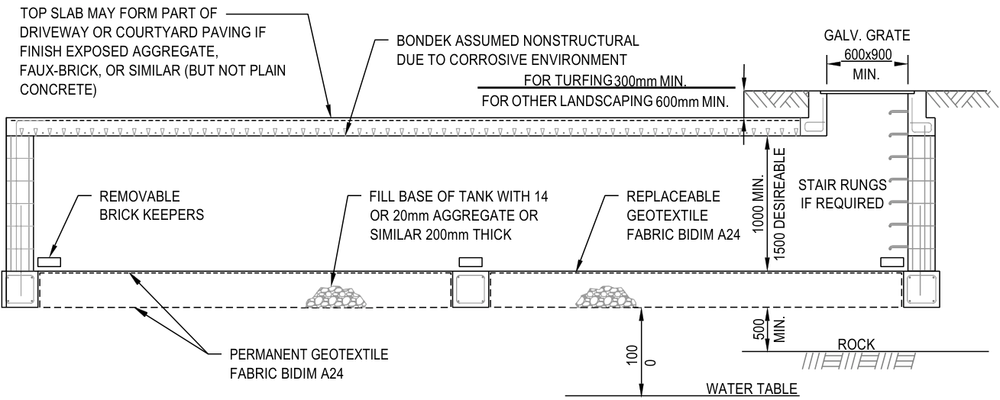

> [Picture on page 66: a map, saved as a picture (images/stormwater-management-page-66-5.gif, 150 dpi); the street names and other small labels are on the picture.]
> Labels printed on the map (copied from the PDF, in no particular order):
> GALV. GRATE · 600x900 · BONDEK ASSUMED NONSTRUCTURAL · DUE TO CORROSIVE ENVIRONMENT · MIN. · DRIVEWAY OR COURTYARD PAVING IF · FINISH EXPOSED AGGREGATE, · FAUX-BRICK, OR SIMILAR (BUT NOT PLAIN · CONCRETE) · FOR TURFING 300mm MIN. · FOR OTHER LANDSCAPING 600mm MIN. · STAIR RUNGS · IF REQUIRED · REMOVABLE · BRICK KEEPERS · FILL BASE OF TANK WITH 14 · OR 20mm AGGREGATE OR · SIMILAR 200mm THICK · REPLACEABLE · GEOTEXTILE · FABRIC BIDIM A24 · 1000 MIN. · 1500 DESIREABLE · 500 · MIN. · 100 · 0 · ROCK · PERMANENT GEOTEXTILE · FABRIC BIDIM A24 · WATER TABLE

#### NOTES:

ISSUE FOR DCP 2020

#### COVERED TANK TYPE ABSORPTION PIT

#### - SECTION A

NTS

SCALE

### A

SK006 NTS

APP'D

K ELAZAR

1\. ALL DIMENSIONS ARE SHOWN IN mm UNLESS

SPECIFIED OTHERWISE IN THE DIAGRAM.

2\. STRUCTURAL ENGINEER TO PREPARE DETAIL

FOR THE TANK WALL, TOP SLAB AND FOOTINGS

ETC. TANK TO BE CAST IN SITU AND DESIGNED

STRUCTURALLY TO WITHSTAND LOADS AS

APPROPRIATE DEPENDING ON LOCATION

3\. THIS DRAWING MUST BE READ IN CONJUNCTION

WITH SK007

DATE DWG NO.

22/09/2020

GRATE (NOT CONCRETE LID) NOT DIRECTLY OVER

#### A

SK009

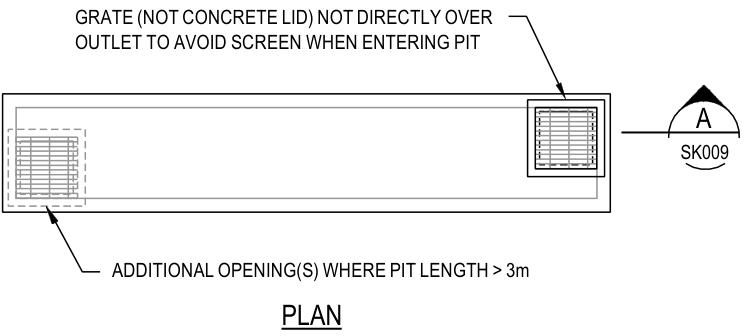

> [Picture on page 67: a picture, saved as a picture (images/stormwater-management-page-67-4.gif, 150 dpi).]
> Words printed on the picture (copied from the PDF):
> OUTLET TO AVOID SCREEN WHEN ENTERING PIT

ADDITIONAL OPENING(S) WHERE PIT LENGTH > 3m

#### PLAN

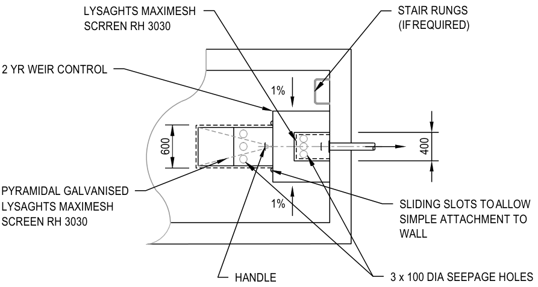

> [Picture on page 67: a picture, saved as a picture (images/stormwater-management-page-67-7.gif, 150 dpi).]
> Words printed on the picture (copied from the PDF):
> SCRREN RH 3030
> 400
> 600
> 1%
> 1%
> WALL

LYSAGHTS MAXIMESH

STAIR RUNGS

(IF REQUIRED)

2 YR WEIR CONTROL

PYRAMIDAL GALVANISED

LYSAGHTS MAXIMESH

SCREEN RH 3030

3 x 100 DIA SEEPAGE HOLES

HANDLE

### B SECTION

SLIDING SLOTS TO ALLOW

SIMPLE ATTACHMENT TO

SK009 NTS

#### NOTES:

1\. STRUCTURAL DETAILS TO BE SUPPLIED WITH CC.

2\. LOCATE INLET PIPES WHERE POSSIBLE ADJACENT TO INSPECTION OPENINGS.

3\. INSTEAD OF BONDEX MAY USE COMPRESSED FRC SHEETING WITH TEMPORARY PROPS

4\. ALL GRATES MUST BE 900mmx600mm AND FITTED WITH CHILDPROOF 'J-LOCKS'.

5\. FOR DEPTHS GREATER THANK 1200mm PROVIDE STEP IRONS.

6\. ALL DIMENSIONS ARE IN mm UNLESS SPECIFIED OTHERWISE IN THE DIAGRAM.

7\. SEEPAGE HOLES ARE ONLY APPROPRIATE WHEN OSD IS LOCATED DIRECTLY ABOVE DEEP SOIL (UNLIMITED IN

DEPTH).

8\. THIS DRAWING MUST BE READ IN CONJUNCTION WITH SK009.

### COVERED TANK TYPE

### DETENTION PIT

NTS

#### COVERED TANK TYPE DETENTION PIT

DWG NO.

| A | ISSUE FOR DCP 2020 | NTS | K ELAZAR | 22/09/2020 |
|---|---|---|---|---|
| REV | DESCRIPTION | SCALE | APP'D | DATE |

TOP SLAB MAY FORM PART OF

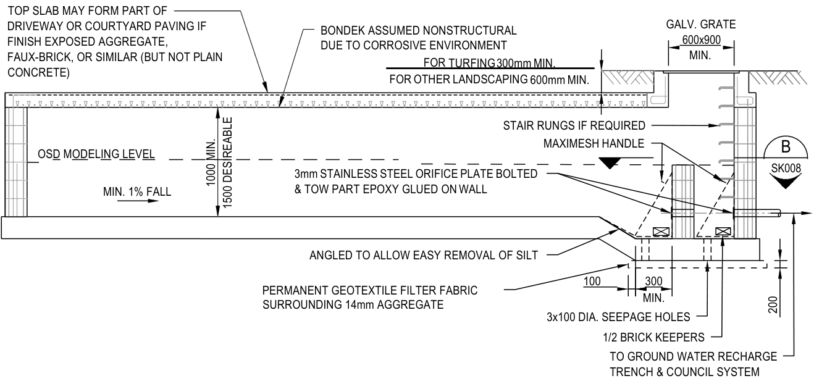

> [Picture on page 68: a map, saved as a picture (images/stormwater-management-page-68-2.gif, 150 dpi); the street names and other small labels are on the picture.]
> Labels printed on the map (copied from the PDF, in no particular order):
> GALV. GRATE · 600x900 · BONDEK ASSUMED NONSTRUCTURAL · DUE TO CORROSIVE ENVIRONMENT · MIN. · DRIVEWAY OR COURTYARD PAVING IF · FINISH EXPOSED AGGREGATE, · FAUX-BRICK, OR SIMILAR (BUT NOT PLAIN · CONCRETE) · FOR TURFING 300mm MIN. · FOR OTHER LANDSCAPING 600mm MIN. · STAIR RUNGS IF REQUIRED · MAXIMESH HANDLE · OSD MODELING LEVEL · SK008 · 3mm STAINLESS STEEL ORIFICE PLATE BOLTED · & TOW PART EPOXY GLUED ON WALL · MIN. 1% FALL · 1000 MIN. · 1500 DESIREABLE · ANGLED TO ALLOW EASY REMOVAL OF SILT · 100 300 · MIN. · PERMANENT GEOTEXTILE FILTER FABRIC · SURROUNDING 14mm AGGREGATE · 200 · 3x100 DIA. SEEPAGE HOLES · 1/2 BRICK KEEPERS

#### B

A

REV

DESCRIPTION

ISSUE FOR DCP 2020

#### COVERED TANK TYPE DETENTION PIT

#### - SECTION A

#### NOTES:

NTS

SCALE

### A

TO GROUND WATER RECHARGE

TRENCH & COUNCIL SYSTEM

SK009 NTS

APP'D

K ELAZAR

DATE DWG NO.

22/09/2020

1\. ALL DIMENSIONS ARE SHOWN IN mm UNLESS SPECIFIED

OTHERWISE IN THE DIAGRAM.

2\. STRUCTURAL ENGINEER TO PREPARE DETAIL FOR THE

TANK WALL, BASE, TOP SLAB AND FOOTINGS ETC. TANK

TO BE CAST IN SITU AND DESIGNED STRUCTURALLY TO

WITHSTAND LOADS AS APPROPRIATE DEPENDING ON

LOCATION.

3\. THIS DRAWING MUST BE READ IN CONJUNCTION WITH

SK008.

CONSOLIDATE

SAND BACKFILL

WITH WATER IN

100mm LAYERS

100mm CAST IN SITU MASS

CONCRETE OR 110mm

BRICKWORK OR PRECAST /

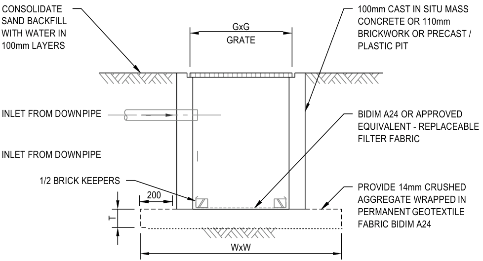

> [Picture on page 69: a picture, saved as a picture (images/stormwater-management-page-69-8.gif, 150 dpi).]
> Words printed on the picture (copied from the PDF):
> GxG
> GRATE
> 200
> T
> WxW

PLASTIC PIT

INLET FROM DOWN PIPE

BIDIM A24 OR APPROVED

EQUIVALENT - REPLACEABLE

FILTER FABRIC

INLET FROM DOWN PIPE

1/2 BRICK KEEPERS

PROVIDE 14mm CRUSHED

AGGREGATE WRAPPED IN

PERMANENT GEOTEXTILE

FABRIC BIDIM A24

#### NOTES:

1\. SUITABLE FOR SMALL AREAS, COURTYARDS, ETC. IN HIGHLY PERMEABLE SOILS OR IN CONJUNCTION WITH ABOVE

GROUND DETENTION.

2\. PLASTIC PIT MUST NOT BE USED IN DRIVEWAY OR PARKING AREAS.

FOR W LESS THAN 3000, G = 600mm AND T = 200mm

FOR W GREATER THAN 3000 AND LESS THAN 3600 (MAX.), G = 1200mm AND T = 200mm

3\. IT IS POSSIBLE TO COMBINE A SERIES OF SINGLE ABSORPTION PITS INTO A LARGER ABSORPTION SYSTEM LINKED

WITH CONNECTING PIPES.

4\. ALL DIMENSIONS ARE SHOWN IN mm UNLESS SPECIFIED OTHERWISE IN THE DIAGRAM.

### OPEN SINGLE ABSORPTION PIT

NTS

#### OPEN SINGLE ABSORPTION PIT

DWG NO.

A ISSUE FOR DCP 2020 NTS K ELAZAR 22/09/2020 REV DESCRIPTION SCALE APP'D DATE

PIT WALL

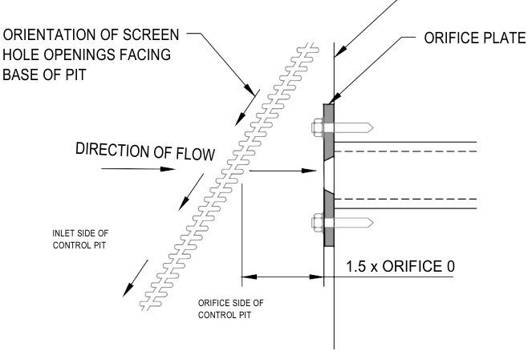

> [Picture on page 70: a picture, saved as a picture (images/stormwater-management-page-70-2.gif, 150 dpi).]
> Words printed on the picture (copied from the PDF):
> 1.5 x ORIFICE 0
> ORIFICE SIDE OF
> CONTROL PIT

ORIFICE PLATE

ORIENTATION OF SCREEN

HOLE OPENINGS FACING

BASE OF PIT

INLET SIDE OF CONTROL PIT

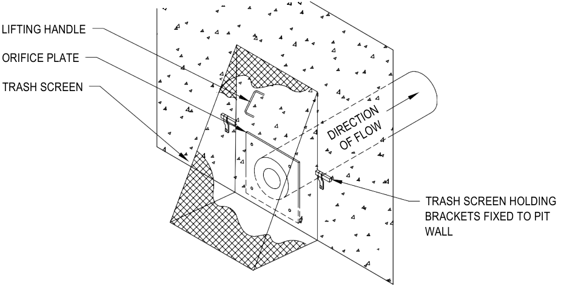

> [Picture on page 70: a picture, saved as a picture (images/stormwater-management-page-70-9.gif, 150 dpi).]

LIFTING HANDLE

ORIFICE PLATE

TRASH SCREEN

TRASH SCREEN HOLDING

BRACKETS FIXED TO PIT

WALL

#### NOTE:

1\. ALL DIMENSIONS ARE SHOWN IN mm UNLESS SPECIFIED

OTHERWISE IN THE DIAGRAM.

### ORIFICE PLATE & TRASH SCREEN

NTS

#### ORIFICE PLATE & TRASH SCREEN

DWG NO.

A ISSUE FOR DCP 2020 NTS K ELAZAR 22/09/2020 REV DESCRIPTION SCALE APP'D DATE

TOP OF BUND WALL

EMERGENCY

OVERFLOW WEIR

OSD MODELING T.W.L.

W x W

OSD MODELING T.W.L.

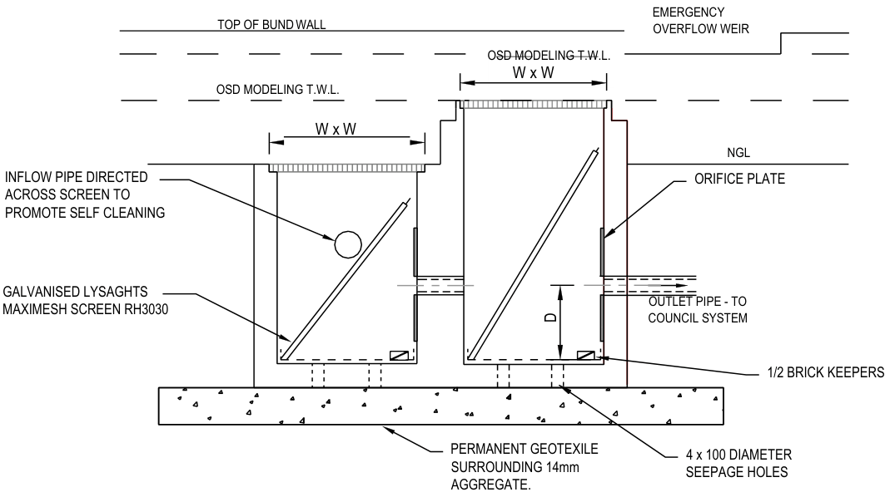

> [Picture on page 71: a picture, saved as a picture (images/stormwater-management-page-71-7.gif, 150 dpi).]
> Words printed on the picture (copied from the PDF):
> W x W
> NGL
> ORIFICE PLATE
> D
> OUTLET PIPE - TO
> COUNCIL SYSTEM
> 1/2 BRICK KEEPERS
> 4 x 100 DIAMETER
> PERMANENT GEOTEXILE

INFLOW PIPE DIRECTED

ACROSS SCREEN TO

PROMOTE SELF CLEANING

GALVANISED LYSAGHTS

MAXIMESH SCREEN RH3030

SEEPAGE HOLES

SURROUNDING 14mm

AGGREGATE.

### EXAMPLE CONFIGURATION OF

### AN OSD DISCHARGE CONTROL PIT

NTS

#### NOTES:

1\. PIT TYPE FOR USE IN ABOVE GROUND SYSTEM

2\. FOR LANSCAPED/TURFED AREAS PROVIDE 20% EXTRA STORGAE

3\. CONTOL PITS TO BE CONSTRUCTED OF CONCRTET (PRECAST OR CAST-INSITU)

4\. ALL DIMENSIONS ARE SHOWN IN mm UNLESS SPECIFIED OTHERWISE IN THE DIAGRAM.

5\. H TO BE A MINIMUM OF 1% AEP DEPTH OF OVERFLOW OVER WEIR.

6\. FOR VARIABLES W & D REFER TO SK001.

#### EXAMPLE CONFIGURATION OF AN OSD

DWG NO.

#### DISCHARGE CONTROL PIT

A ISSUE FOR DCP 2020 NTS K ELAZAR 22/09/2020 REV DESCRIPTION SCALE APP'D DATE

SEALED INSPECTION CAP

100mm DIA SEEPAGE HOLE AT

1m CENTRES

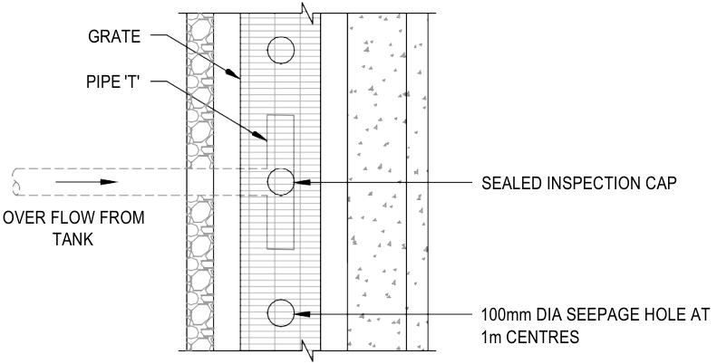

> [Picture on page 72: a picture, saved as a picture (images/stormwater-management-page-72-4.gif, 150 dpi).]
> Words printed on the picture (copied from the PDF):
> GRATE
> PIPE 'T'
> OVER FLOW FROM
> TANK

#### PLAN VIEW

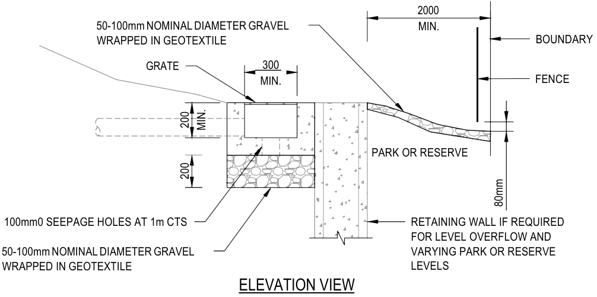

> [Picture on page 72: a map, saved as a picture (images/stormwater-management-page-72-6.gif, 150 dpi); the street names and other small labels are on the picture.]
> Labels printed on the map (copied from the PDF, in no particular order):
> 2000 · MIN. · 50-100mm NOMINAL DIAMETER GRAVEL · WRAPPED IN GEOTEXTILE · GRATE · 300 · MIN. · 200 · 200 · MIN. · 80mm · PARK OR RESERVE · 100mm0 SEEPAGE HOLES AT 1m CTS · RETAINING WALL IF REQUIRED · FOR LEVEL OVERFLOW AND

BOUNDARY

FENCE

VARYING PARK OR RESERVE

LEVELS

50-100mm NOMINAL DIAMETER GRAVEL

WRAPPED IN GEOTEXTILE

#### ELEVATION VIEW

### TYPICAL TROUGH

NTS

#### NOTE:

1\. ALL DIMENSIONS ARE SHOWN IN mm UNLESS

SPECIFIED OTHERWISE IN THE DIAGRAM.

#### TYPICAL TROUGH

DWG NO.

A ISSUE FOR DCP 2020 NTS K ELAZAR 22/09/2020 REV DESCRIPTION SCALE APP'D DATE

WHITE BACKGROUND BLACK BORDER 10mm WIDE

RED BORDER 20mm WIDE

LIGHT BLUE BACKGROUND

"RAIN" DARK BLUE

BLACK FIGURE

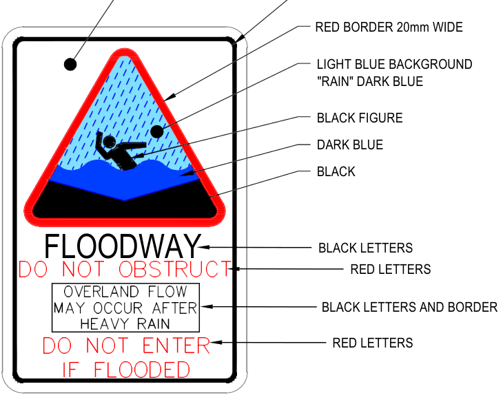

> [Picture on page 73: a picture, saved as a picture (images/stormwater-management-page-73-6.gif, 150 dpi).]
> Words printed on the picture (copied from the PDF):
> BLACK

DARK BLUE

BLACK LETTERS

### FLOODWAY

RED LETTERS

BLACK LETTERS AND BORDER

RED LETTERS

SIZE:   A, 300mm x 450mm

### FLOOD ADVISORY SIGN

NTS

B, 450mm x 600mm

C, 600mm x 900mm

#### NOTES:

1\. SIGN BLANKS SHALL BE 1.6mm THICK ALUMINIUM STEEL ALLOY OF TYPE 5251 OR TYPE 5052 AND TEMPER H38 OR

TEMPER H36 IN ACCORDANCE WITH AS 1734.

2\. SIGN BLANKS SHALL BE FREE OF CRACKS, TEARS AND OTHER SURFACE BLEMISHES AND THE EDGES SHALL BE TRUE

AND SMOOTH. THE DIMENSIONS OF THE SIGN BLANK SHALL BE WITHIN PLUS OR MINUS 1.5mm OF THE DIMENSIONS

SPECIFIED AND THE FINISHED SIGN SHALL BE FLAT WITHIN A MAXIMUM ALLOWABLE BOW OF 0.5 PERCENT OF MAXIMUM

DIMENSIONS OF THE CHEMICALLY CLEANED AND ETCHED OR MECHANICALLY ABRADED.

3\. THE FACE OF EACH SIGN BLANK SHALL BE CHEMICALLY CLEANED AND ETCHED OR MECHANICALLY ABRADED.

4\. THE BACK OF EACH SIGN SHALL BE UNCOATED AND THE SURFACE FINISH SHALL BE RENDERED DULL AND

NON-REFLECTIVE EITHER BY MECHANICAL OR CHEMICAL MEANS AND SHALL BE FREE OF SCRATCHES AND BLEMISHES.

5\. BACKGROUND PAINT SHALL BE AN APPROVED LONG-LIFE INDUSTRIAL QUALITY, TWO COMPOUND POLYURETHANE PAINT.

LEGEND SCREENING INK SHALL BE A HIGH QUALITY DURABLE, FULL GLOSS, NON-FADE, NON-BLEED AND SCRATCH

RESISTANT TYPE OF INK COMPATIBLE WITH THE MATERIAL TO WHICH IT IS APPLIED.

6\. FOR ASSEMBLY AND ERECTION OF SIGNS REFER AUS-SPEC ANS AS1742 ( ALL PARTS), AS1743 AND AS1744.

7\. ALL DIMENSIONS ARE SHOWN IN mm UNLESS SPECIFIED OTHERWISE IN THE DIAGRAM.

#### FLOOD ADVISORY SIGN

DWG NO.

A ISSUE FOR DCP 2020 NTS K ELAZAR 22/09/2020 REV DESCRIPTION SCALE APP'D DATE

'SEE NOTE 6' FOR FRAME HEIGHT

90x50 TOP (90x30 BOTTOM) COLORBOND

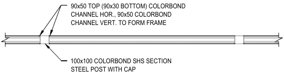

> [Picture on page 74: a picture, saved as a picture (images/stormwater-management-page-74-4.gif, 150 dpi).]
> Words printed on the picture (copied from the PDF):
> CHANNEL HOR., 90x50 COLORBOND
> CHANNEL VERT. TO FORM FRAME

100x100 COLORBOND SHS SECTION STEEL POST WITH CAP

#### PLAN

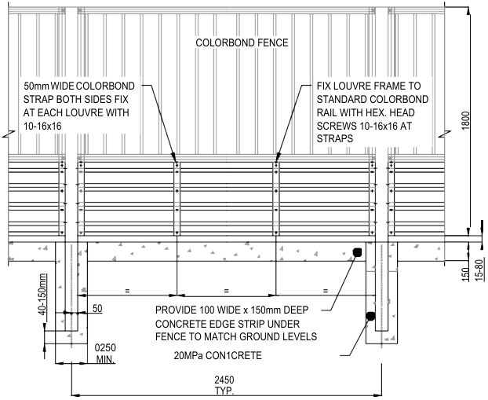

> [Picture on page 74: a map, saved as a picture (images/stormwater-management-page-74-8.gif, 150 dpi); the street names and other small labels are on the picture.]
> Labels printed on the map (copied from the PDF, in no particular order):
> COLORBOND FENCE · 50mm WIDE COLORBOND · STRAP BOTH SIDES FIX · AT EACH LOUVRE WITH · 10-16x16 · FIX LOUVRE FRAME TO · STANDARD COLORBOND · RAIL WITH HEX. HEAD · SCREWS 10-16x16 AT · STRAPS · 150 · 15-80 · 1800 · = · = · = · 40-150mm · 50 PROVIDE 100 WIDE x 150mm DEEP · CONCRETE EDGE STRIP UNDER · FENCE TO MATCH GROUND LEVELS · 20MPa CON1CRETE · 0250 · MIN. · 2450 · TYP.

FOOTING DEPTH 800mm UNDISTURBED MATERIAL / EARTH, 1000mm SAND & LOOSE EARTH

0250

MIN.

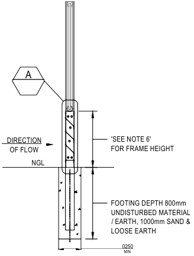

> [Picture on page 74: a picture, saved as a picture (images/stormwater-management-page-74-15.gif, 150 dpi).]
> Words printed on the picture (copied from the PDF):
> A
> DIRECTION
> OF FLOW
> NGL

#### SECTION

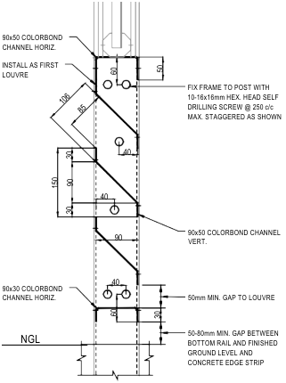

> [Picture on page 74: a map, saved as a picture (images/stormwater-management-page-74-17.gif, 150 dpi); the street names and other small labels are on the picture.]
> Labels printed on the map (copied from the PDF, in no particular order):
> 90x50 COLORBOND · CHANNEL HORIZ. · INSTALL AS FIRST · LOUVRE · 40 · 150 · 40 · 90 · 30 · 30 · 90 · 40 · 90x30 COLORBOND · CHANNEL HORIZ. · 60 · 60 · 30 · 50 · NGL

FIX FRAME TO POST WITH 10-16x16mm HEX. HEAD SELF DRILLING SCREW @ 250 c/c MAX. STAGGERED AS SHOWN

90x50 COLORBOND CHANNEL VERT.

50mm MIN. GAP TO LOUVRE

#### A

#### ELEVATION

#### DETAIL

50-80mm MIN. GAP BETWEEN BOTTOM RAIL AND FINISHED GROUND LEVEL AND CONCRETE EDGE STRIP

#### NOTES

1\. ALL SHARP EDGES AND CORNERS TO BE REMOVED.

2\. USE LYSAGHT INTEGRITY 820 COLORBOND STEEL WITH BMT (BASE METAL THICKNESS)

0.48mm TO FORM LOUVRES AND FRAME.

3\. SELF DRILLING & SELF TAPPING SCREWS WITH HEX. WASHER HEAD TO CONFORM TO

AS3566 CLASS 3.

4\. FIX SCREWS MINIMUM OF 25mm FROM EDGES.

5\. ALL LOOSE MATERIAL AROUND FOOTINGS IS TO BE RAMMED AND COMPACTED.

6\. FRAME HEIGHT = 130+(N x 150)mm WHERE N = NUMBER OF LOUVRES AND FRAME HEIGHT

MUST BE GREATER THAN OPENING HEIGHT APPROVED BY COUNCIL.

7\. ALL DIMENSIONS ARE SHOWN IN mm UNLESS SPECIFIED OTHERWISE IN THE DIAGRAM.

#### LOUVRE FLOODWAY FENCE

DWG NO.

#### INSERT: TYPE A

A ISSUE FOR DCP 2020 NTS K ELAZAR 22/09/2020 REV DESCRIPTION SCALE APP'D DATE

90x50 TOP (90x30 BOTTOM) COLORBOND

'SEE NOTE 6'

FOR FRAME HEIGHT

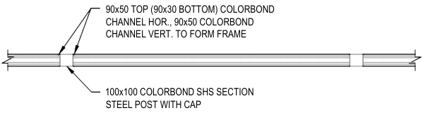

> [Picture on page 75: a picture, saved as a picture (images/stormwater-management-page-75-4.gif, 150 dpi).]
> Words printed on the picture (copied from the PDF):
> CHANNEL HOR., 90x50 COLORBOND
> CHANNEL VERT. TO FORM FRAME

100x100 COLORBOND SHS SECTION

STEEL POST WITH CAP

NGL

#### PLAN

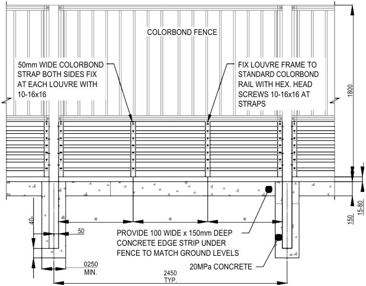

> [Picture on page 75: a map, saved as a picture (images/stormwater-management-page-75-9.gif, 150 dpi); the street names and other small labels are on the picture.]
> Labels printed on the map (copied from the PDF, in no particular order):
> COLORBOND FENCE · 50mm WIDE COLORBOND · STRAP BOTH SIDES FIX · AT EACH LOUVRE WITH · 10-16x16 · FIX LOUVRE FRAME TO · STANDARD COLORBOND · RAIL WITH HEX. HEAD · SCREWS 10-16x16 AT · STRAPS · = · = · = · 40- · 150 · 15-80 · 1800 · PROVIDE 100 WIDE x 150mm DEEP · CONCRETE EDGE STRIP UNDER · FENCE TO MATCH GROUND LEVELS · 50 · 0250 · MIN. · 20MPa CONCRETE · 2450 · TYP.

FOOTING DEPTH 800mm UNDISTURBED MATERIAL / EARTH, 1000mm SAND & LOOSE EARTH 0250

MIN.

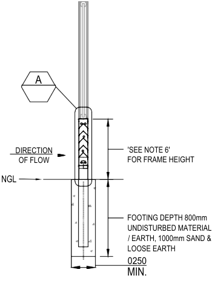

> [Picture on page 75: a picture, saved as a picture (images/stormwater-management-page-75-16.gif, 150 dpi).]
> Words printed on the picture (copied from the PDF):
> A
> DIRECTION
> OF FLOW

#### SECTION

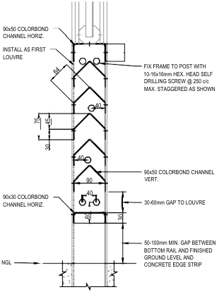

> [Picture on page 75: a map, saved as a picture (images/stormwater-management-page-75-18.gif, 150 dpi); the street names and other small labels are on the picture.]
> Labels printed on the map (copied from the PDF, in no particular order):
> 90x50 COLORBOND · CHANNEL HORIZ. · INSTALL AS FIRST · 75 · 45 · 30 · 40 · 40 · 90 · 40 · 90x30 COLORBOND · CHANNEL HORIZ. · 60 30

LOUVRE

FIX FRAME TO POST WITH 10-16x16mm HEX. HEAD SELF DRILLING SCREW @ 250 c/c MAX. STAGGERED AS SHOWN

90x50 COLORBOND CHANNEL VERT.

30-60mm GAP TO LOUVRE

NGL

#### ELEVATION

#### A

#### DETAIL

50-100mm MIN. GAP BETWEEN BOTTOM RAIL AND FINISHED GROUND LEVEL AND CONCRETE EDGE STRIP

### NOTES:

1\. ALL SHARP EDGES AND CORNERS TO BE REMOVED.

2\. USE LYSAGHT INTEGRITY 820 COLORBOND STEEL WITH BMT (BASE METAL THICKNESS)

0.48mm TO FORM LOUVRES AND FRAME.

3\. SELF DRILLING & SELF TAPPING SCREWS WITH HEX. WASHER HEAD TO CONFORM TO

AS3566 CLASS 3.

4\. FIX SCREWS MINIMUM OF 25mm FROM EDGES.

5\. ALL LOOSE MATERIAL AROUND FOOTINGS IS TO BE RAMMED AND COMPACTED.

6\. TYPE B LOUVRE IS FOR USE WHERE HIGHER SECURITY IS REQUIRED.

7\. ALL DIMENSIONS ARE SHOWN IN mm UNLESS SPECIFIED OTHERWISE IN THE DIAGRAM.

DWG NO.

#### LOUVRE FLOODWAY FENCE

#### INSERT TYPE B

A ISSUE FOR DCP 2020 NTS K ELAZAR 22/09/2020 REV DESCRIPTION SCALE APP'D DATE
