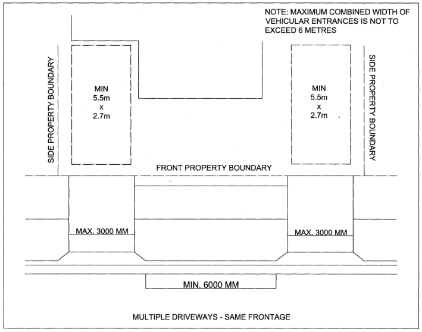
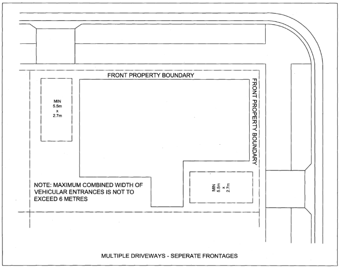
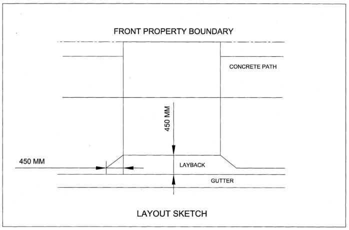

## 3 Design of Parking Facilities

Parking facilities, including all areas for parking vehicles as well as manoeuvring areas and access to parking areas, must be designed to be efficient, safe, and convenient.  Taking account of the characteristics a variety of vehicles described by the Australian Standards (AS2890), the following section describes the method of design of parking facilities.

### 3.1 Design of off-street car parking

The design of off-street car parking facilities shall be in accordance with the Australian Standard 2890.1, except where varied by this Technical Specification.  The variations contained in this Technical Specification are designed to ensure that the objectives of Section 4.6 of the DCP in relation to traffic, access and parking are achieved.

#### 3.1.1 Classification

Off-street car parking shall be classified in accordance with Australian Standard 2890.1.

#### 3.1.2 Parking modules

Off street car parking modules shall be designed in accordance with Australian Standard 2890.1. In public car parks, small car spaces shall not exceed 10% of the total public car parking allocation.  Small car spaces are not permitted in private car parks for employees, domestic property car parks or residential property car parks. Where nominated in a State Environmental Planning Policy, the design of the parking spaces shall also comply with that policy.

#### 3.1.3 Circulation roadways and ramps

Circulation roadways and ramps in car parking facilities shall be designed in accordance with Australian Standard 2890.1, except as follows:

a. Access driveway and circulation roadway widths less than 5.5m must satisfy the Australian Standard

2890.1 in relation traffic volumes, and in the case of a ramp a Traffic Management System will be required to be implemented in the development to establish a control for priority access on the ramp.  Priority should be provided to the vehicle entering the ramp from the nearest frontage roadway, and the system will require automated vehicle detection and signals. Priority should be provided to the vehicle entering the ramp from the nearest frontage roadway, and the system will require automated vehicle detection and signals system.

b. The maximum gradient of straight and curved ramps, in all types of car parks, shall be in accordance with AS/NZS 2890.1. The design of circulation roadways in Multi Dwelling Housing development should avoid straight sections of roadway by providing curved roadways and siting buildings with a staggered effect to create interest.  In larger Multi Dwelling Housing developments, the design of circulation roadways should consider the principles of road design as they relate to subdivision of land, and an appropriate road hierarchy should be established within the development.

#### 3.1.4 Domestic driveways

Domestic driveways shall be designed in accordance with Australian Standard 2890.1, except as follows:

a. The width of a domestic driveway crossing shall be a minimum of 2.7m wide and a maximum of 4.5m

wide. The minimum internal driveway width is to be 3.0m minimum, unless the driveway is a curved driveway.  Internal driveway widths less than 3.0m may be permitted provided that the minimum pavement width is not less than 2.4m and clearance is provided to obstructions, as for a circulation roadway or ramp section in Australian Standard 2890.1.

b. Where high obstructions are present either side of a driveway leading to a parking space/garage, the minimum width is 3.6m.

c. The gradients of a domestic driveway between the frontage roadway and the property boundary, and over a footpath, shall be as determined by Council upon submission of a Vehicular Entrance / Driveway Application.

d. The maximum gradient of a domestic driveway shall be 1 in 4 (25%). Where a steep driveway is proposed, all vehicles shall be able to enter and exit the parking space(s) in a forward direction via the use of a turning bay or mechanical turntable. This is required because the steep driveway reduces pedestrian sightlines for reversing vehicles which creates a safety issue. In these instances, below ground garages will typically need to be enlarged to accommodate the turning movements.

#### 3.1.5 Access driveway width, location, and layout

An access driveway is the roadway/driveway extending from the edge of the frontage roadway (typically defined by kerb and gutter) to the property boundary.  An access driveway may also be referred to as a footpath crossing or vehicular entrance.  A layback or gutter crossing is used in conjunction with an access driveway to allow vehicles to cross the gutter whilst maintaining the drainage function of the frontage roadway. The following design principles are to be considered when planning for vehicular access points:

• Minimise the loss of on-street parking

• Minimise risk of vehicles queueing on a public road reserve Access driveways shall be designed in accordance with Australian Standard 2890.1, except as follows:

a. Access driveway width shall be in accordance with the following:

(i) Single unit dwellings (including secondary dwelling developments) For a property with a single road frontage, vehicle access may be provided by:

• A single access driveway of maximum width 4.5m at the boundary, or

• Two access driveways of maximum width 3m each at the boundary and separated by a minimum of 6m along the kerb (Figure 1).

• In all cases the minimum access driveway width is 2.7m.

> [Picture on page 8: a picture, saved as a picture (images/traffic-parking-and-access-page-8-25.gif, 150 dpi).]

Figure 1

For a property with dual road frontage at the corner of two roads, vehicle access may be provided as for a property with a single road frontage and the additional option as follows:

• Two individual access driveways of maximum width 3m each at the boundary and separated by a minimum of 6m along the kerb, with preferably one driveway on each frontage (Figure 2).

> [Picture on page 9: a picture, saved as a picture (images/traffic-parking-and-access-page-9-3.gif, 150 dpi).]

Figure 2

For a property with dual road frontage, where one frontage is a road and one frontage is a narrow street, vehicle access may be provided as for a property with a single road frontage and the additional options as follows:

• Two individual access driveways of maximum width 3m each at the boundary, where one access driveways is from the road and one access driveway is from the narrow street, or

• A single access driveway of maximum width 6m at the boundary where the access is from the narrow street only.

(ii) Dual Occupancies and Semi-Detached Development For a property with a single road frontage, vehicle access may be provided by:

• A combined single access driveway of maximum width 5.0m at the boundary, or

• Two individual access driveways of maximum width 3m each at the boundary and separated by a minimum of 6m along the kerb.

• In all cases the minimum access driveway width is 2.7m.

• Council may consider individual access driveways of minimum 2.7m in width and separated by at least 5.4m along the kerb/boundary for smaller constrained sites (existing lot width less than 14m) in order to preserve on-street parking. For a property with dual road frontage at the corner of two roads, vehicle access may be provided as for a property with a single road frontage and the additional option as follows:

• Two individual access driveways of maximum width 3m each at the boundary and separated by a minimum of 6m along the kerb, with preferably one driveway on each frontage. For a property with dual road frontage, where one frontage is a road and one frontage is a narrow street, vehicle access may be provided as for a property with a single road frontage and the additional option as follows:

• Two individual access driveways per dwelling of maximum width 3m each at the boundary, where one access driveway is from the road and one access driveway is from the narrow street, or

• A single access driveway per dwelling of maximum width 6m at the boundary where the access is from the narrow street only.

(iii) Multi Dwelling Housing Development For a property with a single road frontage, vehicle access may be provided by:

• A single access driveway of maximum width 3.5m at the boundary, or

• Two individual access driveways of maximum width 3m each at the boundary and separated by a minimum of 6m along the kerb.

• In all cases the minimum access driveway width is 3.0m.

• Larger access driveway widths, in accordance with the Australian Standard 2890.1, may be permitted for developments that have driveway movements in excess of 30 vehicle trips per hour in the peak hour, or a connecting roadway in excess of 30m, or restrictions to sight distance. For a property with dual road frontage at the corner of two roads, vehicle access may be provided as for a property with a single road frontage and the additional option as follows:

• Two individual access driveways of maximum width 3m each at the boundary and separated by a minimum of 6m along the kerb, being a maximum of one driveway per road frontage. For a property with dual road frontage, where one frontage is a road and one frontage is a narrow street, access may be provided as for a property with a single frontage, but access is to be restricted to either the road frontage or the narrow street frontage only.

(iv) Residential Flat Buildings, Mixed Use Developments, Commercial Development, and Industrial Development Access may be provided by a single access driveway designed in accordance with AS2890.1 and AS2890.2. Multiple driveways are discouraged and should be amalgamated into one driveway. Service vehicle access is to be combined with parking access

(v) Child Care Centres For a property with a single road frontage, or a property with dual road frontage at the corner of two roads, access may be provided by:

• A single access driveway of maximum width 6.0m at the boundary, or

• Two individual access driveways of maximum width 3m each at the boundary and separated by a minimum of 6m along the kerb if on the same frontage, or one driveway per road frontage.

b. In addition to the access driveway location requirements of the DCP (i.e. restrictions on access to Classified Roads), access driveway location shall be in accordance with the Australian Standard 2890.1. Driveway access is not permitted within any area designated as a prohibited location, as identified in Australian Standard 2890.1.  When an application for development is lodged and the continuation of use of an access driveway that is located within a prohibited location is proposed, the request for re-use is subject to a determination by Council, and dependant upon the following:

(i) Whether access would be physically impossible if use of the driveway in the prohibited location was denied, or the driveway is a domestic driveway that is excluded from a prohibition by the Australian Standard;

(ii) The sight distances available for vehicles and pedestrians;

(iii) The volume of traffic using the driveway;

(iv) The off-site conditions of the road environment. Where Council considers that the request for re-use of the driveway in a prohibited location is not acceptable, the development must be designed in accordance with Australian Standard 2890.1.

c. Sight lines for pedestrians shall be in accordance with the following:

(i) For a domestic property driveway, a 0.9m x 0.9m triangle shall be provided with no obstruction greater than 1.0m above boundary level. Where a low-level driveway is proposed, a 0.9m x 0.9m triangle shall be provided with no obstruction above boundary level.

(ii) For all other developments other than domestic residential property, pedestrian sightlines shall comply with AS2890.1 and AS2890.2.

d. The layout of the access driveway should attempt to minimise the hard stand area whilst permitting a functional design.  The vehicular entrance layout shall be perpendicular to the line of the kerb and gutter. The layback component needs to function as part of the gutter for adequate drainage whilst permitting vehicles to pass across it. The access driveway layout may include 500mm splays on either side of the crossing, between the path and the layback.  The layback shall be 450mm wide with 450mm wings.  The typical access driveway layout is shown in Figure 3.

> [Picture on page 11: a picture, saved as a picture (images/traffic-parking-and-access-page-11-12.gif, 150 dpi).]

Figure 3 – Layout of an access driveway

e. The footpath or footway area between the front property boundary and the kerb contains assets owned by Council and other parties. At times, an access driveway may be proposed adjacent to an asset or in a conflicting location with an asset, thus requiring relocation or modification of such an asset.  However, Council may not allow relocation or modification of its assets, for example modification of extended kerb inlet lintels.  Other assets may be owned by other authorities or public utilities.  Access driveways shall be located with clearances to objects as follows:

(i) Trees:

• An access driveway shall not be located closer than 1.2m to a tree trunk or within the canopy drip line, whichever is greater.  For trees that are listed as Heritage Items the location of the driveway shall be determined by a Heritage Impact Statement.

• Applications that require the removal of an existing mature tree will need to be referred to Council.  Council’s Tree Preservation Officer will determine whether the tree can be removed or must be preserved.

• The layout of an access driveway adjacent to an existing tree may only be modified by removing the splay.  No further modification will be permitted.

• If approval is obtained for removal of the tree, the cost shall be borne by the applicant.  Payment will be required prior to commencement of work

(ii) Drainage structures:

• Where a proposed access driveway impacts a drainage structure, the matter will be referred to Council for determination.  All determinations are at Council’s discretion, and must consider the local drainage requirements.

• If approval is obtained for relocation or alteration to the drainage structure, the cost shall be borne by the applicant.  Payment will be required prior to commencement of work by Council.

• Certain types of drainage structures can not be modified, or can only be modified with significant difficulty or cost, and in such cases modification will not be permitted, for example extended kerb inlet lintels.

(iii) Traffic Facilities

• Where a proposed access driveway impacts a traffic stem and sign, the matter will be referred to Council for determination.  All determinations are at Council’s discretion and must consider the local traffic management requirements.

• If approval is obtained for relocation of the stem and sign, the cost shall be borne by the applicant.  Payment will be required prior to commencement of work by Council.

• Where a proposed access driveway conflicts with a traffic facility, other than a traffic stem or sign, the access driveway proposal will be required to be amended, since modification of the traffic facility is generally not permitted.

(iv) Redundant Access Driveways

• Where an application for an access driveway involves relocation of an existing access driveway, the existing access driveway shall be made redundant and converted to normal footpath area i.e. Removal of the layback and replacement with kerb and gutter, including removal of all concrete, and replacement of turf.

(v) External Authority and Utility Installations

• Utility pits, manholes, overhead cabling poles, etc, are assets that are owned and managed by external authorities.

• Where an application for an access driveway conflicts with a utility pit, manhole or overhead cabling pole, the asset must be relocated to a position outside of the access driveway.  The minimum clear distance is shall be 0.5m.

• In the case of pits and manholes only, Council may accept an official exemption from the relevant authority, or their authorised representative, stating that they do not object to their asset being located within the access driveway.  This exemption does not apply to overhead cabling poles, such as electricity and telecommunication poles.

#### 3.1.6 Gradients of access driveways

Maximum gradients on and near access driveways, other than domestic driveways, shall be in accordance with Australian Standard 2890.1, except as follows:

a. The gradients of an access driveway between the frontage roadway and the property boundary, and over a footpath, shall be as determined by Bayside Council upon submission of an application for Driveway works/frontage works.

#### 3.1.7 Queuing areas

The design of queuing areas shall be in accordance with Australian Standard 2890.1.

#### 3.1.8 Access to mechanical parking installations

Access to mechanical parking installations shall be in accordance with Australian Standard 2890.1.

#### 3.1.9 Use of mechanical parking installations

Mechanical parking installations include car stackers, car lifts, car turntables and any other device that relies on a mechanical system to move, lift, lower or rotate a car. Mechanical parking installations may be used in parking facilities servicing the following types of parking:

a. Parking for domestic property.

b. Parking for residential property, except parking for visitors.

Mechanical parking installations may not be used in public car parks, or for publicly available car spaces within car parks that are primarily for private use.  Council also discourages the use of mechanical systems in private car parks for employees, since the use of mechanical systems in these instances can lead to unfavourable queuing issues. Council requires all mechanical parking installations to be covered by a positive covenant to ensure the ongoing maintenance and long term viability of the installation.

#### 3.1.10 Design of enclosed garages

An enclosed garage may be a either a structure erected within another parking structure or a stand alone structure, such as a garage on a domestic property. For right angle access to a garage the required width of apron for manoeuvring purposes shall be in accordance with the Australian Standard AS2890.1 and shall be increased by 0.6m to ensure adequate manoeuvring. Where an enclosed garage has a frontage to a narrow street or laneway the apron width shall take account of the lawful ability of a vehicle to park on-street opposite the garage, and therefore obstruct the vehicle swept path.

#### 3.1.11 Stacked/tandem parking

Stack parking may be used in the following types of developments:

a. Residential development, if the car spaces are owned or allocated to the same owner or occupant and there is a maximum of two (2) car parking spaces in line.

b. Automotive development (e.g. vehicle body repair workshop, and vehicle repair station), if the parking available for visitors or customers of the development are the unobstructed parking spaces and there is a maximum of two (2) car parking spaces in line.

c. Office premises and other forms of commercial premises, if the parking available for visitors or customers of the premises are the unobstructed parking spaces and there is a maximum of two (2) car parking

spaces in line.

#### d. Stack parking may be not used for parking for people with a disability or for boarding houses.

### 3.2 Parking for people with a disability

The design of parking spaces for people with a disability shall be in accordance with the Bayside DCP. Where nominated in a State Environmental Planning Policy, the design of the parking spaces for people with a disability shall also comply with that policy.

### 3.3 Design of off-street parking for commercial vehicles

The design of off-street parking facilities for commercial vehicles, including loading bays and associated manoeuvring areas, shall be in accordance with the Australian Standard 2890.2, except where varied by this Technical Specification.  The variations contained in this Technical Specification are designed to ensure that the objectives of Section 4.6 of the DCP in relation to traffic, access and parking are achieved.

#### 3.3.1 Design vehicles

The design of off-street parking facilities shall be based on the types of vehicles defined by Table 1 and the design vehicle dimensions, including clearance height, listed in Table 2.

| Design Vehicle | Description |
|---|---|
| VAN | A 99.8th percentile vehicle equivalent to the Council’s large car. |
| SRV | Small Rigid Vehicle. The SRV represents light trucks, and large vans exceeding the 99.8th percentile vehicle dimensions (such as Mercedes Sprinter, Ford Transit, etc), to a maximum load capacity of 4.0 tonnes, and typically having a single rear axle and either single or dual tyres. |
| MRV | Medium Rigid Vehicle. The MRV represents the common service truck having a load capacity of 8 tonnes, and typically having a single |

| Design Vehicle | Description rear axel and dual tyres. |  |  |
|---|---|---|---|
| HRV | Heavy Rigid Vehicle. The HRV represents the maximum dimensions of a single unit truck (specialist vehicles excepted), and typically has |  |  |
|  | a load capacity of 12 | tonnes. The class also includes 4-axle twin- |  |
|  | steer vehicles with a typical load capacity of 16 |  | tonnes. |
| Council Waste Collection Vehicle | Industrial Refuse Collection Vehicle. |  |  |
| AV | 20m Articulated Vehicle. The AV is the largest vehicle for which under normal circumstances, a service facility would need to be designed. |  |  |
|  | Table 1 Definitions for design commercial vehicles |  |  |
| Vehicle Class | Overall Length | Design Width | Clearance Height |
| VAN | 5.4 | 2.1 | 2.3 |
| SRV | 6.4 | 2.3 | 3.5 |
| MRV | 8.8 | 2.5 | 4.5 |
| HRV | 12.5 | 2.5 | 4.5 |
| Council Waste Collection Vehicle | 10.5 | 2.5 | 4.5m* |
| AV | 20.0 | 2.5 | 4.5 |

Table 2 Design vehicle dimensions and clearance height *6.4m height required for waste collection area to enable tipping of bins

#### 3.3.2 Dimensions of loading bays

The minimum dimensions for loading bays shall be in accordance with AS2890.2.

#### 3.3.3 Design considerations

In addition to providing a sufficient number of servicing bays for the above needs, it is important that servicing areas are well located.  If goods/refuse have to be trolleyed significant distances, or man-handled within service areas, this can affect the turnover time and hence the average number of bays in use at any one time. Design guidelines have been developed by Council to assist developers with appropriately guiding the design of their sites with respect to servicing and loading.  Council’s Technical Specification for Waste Management and the ‘Better Practice Guide for Waste Management in Multi-Unit Dwellings’ (DECC, February 2008) provide information for how waste servicing can be incorporated into varying types of development sites. Other design considerations are as follows:

a. If access is to be provided from a major road or retail street (street with pedestrian activity), then ALL service vehicles must:

(i) Enter and leave the site in a forward direction;

(ii) Traverse the site on circulation roads/aisles to access service areas; and

(iii) Manoeuvre on-site to allow parking and loading/unloading in a designated service area, without affecting the operations of the parking area.

b. If the access is to be provided from a minor street then MRV/HRV/AV service vehicles as a minimum must:

(i) Be able to stand wholly contained within the site without occupying any designated queue areas, or blocking access to more than 50% of car parking spaces;

(ii) Any on-street manoeuvring can be limited to reversing on or off the site in one movement only, entering the site in a reverse direction and exiting the site in a forward direction; and

(iii) For low traffic generating developments (less than 20 vehicles per hour) the swept path of the design vehicle may cover the overall width of a two-way undivided driveway.

c. If access is to be provided from a minor street then VAN/SRV service vehicles must:

(i) Enter and leave the site in a forward direction;

(ii) Traverse the site on circulation roads/aisles to access service areas; and

(iii) Manoeuvre on-site to allow parking and loading/unloading in a designated service area, without affecting the operations of the parking area.

d. For low traffic generating sites (less than 20 vehicles per hour) with access provided from a minor street, VAN/SRV service vehicles as a minimum must:

(i) Be able to stand wholly contained within the site without occupying any designated queue areas, or blocking access to more than 50% of car parking spaces;

(ii) Any on-street manoeuvring can be limited to reversing on or off the site in one movement only, entering the site in a reverse direction and exiting the site in a forward direction; and

(iii) The swept path of the design vehicle may cover the overall width of a two-way undivided driveway.

e. Where site access is to be provided for Waste Collection service vehicle:

(i) The vehicle can stand wholly contained within the site, with minimal impacts on car park operations;

(ii) Any on-street manoeuvring can be limited to reversing on or off the site in one movement only, entering the site in a reverse direction and exiting the site in a forward direction; and

(iii) The swept path of the vehicle does not have a greater overall width than the access driveway. For the design of Ambulance bays, the design considerations are as follows:

a. The following factors must be given prime consideration in the design of an ambulance entry.

(i) Ambulance driveways should be exclusive to ambulance vehicles;

(ii) Entrance driveways should indicate entrance restrictions and Ambulance parking restrictions with a clear directory sign, which may read, “AMBULANCE ENTRY” or “AMBULANCE ONLY”. In some locations the sign may need to be illuminated; and

(iii) Surfaces to driveways should be smooth but nonslip and be without uncovered drainage gutters or speed humps.

b. Turning circles and clearances to kerbs, existing buildings or other obstructions are for the current largest size of ambulance vehicle which requires a minimum turning circle of 15 metres.

c. The canopy over the entrance is to be large enough to provide ample cover for two paramedics to unload the patient from the rear of the vehicle.

d. The surface beneath the canopy should be level and non-slip and ideally at the same level as the entrance to the building. Canopies must be clear of the vehicle turning circles and the stretcher handling area.

e. The height of the canopy from finished paved area to the underside should be 3.5 metres (3.2 metres to the underside of any beam).  These dimensions are required to accommodate roof mounted radio aerials. Further information may be obtained from the published website of the Ambulance Service of NSW.

#### 3.3.4 Gradients

The maximum allowable gradients and rates of grade change on circulation roadways used by commercial vehicles shall be in accordance with Australian Standard AS2890.2. For access driveways used by commercial vehicles, the gradients between the frontage roadway and the property line, and over a footpath, shall be as determined by Council upon submission of an application for Boundary Levels. Where access driveways and circulation roadways are used by cars and commercial vehicles the maximum gradient and rates of gradient change provisions of Australian Standard AS2890.2 shall prevail.

#### 3.3.5 Mechanical systems

The use of turntables to enable the entry and exit of service vehicles in a forward direction is not a recommended approach by Council.  The use of turntables should be seen as an absolute ‘last resort’ to resolving access issues within constrained sites.

### 3.4 Design of bicycle parking facilities

The design of bicycle parking facilities shall be in accordance with Australian Standard AS2890.3 and the Bayside DCP. Where bike parking for tenants is provided in a basement, it is to be located:

(a) on the uppermost level of the basement;

(b) close to entry/exit points; and

(c) subject to security camera surveillance where such security systems exist.

(d) A safe path of travel from bike parking areas to entry/exit points is to be marked. Access to bike parking areas are to be:

(a) a minimum of 1.8m wide to allow a pedestrian and a person on a bike to pass each other and may be shared with vehicles within buildings and at entries to buildings);

(b) accessible via a ramp;

(c) clearly identified by signage; and

(d) accessible via appropriate security or intercom systems.

(e) Bike parking for visitors is to be provided in an accessible on-grade location near a major public entrance to the development and is to be signposted.

### 3.5 Design of on-street parking facilities

The design of on-street parking facilities shall be in accordance with Australian Standard AS2890.5.  However, the design of on-street parking facilities must also consider the requirements of Council’s AUS-SPEC, which outlines the criteria for geometric road design, pavement design, subsurface drainage design, stormwater drainage design, and cycleway and pathway design. Where applicable, on-street parking will also be required to comply with published Technical Directions of the NSW Roads and Traffic Authority (TfNSW).  Where a development is required to provide on-street parking, the design approval of the on-street parking will require the concurrence of the Bayside Local Traffic Committee.
