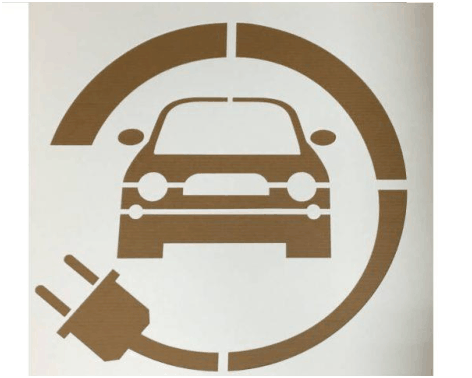
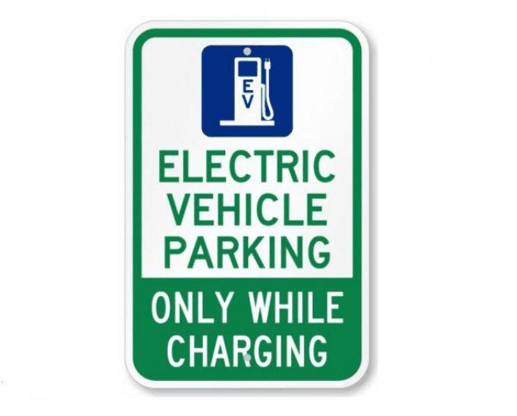

## 5 New and Emerging Transport and Parking Facilities

### 5.1 Electric Vehicle Charging Stations

Electric vehicles charging points aim to address the increase in popularity electric vehicle use and accommodate future demand.  Council encourages the installation of dedicated charging points in residential, mixed use and commercial developments to promote more sustainable methods of transport. The proposed charging station must:

a. Be suitably located to provide for convenient, shared access;

b. Have the capacity to be expanded to accommodate new charging points (through provision of additional pre-cast conduit channels)

c. Be monitored by the Owners Corporation or a 3rd party on behalf of the Owners Corporation;

d. Be installed on a dedicated circuit;

e. Allow for monitoring and individual billing payment for electricity use where applicable;

f. Provide dedicated space for electric vehicles to park and charge; and

g. Accommodating charging points for electric bicycles and mobility scooters to be charged.

#### 5.1.1 Provision and Installation

The installation of EV charging on should be consistent with the State Government Policies NSW Electric and Hybrid Vehicle Plan Future Transport 2056 and the Drive electric NSW EV ready buildings. Council requires a modular/whole of building approach for new medium-high density developments. All multi-unit residential car parking spaces must be ‘EV-Ready’. An ‘EV-Ready’ car space requires the provision of a backbone cable tray and a dedicated spare circuit within an EV Distribution Board enabling future installation of a smart EV charger and cabling to the EV Distribution Board. At least 20% of non-residential car parking spaces in development with a total GFA greater than 1000m2 shall be ‘EV-Equipped’. An ‘EV-Equipped’ car space is a car space equipped with EV fast charger that is ready to use on completion of the development. These may be payment operated systems. At minimum, the charger(s) will need to be ‘Level 2’ fast charging charger – three-phase with 11-22kW power or greater as defined by NSW Electric and Hybrid Vehicle Plan. EV Distribution Board(s) shall be of provided of sufficient size to allow connection of all car spaces ‘EV-Ready’ and ‘EV Equipped’. EV Distribution board(s) shall be located so that no ‘EV-Ready’ car space will require a cable run greater than 55m from the parking bay to an EV distribution board and, ensure that no cables will obstruct vehicular circulation aisles. Development shall provide cable trays, electrical cabinets, and conduits sufficient to accommodate the electric circuitry to each ‘EV-Ready’ and ‘EV Equipped’ car space. Development shall provide cable trays sufficient to accommodate the electric circuitry to each ‘EV-Ready’ and ‘EV Equipped’ car spaces. EV Distribution Boards are to be dedicated to EV charging and capable of supplying not less than 50% of EV connections at full power at any one time during off-peak periods, to minimise impacts to maximum demand loads. To deliver this, an EV Load Management System and an active suitably sized connection to the main switchboard is required. Cables shall be designed to not be a hazard for pedestrians or other vehicles. EV Load Management System is to be capable of:

a. Reading real time current and energy from the EV chargers under management via ethernet connection;

b. Determining, based on known installation parameters and real time data, the appropriate behaviour of each EV charger to minimise building peak power demand whilst ensuring electric vehicles connected are fully recharged;

c. Scale for residents to engage an EV Load Management provider to provide additional smart chargers to residential car spots over time.

d. Ensuring each apartment is metered separately to their electricity account as part of the ‘EV-Ready’ system. Bicycle parking areas should the provision of 1 electrical outlet per 20 bicycle spaces. Note: Provision may be altered where future EV charging infrastructure specifications supersedes what is stated here.

#### 5.1.2     Signage

“EV-Equipped” EV charging stations must have the following signage identifying:

• Whether the bay is for public or private use only;

• Location and identifying signage (see figures 4 & 5); and;

> [Picture on page 23: a picture, saved as a picture (images/traffic-parking-and-access-page-23-10.gif, 150 dpi).]

• Fees and charges, if any.

Figure 4 - ‘Electric Vehicle Parking Only’ within the parking space

> [Picture on page 23: a picture, saved as a picture (images/traffic-parking-and-access-page-23-13.gif, 150 dpi).]

Figure 5 - Preffered parking space signage

### 5.2 Mechanical Parking

#### 5.2.1 Mechanical Car Parking Applicability

Mechanical Carparking systems are generally not preferable, however are permissible where an applicant can demonstrate to Council that conventional carparking cannot be provided. This may be due to one or more of the following applies:

• The topography or lot size does not reasonably allow a simpler, more conventional parking arrangement.

• An existing building is being refurbished and there is no land available for additional parking. Refurbishment does not include extension of the building so as to increase site coverage or any other works to increase site coverage, all of which have the effect of reducing site area which could be used for conventional parking arrangements.

• There is a demonstrate need for a mechanical parking system and that its provision will not adversely affect the use of the site or the immediate locality;

• In the case of non-residential development, the installations are for long-stay parking.

#### 5.2.2 Details required for proposal

The following details are required when an applicant is proposing a mechanical parking system:

• details of required servicing and ongoing maintenance;

• internal and external dimensions of the device;

• details of the noise and vibration output of the device;

• manufacturer’s documentation, including information on service rates;

• general and emergency management procedures. The design and operation is to the satisfaction of the responsible authority A report from a suitably qualified traffic consultant is required for any development application that proposes a mechanical parking installation or paid parking station relating to the parking of three or more cars. As a minimum, the report should provide a queuing analysis, taking into account:

• the proposed peak hour vehicle volumes;

• the service rate (in seconds) associated with the proposed parking equipment; and

• the number of on-site waiting bays required to accommodate the 98th percentile queue at peak traffic levels.

#### 5.2.3 Design requirements

Vehicle access to the mechanical parking installation must be made in accordance with AS 2890.1 (2004). Where there is one car lift proposed, this must be capable of accommodating a B99 vehicle. Where there are multiple car lifts proposed, one car lift must be capable of accommodating a B99 vehicle and the remaining lifts must be capable of accommodating a B85 vehicle. If a car lift is providing access to a car parking area with more than 25 parking spaces, then two separate car lifts must be provided. Where a development is required to provide parking for people with a disability, a mechanical parking installation must allow people with a disability to exit in the event of breakdown or failure. The use of car-stackers to service accessible parking is not permitted. The applicant must be able to demonstrate forward entry and exit from the mechanical system (a turn-table is appropriate).

#### 5.2.4 Waiting Bays/Queueing

The design must include sufficient size to ensure that vehicles queuing to enter the mechanical parking installation or paid parking station does not extend beyond the property boundary. Vehicles must not wait on the footpath or roadway.

• The waiting bay(s) must be adequately sized to enable vehicle(s) to wait, while another vehicle exits the site. It is not acceptable for waiting vehicle(s) to reverse onto the footpath to enable another vehicle to manoeuvre off the site.

• The minimum length of each waiting bay is 5.5m.

• Waiting bays must not exceed a maximum grade of 1 in 20 (5%).

• Waiting bays must not obstruct the driveway.

#### 5.2.5 Safety & Operational Requirements

Operation and Management Plan has been prepared and implemented for the mechanical car stacker. The Plan must set out the following, at a minimum:

• The proposed maintenance regime, specifying that the system is to be regularly inspected and checked by qualified practitioners;

• The proposed method of management of the facility, including procedures, directions to users, safety protection systems, emergency response plan in the event of mechanical failure, etc;

• Any person required to operate the parking system must be trained to do so; and

• Provide signage that shall be erected prominently alongside the mechanical parking facility stipulating the maximum height/width/length of vehicle that can enter the facility.

#### 5.2.6 Visitor Parking

Mechanical car parking spaces facilities that require the operation of the system are not allocated for use by visitors.

### 5.3 Car Share

Proposed car share schemes shall be provided as per the Bayside DCP and comply with the following controls:

a) Car share parking spaces must be publicly accessible at all times, adequately lit and sign posted and located off the street unless council has an on-street car share policy;

b) Car share spaces must be in optimum positions within the parking area to allow ease of access to car share vehicles by residents and the public;

c) Where appropriate, Council may consider the provision of on-street car share spaces in lieu of car parking on site;

d) Car share spaces must always be under the ownership of a building’s Owners’ Corporation as common property;

e) Car share spaces must be used and have authorised use by car share vehicles only;

f) If a car share space is not taken up by a genuine car share provider, the space cannot be permanently or temporarily designated for alternative purposes.
