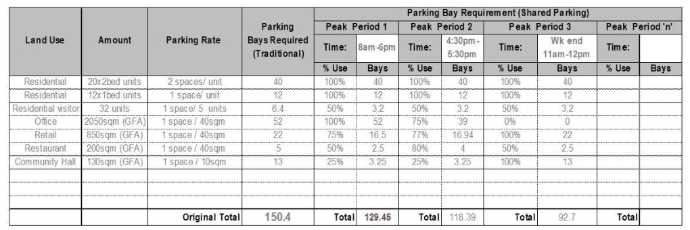

## 6. Design Documentation Requirements

This section sets out the minimum documentation standards for the design of parking facilities.  In most cases the design plans for a parking facility may be prepared by an architect.  However, the advice of a suitably qualified professional, such as a Traffic Engineer, may be required in relation to particular documents.

### 6.1 Plans

Plans are the principal document in the design of a parking facility and indicate most of the features of the parking facility. Plans for the design of parking areas shall include:

• Geometric layout of the parking facility, identifying all access driveways, circulation roadways, control points, parking aisles, parking spaces, queuing areas, ramps, roads and other features that comprise a parking facility.

• Dimensions of all features where they derive from numerical standards set by this Technical Specification or Australian Standards AS2890.

• Details of the classification of parking for cars.

### 6.2 Swept path analysis

Swept path analysis is required in most instances to assess the adequacy of the parking facility design. The swept path diagrams shall be in accordance with Australian standards and include a scale, dimension, legend and be prepared by recognised software (e.g. Auto Track, Auto Turn or equivalent). The objective of the analysis is to ascertain whether design vehicles achieve the minimum clearances when manoeuvring in a parking facility. Swept path analysis should be undertaken by a suitably qualified professional, such as a Traffic Engineer.

#### 6.2.1 Swept path templates

For the assessment of off-street parking facilities, the templates from Australian Standard AS2890.1 and Australian Standard AS2890.2 shall be used to assess the adequacy of the design of the facility. In assessing the adequacy of the design, the clearances from Australian Standard AS2890.1 and Australian Standard AS2890.2 shall be applied. For the movement of vehicles to and from a frontage roadway, in connection with a parking facility the templates from Austroads Design Vehicles and Turning Path Templates shall be used.

#### 6.2.2 Swept path diagrams

Swept path diagrams may be used in the place of swept path templates to assess the adequacy of design of parking facilities.  Where a swept path diagram is used, the diagram must be produced by a recognised computer program and must be plotted onto a design plan of the facility. Swept path diagrams for off-street car parking facilities shall be based on:

a. The base vehicle dimensions for the B99 and B85 cars as defined by Australian Standard AS2890.1.

b. A minimum turn radius of 6.3m for the B99 car and a minimum turn radius of 5.8m for the B85.

c. Swept path clearances in accordance with Australian Standard AS2890.1. Swept path diagrams for off-street parking facilities used by commercial vehicles shall be based on:

a. The design vehicle dimensions specified in Section 4.3.1 of this Technical Specification.

b. The wheel base, design turning radius and swept circle dimensions from Australian Standard AS2890.2.

c. Manoeuvring clearances in accordance with Australian Standard AS2890.2.

For the movement of vehicles to and from a frontage roadway, in connection with a parking facility the swept path diagrams shall be prepared using the base data from Austroads Design Vehicles and Turning Path Templates.

### 6.3 Sections

The preparation of sections allows for gradients in the parking facility to be assessed.  Gradients are critical to the suitability of access, where maximum gradients can prevent vehicle access, and also where minimum gradients can affect the drainage.

#### 6.3.1 Longitudinal sections

Longitudinal sections are required for all circulation roadways, ramps and access driveways where there are changes in gradient requiring consideration of relevant provisions of the Australian Standard AS2890, e.g. in the case of parking facilities for cars, this requires longitudinal sections for changes in gradient exceeding 12.5%. All longitudinal sections are to be drawn to a scale that enables graphical checking of ground clearances using the templates from the Australian Standard AS2890, e.g. in the case of parking facilities for cars, this requires longitudinal sections at a scale of 1 to 25. In the case of ground clearance checking for commercial vehicles, the longsection will be required to plot the commercial vehicle clearance using the ground clearance data from Australian Standard AS2890.2. Sections relating to access driveways must extend in the frontage roadway to enable checking of ground clearance at the movement across the layback or gutter crossing.  It must also be acknowledged that any longitudinal section prepared in relation to an access driveway for a development will not be final until such time as Boundary Levels are issued by Council for the property.

#### 6.3.2 Cross sections

Cross sections shall be provided where a design proposes superelevation of a circulation roadway or ramp, particularly in the cases of curved roadways or ramps.  Cross sections shall also be provided where a design proposes cross fall in a roadway, or where there is an integration of roadway and drainage facilities, such as drainage swales or drainage channels.  Cross sections should be prepared at an appropriate scale, e.g. 1 to 20.

### 6.4 Details

Details may be included on the plans as required for the design of such elements as follows:

• Kerbs;

• Pedestrian ramps;

• Pavements;

• Signs;

• Linemarking; and

• Traffic management facilities.

### 6.5 Specifications

A detailed specification for the construction of parking facilities, including the installation of all signs and linemarking, should be developed to ensure that the completed facilities achieve the intended design. Construction specifications are available from Council for various work elements related to the construction of parking facilities, based on AUS-SPEC. The potential for variations, in particular to the design dimensions, must be minimised, so that facilities are able to adequately cater for the design vehicle.  Variations that reduce the available clearances for the design vehicle can lead to decreased efficiency, and ultimately affect the function and amenity of the parking facility.

### 6.6 Shared parking registers

In mixed use premises the peak parking demand for the various uses may not always correspond, and in such cases a reduction in the number of parking spaces in the facility can provide for a more efficient parking facility.  The DCP identifies the conditions that apply to shared parking concessions.  The method of determining whether a shared parking concession applies is to prepare a Shared Parking Register. Developments that use shared parking concessions to reduce the parking provision of a development may be restricted from the future Strata Title subdivision of the tenancies involved in the shared parking arrangements An example of the Shared Parking Register is included in Appendix A.

### Appendix A

Shared Parking Registers An example of a Shared Parking Register is outlined below. In the example, a major development includes residential units, considerable office and retail floor space, a restaurant and a community facility.

> [Picture on page 29: a picture, saved as a picture (images/traffic-parking-and-access-page-29-6.gif, 150 dpi).]

The method of completing the register is as follows:

1\. Using the DCP, the parking demand for each individual use is calculated.

2\. An assessment is then made of time periods when parking demand may not be at 100%.  These are the designated shared parking periods.

3\. For each of the designated shared parking periods, the parking demand percentage (% use) is multiplied with the full parking demand.

4\. The total parking is calculated within each of the designated shared parking periods.

5\. The highest total amongst the designated shared parking periods is then the minimum number of spaces to be provided. The following conditions apply to the Shared Parking Register:

(a) Parking for residential units must be considered as 100% use at all times.

(b) Parking for residential visitors should be considered as 100% use in the weekday and weekend evenings, and weekend afternoons.

(c) The estimation of % use must be consistent with existing hours of operation or expected hours of operation where the development is a new building.

(d) The calculations should retain flexibility to account for permissible changes of use in the future.
