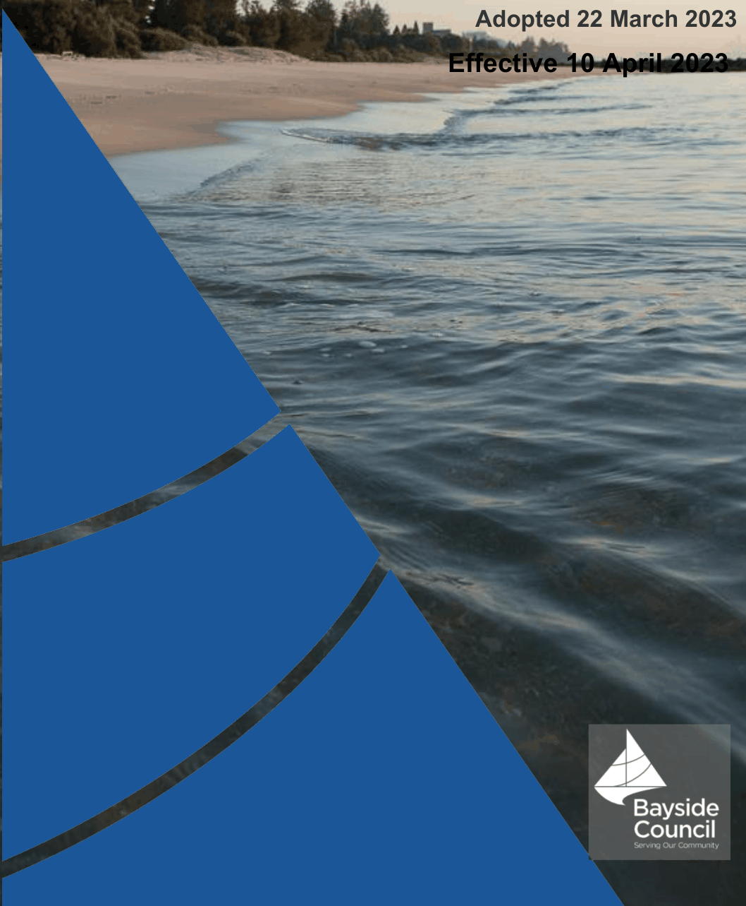

# Bayside Development Control Plan 2022 - Traffic, Parking and Access

> This chapter is split into 6 section file(s), one per numbered heading, in the order they appear in the PDF.

Source PDF: [traffic_parking_and_access_technical_specification.pdf](traffic_parking_and_access_technical_specification.pdf)

### Bayside

### Technical Specification

Traffic, Parking and

### Access

> [Picture on page 1: a picture, saved as a picture (images/traffic-parking-and-access-page-1-5.gif, 150 dpi).]

### Adopted 22 March 2023

### Effective 10 April 2023

### Contents

1 Preliminary ...................................................................................................................................................... 4

1.1 Introduction ............................................................................................................................................ 4

1.2 Objectives ............................................................................................................................................... 4

1.3 Application of the Technical Specification .................................................................................. 4

1.4 Glossary ................................................................................................................................................... 4 2 Traffic and Parking Impact Assessment .............................................................................................. 5

2.1 When is traffic impact study required? ........................................................................................ 5

2.2 What information is included in a traffic impact study? ......................................................... 5

2.3 Parking studies ...................................................................................................................................... 5

2.4 Other surveys ........................................................................................................................................ 6 3 Design of Parking Facilities ....................................................................................................................... 7

3.1 Design of off-street car parking ...................................................................................................... 7

3.2 Parking for people with a disability .............................................................................................. 13

3.3 Design of off-street parking for commercial vehicles ........................................................... 13

3.4 Design of bicycle parking facilities .............................................................................................. 16

3.5 Design of on-street parking facilities ........................................................................................... 16 4 Workplace “Green” Travel Plans .......................................................................................................... 17

4.1 Introduction ............................................................................................................................. 17

4.2 Requirements: ........................................................................................................................ 18

4.3 Preparation of the travel plan: .............................................................................................. 18 5 New and Emerging Transport and Parking Facilities .................................................................... 22

5.1 Electric Vehicle Charging Stations .............................................................................................. 22

5.2 Mechanical Parking ........................................................................................................................... 24

5.3 Car Share .............................................................................................................................................. 25

6\. Design Documentation Requirements ................................................................................................ 26

6.1 Plans ............................................................................................................................................................ 26

6.2 Swept path analysis ............................................................................................................................... 26

6.3 Sections ...................................................................................................................................................... 27

6.4 Details .......................................................................................................................................................... 27

6.5 Specifications ........................................................................................................................................... 27

6.6 Shared parking registers ..................................................................................................................... 28 Appendix A ............................................................................................................................................................ 29

<!-- sections -->
## Sections

1. [1 Preliminary](01-1-preliminary.md)
2. [2 Traffic and Parking Impact Assessment](02-2-traffic-and-parking-impact-assessment.md)
3. [3 Design of Parking Facilities](03-3-design-of-parking-facilities.md)
4. [4 Workplace “Green” Travel Plans](04-4-workplace-green-travel-plans.md)
5. [5 New and Emerging Transport and Parking Facilities](05-5-new-and-emerging-transport-and-parking.md)
6. [6 Design Documentation Requirements](06-6-design-documentation-requirements.md)
