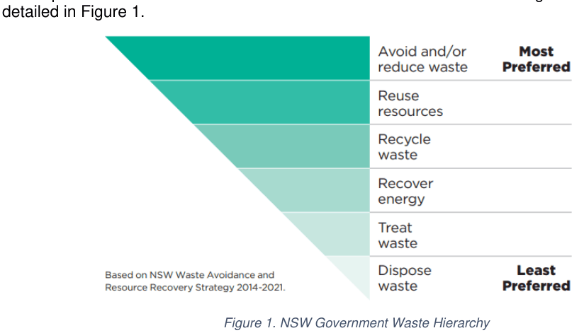
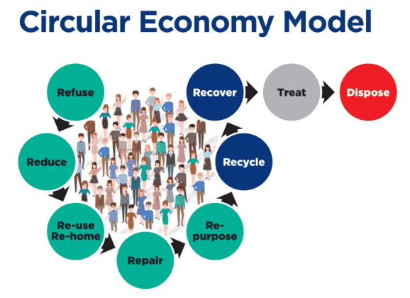
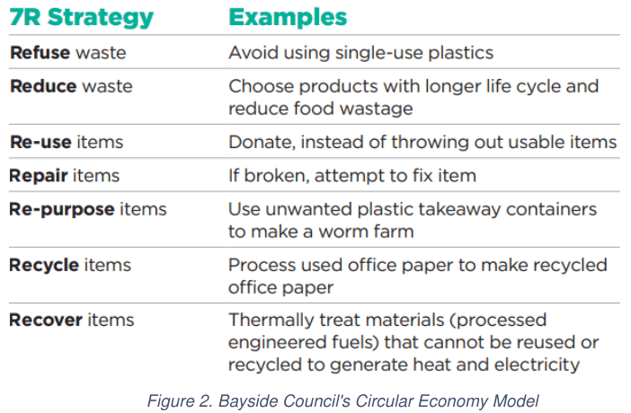
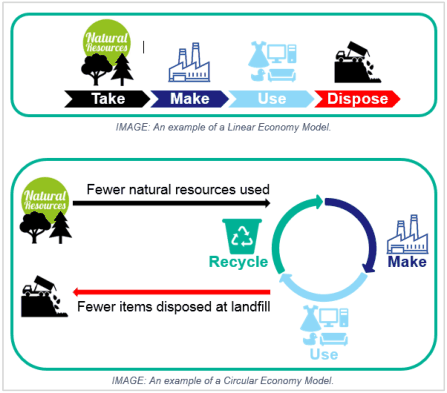

## 1. Introduction

Waste and resource consumption is a major environmental issue and the responsibility of all levels of government in Australia. This is particularly the case as landfill sites become scarce and the environmental and economic costs of waste generation and disposal rise. All levels of government and the community must share the responsibility for reducing waste and recycling more. The NSW Government has a clear waste and resource recovery agenda. The Waste and Resource Recovery Strategy 2014-21 sets the targets and policy direction for diverting waste away from landfill. To help meet these targets, effective resource recovery systems must be designed in new residential and commercial buildings. Bayside Council’s Waste Avoidance and Resource Recovery (WARR) Strategy 2030 has set high aspirational targets - placing a high significance on waste materials being optimised as a resource, as opposed to landfilled. Bayside Council is committed to playing its role as an environmental leader. This includes working with everyone in the region to avoid waste and maximise recovery of resources through the actions outlined in this WARR Strategy 2030 and to promote responsible citizenship. This strategy plays a vital role in maintaining our natural and urban environment and preserving our valuable resources. It provides the targets and guiding principles to assist our community to live sustainably, whilst supporting Bayside’s growth as a vibrant centre for residential living and commercial development. This Waste Management Development Control Plan (DCP) Technical Specification aims to establish systems that provide the best opportunity for builders and building’s occupants to recycle correctly and minimise waste sent to landfill. In NSW, the Waste Avoidance and Resource Recovery Act 2001 sets out the waste hierarchy, which prioritises the most desirable to the least desirable waste management policy, as detailed in Figure 1.

> [Picture on page 12: a picture, saved as a picture (images/waste-management-technical-page-12-28.gif, 150 dpi).]

Figure 1. NSW Government Waste Hierarchy

Council has modified and extended the ‘waste hierarchy’, positioning the community at the centre. Through responsible citizenship and Council leadership, waste materials are returned to the community through initiatives and innovation, striving for a circular economy. The circular model is easily identified as a 7R Strategy. When the 7R circular economy model has been applied, any materials not suitable for recovery can be treated to reduce its environmental impact (e.g. medical waste) and/or disposed to landfill.

> [Picture on page 13: a picture, saved as a picture (images/waste-management-technical-page-13-1.gif, 150 dpi).]

> [Picture on page 13: a picture, saved as a picture (images/waste-management-technical-page-13-2.gif, 150 dpi).]

Figure 2. Bayside Council's Circular Economy Model

Council’s 2030 vision moves completely away from a traditional linear economy model to a circular economy model whereby waste is diverted from landfill and optimised as a resource that returns to nature or the economy through numerous waste avoidance and resource

> [Picture on page 13: a picture, saved as a picture (images/waste-management-technical-page-13-7.gif, 150 dpi).]

recovery solutions.

Figure 3. Linear vs Circular Economy Model

Over the past decade, advances in technology have created new ways for Bayside Council (Council) to improve recovery and waste systems.

Many challenges still face the community. These include increasing recycling to assist the NSW Government to meet their landfill diversion target.

Council faces significant challenges to reduce littering and illegal dumping within the Bayside

area. Council is working with the NSW Environment Protection Authority (EPA), the Regional Illegal Dumping (RID) squad and the community to reduce illegal dumping and littering within the City.

The Bayside Waste Avoidance & Resource Recovery (WARR) Strategy 2030 discusses the current waste and resource recovery situation in the Bayside local government area and outlines strategies to achieve Council’s 2030 vision. These strategies are grouped under five Key Strategic Actions, being:

> [Picture text on page 14 is stored in the PDF without readable letters (no character map), so it could not be copied; see the original PDF.]

Action 1: Avoiding and Reducing Waste. Action 2: Recovering Resources. Action 3: A Healthy Region. Action 4: Reducing Illegal Dumping. Action 5: Litter Prevention.

Ultimately, developments within Bayside Council should be designed and built factoring in these key strategic actions.

### 1.1 Aims and Objectives

Waste is an essential service. It is often only when a waste service fails that residents, businesses, and local government realise just how important it is. Good waste planning at the early stages of development design can: Result in waste systems that are easy to use; Improved amenity of a building; Reduce health, work and safety risks; Encourage waste avoidance and resource recovery.

Failure to address waste management issues at the early design stage can cause long-term problems, as well as compromise safety and visual amenity.

Sustainable resource management and waste minimisation is a priority area for Bayside Council. The building and construction industry is a major contributor to waste.

This document the ‘Bayside Council Waste Management Development Control Plan (DCP) Technical Specification’ or the Waste Management DCP (as this document will be referred) aims to: Provide effective waste minimisation and management strategies to reduce waste volumes from developments; and, Assist in better design and operation of on-going waste management, which is practical, and of minimal adverse impact on the health, safety and convenience on the public domain and residential amenity.

In summary the aims and objectives of this Waste Management DCP are to ensure that waste is managed effectively at all stages of development, including the construction and demolition stages, through to the on-going and continued use of the completed building, by:

Maximising the reuse and recycling of construction materials and minimising demolition waste by promoting reuse of existing structures, adaptable building design and adaptable design for end-of-life deconstruction; Encouraging building design, demolition and construction techniques that help to avoid waste being generated; Ensuring that waste and recyclables are lawfully transported to lawful facilities; Encouraging a safe and clean site; Maximising waste avoidance, and reuse and recycling of household, commercial and industrial waste; Ensuring there are appropriate on-site waste separation systems to assist Council and private sector waste management staff to collect and recover waste materials; Ensuring the amenity of the building and local area is maintained or enhanced; Preventing illegal dumping; and, Ensuring wastes are stored and disposed of safely in line with statutory requirements.

> [Picture text on page 15 is stored in the PDF without readable letters (no character map), so it could not be copied; see the original PDF.]

### 1.2 Purpose

The purpose of this document is to facilitate good or improved building and waste management during demolition, construction and occupation of all types of buildings -residential, mixed-use, commercial and industrial.

It also aims to ensure the provision of convenient and safe waste and recycling collection systems that encourage residents to use them correctly and prevent illegal dumping.

### 1.3 Construction and Demolition Stages

The building and construction industry is a contributor to waste, some of which is deposited to landfill. The implementation of effective waste avoidance and reuse strategies could significantly reduce these quantities.

Effective waste planning and management during demolition and construction can also benefit the builder and developer through: Reduced costs - less material is wasted on-site. Excess material sent to landfill is paid for twice, once in the original purchase and again in its disposal; Enhanced public image - good waste management practices can provide a good reputation for the developer; Best practice - with Green Star, NABERS and other sustainability ratings systems, Regulatory compliance - compliance with legislation such as the Protection of the Environment Operations Act 1997 that requires waste to be lawfully stored, transported and disposed or recycled lawfully. Optimal workplace safety – providing a safe working environment for staff, contractors and visitors can improve site safety and reduce liabilities - a clean site is a safe site.

### 1.4 Building Design

On-site facilities and services for sorting and collecting waste, recycling and organic materials are essential.

Poor design can lead to: Decreased source separation and recycling; Negative streetscape impact with too many bins being left at the kerbside for collection, causing difficulties with pedestrian access and traffic congestion during collection times, and affecting building aesthetics and local area amenity; Dumped waste inside and outside residential buildings due to inadequate storage space on-site for bulky waste awaiting collection;

Missed waste collection services from difficult to service bins such as those around parked cars; and, Council’s inability to service a building, resulting in body corporates having to provide a private contractor and property owners having to pay extra for waste collection services. The details of private collection to be conducted onsite must be included in the WMP to be submitted for Council to review and approve prior to a development application approval.

> [Picture text on page 16 is stored in the PDF without readable letters (no character map), so it could not be copied; see the original PDF.]

### 1.5 Applicability

The provisions of this Waste Management DCP apply when: Applying for a DA under Section 79C of the Environmental Planning and Assessment Act 1979 (EP&A Act). A development consent or a complying development certificate is required for all types of development, including for demolition, construction (including earthworks), alterations or additions or change of use of buildings. Complying with the minimum provisions in this document does not, however, mean that an application will be approved as each application will be considered on its merits. Optimum waste avoidance and resource recovery will need site-specific and sometimes innovative solutions. As a result, Council or a private certifier may approve on its merits an application that proposes to vary the controls, provided it can be demonstrated that all the design objectives in this section (1.5) and the relevant sections of this document will be met.

The provisions of this Waste Management DCP should also be used as a guide for activities that do not require consent, including for complying or exempt development, or development that falls under Part 5: ‘Environmental Assessment’ of the Environmental Planning and Assessment Act 1979.

This section contains four design objectives that advise on the design elements that need to be considered when planning for waste and resource recovery systems in new residential, commercial, industrial, and mixed-use developments.

#### Design Objective 1: Environmental sustainability and best practice

Developments meet requirements for long-term sustainability and best practice when: Systems are designed to maximise waste separation and resource recovery; Innovative and best practice waste management collection systems and technologies are considered and supported where appropriate; Flexibility in design allows for future changes in waste generation rates, materials collected and methods of collection.

#### Design Objective 2: Effective waste and resource management

Developments achieve effective waste and resource management when: Waste services occur in a seamless and timely manner; Collection points, street widths and street configurations, especially in new subdivisions or precinct developments, allow for waste to be removed safely and conveniently; The distance residents have to travel to dispose of waste is minimised and access is safe and easy for all residents; Functional and convenient storage spaces are provided for waste and recycling including temporary storage areas for bulky waste materials like general household furniture waste.

#### Design objective 3: Clean, safe and healthy living environments

> [Picture text on page 17 is stored in the PDF without readable letters (no character map), so it could not be copied; see the original PDF.]

Developments protect and enhance the quality of life for the community when: Negative impacts on amenity for residents, neighbours and the public, such as visually unpleasant waste storage areas, noise from waste collection including traffic noise, and bad odours, are minimised; Illegal dumping and litter from bins are minimised through good planning and installation of adequate storage and waste and recycling infrastructure; Safe and easy access to waste and recycling storage areas is provided for residents, tenants, building managers and collection contractors.

#### Design objective 4: Affordability

Developments provide affordable living and working, when: Careful design and construction prevent costly retrofits; Operational waste management is cost effective for residents and tenants.

### 1.6 Structure of Document

This Waste Management DCP has been based on NSW Government guidelines to provide a degree of consistency across new developments in local government areas.

This Waste Management DCP document will assist applicants to prepare a detailed submission and properly consider waste management at the early design stage, by helping them to: prepare a waste management plan (WMP); minimise waste and facilitate recycling; develop systems for waste and resource management that ensure waste is stored, handled, transported and disposed of safely and legally; provide appropriate space, storage, amenity and management of on-site waste management facilities; ensure waste management systems are compatible with the council’s waste collection services; minimise hazardous and safety risks associated with waste management at all stages of design, planning, construction and operation of a development.

This Waste Management DCP document has been developed and constructed in a manner that provides all stakeholders with practical, clear and concise guidelines that will facilitate the preparation of all appropriate documentation required by Council to address all relevant waste management requirements at all stages of the planning and DA process.

### 1.7 Waste Management Plan(s) (WMP)

#### 1.7.1 Purpose of a WMP

The purpose of a WMP is to ensure the waste and recycling management impacts of a proposed development are assessed as part of the planning approval process.

A WMP describes the ways in which waste will be stored, moved, avoided, reused, recycled and diverted from landfill during each activity or stage of development. It allows Council or the certifying authority to assess the volumes and types of waste likely to be generated by the development and ensure appropriate actions are taken to manage its generation, storage, recycling and disposal.

At a minimum, each type of WMP must: Calculate the volumes and types of waste and recycling that will be generated;

State how waste and recycling will be handled, stored, and treated on-site; State how and where waste will be reused, recycled, or disposed of; Describe the roles and responsibilities in ensuring the WMP is correctly implemented; If presentation or collection of waste (whether loose or containerised) occurs from Council land, Council pre-approval must be sought.

WMPs are required when: Demolishing or constructing buildings; Changing the use of buildings; Subdividing land or buildings.

#### 1.7.2 Types of WMPs

Most development applications will be required to be accompanied by a WMP.

The WMPs will: Minimise the amount of waste generated as part of the project; Maximise the amount of waste material which is sent for reuse, recycling or reprocessing; Minimise the amount of material sent to landfill.

There are three types of WMPs for different activities and different stages of the development. Table 1 identifies the different WMPs and the activity/development stage that it would be triggered:

Table 1. Different types of WMPs

| WMP | Activity/development stage | Section Reference |
|---|---|---|
| Demolition Waste Management Plan (DWMP) | Where any demolition works are proposed. | Section 2 of this DWMP. |
| Construction Waste Management Plan (CWMP) | Where any construction works are proposed. | Section 3 of this CWMP. |
| Operational Waste Management Plan (OWMP) | For operational use of a site or premises for all building types outlined in this chapter. | Section 4 of this OWMP, and any other relevant section of the document. |

It is important that the WMPs be standalone documents to ensure all essential information regarding waste management during demolition/construction and the operational stage of the development is submitted with the development application.

Appendix B provides a template for each WMP.

The WMP should be accompanied by scaled architectural plans that illustrate the proposed on-site waste management infrastructure and how design elements support the proposed internal operations e.g. location of bin storage area, location of bin collection point, travel path for collection vehicles where on-site collection is proposed.

#### 1.7.3 Submitting a Waste Management Plan (WMP)

The larger and more complex a development is, the more details are required in a WMP. The amount of supporting information may also increase. It is highly recommended that an

appropriate waste subject matter expert assists with the preparation of a detailed OWMP to ensure effective waste management optimal outcomes are achieved that are integrated with Council’s guidelines and waste services.

To ensure waste will be effectively managed, WMPs should be prepared and considered during the earliest stages of the development.

Information on Council’s waste services and waste management policies that need to be considered as part of development assessment stage are made available to external stakeholders on Council’s website and Bayside Waste Services app.

#### 1.7.4 Complying Development

WMPs are required for developments identified as complying development in accordance with Council’s adopted exempt and complying development criteria. Approved WMPs will dictate the way waste is managed on-site and facilities for storing, handling, transporting, and disposal and/or recycling of waste.

During construction or demolition, weighbridge receipts must be retained and provided to Council upon request to show where construction or demolition waste has been transported.

#### 1.7.5 Consultation with Council

It is considered extremely important and advisable that Council be consulted and included in any and all correspondence during the master planning stage especially for large and complex developments. These meetings should discuss the details for appropriate waste management systems prior to developers submitting a DA and WMPs.

Any advice provided should be documented and should be incorporated as part of pre-development application meeting/discussions to ensure waste issues are considered early in the process and waste management is integrated as part of the overall development.
