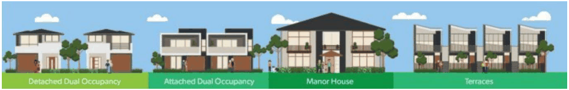

## 5. Low Rise – Low Density Dwelling Developments

### 5.1 Applicability

The following controls and requirements are applicable to the following types of low rise-low density development: Single Dwellings; Dual Occupancies; and, Manor Homes;

The following controls and requirements are also applicable to the following types of small low rise-low density developments that comprise of up to and including four (4) dwellings in total: Villas; and, Townhouse / Terraces.

> [Picture on page 30: a picture, saved as a picture (images/waste-management-technical-page-30-12.gif, 150 dpi).]

Image: NSW Government Planning Portal – Low Rise Housing Diversity Code

### 5.2 Waste Generation & Service Requirements

Bayside Council has two (2) separate collection systems. One for the residents of the former Botany LGA and one for the former Rockdale LGA. Until this is harmonised, the following will apply:

#### 5.2.1 Collection Requirements – Former Botany LGA until Feb 2030

For all of the abovementioned buildings, Council provides the following 3-bin system service for each dwelling type in the former Botany LGA.

| SERVICE | WEEKLY CAPACITY | FREQUENCY | BIN SIZE |
|---|---|---|---|
| Waste | 240-litre | Weekly | 240 L |
| Co-mingled Recycling | 120-litre | Alternate Fortnightly | 240 L |
| Garden Organics | 120-litre | Alternate Fortnightly | 240 L |

#### 5.2.2 Collection Requirements – Former Rockdale LGA until Feb 2030

For all of the abovementioned buildings, Council provides the following 2-bin system service for each dwelling type in the former Rockdale LGA. In 2024, a third bin (GO) service will be provided to each dwelling.

| SERVICE | WEEKLY CAPACITY | FREQUENCY | BIN SIZE |
|---|---|---|---|
| Waste | 240-litre | Weekly | 240 L |
| Co-mingled Recycling | 120-litre | Alternate Fortnightly | 240 L |
| Garden Organics (From 2024) | 120-litre | Alternate Fortnightly | 240 L |

#### 5.2.3 Collection Requirements – All areas of Bayside from Feb 2030

For all of the abovementioned buildings, with the introduction of a NSW Government mandated FOGO service to be implemented by 2030, Council will provide the following 3-bin system service for each dwelling type in the Bayside LGA.

| SERVICE | WEEKLY CAPACITY | FREQUENCY | BIN SIZE |
|---|---|---|---|
| Waste | 120 to 240-litre | Weekly to Fortnightly | 120 to 240 L |
| Co-mingled Recycling | 120-litre | Alternate Fortnightly | 240 L |
| Food Organics & Garden Organics | 240-litre | Weekly | 240 L |

#### 5.2.4 Bin Dimensions

The bin dimension(s) for the abovementioned buildings are:

| Bin Type Height (mm) Depth (mm) Width (mm) |  |  |  |
|---|---|---|---|
| 240-litre | 1080 | 735 | 580 |
| 120-litre (from 2030) | 930 | 545 | 480 |

### 5.3 Design Control

The following controls and requirements are in addition to those detailed in Section 4 of this Waste Management DCP.

#### 5.3.1 Bin Storage & Collection Point(s)

A bin storage area is to be provided for each dwelling. The bin storage area is to be: Located to minimise adverse visual impact on the public domain. It should be positioned behind the front building line of the dwelling. Where it is located within the front setback it must be incorporated into the building’s design or be screened by vegetation; Located to avoid nuisances such as odour and noise to adjoining residential properties; Designed so that it is capable of accommodating all Council allocated bins; Designed and located so that there is unobstructed and convenient access to the Collection Point; Designed and located so not to require bins to be transported through the interior of the dwelling.

#### 5.3.2 Bulky Waste Storage & Collection Point(s)

The kerbside Collection Point must by located so it: Allows a minimum space of 3 m x 1 m per dwelling for the presentation of household clean up waste to be presented at the kerb without obstructing vehicular or pedestrian access.

#### 5.3.3 Collection Vehicle Access

The kerbside Collection Point must by located so it: Allows for all allocated bins to be presented in single file with a minimum 30 cm gap between bins (where up to two bins per dwelling are presented at for collection each week); Ensure all allocated bins are placed within the site’s allocated frontage, not in the driveway and not in front of neighbouring lots;

Has a separation distance of 2 m from street trees, bus stops, street furniture and road infrastructure such as roundabouts and speed humps; Has a height clearance of 4.5 m from overhanging tree branches, powerlines and other obstructions; and, Not be on an active driveway or prevent pedestrian access.

#### 5.3.4 Bin System

These bins are to be self-presented on collection days and taken back in on site after collection occurs.
