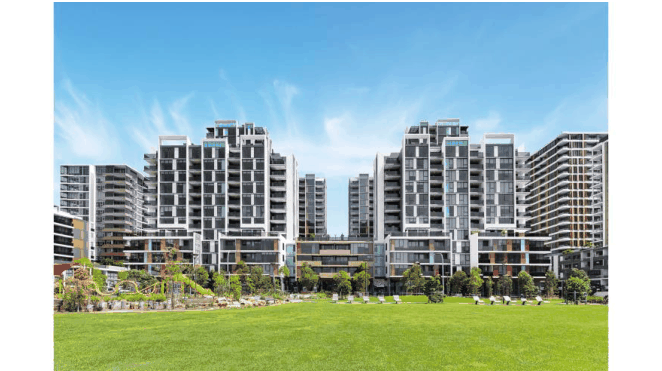

## 9 Residential Flat Building (RFB): High Rise Units

### 9.1 Applicability

These requirements of this Section (Section 9) have specifically been designed to cater for the provision of on-site waste storage facilities, and the collection of bins from premises defined as “Residential Flat Building (RFB): High Rise Units” as defined in this Waste Management DCP. RFB: High Rise Units refers to residential flat buildings of seven (7) storeys and greater, not including basement.

It is Council’s aim to provide the residents of these developments with a waste collection service sufficient to their needs, taking into consideration the following criteria -the size, shape, and design of the overall development: the size, shape, and design of the private open space of each dwelling; the size, shape, and design of the private open space of each dwelling; the availability, size and design of existing on-site waste storage facilities; and, the specific needs of the occupiers of each individual sole occupancy unit.

It is important that a development application addresses all relevant domestic waste considerations in this document.

> [Picture on page 54: a picture, saved as a picture (images/waste-management-technical-page-54-18.gif, 150 dpi).]

Image: An example of RFB: High Rise Units.

### 9.2 Waste Generation & Service Requirements

Bayside Council has two (2) separate collection systems. One for the residents of the former Botany LGA and one for the former Rockdale LGA. Until this is harmonised, the following will apply:

#### 9.2.1 Collection Requirements – Former Botany LGA until Feb 2030

For all of the abovementioned buildings, Council provides the following 3-bin system service for each dwelling (unit) type in the former Botany LGA.

| SERVICE | WEEKLY CAPACITY | COMPACTION | FREQUENCY |
|---|---|---|---|
| Waste | Communal 120-Litre | 2:1 | Twice Weekly |
| Co-mingled Recycling | Communal 120-Litre | N/A | Weekly |
| Garden Organics | Communal 24-Litre | N/A | Fortnightly |

Where possible the waste bins may be converted to 660L or 1100L bin types and calculated at the rate mentioned above. Please consult Council prior to submitting DA and Waste Management Plan to see if this request is possible.

#### 9.2.2 Collection Requirements – Former Rockdale LGA until Feb 2030

For all of the abovementioned buildings, Council provides the following 2-bin system service for each dwelling (unit) type in the former Rockdale LGA. In 2024, a third bin (GO) service will be provided to each dwelling.

| SERVICE | WEEKLY CAPACITY | COMPACTION | FREQUENCY |
|---|---|---|---|
| Waste | Communal 120-Litre | 2:1 | Twice Weekly |
| Co-mingled Recycling | Communal 120-Litre | N/A | Weekly |
| Garden Organics (From Feb 2024) | Communal 24-litre | N/A | Fortnightly |

Where possible the waste bins may be converted to 660L or 1100L bin types and calculated at the rate mentioned above. Please consult Council prior to submitting DA and Waste Management Plan to see if this request is possible.

#### 9.2.3 Collection Requirements – All areas of Bayside from Feb 2030

For all of the abovementioned buildings, with the introduction of a NSW Government mandated FOGO service to be implemented by 2030, Council will provide the following 3-bin system service for each dwelling type in the Bayside LGA.

| SERVICE | WEEKLY CAPACITY | COMPACTION | FREQUENCY |
|---|---|---|---|
| Waste | Communal 120-litre | 2:1 | Twice Weekly (TBD by Council) |
| Co-mingled Recycling | Communal 120-litre | N/A | Weekly |
| Food Organics & Garden Organics | Communal 96-litre | N/A | Twice Weekly |

#### 9.2.4 Bin Dimensions

The bin dimension for the abovementioned buildings are:

| Bin Type Height (mm) Depth (mm) Width (mm) |  |  |  |
|---|---|---|---|
| 60-litre (L) | 640 | 497 | 444 |
| 240-litre (L) | 1080 | 735 | 580 |
| 660-litre (L) | 1250 | 850 | 1370 |
| 1100-litre (L) | 1485 | 1280 | 1370 |

Smaller 60 L bins can be incorporated in the waste management plan by placing these on each Waste Level Room(s) only for FOGO interim or temporary storage as discussed in 9.4.1 Bin System.

Where possible the 240L waste bins may be converted to 660L or 1100L bin types and calculated at the rate mentioned above. Please consult Council prior to submitting DA and Waste Management Plan to see if this request is possible.

### 9.3 Design Control

The following controls and requirements are in addition to those detailed in Section 4 of this Waste Management DCP.

#### 9.3.1 Bin Storage & Collection Point(s)

> [Picture text on page 56 is stored in the PDF without readable letters (no character map), so it could not be copied; see the original PDF.]

A bin storage area or areas is/are to be: located to minimise adverse visual impact on the public domain. It should be positioned behind the front building line of the dwelling. Where it is located within the front setback it must be incorporated into the building’s design or be screened by vegetation; located to avoid nuisances such as odour and noise to adjoining residential properties; designed so that it capable of accommodating all Council allocated bins; designed and located so that there is unobstructed and convenient access to the collection point; designed and located so not to require bins to be transported through the interior of the dwelling.

An on-site communal bin storage area or areas will need to be provided for the development, that has been designed in accordance with Section 4 of this document. The design and location of bin storage areas must be integrated into the design of the overall development and compliment the surrounding streetscape. Materials and finishes visible from the outside should be similar in style and quality to the external materials used in the rest of the development.

The location of the waste, recycling and organics room(s) or area(s) must: provide direct and convenient access for the occupants of the development; not impact on the amenity of occupants in and adjoining the development in relation to visual amenity, noise and odour; not obstruct on- or off-street car parking, driveways, footpaths, landscaping and trees comply with Australian Standards; comply with the Building Code of Australia; be designed to look acceptable from the street; be within 10 meters of the layback where an approved and applicable Wheel Out – Wheel Back collection service is to occur; not require residents to carry waste to the storage area more than 30 metres from their dwelling (not counting vertical space); be a minimum door width of 1.5 metres; Have a minimum unobstructed clearance height of 4.5 metres and 3.5 metres carriageway width to the Collection Point(s), which includes all attachments such as vents, signage, and piping.

On large, difficult, or steep sites, or sites with multiple street frontages, it may be appropriate to have a number of bin storage rooms or areas, to minimise distances and facilitate collection.

A bin storage and service room must be located on each habitable floor, known as a Waste Level Room, containing either: The chute inlet(s) and enough room for the required number of mobile bins for residents to deposit their waste, recycling and organics, or Enough room for the required number of mobile bins for residents to deposit their waste, recycling and organics without chute inlet(s).

Waste Level Rooms must consider required safety measures, required ventilation, and required rotation and cleaning of bins.

A bin storage area in the basement or ground level stores extra bins used to rotate full bins in the bin storage and service rooms. This room may or may not have restricted access for residents. The collection point must not be at the kerbside. All collections must be conducted on-site.

> [Picture text on page 57 is stored in the PDF without readable letters (no character map), so it could not be copied; see the original PDF.]

On-site Collection Points: be located where the bins are usually stored or on-site at a temporary holding area; be located so the collection vehicle, while servicing bins, does not obstruct the use of a driveway; be at street level or in a basement.

Additionally, the movement of bins from the bin storage area to the collection point shall meet the following requirements: bins of up to 360 L capacity - no more than 30 m; bins of 360-1100 L capacity - no more than 5 m; bins of more than 1100 L capacity - no more than 3 m.

The bin carting routes should be designed to be: direct and short as possible; without kerbs and steps; gradients more than 1:14 (or 1:30 where 660 or 1100 L bins are used); a minimum of 2 m wide with a hard, non-slip surface.

#### 9.3.2 Bulky Waste Storage & Collection Point(s)

Council requires all Bulky Waste or Cleanup material to be stored within the confines of this type of development.

All such material shall be stored within dedicated room(s) or caged area(s) and designed to temporarily store discarded bulk items awaiting removal, such as old furniture and approved general household items. Bulky waste storage areas must be located at ground level or in a basement near the main bin storage area. If located at ground level the bulk storage area must be well screened from the front of the street to preserve the amenity of the streetscape.

The bulky waste storage area must: be readily accessible to all residents and located close to the main bin storage room; be secure and caged to allow the contents to be visible from the outside (when located in a basement); have a minimum doorway width of 2 metres to allow for easy movement of large waste items in and out of the room; Have a minimum clearance height of 4 metres.

The size of the bulky waste storage facility should be calculated as follows: 12m2 (4m x 3m) of space for developments of up to 40 dwellings, and then an additional 3m2 for every 10 dwellings thereafter, rounded up by increments of 3m2.

Additional bins should be considered to allow residents to recycle the following materials: Unwanted clothing; Printer cartridges; Household batteries; Fluorescent bulbs or tubs, or light bulbs; Mobile phones and accessories; E-waste; and,

Expanded polystyrene.

The containers used to store these materials can be located in the bin storage room or in nominated areas of the building that are more likely to be frequented by residents and organised by the owners' corporation.

The size and type of containers for each of these material types vary from 240, 660 or 1100 litre mobile bins or in some cases may be a special container provided by a resource recovery or recycling contractor.

It is good practice to encourage and provide an opportunity for residents to recycle other general household waste items such as those listed above. Collection arrangements for these materials may be orgnaised and provided by commercial businesses or charities. Refer to the NSW EPA Better practice guide for resource recovery in residential developments for more details on how to plan for and collect these material types or contact Council.

#### 9.3.3 Collection Vehicle Access

These types of developments are to be serviced through onsite collection. This means the council’s collection vehicle will enter the property and service the development within the property boundary from a designated loading area.

The development must provide safe vehicle access and enable the waste collection vehicle to maneuver and load all allocated bins.

The on-site collection point must by located so it: Ensures all allocated bins are collected on-site, not impeding access to any vehicles or pedestrians; Has a height clearance of 4.5 metres, allowing for all ceiling or roof attachments such as vents, signage, and piping, for Collection Vehicles to access and service the site; Have a minimum unobstructed 3.5 metres carriageway width to the Collection Point(s), which includes all attachments such as vents, signage, and piping. Ensures vehicle can enter and exit the site in a forward driving direction; and, Ensures a swept path of 21 metres and a turning circle of 25 metres to accommodate the length of a Collection Vehicle to safely maneuver within the development.

### 9.4 Waste Management Equipment

The development design must allow for an on-site chute system, compaction unit and towing equipment (if applicable) which must be detailed in the Waste Management Plan.

#### 9.4.1 Bin System

There are multiple innovative options available for a developer to consider when proposing a bin system for the site’s waste, recycling, and organics management. These options include:

1\. Innovative Model:

a. An independent waste chute system; plus,

b. An independent recycling chute system; plus,

c. An independent organics chute system (from 2030).

2\. Hybrid Model:

a. A waste chute system; plus,

b. An independent recycling chute system or a 240L recycling bin for every four units on each level at any given point in time; plus,

c. An independent organics chute system (from 2030) or two 60L organics bins for every four units on each level at any given point in time (from 2030 when

FOGO is introduced) which are to be decanted into larger FOGO bins stored and collected from an approved bin storage area.

Council will preference a system that provides the best balance of automation, convenience, and best practice engineering for the site. Where bins are to be utilised on a particular level, as opposed to using a chute system, the Waste Management Plan must:

> [Picture text on page 59 is stored in the PDF without readable letters (no character map), so it could not be copied; see the original PDF.]

Detail how these bins are to be effectively rotated by a caretaker, on-site managers, and/or other site representatives; Ensure that all the required waste, recycling bins; and including allowances for the implementation of organics bins from 2030; for each level can be stored in a dedicated bin storage and service room on each level, known as a Waste Level Room; Ensure that each Waste Level Room on each level provides ample space for all required bins to be easily and safely wheeled in and out, and for people to move freely and safely around within this bin storage and service room when all required bins are stored in this area; Ensure that the Waste Level Room on each level provides educational signage on what material is accepted and not accepted for each waste stream complying with current material acceptance rules; and, Ensure that a lift is available for bins to be safely wheeled from each level to the main bin storge areas located in an approved basement bin storage room or to and from an approved Collection Point.

Where no chute system is proposed for waste management, a detailed explanation is required detailing how this system cannot be or should not be used.

#### 9.4.2 Waste, Recycling or Organics Chute

Waste, recycling, or organics chutes are vertical tubes that run though each floor of a building to the basement where it empties into standard mobile bins or bulk bins. A waste, recycling or organics chute system must: Be conveniently accessed on each level from a common place shared room. Ensure appropriate educational signage. Be connected to an automated bin system located and collected in the basement. Ensure that a Caretaker maintain chutes and rotates bins under chute outlets. Provide clear signage to explain what each chute is for. Not be used for oversize material, such as cardboard.

#### 9.4.3 On-Site Compaction Units

Where a chute system is proposed for collecting recyclable materials, compaction should not be permitted. This is because compacting recyclables breaks glass and causes contamination of paper and cardboard with glass particles.

#### Where a waste compaction system is utilised it is highly recommended to limit

compaction ratio of waste to 2:1. This halves the amount of bins needed which has an impact on the waste bin storage room space and collection point space needed. Over-compaction of waste can result in damage to bins, jamming of waste inside the bin and can make them heavy and difficult to move to the collection point. Council reserves the right to refuse to collect a bin that is deemed too heavy or unsafe to collect. Fees or costs may apply to replace broken bins due to over-compaction.

#### 9.4.4 Other On-Site Equipment

Where mobile bins containing waste, recycling or organics are required or proposed to be emptied into bulk bins, suitable bin lifter equipment must be provided to eliminate the risks associated with manually lifting and emptying bins. Where the bins need to be transported an excessive distance or there is a large number of bins to transport around the site, speciality bin moving equipment should be used. Storage, manoeuvring and operating areas for waste management equipment such as tow tugs, tractors or other mechanical or self-powered towing equipment used to move bins around large sites, for example, from bin rooms to storage locations or collection points, must be designed to comply with all work, health and safety requirements.

### 9.5 Indemnity

Where on-site collection is required, Council will be required to be indemnified. Council will require indemnity against claims for loss or damage to the pavement, other driving surfaces, structures and buildings. Council will also require indemnity against liabilities, losses, damages and any other demands arising from any on-site collection service. A hazard risk assessment must be conducted before Council or its contractor will agree to undertake any service.

### 9.6 On-going Maintenance

Where a development is managed by an owners’ corporation or a building strata agent, they must be responsible for managing waste and recycling generated on-site.

### 9.7 Innovation

Council encourages innovative design proposals for waste and recycling management. This may include, but is not limited to, the use of advanced collection systems. An innovative waste management proposal will be determined on merit.
