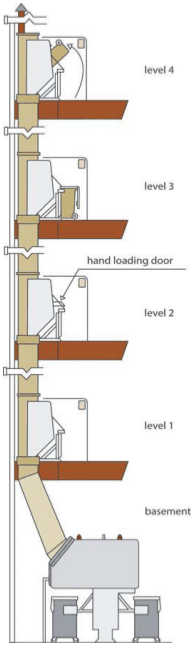
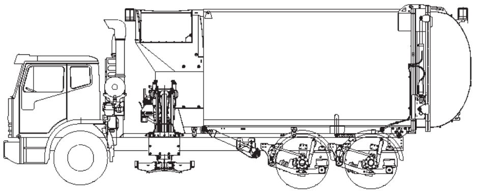
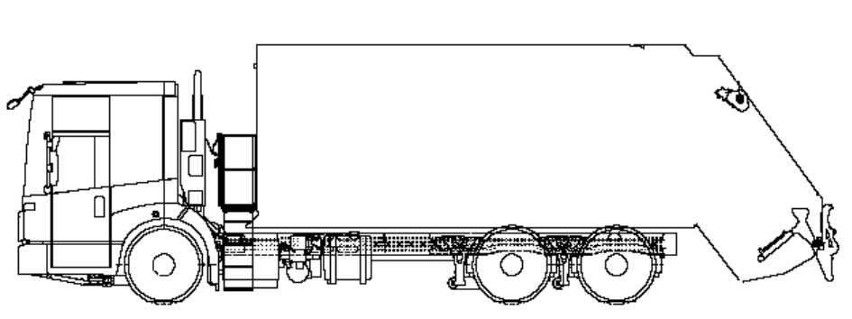

## 4. COLLECTION POINT

Has a collection point and loading area been nominated on scaled plans accompanying the Development Application? Has the development been designed to ensure that access to the collection point can be undertaken by a Heavy Rigid Vehicle?

The Development Application will be required to be accompanied by a traffic statement confirming that the site and collection point has been designed to comply with AS

### 2890.2 Parking Facilities: Off-Street Commercial Vehicle

Facilities.

#### 13.2.4 Plans and drawing checklist

The following checklist is designed to help ensure the OWMP is accompanied by sufficient information to allow the application to be assessed.

Submit drawings to scale, clearly indicating the location of, and provisions for, storing and collecting waste and recycling during operational operation.

Refer to relevant sections of this document for specific objectives and measures.

| Do the OWMP and drawings indicate: | Tick Yes | Drawing/plan number |
|---|---|---|
| Space relating to movement and storage of waste |  |  |
| Size and location(s) of on-site waste storage area(s) |  |  |
| Recycling bins placed next to residual waste bins |  |  |
| Space for access to and manoeuvring of bins and equipment |  |  |
| Space in kitchens, or alternative internal locations, for two days’ worth of waste and recyclables |  |  |
| Bulky waste storage areas or rooms |  |  |
| Any additional waste and recycling facilities such as waste chutes, compaction equipment or storage areas for problem wastes e.g. unwanted clothing, batteries, mobile phones (if applicable) |  |  |
| Access |  |  |
| Access route(s) for occupants to deposit waste in storage room or area(s) |  |  |
| Access and travel routes for waste collection vehicles to collect waste from storage room or area(s) |  |  |
| Access for occupants to bin storage rooms and bin carting route to and from the collection point |  |  |
| Bin carting gradient |  |  |
| Location of final collection point |  |  |
| Clearance, geometric design and strength of internal access driveways and roads |  |  |
| Amenity |  |  |
| Aesthetic design of waste storage areas |  |  |
| Signage - type and location |  |  |
| Construction details of storage areas, including floors, walls, doors, ceiling design, sewer connection, lighting, ventilation, security, wash down provisions |  |  |
| Chutes and compaction equipment |  |  |
| Designed in accordance with the requirements of the Building Code of Australia |  |  |
| Location of waste equipment shown on the drawings (e.g. compactors, chutes) |  |  |
| Storage areas |  |  |
| Have adequate ventilation |  |  |
| Have adequate lighting |  |  |
| Have floor drainage to sewer |  |  |

| Where storage areas are separate rooms such as in basements or on ground level they are fitted with doors that: • open from both in and outside the room • are self-closing • are wide enough (wider enough to allow easy manoeuvring of the largest bin to be supplied or can be a roller door) • are well fitted • are durable. |
|---|
| Have a cold and hot water supply |
| Protect the interior from rain and other inclement weather |
| Are suitably enclosed, covered and maintained to prevent polluted wastewater runoff from entering the stormwater system |
| Are secure and have lockable doors and windows |
| Have roof drainage to the stormwater system |
| Have floors of steel trowel finish concrete |
| Have durable and smooth walls and ceilings made of an impermeable material |
| Have covered walls and floor intersections |
| Are located away from residences to minimise noise |
| Collection point - if at kerbside |
| Has room at the kerb to accommodate all the bins required to be collected without obstructing footpaths or driveways |
| Is not obstructed by kerbside objects like trees, street poles, bus stops |
| Is not located so collection is affected by parking spaces or speed humps |
| Allows safe and easy collection by collection vehicles |
| Is located away from residences to minimise noise |
| Has step-free access between the bin storage areas and the collection point |
| Is shown on the drawings |
| If collection takes place on-site |
| Collection vehicles can enter and exit the site in a forward direction |
| Collection vehicles do not impede general access by other road users to, from or within the site |
| Access driveways are of sufficient strength to support vehicles |
| Access is easy and safe for collection vehicles |
| Access driveways and internal roads are designed in accordance with AS 2890.2 |
| Travel paths of waste collection vehicles are shown on the drawings |

### 13.3 Appendix C - Waste Chutes

#### 13.3.1 Design Requirements

All chute systems must meet the following design requirements:

> [Picture text on page 91 is stored in the PDF without readable letters (no character map), so it could not be copied; see the original PDF.]

Garbage chutes must be constructed in accordance with the requirements of the Building Code of Australia (BCA). Garbage chutes must be located and insulated in a manner that reduces noise impacts. Chutes, service openings and charging devices must be constructed of material, such as metal, that is smooth, durable, impervious, non-corrosive and fire resistant. Chutes, service openings and charging devices must be capable of being easily cleaned. Chutes must be cylindrical and should have a diameter of at least 500 mm. There must not be any bends or sections of reduced diameter in the main shaft of the chute. Internal overlaps in the chute must follow the direction of waste flow. Branches connecting service openings to the main chute must be no more than 1 m long. Chutes must deposit waste directly into a bin or compactor located in a waste or recycling storage room. A cut-off device must be located at or near the base of the chute, so the bottom of the chute can be closed when the bin or compacting device at its base is withdrawn or being replaced. The upper end of a chute should extend above the roofline of the building. The opening of the chute must be self-closing and must not project into the main chute. The upper end of a chute should be protected from weather in a manner that does not impede the upward movement of air out of it. Chute discharge should be caged or enclosed if the discharge point is in the same waste room that is accessible to residents.

#### 13.3.2 Chute Service Room Design Requirements

The opening of the waste chute should be located in a dedicated service room located on each floor. If a recycling chute is not installed, the dedicated service room containing the waste chute opening must also allow residents to deposit recycling and other large materials like cardboard boxes in bins and containers. Each service room must be located for residents to conveniently access and must be well ventilated and well lit. The floors, walls and ceilings of service rooms must be finished with smooth, durable materials that can be easily cleaned. Service rooms must include signage that clearly describes the types of materials that can be deposited in the waste and recycling chute and the types of materials which should be deposited in recycling bins.

#### 13.3.3 Chute Management

To encourage recycling, waste chutes must not be used to dispose of recyclable materials. Signage to this effect should be displayed near service openings.

Arrangements must be in place for the regular maintenance and cleaning of waste chutes and any associated service rooms, service openings and charging devices.

Arrangements must be in place for the regular transfer of recyclable materials stored in service rooms to the main waste or recycling storage room. The following diagram depicts a standard design for a waste chute system:

> [Picture on page 92: a picture, saved as a picture (images/waste-management-technical-page-92-9.gif, 150 dpi).]

#### Example of a waste chute system

Source: NSW EPA, Better practice guide for resource recovery in residential developments Visit: Better practice guide for resource recovery in residential developments (PDF 5.1MB)

### 13.4 Appendix D - Education Initiatives

#### 13.4.1 Waste Signs

Signs for waste, recycling and organics bins should comply with the Council’s signs or with the NSW EPA’s standard signs which can be found at www.epa.nsw.gov.au/wastetools/signs-posters-symbols.htm. Council can provide the necessary educational signage and material to better manage waste on site, relevant to the development type.

#### 13.4.2 Safety Signs

The design and use of safety signs for waste rooms and enclosures should comply with Australian Standard AS 1319 - Safety signs for the occupational environment. Safety signs should be used to: Regulate and control behaviour regarding safety and security; Warn of hazards; Provide emergency information, including fire protection information.

### 13.5 Collection Vehicle Dimensions

The typical dimensions of a Collection Vehicle should be based on the table below when considering your development design and waste management planning. Developments that require Council Collection Vehicles to enter the site for the collection of waste, recycling and/or organics must be deigned to accommodate on-site Collection Vehicle movement. Specific dimensions are subject to chassis, wheelbase, and option selection with the most appropriate available Collection Vehicle to be used for each respective waste stream. Please liaise with Council’s Waste & Cleansing Services regarding the design of development proposals that involve CollectionVehicles entering the site. Services will not be provided where there are undue risks.

> [Picture on page 94: a picture, saved as a picture (images/waste-management-technical-page-94-11.gif, 150 dpi).]

> [Picture on page 94: a picture, saved as a picture (images/waste-management-technical-page-94-12.gif, 150 dpi).]

| Description | Typical Allowance Required |
|---|---|
| Length Overall | 11 metres |
| Vehicle Height 3.9 metres |  |
| Operational Clearance Height | 4.5 metres |
| Width Overall 2.5 metres |  |
| On-Site Width Path (Carriageway) | 3.5 metres |
| Turning Circle (wall to wall) 25 metres |  |
| Swept Path | 21 metres |
| Gross Vehicle Mass 24 tonnes |  |

### 13.6 Document Implementation

#### 13.6.1 Strategy Responsibilities

#### General Manager / Director(s)

The Executive Committee evaluates the provisions of the Waste Management DCP and make decisions to ensure the effective provision of the Waste Management DCP are in accordance with the enabling legislation and Council’s values and policies.

#### Manager Waste and Cleansing Services

The Manager Waste and Cleansing Services’ four major functions are to plan, organise, lead and control in accordance with the enabling legislation and Council’s values and policies, as well as arrange appropriate resourcing, within budgetary constraints, for the effective implementation of this Waste Management DCP.

#### Coordinator Waste Avoidance and Resource Recovery

The Coordinator Waste Avoidance and Resource Recovery interprets the legislation and Council policies and coordinates the implementation of this Waste Management DCP and associated documentation in accordance with the enabling legislation and Council values and policies.

#### Coordinator Operations Waste and Cleansing Services

Ensure the effective implementation of the procedures in accordance with the enabling legislation and Council values and policies that deal with issues arising from the day-to-day operational provision of the services in relation to the Waste Management DCP.

#### Supervisor Waste Contracts & Development Applications

Evaluates the WMP’s in collaboration with Council’s Planning & Development department and Council’s Waste and Cleansing Services.

#### 13.6.2 Document Control

#### Monitoring, Evaluation and Review

This Waste Management DCP will be reviewed as required to respond to changes in local, regional, NSW or Federal strategies and in responses to significant changes affecting waste management, waste avoidance and resource recovery.

#### Version History

| Version | Release Date | Author | Reason for Change |
|---|---|---|---|
| 1.0 | June 2022 | Waste & Cleansing Services | New Waste Management DCP Technical Specifications 2022 for Bayside Council – the amalgamation and replacement of two former Local Government documents. |
