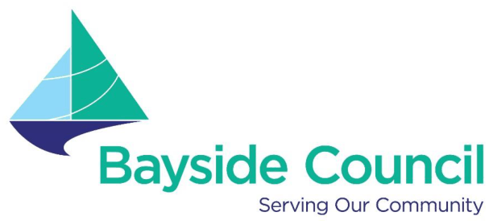

# Bayside Development Control Plan 2022 - Waste Management Technical Specification 2022

> This chapter is split into 23 section file(s), one per numbered heading, in the order they appear in the PDF.

Source PDF: [waste_management_technical_specification_2022.pdf](waste_management_technical_specification_2022.pdf)

> [Picture on page 1: a picture, saved as a picture (images/waste-management-technical-page-1-1.gif, 150 dpi).]

### Waste Management  Technical

### Specification 2022

#### Adopted 22 March 2023 Effective 10 April 2023

> [Picture on page 1: a picture, saved as a picture (images/waste-management-technical-page-1-6.gif, 150 dpi).]

### The Journey to a Circular Economy

### DRAFT October 2020

| 1. | Introduction .............................................................................................................................. 12 1.1 Aims and Objectives ....................................................................................... 14 1.2 Purpose .......................................................................................................... 15 1.3 Construction and Demolition Stages ............................................................... 15 1.4 Building Design ............................................................................................... 15 1.5 Applicability ..................................................................................................... 16 1.6 Structure of Document .................................................................................... 17 1.7 Waste Management Plan(s) (WMP) ................................................................ 17 1.7.1 Purpose of a WMP ............................................................................... 17 1.7.2 Types of WMPs ................................................................................... 18 1.7.3 Submitting a Waste Management Plan (WMP) .................................... 18 1.7.4 Complying Development ...................................................................... 19 1.7.5 Consultation with Council ..................................................................... 19 |
|---|---|
| 2. | Demolition Waste Management Plan (DWMP) ...................................................................... 20 2.1 Applicability ..................................................................................................... 20 2.2 Aims & Objectives ........................................................................................... 20 2.3 Controls .......................................................................................................... 20 |
| 3. | Construction Waste Management Plan (CWMP) .................................................................. 23 3.1 Applicability ..................................................................................................... 23 3.2 Aims & Objectives ........................................................................................... 23 3.3 Controls .......................................................................................................... 23 |
| 4. | Operational Waste Management Plan (OWMP) - Waste Management Systems ............... 25 4.1 Applicability ..................................................................................................... 25 4.2 Aims & Objectives ........................................................................................... 25 4.3 General Controls and Requirements ............................................................... 25 4.4 Bin Storage ..................................................................................................... 26 4.5 Methods of Bin Collection ................................................................................ 27 4.6 Kerbside Bin Collections ................................................................................. 27 4.7 On-Site Bin Collections ................................................................................... 28 4.8 Wheel Out - Wheel Back Collections ............................................................... 28 4.9 Visual Amenity ................................................................................................ 29 |
| 5. | Low Rise – Low Density Dwelling Developments ................................................................ 30 5.1 Applicability ..................................................................................................... 30 5.2 Waste Generation & Service Requirements .................................................... 30 5.2.1 Collection Requirements – Former Botany LGA until Feb 2030 ........... 30 5.2.2 Collection Requirements – Former Rockdale LGA until Feb 2030 ....... 30 5.2.3 Collection Requirements – All areas of Bayside from Feb 2030 ........... 31 5.2.4 Bin Dimensions .................................................................................... 31 5.3 Design Control ................................................................................................ 31 5.3.1 Bin Storage & Collection Point(s) ......................................................... 31 5.3.2 Bulky Waste Storage & Collection Point(s) .......................................... 31 5.3.3 Collection Vehicle Access .................................................................... 31 5.3.4 Bin System .......................................................................................... 32 |
| 6. | Low Rise – Medium Density Multiple Dwellings Developments ......................................... 33 6.1 Applicability ..................................................................................................... 33 6.2 Waste Generation & Service Requirements ..................................................... 33 6.2.1 Collection Requirements – Former Botany LGA until Feb 2030 ........... 33 6.2.2 Collection Requirements – Former Rockdale LGA until Feb 2030 ....... 33 6.2.3 Collection Requirements – All areas of Bayside from Feb 2030 ........... 34 6.2.4 Bin Dimensions .................................................................................... 34 6.3 Design Control ................................................................................................ 34 6.3.1 Bin Storage & Collection Point(s) ......................................................... 34 6.3.2 Bulky Waste Storage & Collection Point(s) .......................................... 34 |

|  |  | 6.3.3 Collection Vehicle Access .................................................................... 35 6.3.4 Bin System .......................................................................................... 35 |
|---|---|---|
| 7 | Residential Flat Building (RFB): Low to Medium Rise Units .............................................. 36 7.1 Applicability ..................................................................................................... 36 7.2 Waste Generation & Service Requirements .................................................... 36 |  |
|  | 7.3 | 7.2.1 Collection Requirements – Former Botany LGA until Feb 2030 ........... 36 7.2.2 Collection Requirements – Former Rockdale LGA until Feb 2030 ....... 37 7.2.3 Collection Requirements – All areas of Bayside from Feb 2030 ........... 37 7.2.4 Bin Dimensions & Bin Numbers ........................................................... 37 Design Control ................................................................................................ 38 |
|  | 7.4 | 7.3.1 Bin Storage & Collection Point(s) ........................................................ 39 7.3.2 Bulky Waste Storage & Collection Point(s) .......................................... 40 7.3.3 Collection Vehicle Access .................................................................... 41 Waste Management Equipment ...................................................................... 42 |
|  | 7.5 7.6 7.7 | 7.4.1 Bin System .......................................................................................... 42 7.4.2 Waste, Recycling or Organics Chute ................................................... 43 7.4.3 On-Site Compaction Units ................................................................... 43 7.4.4 Other On-Site Equipment ..................................................................... 44 Indemnity ........................................................................................................ 44 On-going Maintenance .................................................................................... 44 Innovation ....................................................................................................... 44 |
| 8 | Residential Flat Building (RFB): Medium to High Rise Units.............................................. 45 8.1 Applicability ..................................................................................................... 45 8.2 Waste Generation & Service Requirements .................................................... 45 |  |
|  | 8.3 | 8.2.1 Collection Requirements – Former Botany LGA until Feb 2030 ........... 45 8.2.2 Collection Requirements – Former Rockdale LGA until Feb 2030 ....... 46 8.2.3 Collection Requirements – All areas of Bayside from Feb 2030 ........... 46 8.2.4 Bin Dimensions .................................................................................... 46 Design Control ................................................................................................ 48 |
|  | 8.4 | 8.3.1 Bin Storage & Collection Point(s) ......................................................... 48 8.3.2 Bulky Waste Storage & Collection Point(s) .......................................... 49 8.3.3 Collection Vehicle Access .................................................................... 50 Waste Management Equipment ...................................................................... 51 |
|  | 8.5 8.6 8.7 | 8.4.1 Bin System .......................................................................................... 51 8.4.2 Waste, Recycling or Organics Chute ................................................... 51 8.4.3 On-Site Compaction Units ................................................................... 52 8.4.4 Other On-Site Equipment ..................................................................... 52 Indemnity ........................................................................................................ 52 On-going Maintenance .................................................................................... 53 Innovation ....................................................................................................... 53 |
| 9 | Residential Flat Building (RFB): High Rise Units ................................................................. 54 9.1 Applicability ..................................................................................................... 54 9.2 Waste Generation & Service Requirements .................................................... 54 |  |
|  | 9.3 | 9.2.1 Collection Requirements – Former Botany LGA until Feb 2030 ........... 54 9.2.2 Collection Requirements – Former Rockdale LGA until Feb 2030 ....... 55 9.2.3 Collection Requirements – All areas of Bayside from Feb 2030 ........... 55 9.2.4 Bin Dimensions .................................................................................... 55 Design Control ................................................................................................ 56 |
|  | 9.4 | 9.3.1 Bin Storage & Collection Point(s) ......................................................... 56 9.3.2 Bulky Waste Storage & Collection Point(s) .......................................... 57 9.3.3 Collection Vehicle Access .................................................................... 58 Waste Management Equipment ...................................................................... 58 9.4.1 Bin System .......................................................................................... 58 9.4.2 Waste, Recycling or Organics Chute ................................................... 59 |

|  | 9.4.3 On-Site Compaction Units ................................................................... 59 9.4.4 Other On-Site Equipment ..................................................................... 60 9.5 Indemnity ........................................................................................................ 60 9.6 On-going Maintenance .................................................................................... 60 9.7 Innovation ....................................................................................................... 60 |
|---|---|
| 10 | Mixed Used Development ....................................................................................................... 61 10.1 Applicability ..................................................................................................... 61 10.2 Residential Waste Generation & Service Requirements .................................. 61 10.3 Commercial Waste Generation & Service Requirements ................................ 62 10.4 Bin Dimensions ............................................................................................... 63 10.5 Design Control ................................................................................................ 63 10.5.1 Residential Bin Storage & Collection Point(s) ...................................... 63 10.5.2 Commercial Bin Storage & Collection Point(s) ..................................... 64 10.5.3 Residential Bulky Waste Storage & Collection Point(s) ........................ 65 10.5.4 Collection Vehicle Access .................................................................... 66 10.6 Waste Management Equipment ...................................................................... 67 10.6.1 Residential Bin System ........................................................................ 67 10.6.2 Waste, Recycling or Organics Chute ................................................... 67 10.6.3 On-Site Compaction Units ................................................................... 68 10.6.4 Other On-Site Equipment ..................................................................... 68 10.7 Indemnity ........................................................................................................ 68 10.8 On-going Maintenance .................................................................................... 68 10.9 Innovation ....................................................................................................... 68 |
| 11 | Commercial Development ...................................................................................................... 69 11.1 Applicability ..................................................................................................... 69 11.2 Waste Generation & Service Requirements .................................................... 69 11.3 Bin Dimensions ............................................................................................... 70 11.4 Design Control ................................................................................................ 70 11.4.1 Bin Storage & Collection Point(s) ......................................................... 72 11.4.2 Collection Vehicle Access .................................................................... 73 11.6 Waste Management Equipment ...................................................................... 74 11.6.1 Bin System .......................................................................................... 74 11.6.2 Waste, Recycling or Organics Chute ................................................... 75 11.6.3 On-Site Compaction Units ................................................................... 75 11.6.4 Other On-Site Equipment ..................................................................... 75 11.7 Indemnity ........................................................................................................ 76 11.8 On-going Maintenance .................................................................................... 76 11.9 Innovation ....................................................................................................... 76 |
| 12 | Industrial Development ........................................................................................................... 77 12.1 Applicability ..................................................................................................... 77 12.2 Controls & Requirements ................................................................................ 77 |
| 13 | Appendices .............................................................................................................................. 78 13.1 Appendix A - Reuse & recycling potential of construction & demolition (C & D) material ........................................................................................................... 78 13.2 Appendix B - Waste Management Plan Template ........................................... 78 13.2.1 Stage 1 - Demolition ................................................................................ 80 13.2.2 Stage 2 - Construction ............................................................................. 81 13.2.3 Stage 3 - On-Going Use (Operational) ..................................................... 82 13.2.4 Plans and drawing checklist ..................................................................... 89 13.3 Appendix C - Waste Chutes ............................................................................ 91 13.3.1 Design Requirements .............................................................................. 91 13.3.2 Chute Service Room Design Requirements ............................................. 91 13.3.3 Chute Management ................................................................................. 92 |

| 13.4 | Appendix D - | Education Initiatives ................................................................... | 93 |
|---|---|---|---|
| 13.4.1 | Waste Signs | ............................................................................................. | 93 |
| 13.4.2 | Safety Signs | ............................................................................................. | 93 |
| 13.5 | Collection Vehicle | Dimensions ........................................................................ | 94 |
| 13.6 | Document | Implementation .............................................................................. | 95 |
| 13.6.1 | Strategy | Responsibilities .......................................................................... | 95 |
| 13.6.2 | Document | Control .................................................................................... | 95 |

### Common Terms & Definitions

| Term | Definition / Clarification of Term |
|---|---|
| Approved | Accepted and authorised by the Council. |
| Authority | Any Government (State or Federal), Government department, statutory corporation or other body having power to affect the manner of provision of the waste services or the need for the provision of the waste services by the Council. |
| Better practice guide | The NSW EPA guide which includes advice on design, |
| for resource recovery in | establishment, operation, and ongoing management of waste |
| residential | services, and can be found here: |
| developments | https://www.epa.nsw.gov.au/-/media/epa/corporate- site/resources/warrlocal/19p1559-resource-recovery-in- residential- developments.pdf?la=en&hash=C29AFB3B95D416F29A6F71 1B684C620900174075. |
| Bulky Waste | Also referred to as ‘clean up’ or ‘hard waste’, such as general household waste, which may include white goods, furniture, green waste and other approved items as per Council’s current waste service information. |
| Cluster Housing | Comprised of three (3) or more (>3) dwellings grouped on a site to take advantage of good building areas or views and to conserve large areas of open space. |
| Collection | The manner or method in which different waste streams, such as: garbage; recycling; organics, and bulky items; are serviced by Council, a Council appointed collection contractor, or an approved (by Council) licensed private collection contractor. |
| Collection Point | The Approved point or location from which waste, recycling or organics are collected and transferred to the Collection Vehicle. |
| Collection Vehicle | An approved vehicle operated by Council or its appointed contractor for use in the performance of the Services. |
| Commercial Development | A commercial development as defined in Council’s Local Environment Plan, and includes but is not limited to professional and commercial offices, retail premises, food premises, warehouses, medical facilities, and the commercial components of mixed-use developments. |
| Contractor | A Council appointed waste, recycling, organics and/or Bulky Waste contractor or other body having the delegated authority to provide waste services, including audits, on behalf of Council. |
| Council | Refers to Bayside Council, including any of its authorised officers, or staff under the delegated authority of Bayside Council. |
| Development | Refers to a development application prepared in accordance |
| Application or DA | with the relative provisions of the Environmental Planning and Assessment Act (EP & A Act) 1979, submitted to, assessed and determined by Council under the provisions of this Act, and includes any subsequent modification to the original DA |
| Development Control | A Development Control Plan (DCP) provides detailed planning |
| Plan or DCP | and design guidelines to support the planning controls in the Local Environmental Plan (LEP). It identifies additional controls and standards for addressing development issues at a local level. |

| Dual Occupancy | If attached, means two (2) dwellings on one lot of land that are attached to each other, but does not include a secondary dwelling. |  |
|---|---|---|
|  | If detached, means two (2) detached dwellings on one lot land, but does not include a secondary dwelling. | of |
| Dwelling | means a building or part of a building used, intended to be used, or offers the availability to be used as an Approved place to live, dwell or inhabit. |  |
| Food Organics (FO) | Food waste including fruit and vegetable scraps, processed |  |
|  | food and | leftovers from meals such as meat, fish, chicken, |
|  | bread, egg, egg shells, dairy products, coffee grounds and |  |
|  | tea bags. |  |
| Food Organics Garden | Food Organics and Garden Organics (FOGO) is a collection |  |
| Organics (FOGO) | service that allows food waste or Food Organics (FO) to be added with Garden Organics (GO) waste so it can be recycled into top quality compost. |  |
| Former Botany Local Government Area (LGA) | This refers to the local government area or the boundary of the former City of Botany Bay Council pre-amalgamation in 2016 when it became Bayside Council. |  |
| Former Rockdale Local | This refers to the local government area or the boundary of the |  |
| Government Area | former Rockdale City Council pre-amalgamation in 2016 when |  |
| (LGA) | it became Bayside Council. |  |
| Garden Organics (GO) | Also known as Green Waste, it refers to any organic waste material that is produced as a result of domestic gardening, landscaping, or maintenance activities and includes: grass and lawn clippings; tree, bush and shrub trimmings; prunings, cuttings and branches; and, leaves and cut flowers. |  |

| General Manager | Refers to the General Manager of Bayside Council. |
|---|---|
| Green Waste | Also known as Garden Organics, it refers to any organic waste material that is produced as a result of domestic gardening, landscaping, or maintenance activities and includes: grass and lawn clippings; tree, bush and shrub trimmings; prunings, cuttings and branches; and, leaves and cut flowers. |
| Industrial Development | An industrial development as defined in Council’s Local Environment Plan (LEP), and includes but is not limited to warehouses, factories, manufacturing industries, motor vehicle repairers, wholesalers, and the industrial components of mixed commercial and industrial developments. |
| Local Environment Plan (LEP) | It refers to either the Botany Bay Local Environment Plan 2015 or the Rockdale Local Environment Plan 2012 as they apply to the former Botany and Rockdale LGA’s respectively, until the formal adoption of the Bayside Council Local Environment Plan 2021 or any subsequent equivalent LEP that overrides any of these. |
| Local Government Area | The Local Government Area of the Council within the meaning |
| (LGA) | of the Local Government Act 1993 (and any replacement Act to that Act) as varied from time to time. |

#### Low Rise - Low Density Dwellings

Includes a building or buildings, consisting of the following types of low rise-low density development: Single Dwellings; Dual Occupancies; and, Manor Homes;

The following controls and requirements are also applicable to the following types of small low rise-low density developments that comprise of up to and including four (4) dwellings in total: Villas; Cluster House, Townhouses, and Terraces.

#### Low Rise - Medium Density Multiple Dwellings

Includes a building or buildings, consisting more than four (>4) dwellings (whether or not attached), where each dwelling has an individual entrance and direct private access to private open space at natural ground level, and includes villas, town-houses, terraces, cluster housing, and the like.

#### Manor House

A building containing three or four (3 or 4) dwellings on one (1) lot of land, where:

(a) Each dwelling is attached to another dwelling by a common wall or floor, and

(b) At least one (1) dwelling is partially or wholly located above another dwelling, and

|  | (c) The building contains no more than two (2) storeys (excluding any basement). |
|---|---|
| Mobile Bin (MB) | An Approved and appropriately designed container assembled and manufactured in accordance with Australian Standards, with wheels which may be used in connection with any of the garbage, recycling, and/or organics collection services, with container capacity ranging from 60 to 1100 litres. Also, colloquially referred to as ‘wheelie bins’. |
| Mixed Use Development | A development comprising of mixed residential and commercial components within the one (1) site. |
| Multiple Dwelling | Also known as Terraces, in this guide, it refers to three or more |
| Houses (aka Terraces) | dwellings on one lot. Each dwelling fronts a public road and there are no other dwellings located above or below. |
| Premises | A building of any description and land, whether built on or not. |
| Recyclable Material | Any approved material that has the capacity of being recycled, reused, or reprocessed via a containerised dry recycling bin and includes but is not limited to, recyclable paper and cardboard, glass bottles and containers, and approved rigid plastic and metal packaging and containers. |
| Recycling Service | Refers to the collection and processing of Recyclable Material. |
| Residential Flat | Refers to residential flat buildings of less than four (<4) storeys, |
| Building (RFB): Low to | not including basement or attic space. |
| Medium Rise Units |  |
| Residential Flat Building (RFB): | Refers to residential flat buildings of more than three (>3) and less than seven (<7) storeys, not including basement or attic |
| Medium to High Rise Units | space. |

| Residential Flat | Refers to residential flat buildings of seven (7) storeys and |
|---|---|
| Building (RFB): High | greater, not including basement or attic space. |
| Rise Units |  |
| Single Dwelling | Typically, in most cases this will be a detached free-standing house, but can also include: one dwelling in a conjoined or semi-detached house where the dwelling is on a separate land title with no common property or shared services. one of several similar dwelling houses, each of which is on a separate land parcel, such as in a new subdivision. a change of use (conversion) from a non-residential building, or from a structure that is not approved to be used as a dwelling, to a dwelling house. a secondary dwelling that involves converting non-habitable space (such as a garage) or new construction outside the footprint of the existing (primary) dwelling. |
| Statutory Requirement | Any regulatory or legislative requirement, or instrument of any law, Act or statute made in the state of New South Wales or the Commonwealth of Australia. |
| Townhouse(s) | Comprised of three (3) or more (>3) dwellings on one (1) lot of land, where: (a) They are freestanding, (b) Each dwelling has access at ground level, (c) No part of a dwelling is above any part of any other dwelling, (d) Most have a courtyard and a garage or carport. |
| Terraces | Also known as multiple dwelling houses, are three (3) or more |
| (aka Multiple Dwelling | (>3) dwellings on one (1) lot of land where: |
| Houses) | (a) They are attached, (b) Each dwelling has access at ground level, (c) No part of a dwelling is above any part of any other dwelling, |
|  | and |
|  | (d) dwellings face and generally follow the alignment of one or |
|  | more public roads. |
| Villa(s) | Is a single level dwelling often within a small complex, usually with a private courtyard and an attached garage. |
| Waste Chute | Refers to vertical tubes that run though each floor of a building to the basement where it empties into Mobile Bins. A chute inlet(s) or chute hopper(s) is located on each level. Single chutes are used for garbage only. Chute doors are situated within a bin room on each floor with recycling bins. Independent dual chutes are positioned side by-side within waste cupboards or a bin room on each floor so that residents can dispose of separated garbage and recyclables at the same time. Chutes empty into single bins, or bins mounted on an automatic carousel or linear track system. |
| Waste Level Room | A bin storage and service room located on each habitable floor of a building, known as a Waste Level Room, containing either: |

The chute inlet(s) and enough room for the required number of mobile bins for residents to deposit their waste, recycling and organics, or Enough room for the required number of mobile bins for residents to deposit their waste, recycling and organics without chute inlet(s).

Waste Level Rooms must consider required safety measures, required ventilation, and required rotation and cleaning of bins.

To minimise the floor space required on each Waste Level Room(s), a bin storage area in the basement or ground level can be used to store extra bins for rotational use as Waste Level Room(s) bin(s) become full.

#### Waste Management DCP

Refers to this document, “Bayside Council Waste Management Development Control Plan (DCP) Technical Specification”.

#### Wheel Out – Wheel Back

A type of waste collection service offered by Council where the Council waste collection personnel or their representatives enter the premises to collect the bins and return them to the property after emptying. Can also be referred to as ‘collect and return’ or ‘wheel out – wheel in’ service.

<!-- sections -->
## Sections

1. [1 Introduction](01-1-introduction.md)
2. [2 Demolition Waste Management Plan (DWMP)](02-2-demolition-waste-management-plan-dwmp.md)
3. [3 Construction Waste Management Plan (CWMP)](03-3-construction-waste-management-plan-cwmp.md)
4. [4 Operational Waste Management Plan (OWMP) - Waste Management Systems](04-4-operational-waste-management-plan-owmp.md)
5. [5 Low Rise – Low Density Dwelling Developments](05-5-low-rise-low-density-dwelling.md)
6. [6 Low Rise – Medium Density Multiple Dwellings Developments](06-6-low-rise-medium-density-multiple.md)
7. [7 Residential Flat Building (RFB): Low to Medium Rise Units](07-7-residential-flat-building-rfb-low-to.md)
8. [8 Residential Flat Building (RFB): Medium to High Rise Units](08-8-residential-flat-building-rfb-medium-to.md)
9. [9 Residential Flat Building (RFB): High Rise Units](09-9-residential-flat-building-rfb-high-rise.md)
10. [10 Mixed Used Development](10-10-mixed-used-development.md)
11. [11 Commercial Development](11-11-commercial-development.md)
12. [12 Industrial Development](12-12-industrial-development.md)
13. [13 Appendices](13-13-appendices.md)
14. [1 DEVELOPMENT WASTE AND RECYCLNG GENERATION](14-1-development-waste-and-recyclng.md)
15. [3 SERVICING TYPE](15-3-servicing-type.md)
16. [5 TEMPORARY HOLDING AREAS](16-5-temporary-holding-areas.md)
17. [6 ON-SITE COLLECTION](17-6-on-site-collection.md)
18. [7 WASTE CHUTE SYSTEMS](18-7-waste-chute-systems.md)
19. [8 ON-GOING USE](19-8-on-going-use.md)
20. [1 DEVELOPMENT COMMERCIAL WASTE AND RECYCLING GENERATION](20-1-development-commercial-waste-and.md)
21. [2 BIN ALLOCATION AND SERVICING REQUIREMENTS](21-2-bin-allocation-and-servicing.md)
22. [3 STORAGE OF WASTE BINS](22-3-storage-of-waste-bins.md)
23. [4 COLLECTION POINT](23-4-collection-point.md)
