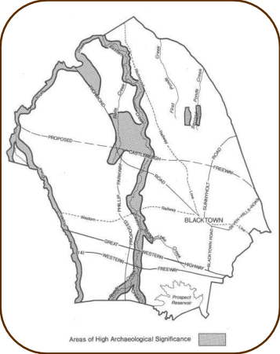

## 4 Environmental protection

### 4.1 Introduction

Council, as well as developers, has a responsibility to ensure that development is undertaken

in a manner which will enhance the existing environment or at least minimise any likely

adverse environmental impacts. This section outlines some Council requirements for

safeguarding the environment as a result of development. Council is required to assess the

environmental impact of each Development Application under ‘Matters for Consideration’

which are in Section 4.15 of the Environmental Planning and Assessment Act 1979.

### 4.2 Areas requiring fill

The filling of land requires separate development consent, except where the proposed fill

forms part of a Development Application for overall development of a site or is exempt under

the provisions of State Environmental Planning Policy (Exempt and Complying Development

Codes) 2008. The DCP maps on Council’s website indicate those areas which require significant filling to

raise lot and land levels above the predicted developed 100-year Average Recurrence

Interval flood level of adjacent creeks. The fill limits and areas shown on the DCP map are indicative only. Final fill areas will be

determined by detailed trunk drainage designs, allotment survey information, the type of

development proposed and adjoining development constraints (e.g. existing or future

roadworks). For these areas Council will impose conditions of development consent regarding type of fill

and compaction of soil. As detailed engineering plans may be necessary, developers will be

required to consult with Council prior to commencement of filling operations.

### 4.3 Heritage

#### 4.3.1  Specified heritage items

Schedule 5 of Blacktown LEP 2015 lists certain buildings, works and relics which are

defined as ‘heritage items’, comprising both European and Indigenous items. The location

of these items is indicated on the Blacktown LEP Heritage Map. Clause 5.10 of Blacktown LEP 2015 sets out the specific requirements relating to proposals

affecting heritage items and items of archaeological heritage, or located in the vicinity of

heritage items listed in Schedule 5.

#### 4.3.2  Development in the vicinity of a heritage item

The setting of a heritage item often contributes to its heritage significance. With an historic

curtilage, the setting can extend beyond current property boundaries, and will be different

for each heritage item. These provisions apply to development that is adjoining and/or

adjacent to a heritage item. ■ Objectives

(a) Ensure that development does not adversely affect the heritage

significance of heritage items, heritage groups or archaeological sites

as well as their settings, distinctive streetscape, landscape and

architectural styles

(b) Ensure that development in the vicinity of a heritage item is responsive

and respectful in terms of height, setback, form and overall design.

■ Controls

(a) Development Applications on land adjacent to and/or adjoining a

heritage item must be accompanied by a Heritage Impact Statement

that addresses:

(i) The impact of the proposed development on the heritage

significance, visual curtilage and setting of the heritage item

(ii) The size, shape and scale of, setbacks for, and the materials to

be used in, any proposed buildings or works

(iii) Any modifications that are needed to reduce the impact of the

proposed development on the heritage significance of the

heritage item

(b) The design and siting of new works must complement the form,

orientation, scale and style of the heritage item

(c) Development must maintain significant or historic public domain views

to and from the heritage item

(d) Development in the same street as a heritage item that is part of a

streetscape of buildings of consistent style, form and materials should

incorporate the dominant style, form and materials of the streetscape

(e) Development is not permitted beneath the drip zone of trees that are

integral to the significance of a heritage item

(f) Materials and colours of the facade of new developments must be

complementary to an adjoining and/or adjacent heritage item

(g) Development must have effective screen planting on side and rear

boundaries adjoining a heritage item, with planting to achieve a

minimum mature height of 10m

(h) Front and side fences are to be no higher than the fence on an

adjoining heritage item. Front fences should be open and transparent,

such as timber picket or metal palisade. Side fences should be timber.

No metal panel fencing is to be constructed on the boundary of any

heritage item.

#### 4.3.3  Archaeological sites and areas of significance

■ Known archaeological sites These are sites which have been recorded and managed by the Office of

Environment and Heritage (OEH) via the Aboriginal Heritage Information

Management System (AHIMS). Some are listed in Schedule 5 of Blacktown

LEP 2015 and there are others that are indicated on the DCP map. As a

condition of development consent to develop land on which a site has been

located, the applicant will be required to consult with the OEH to determine

its requirements, it is advised to undertake this at the earliest possible stage

as it may be necessary to take into account the location of the archaeological

site in designing the development or, alternatively, obtain a permit to destroy

in relation to the development.

■ Areas of high archaeological significance These areas are indicated on Figure 4.1 and are shown in detail on the DCP

map on Council’s website. There is a high likelihood of archaeological sites

occurring in these locations. Therefore, it is advised to contact OEH at the

earliest possible stage. An Aboriginal Heritage Impact Permit (AHIP) application will likely be

required. An AHIP is a legal document issued by the OEH which allows

applicants to remove or in some way impact the object or place when no

other options are available. The OEH aims to protect and manage Aboriginal

objects and places. An AHIP is a last resort.

> [Picture on page 23: a picture, saved as a picture (images/part-a-introduction-and-general-guidelines-page-23-12.gif, 150 dpi).]

#### Figure 4.1 Areas of high archaeological significance

■ Other areas Areas other than those noted above are substantially developed. There is

little likelihood of finding archaeological sites in such areas and no further

archaeological survey is required. However, some sites have been found in

these areas. Sites which are found to have archaeological significance will

have a condition of development consent requiring consultation with OEH. In addition to the above requirements, applicants are advised to ensure that

they do not contravene the National Parks and Wildlife Act 1974 relating to

Aboriginal archaeological remains. In particular:

(a) Anyone who discovers an Aboriginal relic must report it to the OEH

(b) No-one is permitted to destroy, deface or damage an Aboriginal site or relic

without an AHIP or OEH consent. This applies to all tenures of land including

freehold property and Crown land

(c) Research work into sites, involving disturbing, excavating or collecting relics,

requires a permit from the OEH.

### 4.4 Pollution control

The following requirements under this Section will be applied to all types of

development in all zones, where relevant to the particular Development

Application.

#### Air pollution

The emission of air impurities, as defined under the Protection of the Environment

Operations Act 1997, is to be controlled to the satisfaction of Council at all times.

Approval may be required from the Office of Environment and Heritage for some

development.

#### Water pollution

If the premises are subject to licensing under the Protection of the Environment

Operations Act 1997, any conditions of such a licence will form part of any

development approval.

#### Noise pollution

Any machinery or activity considered to create a noise nuisance must be

adequately sound- proofed in accordance with the provisions of the Protection of

the Environment Operations Act 1997. The Environment Protection Authority may

require certain premises to be licensed under the Protection of the Environment

Operations Act 1997. The use of mechanical plant and equipment may be restricted where sites are

located near a residential area. Developments located near residential areas

should be designed so that the development does not cause a noise nuisance.

### 4.5 Noise reduction

Expected traffic volumes on designated roads may create noise which will exceed

the level generally acceptable by the community for residential development.

Applicants wishing to develop residential land adjacent to designated roads should

have regard to the future amenity of the residential development so created. Noise

can be reduced by sensitive site planning, architectural design, construction

techniques and noise barriers.

### 4.6 Bush fire prone land

Development subject to bush fire risk will be required to address the requirements

of the NSW Rural Fire Service Guidelines entitled Planning for Bush Fire

Protection (2019).

### 4.7 Development adjoining rail corridors and high volume roads

Development in areas that are in or adjacent to rail corridors or high volume roads

should consider NSW Department of Planning’s Development Near Rail Corridors

and Busy Roads – interim guideline.

### 4.8 Cool roofs

Urban heat reduction is to be considered in the design and selection of materials in

all built development. The Solar Reflectance Index is an indicator of the ability of a

roof surface to return solar energy to the atmosphere. All developments must meet

minimum Solar Reflectivity Index values with the following specific exceptions:

• where heritage requirements preclude the use of cool roofing materials, or

• it can be demonstrated that glare would be a problem for particular locations

above the building’s roof. Roofing should achieve nominated Solar Reflectance Index minimums:

| Roof Pitch | Solar Reflectance Index minimum |
|---|---|
| Less than 15° | 64 |
| Greater than 15° | 34 |
| Rooftop terraces | 28 |

#### Table 4.1  Solar Reflectance Index based on angle of roof pitch

• at least 75% of the roof area should meet nominated Solar Reflectance Index

values and/or be designed as a green roof. Areas where solar panels (Photo

Voltaic) are mounted flat on a roof can be excluded and all other roof areas

with Photo Voltaic panels count toward the Cool Roof area calculation.

• all roof materials must have a minimum 3-year manufacturer guarantee. To demonstrate compliance, provide:

• a site plan illustrating all roof surface areas and associated Solar Reflectance

Index values or notation as green roof, and

• a material data sheet for compliant roofing and hard-scaping materials

highlighting the three year or initial Solar Reflectance Index for the product.
