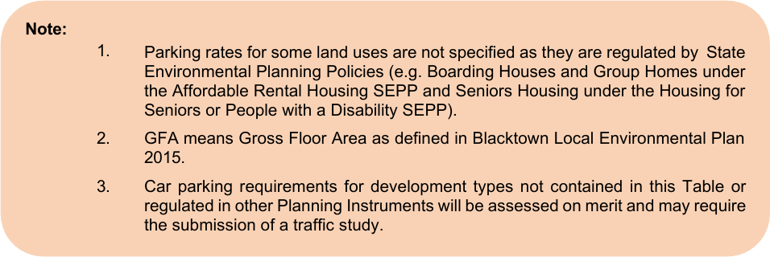

## 7 Car parking

Council’s car parking requirements are largely based on the standards applied by the Roads

and Maritime Services in its publication Policies Guidelines and Procedures for Traffic

Generating Developments.

### 7.1 Objectives

Recognising the varying availability of public transport within Blacktown, the aim of the car

parking provisions of Blacktown DCP 2015 is to provide a comprehensive guide for the

provision of parking for new development in order to:

(a) Ensure adequate traffic safety and management

(b) Ensure an adequate environmental quality of parking areas (both safety and

amenity)

(c) Provide parking areas that are convenient and sufficient for the use of

employees and visitors generated by new developments.

### 7.2 General principles

Council will take the following factors into account in determining car parking provision for a

particular development:

(a) The size and type of the development and its traffic generation

(b) The availability and accessibility of other public parking

(c) Traffic volumes on the street network, including expected future traffic

volumes relating to the City's road hierarchy

(d) Hours of operation and any other specific characteristics of the development

proposal.

### 7.3 Specific land use requirements

Car parking is to be provided for specific types of development in accordance with the

standards shown in Table 6.1. Parking is to be provided off-street and is to be readily

identifiable and accessible from public roads. The parking requirements in Table 7.1 apply to development in general. For activities not

specifically mentioned, car parking requirements will be determined on the merits of the

application. Additionally, you should check the relevant parts of Blacktown DCP 2015 to

ensure that there are no site specific parking requirements that apply to your site. For developments incorporating a number of related land uses, a separate calculation will be

made for each component. Parking needs will be calculated based on the peak demand time.

Thus, where peak demand is staggered, Council may permit a reduction in the total number

of spaces otherwise required. In respect of existing premises being remodelled:

(a) If the remodelling does not result in increased floor space and the use of the

building is not significantly changed, then additional parking provision will not

be required

(b) If the remodelling results in an increased floor area, then additional parking

will be required in respect of the increased area

(c) If the use of the building is changed, this will be taken into account in

assessing the parking required as well as any increase in floor space.

| Specific land use | Car parking requirement |
|---|---|
| Attached dwelling development | Where a dwelling has a direct public road frontage 1 space per 1 or 2 bedroom dwelling behind the building setback 2 spaces per 3 or more bedroom dwelling behind the building setback Where a dwelling does not have a direct public road frontage As per above plus 1 space per 2.5 dwellings (or part thereof) for visitor parking |
| Bulky goods premises | 1 space per 45sq.m GFA |
| Child care centre | 1 space per employee, plus 1 space per 6 children or part thereof for parents and visitors |
| Community facility and place of public worship | 1 space per 4 seats or 1 space per 10sq.m of seating area, whichever is the greater |
| Dual occupancy and semi-detached dwellings | Residential parking 1 space per 1 or 2 bedroom dwelling 2 spaces per 3 or more bedroom dwelling Plus 1 space per battle-axe lot for visitor parking, but only for dual occupancy |
| Dwelling house | 2 spaces per dwelling |
| Educational establishment | For primary and secondary schools 1 space per staff member Plus 1 space per 100 students Plus 1 space for delivery vehicles, drop-off area and buses as appropriate For senior high schools only In addition to the above, 1 space per 5 students in Year 12 For tertiary educational establishments 1 space per 5 seats or 1 space per 10sq.m floor area, whichever is the greater |

| Specific land use | Car parking requirement |
|---|---|
| Entertainment facility | 1 space per 8 seats or 1 space per 15sq.m GFA, whichever is greater |
| Function centre | Land zoned B3 Commercial Core or B4 Mixed Use 1 space per 30sq.m GFA Elsewhere 1 space per 10sq.m of dining area, plus 1 space per 2 employees |
| Gymnasium | 1 space per 25sq.m GFA |
| Health consulting rooms | 2 spaces for each surgery Plus 1 space for each employee Note: A minimum of 4 spaces shall be provided for development containing 1 surgery only |
| Hotel or motel accommodation, serviced apartments and bed and breakfast accommodation | 1 space per unit Plus 1 space per 2 employees Plus 1 space per 10sq.m of dining area Plus 1 space per 3 seats of function area |
| Light industry, general industry, heavy industry and warehouse or distribution centre | 1 space per 75sq.m GFA Plus 1 space per 40sq.m GFA for the office component |
| Medical centre | 1 space per staff member, plus additional visitor car parking at a rate of 1 space per 30 sqm |
| Multi dwelling housing | Residential parking 1 space per 1 or 2 bedroom dwelling 2 spaces per 3 or more bedroom dwelling Visitor parking 1 space per 2.5 dwellings (or part thereof) |

| Specific land use | Car parking requirement |
|---|---|
| Office premises | Blacktown CBD Refer to Part D Outside the Blacktown CBD 1 space per 40sq.m GFA |
| Pub and registered club | Land zoned B3 Commercial Core or B4 Mixed Use Assessed on merit Elsewhere 1 space per 18.5sq.m GFA |
| Residential flat building | Blacktown CBD Refer to Part D Outside the Blacktown CBD 1 space per 1 or 2 bedroom dwelling 2 spaces per 3 or more bedroom dwelling Plus 1 space per 2.5 dwellings for visitor parking (or part thereof) |
| Restaurant or café | Land zoned B3 Commercial Core or B4 Mixed Use 1 space per 30sq.m GFA Elsewhere 1 space per 10sq.m of dining area, plus 1 space per 2 employees |
| Retail premises and business premises | Blacktown CBD Refer to Part D Outside the Blacktown CBD 200sq.m or greater – 1 space per 22sq.m GFA Less than 200sq.m – 1 space per 30sq.m GFA |
| Service station | 6 spaces per work bay Plus 1 space per 20sq.m ancillary retail GFA |
| Sex services premises | 1 space per employee, 1 space per room and 1 space for a manager. Stacked parking is not acceptable |

| Specific land use | Car parking requirement |
|---|---|
| Shop top housing | For the residential component, refer to the residential flat building car parking requirements in this table For other components of shop top housing development, car parking requirements are determined by the type of land use and will need to address that specific land use’s car parking requirement in this table |
| Takeaway food and drink premises | 12 spaces per 100sq.m GFA. Plus 1 space per 5 seats or 1 space per 10sq.m dining area, whichever is the greater |
| Tennis centre | 3 spaces per court |
| Vehicle sales or hire premises | 1.5 spaces per 200sq.m site area |

#### Table 7.1 Car parking rates

> [Picture on page 48: a picture, saved as a picture (images/part-a-introduction-and-general-guidelines-page-48-3.gif, 150 dpi).]
> Words printed on the picture (title and legend, copied from the PDF):
> Note:
> Parking rates for some land uses are not specified as they are regulated by State
> Environmental Planning Policies (e.g. Boarding Houses and Group Homes under
> the Affordable Rental Housing SEPP and Seniors Housing under the Housing for
> Seniors or People with a Disability SEPP).
> GFA means Gross Floor Area as defined in Blacktown Local Environmental Plan
> 2015.
> 1.
> 2.
> 3\. Car parking requirements for development types not contained in this Table or
> regulated in other Planning Instruments will be assessed on merit and may require
> the submission of a traffic study.

### 7.4 Design

#### 7.4.1 Location of parking area

Within the development site the location of the parking area should have regard to: (i)

The site conditions, such as slope and drainage

(ii)

The visual amenity of the development and the adjacent sites

(iii)

The proximity of the parking area to any neighbouring residential areas

(iv)

The relationship of the building/s to the parking area

(v)

The relationship of the parking area to the street.

#### 7.4.2 Access

Car parking areas should be designed so that vehicles can enter and leave the site in a

forward direction. Ingress and egress to or from the site should be located where they will cause the least

interference with vehicular and pedestrian movement on public roads. Direct access should

not be gained off existing or proposed high volume roads where an alternative access can be

provided. Road access to parking areas will not be permitted in close proximity to traffic signals,

intersections or where sight distance is considered inadequate by Council in accordance with

Austroad’s Guide to Traffic Management. The number of access points to be provided from any site to any one street frontage should

be limited to one ingress and one egress. Parking areas should have a separate entrance and exit where more than 50 spaces are

provided or where the development generates a high turnover of traffic, such as a

supermarket or a drive-in service facility. The potential for on-street queuing should be eliminated by the provision of sufficient standing

area for vehicles entering the carpark and loading areas.

#### 7.4.3 Maneuvering

All parking bays should be readily accessible. The provision of adequate space for the

maneuvering of vehicles, particularly rigid and articulated heavy vehicles, may be necessary

depending upon the type of development. The NSW Roads and Maritime Services’ standards

for car, truck and semi-trailer design turning paths (which are available from Council) should

be used to determine the layout of parking areas. Dead-end parking aisles will generally not be permitted. Consideration will be given to their

provision in small parking areas or when reserved for a specific low turnover use (such as for

employees) which is signposted in that way.

#### 7.4.4 Bay and aisle dimensions

Minimum bay and aisle dimensions are outlined in the Australian Standards and have been

incorporated into Table 7.2 below. For more information refer to the relevant sections within

the Australian Standards, AS/NZ 2890.1:2004 and AS/NZ 2890.6:2009 for persons with a

disability.

| Land use | Bay width (in metres) | Bay length (in metres) | Aisle width (2 way in metres) |
|---|---|---|---|
| Low turnover (such as educational establishments, industrial, employee and commuter parking) | 2.5 | 5.2 | 7 |
| Medium turnover (such as sports and entertainment facilities, hotels and restaurants) | 2.6 | 5.2 | 7 |
| High turnover (such as medical centres, shopping centres, department stores and supermarkets) | 2.7 | 5.2 | 7 |
| Residential | 2.8 | 5.5 | 7 |
| Disabled parking bays | 3.2 | 5.5 | 7 |

#### Table 7.2 Minimum bay and aisle dimensions

In general, 90-degree angle parking, from both sides of an access aisle, represents the most

efficient use of available space. Alternative parking layouts (such as angle parking) will be

considered by Council where circumstances warrant. Bays should be greater than the minimum dimensions when located adjacent to an

obstruction wall, fence or the like. The use of stack parking is not favoured and may only be permitted in small quantities under

special circumstances, such as parking for employees or residential developments where 2

spaces are provided for 1 housing unit.

#### 7.4.5 Service vehicle areas

Service vehicle areas should be provided off-street with convenient access. In larger

developments, service areas should operate independently of other parking areas. This

includes access for inspections and cleaning of integrated water cycle management and

water sensitive urban design measures incorporated into roadways.

#### 7.4.6 Pedestrians

Parking areas should be designed to minimise the potential for vehicular / pedestrian conflict.

Pedestrian pathway connections between car parking areas and buildings are desirable.

#### 7.4.7 Bicycle parking and facilities

Applicants are encouraged to incorporate, in the design of their buildings, safe storage/parking areas for bicycles, with adequate shower and change facilities provided for staff (where appropriate).

#### 7.4.8 Parking for persons with a disability

In all parking areas, Council wishes to encourage the provision of parking spaces for the

disabled, located to allow convenient and safe access within sites. All parking areas must

provide for disabled drivers in accordance with the provisions of the Building Code of

Australia. Such spaces shall be clearly marked and signposted for this purpose. In any parking area, Council may require additional parking spaces for the disabled where it

considers that the proposed land use warrants extra provision.

#### 7.4.9 Landscaping

Parking areas should be landscaped to provide shade, to improve the visual amenity of large,

all-weather surfaces and to provide a buffer to neighbouring properties, and may incorporate

integrated water cycle management measures. Landscaping should be an integral part of the parking layout and can be used to separate

conflicting traffic movements (vehicular and pedestrian). Recreational or leisure areas, such

as employee lunch areas, can be incorporated within the landscaping design. Landscaping should be used throughout the carpark and on the perimeter. Care should be

taken, in the selection of species, not to block signs and to allow ingress and egress points

to be clearly visible. Shade trees within parking areas between rows of cars should be

protected from vehicular movement and encroachment (e.g. by the use of wheel stops). Trees should be planted to achieve 50% shading of the carpark at 10-year maturity. Appendix

1 provides a list of the tree species recommended by Council, with native species favoured. A landscaping plan will be required to be submitted with the Development Application, unless

otherwise specified by Council. Such plans must show dimensions, levels, existing vegetation

and the position, type and characteristics of all proposed planting. Where car parking areas utilised at night are located within or adjacent to residential areas,

consideration should be given to the location of lighting and driveways, and noise prevention

measures (such as fencing and/or mounding), to avoid the loss of amenity of these residential

areas.

### 7.5 Materials

All internal roads and car parking areas must be constructed of hard-standing, all-weather

material which is maintained to the satisfaction of Council at all times. Wheel stops should be provided to protect areas from vehicle encroachment, particularly

walls, landscaping and pedestrian areas.

### 7.6 Signs

Parking areas should be well signposted, to indicate the availability of off-street parking, with

entry and exit points clearly visible from both the street and the site. Pavement arrows should clearly indicate the direction of traffic circulation, and parking bays

should be clearly delineated. Parking spaces for specific uses (e.g. disabled, employees or visitors) should be clearly

signposted. Details of proposed signposting and marking should be submitted with the

Development Application. Where car parking is subject to frequent night-time use by the public, signposting and line

marking shall utilise reflective background materials or paint to the standards of the NSW

Roads and Maritime Services.

### 7.7 Monetary contributions

In most cases Council will require on-site parking to be provided by the applicant. However,

in certain circumstances, such as where on-site parking presents undesirable traffic

problems, is impractical because of site constraints or where it affects the overall car parking

strategy for a retail or commercial centre, Council may require a cash contribution in lieu of

the provision of on-site parking Such cases would be considered on their individual merits, depending upon the size of the

development, proximity to existing or planned public car parking areas and the accessibility

of such areas, the demand for parking in the locality generally and the general flow of traffic

in the area.

Car parking contributions are reviewed regularly to consider changes in the estimated land

and construction costs of car parking areas provided by Council.
