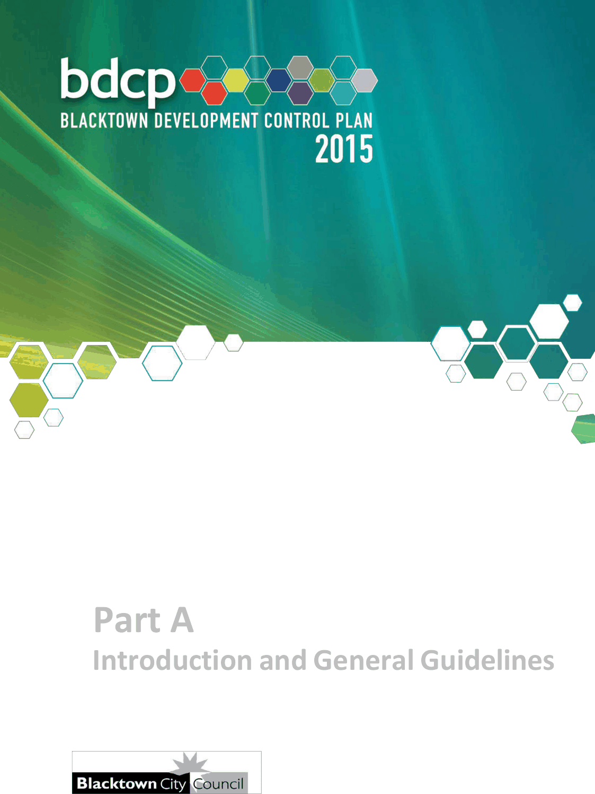

# Blacktown Development Control Plan 2015 - Part A Introduction and General Guidelines

> This chapter is split into 12 section file(s), one per numbered heading, in the order they appear in the PDF.

Source PDF: [Part-A-Introduction-and-General-Guidelines-01-02-2026.pdf](Part-A-Introduction-and-General-Guidelines-01-02-2026.pdf)

> [Picture on page 1: a picture, saved as a picture (images/part-a-introduction-and-general-guidelines-page-1-1.gif, 150 dpi).]

### Part A

### Introduction and General Guidelines

### Table of Contents

| 1 | Introduction ................................................................................................................. 6 |  |
|---|---|---|
|  | 1.1 | Land to which this DCP applies .................................................................. 6 |
|  | 1.2 | Relationship of this DCP to other Acts, plans and policies ...................... 6 |
|  | 1.3 | Aims ............................................................................................................. 7 |
|  | 1.4 | Objectives .................................................................................................... 7 |
|  | 1.5 | The structure of Blacktown DCP 2015 ........................................................ 8 |
|  | 1.6 | DCP and LEP maps ..................................................................................... 9 |
|  | 1.7 | How to use Blacktown Development Control Plan 2015 ........................... 9 |
| 2 | Submitting a Development Application .................................................................... 10 |  |
|  | 2.1 | When is a Development Application required? ........................................ 10 |
|  | 2.2 | Preparing your Development Application ................................................ 10 |
|  | 2.3 | What happens to your Development Application? ................................... 11 |
| 3 | Notification ................................................................................................................. 12 |  |
|  | 3.1 | Objectives .................................................................................................. 12 |
|  | 3.2 | Definitions .................................................................................................. 12 |
|  | 3.3 | When does notification apply ................................................................... 13 |
|  | 3.4 | Persons to be notified ............................................................................... 13 |
|  | 3.5 | What types of impacts are of concern ...................................................... 13 |
|  | 3.6 | Notice to be given to amended applications ............................................ 14 |
|  | 3.7 | Notice to be given for applications for modified approvals .................... 14 |
|  | 3.8 | Applications which will not be notified .................................................... 14 |
|  | 3.9 | Information to be included in written notice and notification plan ......... 14 |
|  | 3.10 | Submissions .............................................................................................. 20 |
| 4 | Environmental protection ......................................................................................... 21 |  |
|  | 4.1 | Introduction................................................................................................ 21 |
|  | 4.2 | Areas requiring fill ..................................................................................... 21 |
|  | 4.3 | Heritage ...................................................................................................... 21 |
|  | 4.4 | Pollution Control ....................................................................................... 24 |
|  | 4.5 | Noise reduction ......................................................................................... 24 |
|  | 4.6 | Bushfire prone land .................................................................................. 24 |
|  | 4.7 | Development adjoining rail corridors and high volume roads ............... 24 |
|  | 4.8 | Cool roofs ................................................................................................. 25 |
| 5 | Biodiversity, vegetation and tree preservation ....................................................... 26 |  |
|  | 5.1 | Definitions ................................................................................................. 26 |
|  | 5.2 | Objectives…………………………………………………………………………27 |

|  | 5.3 | Vegetation and trees…………………………………………………………….31 |
|---|---|---|
| 6 | Roads ......................................................................................................................... 37 |  |
|  | 6.1 | Blacktown road network ........................................................................... 37 |
|  | 6.2 | Road hierarchy and required road widths ................................................ 39 |
|  | 6.3 | Cul-de-sac heads and intersections ......................................................... 41 |
|  | 6.4 | Amendments to proposed road locations ................................................ 41 |
|  | 6.5 | Land adjoining arterial and sub-arterial roads ......................................... 42 |
| 7 | Car parking ................................................................................................................ 44 |  |
|  | 7.1 | Objectives .................................................................................................. 44 |
|  | 7.2 | General principles ..................................................................................... 44 |
|  | 7.3 | Specific land use requirements ................................................................ 44 |
|  | 7.4 | Design ........................................................................................................ 49 |
|  | 7.5 | Materials ..................................................................................................... 51 |
|  | 7.6 | Signs .......................................................................................................... 51 |
|  | 7.7 | Monetary contributions ............................................................................. 51 |
| 8 | Services ..................................................................................................................... 53 |  |
|  | 8.1 | Water .......................................................................................................... 53 |
|  | 8.2 | Sewerage.................................................................................................... 53 |
|  | 8.3 | Electricity ................................................................................................... 53 |
|  | 8.4 | Telephony .................................................................................................. 53 |
|  | 8.5 | Gas ............................................................................................................. 53 |
|  | 8.6 | Postal services .......................................................................................... 53 |
| 9 | Special 9.1 9.2 9.3 9.4 9.5 | considerations ............................................................................................... 54 Solar access .............................................................................................. 54 Downstream owner’s consent ........................................................................... 54 Traffic generating development ................................................................ 54 Crime prevention through environmental design .................................... 54 Retaining walls and ground reshaping ..................................................... 56 |
| 10 | Development on flood prone land ............................................................................ 57 |  |
|  | 10.1 | General ....................................................................................................... 57 |
|  | 10.2 | Aims and objectives .................................................................................. 57 |
|  | 10.3 | Definitions .................................................................................................. 58 |
|  | 10.4 | Control of development on flood prone land ........................................... 59 |
|  | 10.5 | Work as executed plan.............................................................................. 69 |

| Appendix 1 | Exempt vegetation .................................................................................... 70 |
|---|---|
| A.1.1 | Exempt vegetation work ........................................................................... 70 |
| Appendix 2 | Exempt Tree species and Tree work ........................................................ 70 |
| A.2.1 | Exempt Tree species list........................................................................... 70 |
| A.2.2 | When exemptions do not apply ................................................................ 72 |
| A.2.3 | When a Tree work permit is required ....................................................... 72 |
| A.2.4 | Evidence accepted for exempt Tree work ............................................... 73 |
| Figures |  |
| Figure 4.1 | Areas of high archaeological significance ................................................ 23 |
| Tables |  |
| Table A. | List of amendments ................................................................................... 5 |
| Table 3.1 | Notification policy for different classes of development .......................... 19 |
| Table 4.1 | Solar Reflectance Index based on angle of roof pitch…………………….25 |
| Table 5.1 | Area clearing thresholds ........................................................................... 29 |
| Table 5.2 | Pathways for vegetation works ................................................................. 32 |
| Table 5.3 | Pathway for tree works .............................................................................. 33 |
| Table 6.1 | Recommended road hierarchy and road widths ...................................... 40 |
| Table 7.1 | Car parking rates ........................................................................................ 45 |
| Table 7.2 | Minimum bay and aisle dimensions.......................................................... 50 |
| Table 9.1 | Maximum cut and fil ................................................................................... 56 |
| Table 10.1 | Land use by vulnerability to flooding ....................................................... 61 |
| Table 10.2 | Flood related Development Controls ........................................................ 63 |
| Table 10.3 | Flood related Development Controls matrix ............................................ 66 |
| Table A2.1 | Exempt tree species list ............................................................................ 70 |

### Amendments

| Amendment | No | Date adopted Council | by | Date of effect | Parts which have been changed | Nature of amendments |
|---|---|---|---|---|---|---|
| 2025-A |  | 26 November 2025 |  | 1 February | Parts A, C, E | House-keeping |
| Table A. | List of amendments |  |  | 2026 | and H | amendments |

<!-- sections -->
## Sections

1. [1 Introduction](01-1-introduction.md)
2. [2 Submitting a Development Application](02-2-submitting-a-development-application.md)
3. [3 Notification](03-3-notification.md)
4. [4 Environmental protection](04-4-environmental-protection.md)
5. [5 Biodiversity, vegetation and tree preservation](05-5-biodiversity-vegetation-and-tree.md)
6. [6 Roads](06-6-roads.md)
7. [7 Car parking](07-7-car-parking.md)
8. [8 Services](08-8-services.md)
9. [9 Special considerations](09-9-special-considerations.md)
10. [10 Development on flood prone land](10-10-development-on-flood-prone-land.md)
11. [1 Exempt vegetation](11-1-exempt-vegetation.md)
12. [2 Exempt tree species and tree work](12-2-exempt-tree-species-and-tree-work.md)
