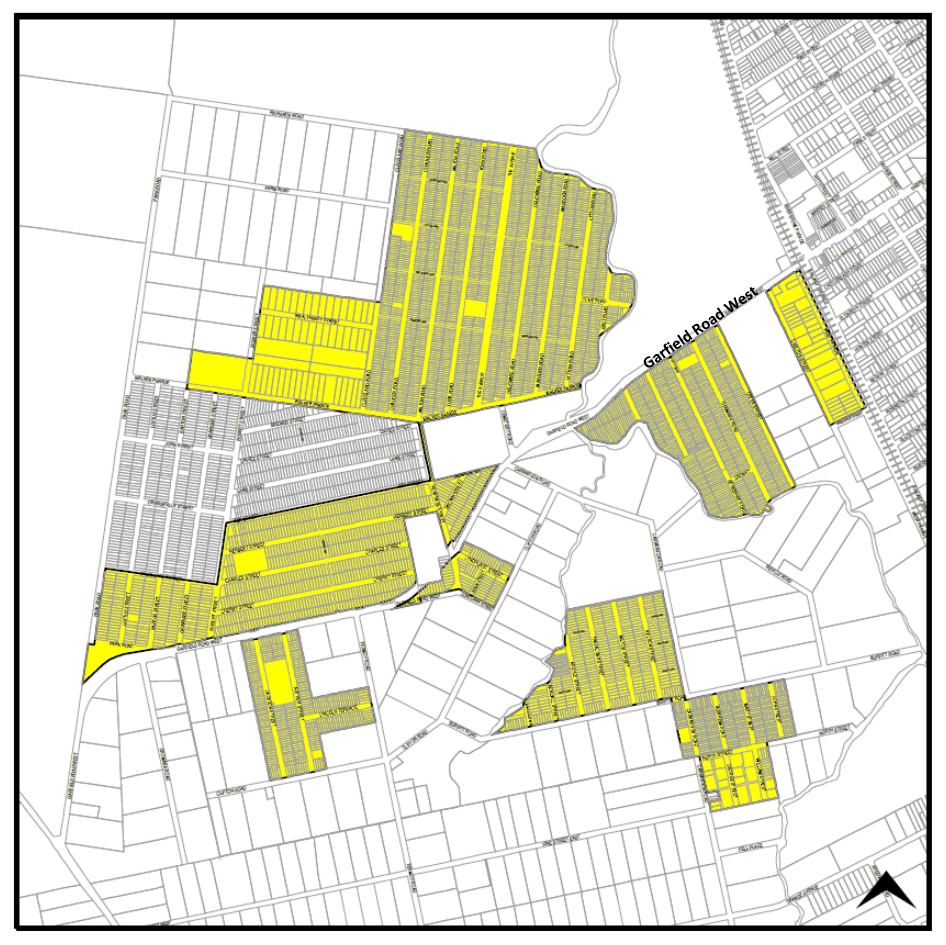
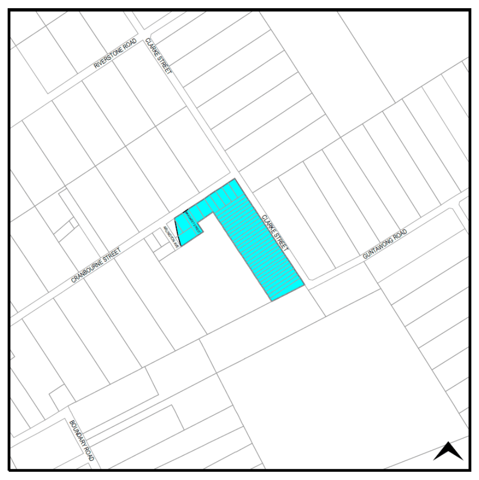

## 3 Dwelling houses

A dwelling house may be erected with Council’s consent on a separate parcel of land within the RU4 Primary Production Small Lots Zone where the area of that land is not less than 4,000sq.m. This provision does not apply to the ‘Scheduled Lands’ located in the Marsden Park North and West Schofields Precincts that have not yet been rezoned for urban development. See Figures 3.1 and 3.2 for details of where this land is located. The existing pattern of subdivision is highly fragmented and additional land is required for the erection of a dwelling house on the following designated land:

(a) On land marked Clause 4.2A(b) and coloured yellow on the Blacktown LEP 2015 Key Sites map (see Figure 3.1), a dwelling house cannot be erected unless the parcel of land has an area of not less than 10 hectares

(b) On land marked Clause 4.2A(c) and coloured blue on the Blacktown LEP 2015 Key Sites map (see Figure 3.2), a dwelling house cannot be erected unless the parcel of land has an area of not less than 2 hectares.

For more information regarding the ‘Scheduled Lands’ as outlined above, please refer to the ‘Scheduled Lands Interim Policy on Existing and Further Development’ adopted by Council on 7 September 1994. The Policy provides a land use table identifying permissible development within these areas along with their relevant and correct planning approaches to each category of development. This Policy will apply to the Scheduled Lands until the Marsden Park North, West Schofields and Riverstone East Precincts are rezoned for urban purposes.

A copy of the Policy is available on Council’s website and upon request at the Customer Service Centre.

An applicant proposing to erect a dwelling house on land within the rural zone should demonstrate that the proposed siting of the dwelling house maximises the natural advantages of the land in terms of:

(a) Providing flood-free access to the dwelling house and a flood-free location for the dwelling house itself

(b) Solar access

(c) Retaining the existing vegetation on the land

(d) Locating the dwelling house in a manner likely to be consistent with any future urban development of the land.

Reference should also be made to Section 5 (Services) of this Part for servicing requirements for development in the rural zone. The building line from a local street is 7.5m. Where the site fronts any road zoned SP2 Infrastructure (Classified or Local) a 10m building line applies.

> [Picture on page 7: a picture, saved as a picture (images/part-b-development-in-the-rural-areas-page-7-1.gif, 150 dpi).]

Figure 3.1 Land either side of Garfield Road West, Riverstone subject to Clause 4.2A(b)

> [Picture on page 8: a picture, saved as a picture (images/part-b-development-in-the-rural-areas-page-8-1.gif, 150 dpi).]

Figure 3.2 Land fronting Cranbourne Street and Clarke Street, Riverstone subject to

#### Clause 4.2A(c)
