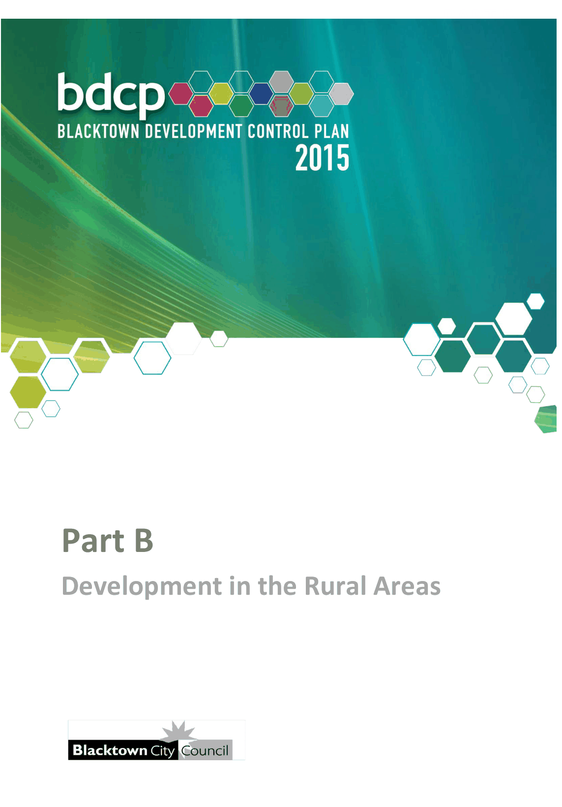

# Blacktown Development Control Plan 2015 - Part B Development in the Rural Areas

> This chapter is split into 6 section file(s), one per numbered heading, in the order they appear in the PDF.

Source PDF: [Part-B-Development-in-the-Rural-Zones.pdf](Part-B-Development-in-the-Rural-Zones.pdf)

> [Picture on page 1: a picture, saved as a picture (images/part-b-development-in-the-rural-areas-page-1-1.gif, 150 dpi).]

### Part B

### Development in the Rural Areas

### Table of Contents

| 1 | Introduction ................................................................................................................ 3 1.1 Land to which this Part applies ....................................................................... 3 1.2 Aims and objectives ......................................................................................... 3 1.3 The Rural Zone .................................................................................................. 3 |
|---|---|
| 2 | Subdivision of rural land ........................................................................................... 5 2.1 Minimum allotment size and minimum subdivision lot size .......................... 5 2.2 Additional requirements ................................................................................... 5 |
| 3 | Dwelling houses ......................................................................................................... 6 |
| 4 | Farm buildings ........................................................................................................... 9 |
| 5 | Services .................................................................................................................... 10 |
| 6 | Environmental protection ........................................................................................ 11 |
| Figure |  |
| Figure 3.1 Land either side of Garfield Road West, Riverstone |  |
|  | subject to Clause 4.2A(b) .......................................................................... 7 |
| Figure 3.2 Land fronting Cranbourne Street and Clarke Street, |  |
|  | Riverstone subject to Clause 4.2A(c) ....................................................... 8 |

<!-- sections -->
## Sections

1. [1 Introduction](01-1-introduction.md)
2. [2 Subdivision of rural land](02-2-subdivision-of-rural-land.md)
3. [3 Dwelling houses](03-3-dwelling-houses.md)
4. [4 Farm buildings](04-4-farm-buildings.md)
5. [5 Services](05-5-services.md)
6. [6 Environmental protection](06-6-environmental-protection.md)
