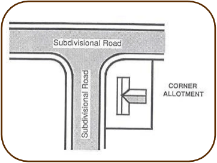
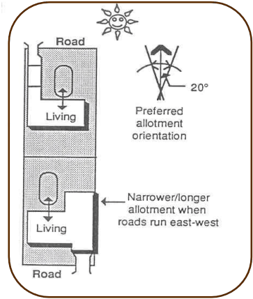
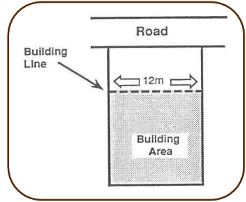
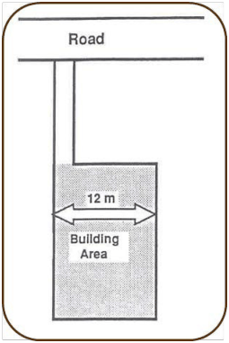
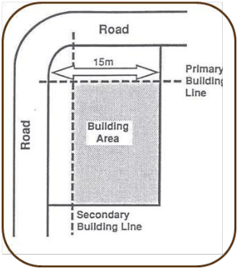
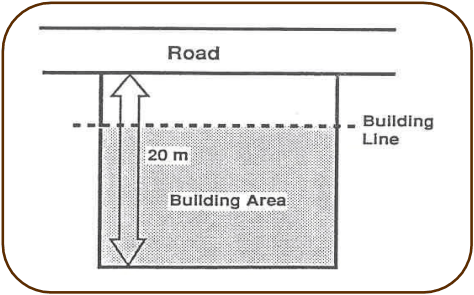
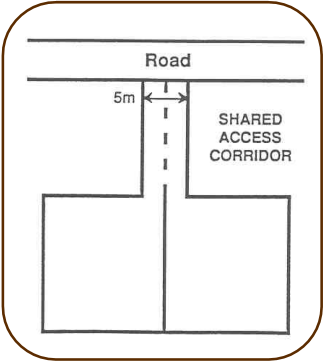
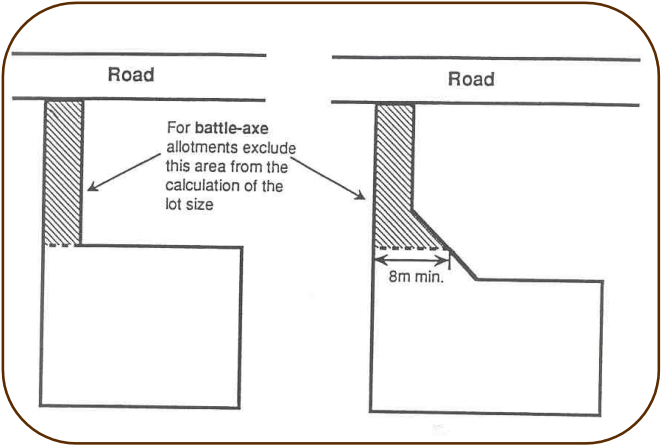

## 2 Subdivision for detached housing

### 2.1 Definitions

The definitions and diagrams below explain Council’s interpretation of allotment types and

shapes. Corner allotment is an allotment, not being a battle-axe shaped allotment, having frontage

to 2 or more intersecting, differently named roads.

> [Picture on page 12: a picture, saved as a picture (images/part-c-development-in-the-residential-areas-page-12-7.gif, 150 dpi).]

#### Figure 2.1 Example of a corner allotment

Irregular shaped allotment is an allotment which is not a regular shaped allotment. Regular shaped allotment is an allotment which comprises either:

(a) An allotment which is square or rectangular in shape, or

(b) An allotment of any other shape where a square or rectangular shape

equivalent in area to the minimum area for the allotment type could be

contained within the boundaries of the allotment and includes a battle-axe shaped allotment and a corner allotment where the only

deviation from the above requirements is the access corridor or splay corner

respectively.

#### Figure 2.2 Example of regular shaped allotments

### 2.2 Subdivision design

Subdivision is generally the first stage of development in a residential area. The design of a

subdivision can influence the “comfort” of the future residents of the area.

#### 2.2.1 Road patterns

Detailed requirements for road design are contained in Blacktown DCP, Section 5 of Part A

(Introduction and General Guidelines). The Blacktown LEP 2015 Land Zoning Maps show the location and zoning of arterial roads

(shown in yellow and zoned SP2 Infrastructure – Classified Road) and sub-arterial roads

(shown in yellow and zoned SP2 Infrastructure – Local Road). All other roads are zoned in

accordance with the dominant surrounding zone.

#### 2.2.2 Lot configuration

To increase visual surveillance of the street and avoid a streetscape of garage facades,

irregular shaped allotments with narrow street frontages should be avoided, particularly where

several of these lots are proposed in an adjoining manner.

#### 2.2.3 Solar access

In determining a Subdivision Application, Council may take into consideration access to

solar radiation for dwellings which will be built on the allotments. Council’s objectives are to:

(a) Encourage the design of subdivisions which maximise solar access

(b) Ensure flexibility in the siting of dwellings to take advantage of a northerly

orientation

(c) Avoid the reduction of solar access due to poor subdivision design

(d) Encourage building orientation that allows internal and outdoor living areas to

be directly connected.

Solar access is maximised where the dwelling can be sited facing north (see Figures 2.3

and 2.4) and where overshadowing from other buildings is minimised. The greatest usage of a residential allotment will usually be achieved where the house is

sited parallel to one or more boundaries of the site.

> [Picture on page 14: a picture, saved as a picture (images/part-c-development-in-the-residential-areas-page-14-1.gif, 150 dpi).]

#### Figure 2.3 Road and allotment orientation for roads that run east-west

#### Figure 2.4 Road and allotment orientation for roads that run north-south

#### 2.2.4 Road and allotment orientation

Consideration of road orientation is an important factor in influencing allotment orientation to

achieve an energy-efficient subdivision. On roads running north-south (thus resulting in allotments with an east-west orientation as

illustrated in Figure 2.3), allotments may need to be widened to provide for solar access and

prevent overshadowing of dwellings and private open space. Allotments with a NW-SE or NE-SW orientation are unfavourable for solar access unless

they are much larger than the minimum allotment size.

### 2.3 Minimum allotment sizes

Clause 4.1 of Blacktown LEP 2015 contains the minimum allotment size and minimum

subdivision lot size requirements for residential land.

### 2.4 Allotment dimensions

Council aims to ensure that allotments are of dimensions which allow flexibility in the choice

of housing design, whilst minimising development costs.

In assessing a DA for subdivision, Council is required to consider a number of matters

including:

(a) The size and shape of each allotment to be created

(b) The length of road frontage of each allotment.

#### 2.4.1 Minimum width

Allotments should have a minimum width of 12m at the building line, as shown in Figure 2.5. In the case of irregular shaped allotments Council will require that a suitable building area is

> [Picture on page 15: a picture, saved as a picture (images/part-c-development-in-the-residential-areas-page-15-8.gif, 150 dpi).]

available for development.

#### Figure 2.5 Minimum allotment width

In the case of battle-axe shaped allotments the minimum dimension in any direction should

> [Picture on page 15: a picture, saved as a picture (images/part-c-development-in-the-residential-areas-page-15-12.gif, 150 dpi).]

be 12m, as shown in Figure 2.6.

#### Figure 2.6 Minimum allotment width for battle-axe shaped allotments

Corner allotments should have a minimum width of 15m to take account of the building line

to the secondary frontage, as shown in Figure 2.7.

> [Picture on page 16: a picture, saved as a picture (images/part-c-development-in-the-residential-areas-page-16-3.gif, 150 dpi).]

#### Figure 2.7 Minimum allotment width for corner allotments

#### 2.4.2 Minimum depth

An allotment should not be less than 20m in depth to ensure that there is some flexibility in

the choice of housing design and siting, as well as the availability of suitable space for other

activities normally associated with a dwelling.

> [Picture on page 16: a picture, saved as a picture (images/part-c-development-in-the-residential-areas-page-16-9.gif, 150 dpi).]

#### Figure 2.8

#### Minimum depth

#### 2.4.3 Variation to minimum width and depth

Council may permit a variation to the minimum width and depth of an allotment where, for

example, the siting of the dwelling is planned in conjunction with subdivision or where site

conditions require special consideration. Applicants requesting such a variation should first discuss the proposed change with Council

and, when lodging a DA for subdivision, submit additional information in support of the

variation.

### 2.5 Battle-axe shaped allotments

To help create a pleasant, safe residential environment it is desirable to:

(a) Maximise the amount of car parking which may be available on the street

relative to the number of dwellings in the street

(b) Maximise the safety of pedestrians by ensuring that the number of driveways

which cross the footpath are kept to a minimum.

In general no more than 2 battle-axe shaped allotments should adjoin each other. On battle axe allotments provision must be made for vehicles to enter and exit the site in a

forward direction. The access corridor is that part of a battle-axe shaped allotment which provides private

access between the main part of the allotment and the public road. Council’s requirements for access corridors are as follows:

| Standard | Control |
|---|---|
| Maximum length | 60m |
| Minimum width | 3.5m |
| Minimum width of shared access corridor | 5m |

No more than 2 allotments should be served by a shared access corridor. The access corridor of a battle-axe allotment is not included in the calculation of the

minimum allotment area, as shown in Figure 2.9.

#### Figure 2.9 Access corridors for battle-axe shaped allotments

> [Picture on page 18: a picture, saved as a picture (images/part-c-development-in-the-residential-areas-page-18-1.gif, 150 dpi).]

#### Figure 2.10 Shared access corridor requirements for battle-axe shaped

allotments

> [Picture on page 18: a picture, saved as a picture (images/part-c-development-in-the-residential-areas-page-18-4.gif, 150 dpi).]

#### Figure 2.11 Minimum allotment area calculation for battle-axe shaped allotments
