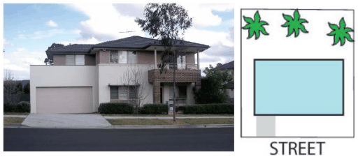
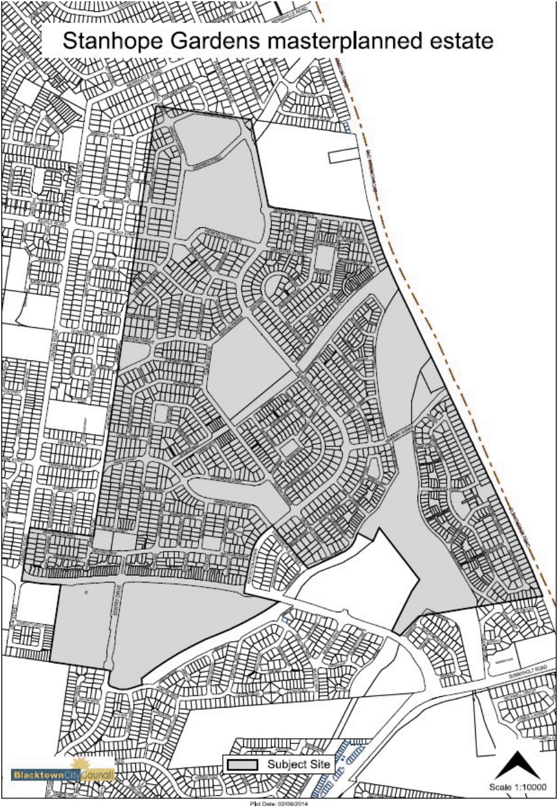
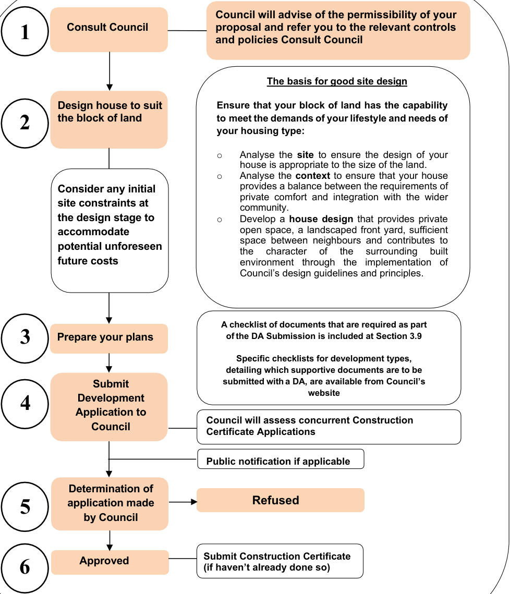
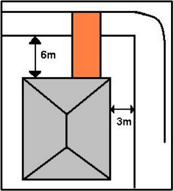
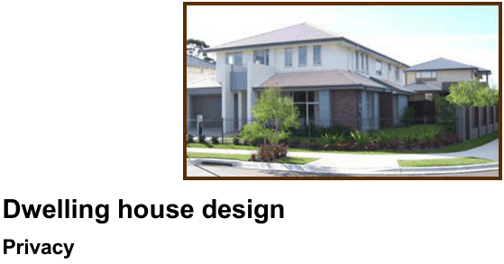
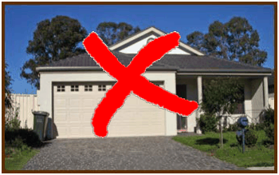
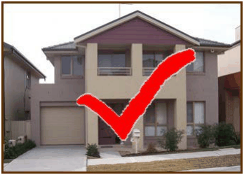

## 3 Dwelling houses

Under Blacktown LEP 2015, dwelling house means a building containing only one

> [Picture on page 19: a picture, saved as a picture (images/part-c-development-in-the-residential-areas-page-19-3.gif, 150 dpi).]

dwelling.

Under Blacktown LEP 2015, development consent for dwelling houses is generally required

in all residential zones. However, development consent is not required where development

for a dwelling house meets all of the criteria and standards within State Environmental

Planning Policy (Exempt and Complying Development Codes) 2008.

### 3.1 Objectives

The objective of Council’s controls for residential development is to guide the layout of

dwelling houses in order to achieve orderly development in proportion to the allotment area.

Dwelling house development should provide for:

(a) Sufficient private open space

(b) A landscaped front garden that complements and contributes to the amenity of the street

(c) The provision of adequate space between neighbouring dwelling houses.

Dwelling houses should be designed so as to be both functional and visually appealing.

### 3.2 Design guidelines

#### 3.2.1 Wall setbacks

Building setbacks promote the amenity and functionality of the built environment. This can

be achieved by demonstrating consideration of the following:

(a) Enhancing the visual impact of dwelling house development on the streetscape

(b) Provide opportunities for residents to landscape in a manner that reduces the visual and acoustic impacts of pedestrian and vehicular traffic, while enhancing the visual presentation of the dwelling frontage

(c) Providing space around a building to maximise solar access, natural ventilation, access for services and occupant movement

(d) Ensuring buildings comply with the performance requirements of Volume 2 (Housing Provisions) of the Building Code of Australia.

#### 3.2.2 Allotment width

The width of an allotment where a single dwelling house is proposed is to be a minimum of

12m. Where existing allotments do not meet this requirement, they are classified as “narrow

frontage allotments” (see definition in Section 3.8). Refer to Section 3.7 for Council’s

requirements for the development of narrow frontage allotments.

#### 3.2.3 Building line

The minimum building line for a dwelling house or dwelling house addition to the primary

road frontage shall be:

(a) 6m for all locations covered by this Part, except for Stanhope Gardens

(b) 4.5m for land located in Stanhope Gardens (see Figure 3.1), except where dwellings directly front Stanhope Parkway that have rear driveway access to which 6m shall apply.

The wall of any dwelling shall be setback a minimum 3m from any rear boundary of the

allotment that directly abuts a roadway. The aggregate width of a garage door/s or carport shall not exceed 50% of the total width of

the front elevation (i.e. facing the primary road) of the dwelling.

> [Picture on page 21: a picture, saved as a picture (images/part-c-development-in-the-residential-areas-page-21-1.gif, 150 dpi).]

#### Figure 3.1 Stanhope Gardens masterplanned estate

#### 3.2.4 Side and rear boundary wall setbacks (maximum 2 storeys)

(a) The ground storey walls of any dwelling house or addition shall be setback a

minimum 900mm from any side or rear boundary of the allotment, except

where the provisions of Section 3.2.3 apply

(b) Side walls containing windows to habitable rooms should be setback from the

side boundary by at least 1.2m for land within Stanhope Gardens

(c) The upper storey walls of any dwelling house shall be setback a minimum

900mm from any side boundary and 3m from any rear boundary of the

allotment, except where the provisions of Section 3.2.3 apply

(d) For land within Stanhope Gardens, 2 storey walls neighbouring zero lot

boundaries must be setback 1.5m from the side boundary. In other cases,

2storey walls should be setback from the side boundary at least 1.2m

(e) The eaves/gutters of any single-storey dwelling house or dwelling house

addition shall be setback a minimum 450mm from any side or rear boundary,

other than a secondary road

(f) The eaves/gutters of any 2 storey dwelling house or dwelling house addition

shall be setback a minimum 675mm from any side or rear boundary, other than

a secondary road

#### 3.2.5 Side and rear boundary wall setbacks (more than 2 storeys)

The ground storey walls of any dwelling house or dwelling house addition shall be setback a

minimum 1.5m from any side or rear boundary of the allotment. The upper storey walls of any dwelling house or dwelling house addition shall be setback a

minimum 1.5m from any side boundary and 3m from any rear boundary of the allotment. The eaves/gutters of any dwelling house shall be setback a minimum 675mm from any side

boundary.

#### 3.2.6 Dwelling house height

The height of any dwelling house is to be in accordance with Clause 4.3 (Height of buildings)

of Blacktown LEP 2015. This clause should be read in conjunction with the LEP Height of

Building Map.

### 3.3 Dwelling house design and approval / determination

#### process

> [Picture on page 23: a picture, saved as a picture (images/part-c-development-in-the-residential-areas-page-23-3.gif, 150 dpi).]
> Words printed on the picture (copied from the PDF):
> Consult Council
> Council will advise of the permissibility of your
> proposal and refer you to the relevant controls
> and policies Consult Council
> The basis for good site design
> Design house to suit
> the block of land
> Ensure that your block of land has the capability
> to meet the demands of your lifestyle and needs of
> your housing type:
> Consider any initial
> site constraints at
> the design stage to
> accommodate
> potential unforeseen
> future costs
> Analyse the site to ensure the design of your
> house is appropriate to the size of the land.
> Analyse the context to ensure that your house
> provides a balance between the requirements of
> private comfort and integration with the wider
> community.
> Develop a house design that provides private
> open space, a landscaped front yard, sufficient
> space between neighbours and contributes to
> the character of the surrounding built
> environment through the implementation of
> Council’s design guidelines and principles.
> A checklist of documents that are required as part
> Prepare your plans
> of the DA Submission is included at Section 3.9
> Specific checklists for development types,
> detailing which supportive documents are to be
> submitted with a DA, are available from Council’s
> website
> Submit
> Development
> Application to
> Council
> Council will assess concurrent Construction
> Certificate Applications
> Public notification if applicable
> Determination of
> application made
> by Council
> Approved
> Submit Construction Certificate
> (if haven’t already done so)

### 1

### 2

### 3

### 4

#### Refused

### 5

### 6

### 3.4 Development on corner lots

■ Objectives Corner sites are prominent in residential neighbourhoods as they have 2 street

frontages and are therefore highly visible. Proposals for dwelling houses on

corner allotments should be designed in such a way as to address both streets,

and emphasise such a significant location through built form and landscaping.

■ Controls There are many ways to design a dwelling house, or make alterations and/or

additions to a dwelling house on a corner allotment that also responds to both

streets. Such buildings should be designed with multiple frontage concepts,

paying particular attention to design principles including fencing, articulation,

materials, façade treatments, landscape planting and setbacks, to contribute

to the streetscape and make a positive contribution to the neighbourhood.

#### 3.4.1 Setbacks

The minimum building line for a dwelling house or dwelling house addition to the primary road

frontage shall be 6m, with a maximum 1m encroachment of any architectural feature. The

building line to any secondary road is 3m with a maximum 1m encroachment of any

architectural feature (such as a patio, balcony, porch and the like, but not a garage or carport).

These controls are demonstrated in Figure 3.2.

> [Picture on page 24: a picture, saved as a picture (images/part-c-development-in-the-residential-areas-page-24-20.gif, 150 dpi).]

#### Figure 3.2 Setback controls for corner lots

The minimum setback from a property boundary to a secondary frontage on land located in

Stanhope Gardens is 2m on collector streets (road reserve of 18m or wider) and 1m on all

other streets.

#### 3.4.2 Design guidelines

■ Fencing Fencing used incorrectly can work to the detriment of the street and provide an

intimidating street presence. To maintain an interesting street frontage and

encourage visual surveillance, fencing should be of a similar quality and

material to the dwelling.

■ Landscaping Looking for good landscape planting opportunities should always be a priority,

but even more so on corner allotments. Proposals should retain contact

between the dwelling and the street, and complement the design of the

dwelling with an attractive interface that contributes to the streetscape and

character of the neighbourhood.

■ Design / articulation The dwelling house should be designed to have frontage to both the primary

and the secondary streets. Articulation of the facades is encouraged to create

interesting and aesthetically pleasing street facades. Consider the location of

windows and entries in order to maximise space, and maintain personal

privacy and encourage surveillance.

> [Picture on page 25: a picture, saved as a picture (images/part-c-development-in-the-residential-areas-page-25-19.gif, 150 dpi).]

### 3.5 Dwelling house design

#### 3.5.1 Privacy

The objective is to maintain a visual level of privacy for proposed building occupants and for

neighbouring residents. Private open space is an important factor in the design and layout of

single dwelling house developments. Council will consider the character of adjoining

development and the implications on occupants’ levels of privacy and visual invasion on

private outdoor space when assessing a Development Application. The design and layout of dwelling house proposals are to demonstrate adequate

consideration of, and provision for, a reasonable level of privacy for occupants of adjoining

residential buildings and existing, proposed or potential private open spaces. First floor living areas are of particular concern and should be designed with privacy and

views in mind. The design of the dwelling should reflect private amenity by:

(a) Offsetting side windows with those of neighbouring dwellings

(b) Providing screening to limit views

(c) Carefully considering the location of balconies and openings to minimise

overlooking and maintain personal privacy

(d) Implementing other design elements to ensure privacy where required, such

as raising sill heights, using translucent glass and other forms of screening.

#### 3.5.2 Drainage

Roofwater from a dwelling house or dwelling house addition must be drained to the street

gutter or registered interallotment drainage system in accordance with AS 3500.3 where

possible. Where this provision cannot be satisfied, roofwater must be drained to a rainwater

tank with a minimum capacity of 5,000 litres, in accordance with AS 3500.3. The tank overflow drain shall be connected to a rubble pit having minimum dimensions of

600mm wide x 600mm depth x 1200mm length per required downpipe. It must be located a

minimum 3m from any property boundary and any existing or proposed building (including

impervious pavement) on the land.

#### 3.5.3 Parking spaces

The design of parking and the arrangement of car parking spaces should contribute to the

creation of safer and attractive streets through the reasonable provision for motor vehicle

accommodation on the developed land. In doing so, the demand for parking within the road

reserve is to be reduced and the quality of the urban environment improved. A minimum of 2 vehicle parking spaces shall be provided behind the building line on each

residential allotment. Each parking space shall be located in a garage, carport or on another

sealed part of the allotment, but not within the required front boundary setback or open space. Each parking space shall measure a minimum of:

(a) 5.5m long x 3m wide (where a single space does not adjoin another space)

or

(b) 5.5m long x 2.75m wide (where spaces adjoin side-by-side, i.e. 5.5m wide for

a double garage) or

(c) 5.75m long x 3m wide (where spaces adjoin end to end).

At entry and exit points, access driveways should be graded to increase safety for pedestrians

and make it easier for private users to enter the street. The driveway gradient to each parking

space shall comply with the requirements of AS 2890.1. The vehicular crossing of the footway shall be located a minimum 1m from any gully pit or

other utility service infrastructure located within the road reserve, and shall be located a

minimum 6m from any tangent of the road kerb return on a corner allotment.

#### 3.5.4 Private open space

Private open space is to be provided on a reasonable area of land for the recreational use of

building occupants. An area of the allotment having a minimum area of 80sq.m is to be provided behind the

primary building line as private open space. The minimum horizontal dimensions of the private open space shall be 6m x 4m for one area,

with any other composite area having a minimum dimension of 2.5m measured perpendicular

to an external wall of the building.

#### 3.5.5 Solar access / overshadowing

A minimum 50% of the required private open space of the subject and adjoining residential

development sites should receive a minimum 4 hours of sunlight between 9:00am and 3:00pm

on 21 June. A shadow diagram may be required to verify compliance. Applications for a dwelling of more than 2 storeys shall be verified by a complying shadow

diagram that accurately reflects the topography of the land and incorporates existing

structures and likely future structures on the subject and adjoining land. The building design

and site layout of dwelling house development is to ensure adequate sunlight access to

internal living spaces of the proposed and adjoining developments.

### 3.6 Garages, carports, awnings and sheds

■ Objective Garages and carports should not be designed in isolation, but should be

designed as part of a holistic approach to the property. It is important that they

do not dominate the frontage and do not detrimentally compromise the

aesthetic relationship to the front garden and the street.

#### 3.6.1 Site requirements

Any garage, carport, awning or shed on a site must not exceed 60sq.m where minimum

setbacks are utilised. Larger structures may be acceptable if sited on large allotments and

where, greater setbacks are provided.

#### 3.6.2 Building line

The minimum building line for an attached or detached garage, carport, awning or shed to the

primary road frontage shall be:

(a) 6m or lesser where compatible with adjoining residential development,

except for Stanhope Gardens as provided in (b) below

> [Picture on page 27: a picture, saved as a picture (images/part-c-development-in-the-residential-areas-page-27-19.gif, 150 dpi).]

#### Figure 3.3 Dominant garage placement

(b) 4.5m building line with a maximum projection of 1m applies to land

located in Stanhope Gardens for awnings.

Garages and carports are to be setback or in line with the main building frontage / façade in

order to be a non-dominant visual component of the streetscape - see Figures 3.3 and 3.4. Council encourages the same setback for detached garages, carports and sheds as the

dwelling to which it is ancillary, from any secondary road. This will assist in these ancillary

structures acting as a non-dominant component of the streetscape in compliance with

Council’s objectives.

#### 3.6.3 Building line – corner allotments

The minimum building line for a detached garage, carport, awning or shed to any secondary

> [Picture on page 28: a picture, saved as a picture (images/part-c-development-in-the-residential-areas-page-28-3.gif, 150 dpi).]

road shall be 3m.

#### Figure 3.4 Non-dominant garage placement

#### 3.6.4 Side or rear boundary wall setbacks

The wall of any detached garage, carport, awning or shed shall be setback a minimum

500mm from any side or rear boundary of an allotment.

#### 3.6.5 Height

The wall height of any garage or carport shall be a maximum 2.7m above the lowest

immediately adjacent ground level. The overall height of any garage or carport shall be a maximum 4m above the lowest

immediately adjacent ground level.

#### 3.6.6 Design

Garages, carports and awnings are to be designed and constructed in a manner that is

compatible with the design of the dwelling house. Garages are not to obstruct the visual

contact of the dwelling with the street. Furthermore, building design is to achieve relief in roof

and built form, and facades are to be articulated through materials and encroachments at a

detailed level to achieve a high standard of visual character and contribution to the

streetscape. The garage design, including the choice of style for the door, should be simple,

so that the entire frontage of the development is not dominated by the garage, but is

compatible with the dwelling design and addresses the street. The aggregate width of garage door/s or carport should not exceed 50% of the total width of

the front elevation (i.e. facing the primary road) of the dwelling. This is essential to maintain

the visual perception that the primary use of a residential lot is for that of a residence. Council

will consider variation for 2 storey dwellings where the façade is suitably articulated and a

high standard of design innovation has been expressed to the satisfaction of Council.

#### 3.6.7 Drainage

Roofwater from a dwelling house or dwelling house addition must be drained to the street

gutter or registered interallotment drainage system in accordance with AS 3500.3 where

possible. Where this provision cannot be satisfied, roofwater must be drained to a rainwater

tank with a minimum capacity of 5,000 litres, in accordance with AS 3500.3. The tank overflow drain shall be connected to a rubble pit having minimum dimensions of

600mm wide x 600mm depth x 1200mm length per required downpipe. It must be located a

minimum 3m from any property boundary and any existing or proposed building (including

impervious pavement) on the land.

#### 3.6.8 Battle-axe allotments

Carports and similar structures are not permitted to be located within the battle-axe

accessway.

### 3.7 Narrow frontage allotments

#### 3.7.1 Introduction

The City of Blacktown has a number of areas where lots exist that are less than 12m in width

at the building line, and are generally consistent in width throughout the depth of the lot. These

lots are in existence as a result of past premature subdivision created by a former Government

Plan over 100 years ago. Section 3.5 of this Part requires that conventional Torrens title lots

have a minimum frontage of 12m, and it is to lots that fall short of achieving this standard, and

that were legally subdivided under a previous plan, to which this section applies. These

controls accompany and strengthen the controls for residential dwelling house development. Narrow frontage allotment means an allotment being less than 12m in width that was

created by a former plan (such as a Government Plan), not being a Council subdivision plan. This section of the DCP only applies to land zoned R2 Low Density Residential under

Blacktown LEP 2015. It does not apply to any masterplanned estates that are zoned R3 under

Blacktown LEP 2015 or land zoned RU4 Primary Production Small Lots under Blacktown LEP

2015 which is subject to future rezoning and precinct planning in the North West Growth

Centre by the Department of Planning and Environment. ■ Objectives

(a) To achieve a high standard of building design and additional design

innovation from proposals, to accommodate the restrictive nature of

narrow frontage allotments

(b) To ensure that orderly and visually appealing development is not

compromised and high standards of design are maintained

(c) To ensure that the development of narrow allotments is appropriate to

the character and streetscape of existing residential neighbourhoods,

and makes a positive contribution to the local built environment

(d) To ensure that the design of narrow allotments facilitates a high standard

of amenity to occupants and neighbouring properties

(e) To ensure consistency with Council’s dwelling house development

controls and other relevant guidelines elsewhere in Blacktown DCP

2015.

#### 3.7.2 Controls for development on 2 lots

A minimum of 2 lots are to be consolidated to form one registered Torrens title lot of at least

12m width, to accommodate either a single dwelling or an attached dual occupancy with no

subdivision entitlement (See Figure 3.5). Applicants seeking to retain 2 existing allotments that adjoin each other may design 2

attached dwellings that are each provided with an independent separating wall on each

allotment. This ensures the development addresses the street as a unified structure, giving

the appearance of an attached dual occupancy, but technically being detached by the

separating walls, thus meeting the objectives of the narrow frontage allotment policy, the

dwelling house development guidelines and Council’s policy of not permitting dual occupancy

subdivision (see Figure 3.5).

Dwelling house development that takes this form is to comply with the controls contained

within the checklist at Table 3.1 below, in addition to the requirements of this section. Where

there is any inconsistency between the checklist at Table 3.1 and the rest of this section, the

controls within Table 3.1 shall prevail. Additionally, this type of development is to comply with

the requirements of the Building Code of Australia and is to meet the relevant acoustic and

fire rating standards. As a result of the restrictive nature of narrow frontage allotments and the potential complexity

of achieving Council’s controls, a sealed off-street car parking space is permitted within the

front setback as a concession to help proposals achieve high standards of visual design and

a non-dominant garage, as well as the required number of car parking spaces. Sealed off-

street car parking spaces are to be setback a minimum of 2.5m from the front boundary. This

space is to be located in front of a garage and not directly in front of the habitable portion of

the dwelling, to ensure there is no interference with the aesthetic relationship and visual

connection between the development and the streetscape.

| Standard | Control |
|---|---|
| Building line setback: • Dwelling • Maximum encroachment of architectural feature • Garage/carport | 6m 1m 6m |

### 3

### 2

### 1

#### Table 3.1 Checklist for narrow allotments (dual occupancy)

#### OR

#### OR

#### Figure 3.5 Two lot policy

(1) 2 lots are to be consolidated to create 1 allotment for the development of a

single dwelling house with a minimum frontage of 12m.

(2) 2 lots are to be consolidated to create an attached dual occupancy with a

minimum frontage of 12m.

(3) The development of 2 single dwellings on 2 separate existing allotments each

joined by a separating wall and complying with the requirements of this code.

#### 3.7.3 Controls for development on 3 lots

Where 3 narrow frontage allotments exist, consolidation is required to create either a single

allotment or 2 allotments in order to comply with the controls of this code and achieve the

objectives for the development of narrow frontage allotments (See Figure 3.6). Where consolidation of 3 narrow frontage allotments creates 2 allotments of a minimum 10m

width each, and the development of 2 single dwelling houses is proposed, the standard of

design is to be of the highest quality. Council will be careful in its assessment of such

proposals to ensure the frontage is not dominated by the garage and that the use of materials,

articulation and architectural design make a positive contribution to the local built environment

and enhance the character and amenity of the streetscape and local neighbourhood.

> [Picture on page 31: a picture, saved as a picture (images/part-c-development-in-the-residential-areas-page-31-4.gif, 150 dpi).]
> Words printed on the picture (copied from the PDF):
> (a)

### 3

### 1

### 2

#### OR

#### OR

#### Figure 3.6 Three lot policy

(1) 3 lots are to be consolidated to create 1 allotment for the development of a

single dwelling house with a minimum frontage of 12m.

(2) 3 lots are to be consolidated to create an attached dual occupancy with a

minimum frontage of 12m.

(3) 3 lots are to be consolidated to create 2 allotments for the development of 2

single detached dwellings on 2 separate allotments, with a minimum frontage

width of 10m each.

#### 3.7.4 Isolated narrow frontage allotments

Council will not support development on an isolated narrow frontage allotment. Isolated

allotments are to be consolidated with neighbouring allotments in order to comply with the

minimum frontage width of 12m and the requirements of this code.

### 3.8 Studios and Lofts

#### 3.8.1 Land to which these controls apply

The following controls for studios and lofts apply only to land within the Stanhope Gardens masterplanned estate (see Figure 3.1).

#### 3.8.2 Objectives

To provide the opportunity for studios and lofts to be constructed in the Stanhope Gardens masterplanned estate to provide a range of housing choice.

#### 3.8.3 Performance criteria

A studio is defined as a unit having a kitchen and bathroom requiring extra parking and open space. A loft containing a bathroom but not a kitchen, is not considered a studio. One method of achieving casual surveillance is to have at least one of the garages fronting each private driveway include a studio or loft. The best location for a studio or loft is at the end of a long axis vista, preferably overlooking private open space areas, a private driveway or a common car court area. The location of studios or lofts should also consider overshadowing and privacy of neighbours. Windows should face onto private open space areas, driveways or common car court to allow for the casual surveillance of the area.

#### 3.8.4 Controls

(1) Common requirements for both studios and lofts include:

(a) Only permitted on allotments greater than 350 square metres

(b) No more than one studio or loft for every seven dwellings

(c) Only permitted if approved and built in conjunction with a medium

density development application

(d) Cannot be subdivided off from the main dwelling onto a separate title at

any time

(e) Can be either attached or detached from the main residential dwelling

(f) Cannot be positioned where they will have direct frontage to public

roads, such as on corner allotments

(g) Cannot have balconies that overhang into driveway or car court areas

(h) Cannot be attached to another studio or loft on an adjoining property.

(2) Additional specific requirements for studios include:

(a) A parking space is to be provided and can be either covered or uncovered.

Council will not permit the sharing of a double garage by a studio and the

main dwelling under any circumstances

(b) Proportional allocation of private open space, with a minimum courtyard

area of 25 square metres. Council may allow a proportion of the minimum

25 square metres to be included as a balcony if deemed usable.

### 3.9 Definitions

Aggregate floor area means the horizontal area of all storeys in the existing or proposed

building measured over the enclosing walls and any column or pier that supports the roof

structure, including all habitable and non-habitable portions of the building. AS means the current Australian Standard published by Standards Australia. BASIX Certificate means that document required by State Environmental Planning Policy

No. 75 - Building Sustainability Index (BASIX) and generated on the interactive website

www.basix.nsw.gov.au Building line means that part of land adjoining a public road within which a building may not

be constructed. Detached means separated by a minimum 900mm horizontal distance between the closest

part of any external wall of any adjacent existing or proposed building on the allotment. Dwelling house means a building containing only one dwelling. Natural ground level means that ground level existing on the day the subdivision certificate

was issued for the land, but not including any subsequent ground reshaping, whether or not

that reshaping is Exempt Development under State Environmental Planning Policy (Exempt

and Complying Development) 2008. Narrow frontage allotment means an allotment being less than 12m in width that was

created by a former plan (such as a Government Plan), not being a Council subdivision plan. Private open space means a single area of the allotment that is available for the recreational

use of building occupants, which may include the installation of a swimming pool, children’s

play equipment, barbeque and similar recreational facility.

Separating wall (also known as a party wall) means a wall that is independent to adjoining

single dwelling houses. Wall means the generally vertical external portion of an existing or proposed building,

including any pier or column designed to support the roof structure.

### 3.10 Development Application checklist

In preparing a Development Application (DA) it is necessary to consider relevant Acts, policies

and Regulations such as:

(a) Environmental Planning and Assessment Act 1979

(b) Environmental Planning and Assessment Regulation 2000

(c) Relevant State Environmental Planning Policies and Environmental Planning

Instruments

(d) Local Government Act 1993

(e) Building Code of Australia.

Council has prepared a number of checklists detailing what supporting documents should

accompany a DA. Applicants are encouraged to use the checklist relevant to their proposed

development to assist in preparing their DA. The table below acts as a general guide for what

supporting documents should accompany DAs. For a more detailed checklist tailored to

specific proposed works, refer to Council’s website: https://www.blacktown.nsw.gov.au/Plan-build/Stage-4-apply/Lodging-a-development-

application

| The following documents or supporting information should accompany a Development Application | Check (√) |
|---|---|
| 4 x Development Application plans including: |  |

• Site plan

• Elevations

• Floor plans

• Section plans (if applicable)

• Notification plans (6 x A4 copies)
