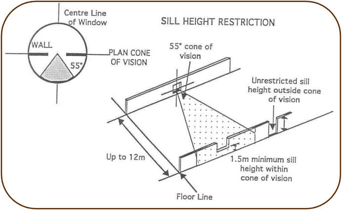

## 5 Attached dwellings and multi dwelling housing

Attached dwelling means a building containing 3 or more dwellings, where:

(a) Each dwelling is attached to another dwelling by a common wall, and

(b) Each of the dwellings is on its own lot of land, and

(c) None of the dwellings is located above any part of another dwelling.

Multi dwelling housing means 3 or more dwellings (whether attached or detached) on one

lot of land, each with access at ground level, but does not include a residential flat building.

### 5.1 Site requirements

The minimum width, when measured at the building setback line to the street frontage, of any

site on which an attached dwelling or multi dwelling housing development is proposed should

be no less than 26m. The maximum depth of any site must be no greater than 2.75 times the width of the site at

the building line, when any depth is measured along a line drawn perpendicular to the building

line.

### 5.2 Building setbacks

The building setback from the street is 6m. The secondary building setback for a corner allotment is 3m, but only to the wall of the first

building on the site located near the corner of this frontage. All other buildings on the

secondary frontage shall comply with Council’s normal building setbacks. Garages and carports should not project forward of the main front wall of any dwelling that

adjoins a public road. The building setback from the road frontage shall be 10m where the site fronts any road

zoned SP2 Infrastructure (Classified or Local Road) and where vehicular access from the site

to the road is to be permitted. Where the site fronts any road zoned SP2 Infrastructure

(Classified or Local Road) and where vehicular access from the site to the road is denied, the

setbacks to the buildings outlined above shall apply.

### 5.3 Building design

In relation to multi dwelling housing, buildings shall generally contain a maximum of 3

individual dwellings. However, where the roof line and roof height of the building are

significantly varied and the principal building facade is staggered, Council may permit a

maximum of 4 individual dwellings. These standards will add variety and interest to

developments and will result in designs which “break up” long lines of dwellings into better

designed groups of 3 or 4 dwellings. Dwellings that directly adjoin a public street must be orientated towards that street by way of

a front door, verandah, awning or other similar structure, in order to provide an aesthetically

pleasing front facade. Blank walls facing the street will not be accepted. If a dwelling is

proposed on a corner allotment, relief in the building facade must also be provided on the

non-entry side. Development must display relief in the roof form and articulation of the walls.

Samples of all external materials and colours must be submitted to Council as part of the

application for the development.

### 5.4 Solar access

Council will not favour development proposals which cause unreasonable overshadowing on

either the adjoining sites or the proposed development site itself. Residential buildings should be designed to ensure that 50% of the common open space and

private courtyard areas of both the proposed development and the adjoining sites receive a

minimum of 4 hours of sunlight between the hours of 9am and 3pm on 21 June. The building design and site layout should ensure adequate sunlight access to the internal

living spaces of the proposed and adjoining developments. The application must include shadow diagrams showing the impact of the proposal on the

site and on adjoining sites between the hours of 9am and 3pm on 21 June. Such diagrams

should be prepared by an appropriate professional, be based on a survey of the site and

buildings on adjoining sites and include details of finished ground levels.

### 5.5 Building height

The height of any attached dwelling or multi dwelling housing is to be in accordance with

Clause 4.3 (Height of buildings) of Blacktown LEP 2015. This clause should be read in

conjunction with the LEP Height of Buildings Map.

### 5.6 Private open space

Each dwelling shall be provided with at least 1 private open space area. They should be

suitably landscaped and be directly accessible from the dwelling at ground level. They may

only be permitted in the setback area where a development backs onto or has frontage to,

but does not have access from, a road zoned SP2 Infrastructure (Classified or Local Road).

In such circumstances the fence to the private open space is to be suitably staggered (or

indented) and landscaped to provide relief to an uninterrupted fence along the road frontage. An open-air clothes drying area shall be provided as part of each dwelling’s private open

space area. Private courts are to be clearly defined by building walls, screen walls or fencing and must

have direct access to the internal living areas of the dwelling.

#### 5.1.1 Multi dwelling housing

For multi dwelling housing, the total area required in any development to be devoted to private

open space shall be at the rate of:

(a) 50sq.m per 1 bedroom dwelling

(b) 60sq.m per 2 bedroom dwelling

(c) 70sq.m per 3 or more bedroom dwelling.

Within the main private open space area, a minimum square of 7m x 7m must be provided.

The remaining area must have a minimum dimension in any direction of 2.5m.

#### 5.1.2 Attached dwellings

The private open space area for each attached dwelling shall be a minimum of 80sqm in size

for a 2 or 3 bedroom dwelling and a minimum of 100sq.m in size for a 4 or more bedroom

dwelling. The following dimensions for the private open space areas for each dwelling are required to

be complied with:

(a) Minimum width of 2.5m

(b) One part of the private open space area is to be capable of containing a

rectangle of 4m x 6m which is directly accessible from the dwelling.

The private open space area shall have direct access to the internal living area of the dwelling.

### 5.7 Common open space (only applies to multi dwelling

#### housing)

Landscaped common open space for the use of all residents of a development shall be

provided at the rate of 15sq.m per dwelling and shall be in large aggregated areas which are

capable of active use by residents. At least 100sq.m of such open space is required in any

one multi dwelling housing development and must not be disproportionately elongated in

shape. Small pockets of open space designed to enhance the appearance of the development will

not be counted in the common open space allocation, neither will parking areas, vehicle

accessways nor landscaped areas located in the front setback.

### 5.8 Landscaping

All parts of the site not built-upon or paved shall be landscaped with grass, trees, shrubs and

other vegetation. At least 4 trees per dwelling shall be provided on site. This may include

existing trees which are retained as part of the development. All landscaping work should enhance the existing natural features of the site and of adjoining

unfenced areas. Care should be paid to the preservation and maintenance of existing natural

landscape elements. The development site should be densely landscaped to the depth of the setback along the

front boundary. Corner sites shall also be required to incorporate landscaping along the

frontage to the minor road to the depth of the setback. Such landscaped areas may contain vehicular and pedestrian accessways only. Parking

areas and private courts are not permitted in these landscaped areas except as specified

below. Any landscaped setback area will not count as part of the common open space

required for the development. Private courts may only be permitted in the setback area where a development backs onto or

has frontage to, but does not have access from, a road zoned SP2 Infrastructure (Classified

or Local Road). Unless otherwise advised by Council, the landscape design and planting should include the

footpath nature strip. The developer is to liaise with Council to provide co-ordination between

the site and the streetscape. Each DA is to be accompanied by a plan showing the broad intention of the proposed

landscaping on the site. This plan should indicate areas where earth shaping is proposed,

areas which are to be embellished for purely visual effect, areas intended for recreation

purposes and any area required for the on-site detention of stormwater. Landscaping must not obstruct driver sightlines. Landscaping and tree planting play an important role in maintaining biodiversity, creating

canopy coverage and providing ecological habitat. Indigenous species are to make up a large

percentage of the planting mix. Suggested plant communities and species for planting are found

in Councils Vegetation Management Plan Guideline booklet: https://www.blacktown.nsw.gov.au/Plan-build/Stage-2-plans-and-guidelines/Native-

vegetation-management The development site should be densely landscaped to the depth of the setback along the front

boundary. Corner sites are also required to incorporate landscaping along the frontage to the

minor road to the depth of the setback. Such landscaped areas may contain vehicular and

pedestrian accessways only. Parking areas are not permitted in these landscaped areas.

Unless otherwise advised by Council, landscape design and planting of the site should include

the footpath nature strip. The developer is to liaise with Council to provide coordination between

the site and the streetscape. Each DA is to be accompanied by a landscape plan showing the broad intention of the

proposed landscaping on the site, including details of any significant trees requiring removal.

Where there are existing trees on a development site, applicants should have regard to State

Environmental Planning Policy (Biodiversity and Conservation) 2021. The landscape plan should also indicate:

• areas where earth shaping is proposed

• areas which are to be embellished for purely visual effect

• areas intended for recreation purposes

• areas required for the on-site detention of stormwater

• proposed paving treatment for main entry points and pathways.

### 5.9 Setbacks of dwellings

Each dwelling shall be setback from the site boundaries (other than the street frontage

boundary), from other dwellings on the site and from common accessways in accordance

with the following principles:

(a) The minimum distance from any wall of a building to a site boundary shall be 2.3m.

No eaves, window hoods or structures likely to obstruct the access of light and air

may extend into this minimum setback distance by more than 600mm

(b) As far as practicable, long walls or groups of walls along a boundary setback

area should be broken or staggered, subject to the maintenance of reasonable

solar access to all dwellings

(c) Main building walls shall be setback from the pavement of a common

accessway by at least 3m

(d) Where dwellings are attached to each other and constructed in groups, the

minimum distance between any external wall of one group of dwellings and

any external wall of another group of dwellings shall be 6m

(e) Where individual detached dwellings are constructed, the minimum distance

between any external walls of any 2 dwellings shall be 2.5m.

### 5.10 Off-street car parking

Refer to Part A for Council’s off-street car parking rates.

### 5.11 Accessways

An accessway is defined as an area or road for the access and maneuvering of vehicles

within the boundaries of a development, but does not include car parking spaces. The common accessway pavement shall be 6m wide from the street to the building setback

and may reduce in width onto the site thereafter depending upon the scale of the

development. No accessway pavement width shall be less than 4m for developments up to 5

dwellings and 5m for developments up to 15 dwellings. Council will assess the suitability of vehicular accessways for cars and garbage trucks by

reference to the State Government’s standard vehicle turning templates for a car and a large

rigid truck.

### 5.12 Public road access and construction

Council requires public road access to a standard appropriate to the new development and

half width road construction with associated transition works adjacent to the frontage of the

development. Such work shall include conventional kerb and gutter or roll-over kerbing, road

pavement construction and drainage in accordance with detailed plans submitted to Council. Concrete path paving in accordance with Council’s standards shall be provided for the full

frontage of the development to any road. Vehicular crossings (of public road reservations) are to be located so as to avoid disturbing

trees or any service installation, including road and drainage structures, sewer vents, service

poles, light standards, Telstra frames and junctions and transformer units. Alternatively, an

applicant can decide with the relevant service authority for the relocation of plant and

equipment not owned by Council at no expense to Council. Attached dwellings or multi dwellings housing development is not appropriate at the end of a

cul-de-sac where lots do not front the street.

### 5.13 Fencing and screen walls

Clothes drying areas should be located away from the street or public places. Where this

cannot be avoided, they shall be totally screened from public view. Clothes drying areas shall be screened by walls 1.8m high. No such wall is to contain any

windows of an adjoining dwelling unit. Where a screen wall or fence faces a road, pedestrian walkway, reserve or public place, that

wall shall be constructed of the same brick as used in the external walls of the dwelling units.

The screen wall may incorporate other building material provided, in the opinion of Council,

such materials enhance the physical appearance of the development. Should the wall be

considered excessively long, Council may require it to be staggered and landscaped. Site boundaries not fronting a street, pedestrian walkway, reserve or public place shall be

fenced, at full cost to the developer.

### 5.14 Privacy

Where walls of neighbouring buildings are closer than 12m, care should be taken to establish

a reasonable measure of visual privacy. The location of major windows of living rooms is of

importance in this respect.

As far as practicable the windows of habitable rooms shall be screened or adequately

separated from walkways, footpaths, communal areas, driveways, windows of other dwellings

and balconies above. Courtyard walls, walls of the building, carport screen walls and the like

will be an acceptable method of screening of ground floor windows. Windows of a habitable room which are not screened adequately shall not be within sight of

the window of another dwelling within a distance of 12m, unless the sill of one of the windows

is 1.5m above floor level. For the purposes of this standard, “within sight” shall mean within a

55-degree cone of vision centred about a line drawn perpendicular to the centre of the window

of a habitable room. This is shown diagrammatically in Figure 5.1 below.

> [Picture on page 48: a picture, saved as a picture (images/part-c-development-in-the-residential-areas-page-48-10.gif, 150 dpi).]

#### Figure 5.1 Sill height restrictions in multi dwelling housing development

Visual privacy can be achieved by:

(a) Not having major windows of the living room in the proposed side boundary

wall or walls

(b) Avoiding windows that face directly onto the windows, balconies or

courtyards of adjoining dwellings

(c) Using long narrow windows that provide light without significantly reducing

privacy, like high vertical windows

and/or

(d) Providing privacy screening by way of walls, fences or planting (so long as

these do not unduly reduce the availability of natural light).

Reasonable care should be taken to preserve the outdoor privacy of neighbouring dwellings.

Ways of achieving this aim include:

(a) Locating any proposed dwellings, rooms, windows or balconies such that any

neighbouring dwelling is left with at least one portion of open space that is not

overlooked

and/or

(b) Providing screening by way of walls, fences or planting to prevent

overlooking.

In assessing the level of intrusion on outdoor privacy Council will consider the character of

adjoining development and the character of the area in general.

### 5.15 Views

The design of developments should minimise, wherever possible, the obstruction of views

from adjoining buildings. Council may require an applicant to provide a survey or plan, as part of the DA, showing the

position of the proposal on its site, the location of adjoining buildings and the degree of view

loss, if any, resulting from the proposal.

### 5.16 Services

Should an electricity substation (located within the site area or on the street frontage of the

site) be necessary, the requirements of both Council and the relevant electricity provider shall

be met. All electrical reticulation within the site shall be underground. Provision shall be made to illuminate all common accessways and driveways to the

satisfaction of Council. Spacing between lights should not exceed 20m. All common

accessways shall be lit at the vehicular footway crossing by an approved means from dusk

to dawn. A master television antenna is to be installed within the roof of each building and provision

for connection thereto is to be made to each dwelling.

### 5.17 Laundry facilities

Each dwelling shall have individual internal laundry facilities in accordance with the

requirements of the Building Code of Australia.

### 5.18 Drainage

Adequate provision must be made for the collection and disposal of surface and roofwater

runoff. All stormwater shall be either reticulated to the street gutter or piped to a suitable

location as approved by Council. Where a site proposed for attached dwelling and multi dwelling housing falls away from the

fronting street, the DA must include documentation establishing a suitable drainage solution

including interallotment drainage (and proposed easement) through downstream properties,

and written permission from downstream property owners where applicable. Section 88K of

the Conveyancing Act 1919 provides suitable mechanisms to negotiate the creation of

easements where an amicable arrangement cannot be made. Council will not support the

placement of fill on land to channel stormwater drainage back to the street.
