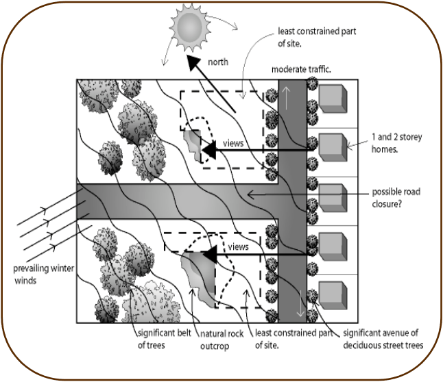
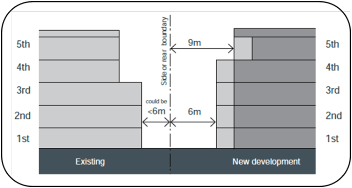
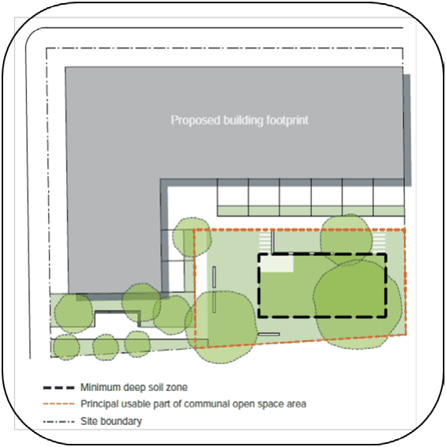
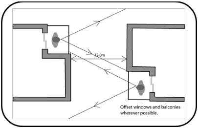
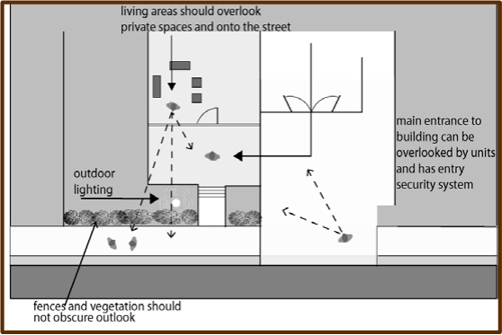
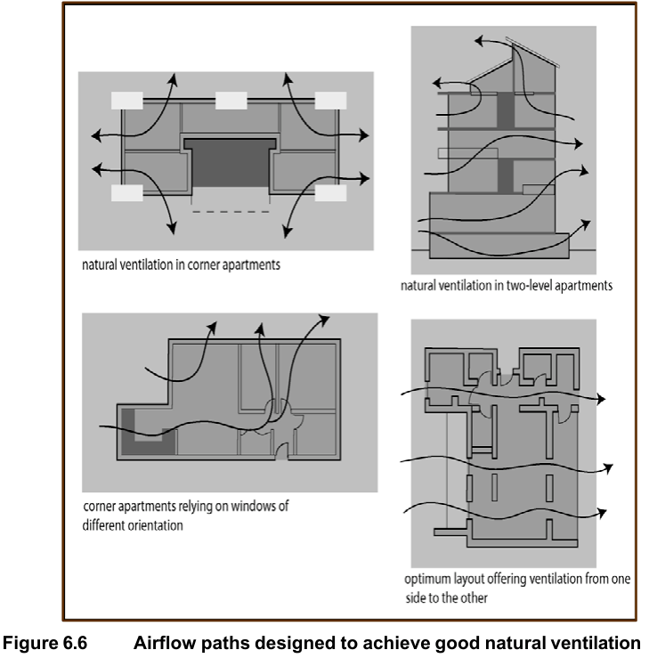

## 6 Residential flat buildings

Residential flat building means a building containing 3 or more dwellings, but does not

include an attached dwelling or multi dwelling housing.

### 6.1 State Environmental Planning Policy No. 65 and the Apartment Design

#### Guide

State Environmental Planning Policy No. 65 – Design Quality of Residential Apartment

Development (SEPP 65) applies to all development for residential flat buildings of 3 storeys

and over. This includes new buildings and the redevelopment or conversion of existing

buildings. Under SEPP 65 all applications must:

(a) Have a Design Verification Statement demonstrating how the Design Quality

Principles of SEPP 65 have been achieved

(b) Have a statement that the development has been designed by a registered

architect

(c) Demonstrate how the development complies with the objectives and design

criteria in the NSW Apartment Design Guide published by the NSW

Department of Planning and Environment.

### 6.2 Local context

Understanding context is fundamental to developing housing which will be harmonious with

the physical character of an area. The context of an area includes a wide range of factors

ranging from broad characteristics to more specific considerations including:

(a) Zonings and other planning provisions for adjacent land

(b) Nature of surrounding uses and built form

(c) Topographic and landscape character

(d) Subdivision pattern of the area

(e) Significant features and constraints

(f) Access and public transport access

(g) Potential hazards from bushfire, flooding and landslip

The proper understanding of such factors is the most important first step for architects and

developers in preparing DA plans.

#### 6.2.1 Policy and desired outcomes

DAs for residential flat buildings should be based on a thorough understanding of site context,

culminating in development which is reflective of context, safeguards local amenity and obeys

sustainability principles.

#### 6.2.2 Standards

Proposed residential flat development shall be designed in accordance with the assessed

context. A Statement of Environmental Effects is required which includes a thorough

assessment of context having regard to matters referred to in State Environmental Planning

Policy No. 65 – Design Quality of Residential Flat Development (SEPP 65) and the Apartment

Design Guide. The Statement of Environmental Effects shall demonstrate that the proposed

development is appropriate and complementary to the assessed context in terms of the

environmental factors identified by way of written analysis and diagrams.

### 6.3 Site analysis

A site analysis should be undertaken covering relevant factors from the list as assembled in

the Statement of Environmental Effects. The analysis should include a drawing and a written

statement, and be incorporated in the Statement of Environmental Effects.

> [Picture on page 51: a picture, saved as a picture (images/part-c-development-in-the-residential-areas-page-51-13.gif, 150 dpi).]

#### Figure 6.1 Site analysis

### 6.4 Site density controls

Sites should have sufficient dimensions to accommodate appropriately scaled residential

flat buildings that comply with the other siting requirements of this Part of the DCP. Sites should have a minimum frontage of 30m and a minimum depth of 30m.

### 6.5 Height

The height of any residential flat building is to be in accordance with Clause 4.3 (Height of

buildings) of Blacktown LEP 2015. This clause should be read in conjunction with the LEP

Height of Buildings Map.

### 6.6 Setbacks – front, rear and side

Setbacks from the front, rear and sides property boundaries play an important role in ensuring

new development fits in with the local built context. Front setbacks in areas zoned for

residential flat buildings create a continuous landscape and provide visual buffering between

development and the public domain. Side setbacks maintain visual permeability through development sites via landscaped

corridors and prevent long unbroken walls of housing. Rear setbacks are also important to

ensure that there is sufficient separation between sites and buildings for visual and acoustic

privacy, and maintenance of solar access.

> [Picture on page 52: a picture, saved as a picture (images/part-c-development-in-the-residential-areas-page-52-14.gif, 150 dpi).]

#### Figure 6.2 Side and rear setbacks from property boundaries

#### Source: Apartment Design Guide, NSW Planning and Environment

#### 6.6.1 Objectives

(a) Ensure that setbacks provide space for building separation that is equitably

shared between neighbouring sites

(b) Ensure that setbacks facilitate a consistent urban design character and

protect view corridors and items of environmental heritage

(c) Provide opportunities for deep soil landscaping around the perimeter of the

site to enhance residential amenity and local character

(d) Minimise impacts on adjacent properties, including privacy, views, solar

access, and visual intrusion.

#### 6.6.2 Standards

(a) The front building setback must be generally in line with the setback

characteristic of neighbouring properties.

(b) The minimum front setback is:

(i) 9m for 3 or more storey buildings

(ii) 7.5m for 1 and 2 storey buildings.

(c) The minimum setback applies to sites adjoining or opposite low-density

residential development even if the dominant street setback is less.

(d) Open style balconies (i.e. open on 3 sides) may project into the front

setback by a maximum of 1m.

(e) Roof eaves and sunhoods may project into the front setback by a maximum

of 600mm.

(f) Basements and basement parking areas are not permitted in the setback.

(g) For sites with more than 1 street frontage, including corner lots, appropriate

setbacks will be set by Council during pre-lodgement discussions based on:

(i) The widest frontage and the main address of the development

(ii) The main pedestrian and vehicle access of the development

(iii) Streetscape, road hierarchy, and adjoining building lines

(iv) Any nearby items of environmental or cultural heritage.

(h) The minimum setback from the side and rear property boundaries must

comply with the requirements of the NSW Apartment Design Guide:

| Building height | Habitable rooms/balconies | Non-habitable rooms |
|---|---|---|
| 4 storeys | 6m | 3m |
| 5-8 storeys | 9m | 4.5m |
| 9+ storeys | 12m | 6m |

#### Table 6.1 Minimum side and rear setbacks

(i) Buildings adjacent to lower density residential zones must increase the

separation distance from the boundary by 3m

(j) The first 3m of the side and rear setbacks must be a deep soil zone.

(k) Vehicle access ramps running parallel to the boundary must be setback 3m

from side and rear boundaries.

(l) Reduced side and rear setbacks may be considered for shop top housing or

buildings 9 storeys and above if it is demonstrated to Council's satisfaction

that:

(i) Building separation can be achieved on-site and on adjoining properties

(ii) Suitable amenity can be achieved on-site and on adjoining properties,

particularly with regard to solar access, ventilation and privacy

(iii)  Appropriate separation and visual transition can be achieved between:

• Adjoining low density residential development or any sensitive uses

• Nearby items of heritage significance.

### 6.7 Common open space

Common open space provides an important amenity for residents of flat buildings, partially

compensating for the higher densities found in these areas. It needs to provide opportunities

for both passive and active recreation and have reasonable dimensions so that it is highly

functional.

#### 6.7.1 Objectives

(a) Provide functional and attractive outdoor spaces for residents to engage in

active and passive recreational activities

(b) Ensure common open space is provided in proportion to development

density

(c) Ensure that residential flat buildings have large areas of function ground

level common open space.

#### 6.7.2 Standards

(a) All residents must have access to landscaped common open space.

(b) Common open space must comply with the requirements of the NSW

Apartment Design Guide:

(i) Minimum total area equal to 25% of the site

(ii) 3m minimum dimension

(iii) Minimum of 50% direct sunlight for a minimum of 2 hours between

9:00 am and 3:00 pm on 21 June (mid-winter).

(c) 40% of the total common open space must be located at ground level. If

no common open space is provided on the rooftop, then the ground level

common open space must be increased to 70%.

(d) Common open space above ground level must not exceed a maximum of:

(i) 30% on podium, balcony or terrace areas

(ii) 30% of the total common open space on the roof of the building.

(e) Variations to the ground level common open space standards may be

considered if it is demonstrated to Council's satisfaction that:

(i) the development is unable to provide useful open space on the ground level

(ii) suitable active internal open space facilities will be provided, such as a

gym or pool.

(f) Common open space must be provided in large consolidated areas which are

capable of active use by residents in addition to providing children's play

equipment, seating, lighting and other recreational facilities like BBQs or

gazebos. These facilities must not be located in the front setback area.

(g) Ground level common open space must include deep soil planting.

(h) Large areas of consolidated planting are preferred over narrow perimeter

planting (see Figure 6.3).

> [Picture on page 55: a picture, saved as a picture (images/part-c-development-in-the-residential-areas-page-55-10.gif, 150 dpi).]

#### Figure 6.3 Common open space

#### Source: NSW Apartment Design Guide, Planning

and Environment NSW

(i) Calculation of the total common open space area must not include:

(i) Any part of the front setback area

(ii) Any area of less than 10sq.m such as small pockets of open space at

ground level designed to enhance the appearance of the development

(iii) Any area with a dimension less than 3m

(iv) Parking areas, vehicle accessways, garbage areas or clothes drying areas.

(j) Rooftop and podium common open space must:

(i) Provide suitable shade, drainage and weather protection

(ii) Provide sustainable planting (minimum dimension 1.5m and 0.6m

minimum soil depth

(iii) Mitigate wind impacts

(iv) Provide safety around edges for the safety of residents and visitors and

pedestrians in the public domain. The Applicant must address how the

design will prevent falls and objects being thrown over the side.

(v) Have set hours of operation. As a guide 8am to 8pm is

encouraged on weekdays/nights.

### 6.8 Separation between buildings

#### 6.8.1 Objectives

(a) Protect visual privacy and amenity for residents and adjoining development

(b) To minimise visual impacts of development.

#### 6.8.2 Standards

(a) Separation between buildings must comply with the requirements of the NSW

Apartment Design Guide:

(i) The minimum separation for windows and balconies is:

| Building height | Habitable rooms/balconies | Non-habitable rooms |
|---|---|---|
| 4 storeys | 12m | 6m |
| 5-8 storeys | 18m | 9m |
| 9+ storeys | 24m | 12m |

#### Table 6.2 Minimum building separation

(ii) Where more than 1 building is to be erected on a development site, the

minimum separation distance between room types is:

| Building height | Habitable rooms or balconies | Habitable rooms or balconies and non- habitable rooms | Non-habitable rooms |
|---|---|---|---|
| 4 storeys | 12m | 9m | 6m |
| 5-8 storeys | 18m | 12m | 9m |
| 9+ storeys | 24m | 18m | 12m |

#### Table 6.3 Minimum separation for buildings on the same site

(b) Buildings must increase the separation distance from the boundary by 3m when

adjacent to lower density residential zones

(c) Maximum 1 step in the building form is preferred to avoid buildings with a

'ziggurat' appearance.

### 6.9 Site design

#### 6.9.1 Site planning and landscaping

Landscape planning follows a complementary and integrated design process with the

development of architectural plans. A detailed analysis of the site and its environs should

precede the preparation of the site plan and landscape plan by suitably qualified practitioners.

The analysis is fundamental to addressing the factors which condition environmental and

urban design outcomes. Landscape planning which attempts to promote cosmetic visual

improvement of an otherwise unsatisfactory development will not be supported. Site landscaping is as important as the architectural design of a development in terms of

environmental outcomes and must be carefully planned. The need for an abundance of soft

landscaping, the use of suitable plant species (in terms of appearance, ecological

appropriateness, safety etc.), the use of salt tolerant plants to combat potentially saline soils

and the integration of active and passive recreation areas are some of the many factors that

are fundamental to successful flat development. All landscaping work enhances the existing natural features of the site and adjoining unfenced

areas. Existing natural landscape elements should be conserved and maintained effectively. All parts of the site not built-upon or paved should be landscaped with grass, trees, shrubs

and/or other vegetation. As many trees as possible should be retained on the site. Landscaping and tree planting play an important role in maintaining biodiversity, creating canopy coverage and providing ecological habitat. Indigenous species should make up a large percentage of the planting mix. Suggested plant communities and species for planting are found in Councils Vegetation Management Plan Guideline booklet: https://www.blacktown.nsw.gov.au/Plan-build/Stage-2-plans-and-guidelines/Native-

vegetation-management The development site should be densely landscaped to the depth of the setback along the

front boundary. Corner sites are also required to incorporate landscaping along the frontage

to the minor road to the depth of the setback. Such landscaped areas may contain vehicular

and pedestrian accessways only. Parking areas are not permitted in these landscaped areas. Unless otherwise advised by Council, landscape design and planting of the site should

include the footpath nature strip. The developer is to liaise with Council to provide co-

ordination between the site and the streetscape. Each DA is to be accompanied by a landscape plan showing the broad intention of the

proposed landscaping on the site, including details of any significant trees requiring removal. Where there are existing trees on a development site, applicants should have regard to Part 2

State Environmental Planning Policy (Biodiversity and Conservation) 2021.

The landscape plan should also indicate:

(a) Areas where earth shaping is proposed

(b) Areas which are to be embellished for purely visual effect

(c) Areas intended for recreation purposes

(d) Areas required for the on-site detention of stormwater

(e) Proposed paving treatment for main entry points and pathways.

Common open space on rooftops must be included in the detailed landscape strategy and

plan. Deep soil zones should be located to retain existing trees and allow adequate clearance

around trees for healthy root development. Deep soil zones must comply with the requirements of the NSW Apartment Design Guide.

| Site area | Minimum dimension | Minimum size (% of site area) |
|---|---|---|
| less than 650sq.m | - | 7% |
| 650sqm – 1,500sq.m | 3m |  |
| greater than 1,500sq.m | 6m |  |
| greater than 1,500sq.m with significant existing tree cover | 6m |  |

#### Table 6.4 Minimum deep soil zone sizes

#### 6.9.2 Protection of views

The design of developments should minimise the obstruction of views from adjoining

buildings. Council may require an applicant to provide a survey or plan, as part of the DA, showing the

position of the proposal on its site, the location of adjoining buildings and the degree of view

loss, if any, resulting from the proposal.

#### 6.9.3 Visual and acoustic privacy

In the higher density conditions found in flat buildings, visual privacy and freedom from

overlooking is important. Protection from mechanical noise and activity noise in other parts of

the development is equally important and steps must be taken to ensure adequate sound

amenity. The development must ensure visual privacy for occupants both during the day and at

night. Outlook and views from private open space areas should be maintained without

compromising privacy. Noise disturbance should be minimised by locating noisy activities and mechanical sources

of noise away from living areas and private open space areas.

> [Picture on page 59: a picture, saved as a picture (images/part-c-development-in-the-residential-areas-page-59-1.gif, 150 dpi).]

#### Figure 6.4 Visual and acoustic privacy

Visual privacy is to be maintained by:

(a) Laying out buildings and windows to avoid overlooking opportunities

(b) Separating facing windows by a suitable distance

(c) Off-setting facing windows to avoid direct lines of sight

(d) Admitting light through windows which are narrow or opaque

(e) Ensuring that windows do not face directly onto the windows, balconies or

courtyards of adjoining dwellings

(f) Screening opposing windows, or balconies overlooking courtyards using either

fixed screens or via landscaping.

Noise disturbance is to be minimised by:

(a) Locating active recreation facilities, such as swimming pools, away from the

bedroom areas of adjoining dwellings

(b) Designing communal areas and vehicle driveways to minimise reflected noise

(c) Ensuring that operating plant or equipment does not disturb neighbours

(d) Avoiding noisy walking surfaces, such as suspended timber or metal decks, and

reflective internal surfaces to hallways or other communal areas

(g) Ensuring that plumbing noise between dwellings and between buildings is

eliminated or contained by the use of ducts, and ensuring wherever possible that

bedrooms or living spaces do not back onto the bathroom or toilet walls of

adjacent flats.

No electrical, mechanical or hydraulic plant or equipment shall generate a noise level greater

than 5dB(A) above the ambient L90 sound level at the boundaries of any allotment at any

time of day.

Windows and balconies of dwellings should be separated or screened from common use

areas such as paths, driveways, common open space, etc. Screens could include courtyard

walls, hedges and fences, whilst separation could be achieved by either distance or changes

in level.

#### 6.9.4 Orientation

Correct orientation is vital to ensure optimum solar access for the majority of units, but must

be balanced against other concerns including configuration of the land, the need to maintain

an appropriate ‘address’ and to maximise enjoyment of view. The site and development should be planned to optimise solar access by:

(a) Positioning and orientating walls of flat buildings to maximise north facing walls

(i.e. walls facing between 30 degrees east and 20 degrees west of north)

(b) Selecting apartment plan types which maximise living spaces within flat buildings

with a north orientation (e.g. apartments which run the full width of the

development block and face north).

#### 6.9.5 Parking provision

Refer to Part A for Council’s off-street car parking rates.

#### 6.9.6 Vehicle and pedestrian access

Appropriate access arrangements ensure that the main entrances to the development or

individual units are attractively landscaped, clearly address the main access street, and can

be subject to surveillance of visitors to the development. The development must also provide

clear, separate, convenient and safe access to parking and servicing areas.

#### 6.9.7 Public road access and construction

Council requires public road access to a standard appropriate to the new development and

half-width road construction with associated transition works adjacent to the frontage of the

development, funded in full by the developer and dedicated to Council at no cost. Such work

shall include conventional kerb and gutter or roll-over kerbing and road pavement

construction and drainage in accordance with detailed plans submitted to and approved by

Council. Concrete path paving in accordance with Council’s standards shall be provided along the full

frontage of the development to any road. Vehicular crossings (of public road reservations) are to be located so as to avoid disturbing

trees or any service installation including road and drainage structures, sewer vents, service

poles, light standards, utility installations etc. Alternatively, an applicant can make

arrangements with the relevant service authority for the relocation of plant and equipment not

owned by Council at no expense to Council.

#### 6.9.8 Accessways

An accessway is defined as an area or road for the access and manoeuvring of vehicles

within the boundaries of a development, but does not include car parking spaces. The common accessway pavement shall be 6m wide from the street to the building setback.

Consideration needs to be given to maximising the distance between the accessway and

intersections and traffic lights. All accessways shall be constructed to Council’s standards appropriate to the type and

volume of traffic it is assessed they will carry. Long straight driveways are to be avoided.

Direct access to the units from driveways is to be avoided as far as possible in the design of

the project. Where direct access is present, then speed humps shall be constructed on the

driveway to the satisfaction of Council. Council will assess the suitability of vehicular accessways for cars and garbage trucks by

reference to State Government standards.

#### 6.9.9 Fencing and screen walls

Screen walls which face a road, pedestrian walkway, reserve or public place shall be

staggered and constructed of brick or open style palisade fence. A screen wall may

incorporate other building materials, provided in the opinion of Council such materials

enhance the physical appearance of the development. Site boundaries not fronting a street, pedestrian walkway, reserve or public place shall be

fenced in accordance with Council’s requirements, at full cost to the developer. Common open space areas are to be enclosed by open style fencing, such as pool fencing,

and provided with a latch-top childproof gate. This is to ensure that the common open space

areas have been suitably secured. Clothes drying areas should be located away from the street or public places. Where this

cannot be avoided, they shall be totally screened from public view. Clothes drying areas shall be screened by walls 1.8m high. No such wall is to contain any

windows of an adjoining dwelling unit. Swimming pools must be fenced in accordance with the provisions of the Swimming Pools

Act 1992. Details of fencing must be shown on the required building plans and landscape plans.

#### 6.9.10 Podium design

Podiums over basement parking projecting more than 0.5m above natural ground level count

as a storey. Podiums shall not be constructed beyond the setback line.

#### 6.9.11 Accessibility provisions

Not less than 10% of units in the whole development or one unit (whichever is the greater

number of units) shall be designed for persons with a disability. In buildings having no lift, such units must be located on the ground floor and be accessible

by a safe path of travel to the main entrance to the street. Refer to Part A for Council’s off-street car parking rates for persons with a disability. Buildings containing 4 or more levels, including the basement, must have lift access to all

levels.

#### 6.9.12 Safety and security

The development is to maintain and enhance the safety and security of the locality. In

particular:

(a) Buildings are to overlook streets and entrances to facilitate casual surveillance

(b) Service ways, paths and parking areas are to be either secured or designed to

allow casual surveillance

(c) There is to be adequate lighting of entrances, pedestrian areas and common

open space areas

(d) Pedestrian entrances to the development are to be from public streets

(e) Buildings shall be constructed in external materials that are robust, durable and

discourage vandalism and graffiti.

### 6.10 Building design

> [Picture on page 62: a picture, saved as a picture (images/part-c-development-in-the-residential-areas-page-62-2.gif, 150 dpi).]

#### 6.10.1 General

#### Figure 6.5 Security design elements intended to achieve crime prevention

All new residential flat development shall generally be designed in accordance with

contemporary design principles, and for development 3 storeys and above designed by a

Registered Architect. A photomontage and sample board showing all external materials and colours are to be

submitted with the DA. Floor plans of units are to be designed to ensure that the amenity of the future occupants is

to the satisfaction of Council. Units are to be provided with a separate self-contained laundry,

full kitchen and ample living areas.

#### 6.10.2 Unit types in the development

Units shall be provided in accordance with likely market expectations. Developments shall contain a mix of 1, 2 and 3 bedroom units.

#### 6.10.3 Floor to ceiling height

(a) Floor to ceiling height must provide adequate amenity, scope for ventilation,

insulation, flexibility of use and headroom for ceiling mounted ducts in corridors

or bathrooms.

(b) All ceiling heights must comply with the design criteria in the NSW Apartment

Design Guide:

| Minimum floor to ceiling dimensions for different room types – as measured to the underside of the constructed floor |  |
|---|---|
| Room type: |  |
| Habitable rooms and corridors | 2.7m |
| Non-habitable rooms | 2.4m |
| Second storey of 2 storey units | 2.4m |

|  | Development in the | PART C Residential Areas |
|---|---|---|
| Attic spaces (require minimum roof slope of 30 degrees) | 1.8m |  |
| Mixed use areas (ground and first floor levels) | 3.3m |  |

#### Table 6.5 Minimum floor to ceiling heights

#### 6.10.4 Passenger lift access

Passenger lift access is required for any residential flat building either 4 levels above ground

with no basement parking or 3 levels above ground and including basement parking.

#### 6.10.5 Balconies

(a) All balconies and private open space must comply with the requirements set out

in the NSW Apartment Design Guide:

| Apartment type | Minimum area | Minimum depth |
|---|---|---|
| Studio | 4 sqm | - |
| 1 bedroom | 8 sqm | 2m |
| 2 bedroom | 10 sqm | 2m |
| 3 bedrooms or more | 12 sqm | 2m |
| Ground level (terraces/courtyards) | 15 sqm | 3m |

#### Table 6.6 Minimum size of balconies and private open space

(b) Calculation of the balcony area must not include any area less than 1 m in depth

or any storage facilitates

(c) Balconies must not be enclosed except with pre-lodgement approval from

Council. All balcony enclosures must comply with the Building Code of Australia.

(d) Balcony balustrades must be constructed of materials that provide contrast with

the main wall of the building to create visual interest.

(e) Clothes hanging/drying on balconies must not be visible from the public domain.

#### 6.10.6 Internal and external shading and solar access

Freedom from overshadowing and enjoyment of solar access in living spaces and open space

areas are important amenity design elements in housing. The level of solar access and overshadowing is affected by factors relating to the siting of the

development and the internal layout of the individual apartments. Sometimes these matters

have to be balanced against other planning considerations such as aspect, address or views. Often, significant improvements to amenity can be achieved by minor changes in layout and

siting at no significant additional cost to the project.

(a) The building design and site layout must ensure adequate solar access to the

internal living spaces of the proposed and adjoining developments.

(b) Solar access must comply with the requirements set out in the NSW Apartment

Design Guide:

(i) Living rooms and private open spaces of at least 70% of

apartments in a building receive a minimum of 2 hours direct

sunlight between 9am and 3pm at mid-winter

(ii) A maximum of 15% of apartments in a building receive no direct

sunlight between 9am and 3pm at mid-winter.

(c) Private open space areas on the site and adjoining land must maintain

reasonable solar access throughout the year.

(d) 50% of the common open space area at ground level must receive a minimum of

2 hours of sunlight between the hours of 9am and 3pm on 21 June.

(e) A minimum of 50% of the principal area of ground level open space in adjacent

properties must receive a minimum of 2 hours direct sunlight between 9am and

3pm on 21 June. If the level of solar access is already less than this, sunlight

must not be further reduced by more than 20%.

(f) The DA must have shadow diagrams showing the impact of the proposal on the

site and on adjoining sites between the hours of 9am and 3pm on 21 June.

These diagrams must:

(i) be prepared by a suitably qualified professional

(ii) be based on a survey of the site and buildings on adjoining sites

(iii) include details of finished ground levels.

#### 6.10.7 Natural ventilation

(a) Ventilation must comply with the requirements in the NSW Apartment

Design Guide:

(i) 60% of all apartments must be naturally cross ventilated in the

first 9 storeys of a residential flat building

(ii) Over-all depth of a cross-over of cross-through apartment must

not exceed 18m (measured glass line to glass line).

(b) Site planning must promote and guide natural breezes by:

(i) Orientating the building to the prevailing breeze

(ii) Locating vegetation to direct breezes and cool air across the site.

(c) The design of apartments must facilitate natural ventilation as shown

in the alternative diagrammatic airflow paths below:

> [Picture on page 65: a picture, saved as a picture (images/part-c-development-in-the-residential-areas-page-65-1.gif, 150 dpi).]

#### Figure 6.6 Airflow paths designed to achieve good natural ventilation

#### 6.10.8 Energy performance and sustainability

The BASIX for residential flat buildings applies to all new development. A BASIX Certificate

is to accompany the DA.

#### 6.10.9 Provision for services

Should an electricity substation (located within the site area or on the street frontage of the

site) be necessary, the requirements of both Council and the relevant electricity provider shall

be met. All electrical reticulation within the site shall be underground. Provision shall be made to illuminate all common accessways and driveways to the

satisfaction of Council. Spacing between lights should not exceed 20m. All common

accessways shall be lit at the footway crossing by an approved means from dusk to dawn. A master television antenna is to be installed within the roof of each building and provision

for connection thereto is to be made to each dwelling. A toilet accessible by residents, visitors and maintenance contractors should be provided

within the ground floor of the building.

#### 6.10.10 Provision for other building services

Provision for all necessary services must be considered at the DA stage to avoid the necessity

for changing room sizes and ceiling heights later at the Construction Certificate stage. The external walls of the development shall be maintained free of other services, fixtures and

appliances including:

(a) Sewerage stackwork and sanitary plumbing

(b) Water plumbing and fixtures

(c) Wall mounted air conditioning

(d) Air conditioning ductwork

(e) Service conduits or wiring (for electricity, telephone, cable television and internet

etc.).

All such services shall be contained within service ducts or plant rooms and documented in

the DA.

#### 6.10.11 Laundry facilities

The development shall provide a single communal area for wet weather drying of laundry,

having a minimum area of 20sq.m for developments up to 10 units, with an additional 10sq.m

per 10 units thereafter to a maximum size of 60sq.m. This facility may not be located at roof

level.

The following clothes drying facilities are required for each dwelling within a building:

(a) 7.5m of external clothes drying line in a suitably screened position which

receives adequate sunlight and does not compromise the common open space

requirement; or

(b) Mechanical drying appliance within the dwelling unit.

### 6.11 Drainage

Adequate provision must be made for the collection and disposal of surface and roofwater

runoff. All stormwater shall be either reticulated to the street gutter or piped to a suitable

location as approved by Council. Where a site proposed for a residential flat building falls away from the fronting street, the DA

must include documentation establishing a suitable drainage solution including inter-

allotment drainage (and proposed easement) through downstream properties, and written

permission from downstream property owners where applicable. Section 88K of the

Conveyancing Act 1919 provides suitable mechanisms to negotiate the creation of easements

where an amicable arrangement cannot be made. Council will not support the placement of

fill on land to channel stormwater drainage back to the street.

### 6.12 Checklist of numerical standards for residential flat buildings

| Standard and DCP reference |  | Required | Provided in proposal |
|---|---|---|---|
| 6.4 | Development site parameters: width, depth and area | Minimum dimensions 30m x 30m |  |
| 6.6 | Minimum setbacks: • front • rear and side | 9m 6m |  |
| 6.7 | Minimum common open space provision | Equal to 25% of site area Max. 30% on roof Max. 30% on podiums or balconies Min. 40% on ground (Note: This must be increased to 70% if no rooftop common open space) |  |
| 6.8 | Separation between buildings | 9 + storeys: 12-24m, up to 8 storeys: 9-18m, up to 4 storeys: 6-12m |  |
| 6.9.11 | Minimum provision of disabled units | Minimum of 1 accessible unit or 10% (whichever greater) |  |
| 6.10.3 | Minimum floor to ceiling dimensions | Habitable rooms and corridors 2.7m Non-habitable rooms 2.4m Second storey of 2 storey units 2.4m Attic spaces (300 minimum roof pitch) 1.8m Mixed use areas 3.3m |  |
| 6.10.5 | Minimum balcony size | 4 sqm |  |

| Standard and DCP reference |  | Required | Provided in proposal |
|---|---|---|---|
| 6.10.6 | Solar access and overshadowing | Min. 70% of units 2 hrs in midwinter Min. 50% common open space 2hrs in midwinter |  |
| 6.10.7 | Natural ventilation | Min. 60% cross ventilation |  |
| 6.10.12 | Laundry facilities | Communal area - wet weather drying minimum area of 20sq.m up to 10 units, plus 10sq.m per 10 units thereafter to a maximum of 60sq.m. 7.5m of external clothes drying line or mechanical drying appliance within the dwelling unit. |  |
