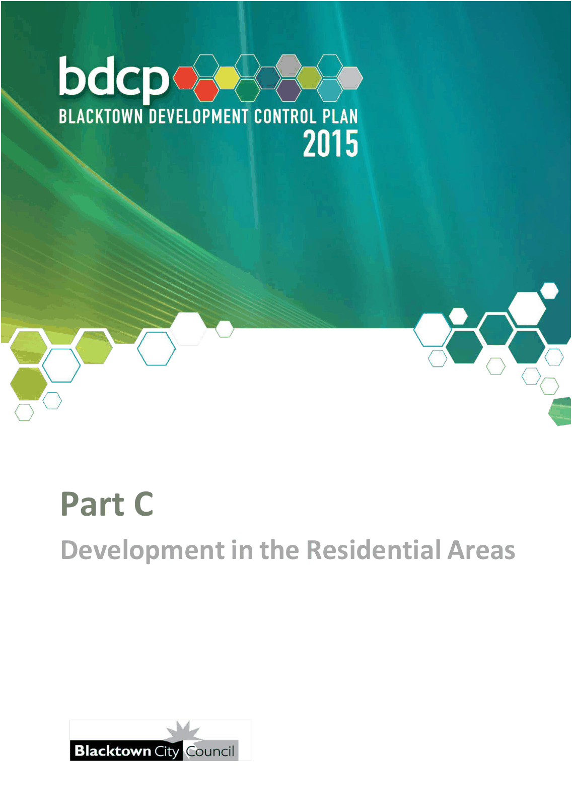

# Blacktown Development Control Plan 2015 - Part C Development in the Residential Areas

> This chapter is split into 12 section file(s), one per numbered heading, in the order they appear in the PDF.

Source PDF: [Part-C-Development-in-the-Residential-Areas_01-02-2026.pdf](Part-C-Development-in-the-Residential-Areas_01-02-2026.pdf)

> [Picture on page 1: a picture, saved as a picture (images/part-c-development-in-the-residential-areas-page-1-1.gif, 150 dpi).]

### Part C

### Development in the Residential Areas

### Table of Contents

| 1 | Introduction ................................................................................................................ 6 1.1 Land to which this Part applies ....................................................................... 6 1.2 Aims and objectives of this Part ...................................................................... 6 1.3 The residential zones ....................................................................................... 6 1.4 Types of residential accommodation .............................................................. 7 1.5 Building elements and design principles ........................................................ 8 1.6 The Building Sustainability Index (BASIX) ...................................................... 9 1.7 Retaining walls and ground reshaping ............................................................ 9 1.8 Demolition of buildings .................................................................................. 10 |
|---|---|
| 2 | Subdivision for detached housing ......................................................................... 12 2.1 Definitions ....................................................................................................... 12 2.2 Subdivision design ......................................................................................... 13 2.3 Minimum allotment sizes ............................................................................... 14 2.4 Allotment dimensions .................................................................................... 14 2.5 Battle-axe shaped allotments ........................................................................ 17 |
| 3 | Dwelling houses ...................................................................................................... 19 3.1 Objectives ....................................................................................................... 19 3.2 Design guidelines ........................................................................................... 19 3.3 Dwelling house design and approval / determination process .................... 23 3.4 Development on corner lots .......................................................................... 24 3.5 Dwelling house design ................................................................................... 25 3.6 Garages, carports, awnings and sheds ......................................................... 27 3.7 Narrow frontage allotments ........................................................................... 29 3.8 Studios and Lofts ........................................................................................... 31 3.9 Definitions ....................................................................................................... 32 3.10 Development Application checklist ............................................................... 33 3.11 Checklist of numerical standards for dwelling houses ................................34 |
| 4 | Dual occupancy housing and secondary dwellings ..............................................37 4.1 Definitions .......................................................................................................37 4.2 Subdivision of dual occupancies and secondary dwellings ........................ 37 4.3 Development requirements ............................................................................ 37 |

| 5 | Attached dwellings and multi dwelling housing .................................................... 43 5.1 Site requirements ........................................................................................... 43 5.2 Building setbacks ........................................................................................... 43 5.3 Building design .............................................................................................. 43 5.4 Solar access ................................................................................................... 44 5.5 Building height ............................................................................................... 44 5.6 Private open space ......................................................................................... 44 5.7 Common open space (only applies to multi dwelling housing) ................... 45 5.8 Landscaping ................................................................................................... 45 5.9 Setbacks of dwellings .................................................................................... 46 5.10 Off-street car parking ..................................................................................... 47 5.11 Accessways .................................................................................................... 47 5.12 Public road access and construction ............................................................ 47 5.13 Fencing and screen walls............................................................................... 47 5.14 Privacy ............................................................................................................ 49 5.15 Views ............................................................................................................... 49 5.16 Services .......................................................................................................... 49 5.17 Laundry facilities ............................................................................................ 49 5.18 Drainage .......................................................................................................... 49 |
|---|---|
| 6 | Residential flat buildings ........................................................................................ 50 6.1 State Environmental Planning Policy (Housing) 2024 and the Apartment Design Guide……………………………………………………………………………………50 6.2 Local context .................................................................................................. 50 6.3 Site analysis .................................................................................................... 51 6.4 Site density controls....................................................................................... 51 6.5 Height .............................................................................................................. 52 6.6 Setbacks – front, rear and side ...................................................................... 52 6.7 Common open space ..................................................................................... 54 6.8 Separation between buildings ....................................................................... 56 6.9 Site design ...................................................................................................... 57 6.10 Building design............................................................................................... 62 6.11 Drainage .......................................................................................................... 66 6.12 Checklist of numerical standards for residential flat buildings ................... 67 |

7 Seniors housing ...................................................................................................... 68

### 7.1 Provisions of the State policy and

Blacktown Local Environmental Plan 2015 .................................................. 68

7.2 Additional council requirements .................................................................. 68

8 Non-residential development in the residential zones ......................................... 71

8.1 General requirements .................................................................................... 71

8.2 Places of public worship and educational establishments ......................... 72

8.3 Child care facilities ........................................................................................ 73

8.4 Neighbourhood shops .................................................................................. 78

8.5 Health consulting rooms ............................................................................... 79

8.6 Home businesses and veterinary hospitals ................................................. 80

8.7 Home occupations......................................................................................... 81

Appendix 1 Detailed design requirements for child care centres ........................... 83

#### Figures

Figure 2.1 Example of a corner allotment ................................................................. 12 Figure 2.2 Example of regular shaped allotments .................................................... 12 Figure 2.3 Road and allotment orientation for roads that run east-west ................. 14 Figure 2.4 Road and allotment orientation for roads that run north-south ............. 14 Figure 2.5 Minimum allotment width ......................................................................... 15 Figure 2.6 Minimum allotment width for battle-axe shaped allotments .................. 15 Figure 2.7 Minimum allotment width for corner allotments ..................................... 16 Figure 2.8 Minimum depth ......................................................................................... 16 Figure 2.9 Access corridors for battle-axe shaped allotments ................................ 17 Figure 2.10 Shared access corridor requirements for

battle-axe shaped allotments ................................................................... 18

Figure 2.11 Minimum allotment area calculation for

battle-axe shaped allotments ................................................................... 18

Figure 3.1 Stanhope Gardens masterplanned estate ............................................... 21 Figure 3.2 Setback controls for corner lots .............................................................. 24 Figure 3.3 Dominant garage placement .................................................................... 27 Figure 3.4 Non-dominant garage placement ............................................................ 28

| Figure 3.5 | Two lot policy ........................................................................................... 30 |
|---|---|
| Figure 3.6 | Three lot policy ......................................................................................... 31 |
| Figure 5.1 | Sill height restrictions in multi dwelling housing development ............ 48 |
| Figure 6.1 | Site analysis .............................................................................................. 51 |
| Figure 6.2 | Side and rear setbacks from property boundaries ................................. 52 |
| Figure 6.3 | Common open space................................................................................ 55 |
| Figure 6.4 | Visual and acoustic privacy ..................................................................... 59 |
| Figure 6.5 | Security design elements intended to achieve crime prevention .......... 62 |
| Figure 6.6 | Airflow paths designed to achieve good natural ventilation .................. 65 |
| Tables |  |
| Table 3.1 | Checklist for narrow allotments (dual occupancy) ................................. 30 |
| Table 6.1 | Minimum side and rear setbacks ............................................................. 53 |
| Table 6.2 | Minimum building separation .................................................................. 56 |
| Table 6.3 | Minimum separation for buildings on the same site .............................. 56 |
| Table 6.4 | Minimum deep soil zone sizes ................................................................. 58 |
| Table 6.5 | Minimum floor to ceiling heights ............................................................. 62 |
| Table 6.6 | Minimum size of balconies and private open space ............................... 63 |
| Table 7.1 | Minimum size of common room .............................................................. 69 |

<!-- sections -->
## Sections

1. [1 Introduction](01-1-introduction.md)
2. [2 Subdivision for detached housing](02-2-subdivision-for-detached-housing.md)
3. [3 Dwelling houses](03-3-dwelling-houses.md)
4. [1 x Statement of Environmental Effects](04-1-x-statement-of-environmental-effects.md)
5. [4 Dual occupancy housing and secondary dwellings](05-4-dual-occupancy-housing-and-secondary.md)
6. [5 Attached dwellings and multi dwelling housing](06-5-attached-dwellings-and-multi-dwelling.md)
7. [6 Residential flat buildings](07-6-residential-flat-buildings.md)
8. [7 Seniors housing](08-7-seniors-housing.md)
9. [8 Non-residential development in the residential zones](09-8-non-residential-development-in-the.md)
10. [1 Internal design](10-1-internal-design.md)
11. [2 External children’s areas](11-2-external-children-s-areas.md)
12. [3 Safety provisions](12-3-safety-provisions.md)
