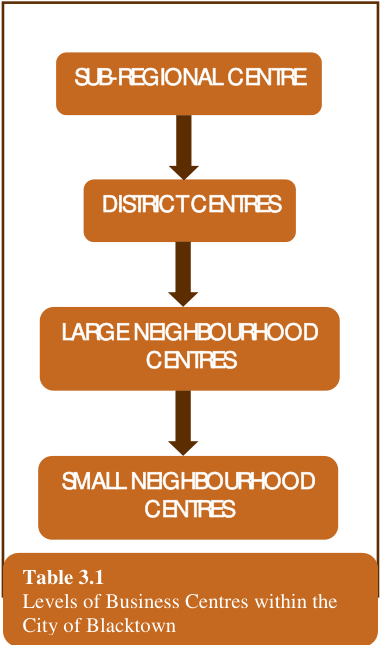

### 3.0 HIERARCHY OF BUSINESS CENTRES

#### 3.1

### 3.1 The Blacktown Retail Hierarchy

### 3

### HIERARCHY OF

### BUSINESS CENTRES

Levels of Business Centres within the

#### The Blacktown Retail Hierarchy

In 1981 a retail strategy was established for the City of Blacktown which has

been periodically reviewed to ensure it remains relevant to current retail trends.

Such reviews have occurred in 1986, 1991 and 1999.  The Study identified the

location and size of all business centres in the City and gave recommendations

for their future growth or otherwise, based upon projected population and

expenditure figures.

Within the City of Blacktown there are 4 main levels of business centres these

> [Picture on page 10: a picture, saved as a picture (images/part-d-development-in-the-business-zones-page-10-17.gif, 150 dpi).]
> Words printed on the picture (copied from the PDF):
> SUB-REGIONAL CENTRE
> DISTRICT CENTRES
> LARGE NEIGHBOURHOOD
> CENTRES
> SMALL NEIGHBOURHOOD
> CENTRES
> City of Blacktown

Table 3.1

being:

Of the existing and proposed business centres in the City of Blacktown, 2 are

sub-regional centres (Blacktown CBD and Mount Druitt Town Centre) and 5 are

district centres (Seven Hills, Plumpton and the proposed centre at Parklea and

the proposed expanded centre at Quakers Hill and Riverstone).  Other centres

serve local retail and commercial needs to varying degrees.

#### 3.2
