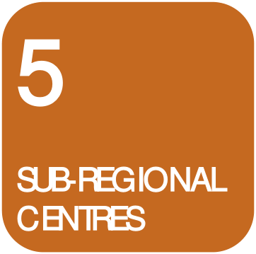

### 5.0 SUB-REGIONAL CENTRES

#### 5.1

### 5.1 Description

> [Picture on page 18: a picture, saved as a picture (images/part-d-development-in-the-business-zones-page-18-4.gif, 150 dpi).]

### 5

### SUB-REGIONAL

### CENTRES

#### Description

A sub-regional centre is one which has major office, retail and community

facilities and is situated on highly accessible transport routes.  Both the

Blacktown Central Business District (CBD) and Mount Druitt Town Centre

have been identified by the State Government as sub-regional centres.  Such

centres are also the focus for the City’s community facilities as well as

commercial activity and transport facilities.

A sub-regional centre will accommodate major shopping facilities, including at

least 1 department store, major supermarket facilities, cinemas, a wide range of

speciality shops and services, branches of major banks and building societies, as

well as community facilities such as libraries, baby health care centres etc.  As

far as possible, a diversity of uses is encouraged in these centres, including the

integration of residential accommodation.

Sub-regional centres will, in general, range in size from 50 000 to 150 000 sq.m

gross floor area at full development.

#### 5.2
