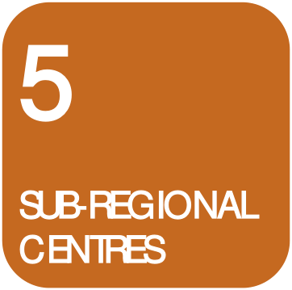
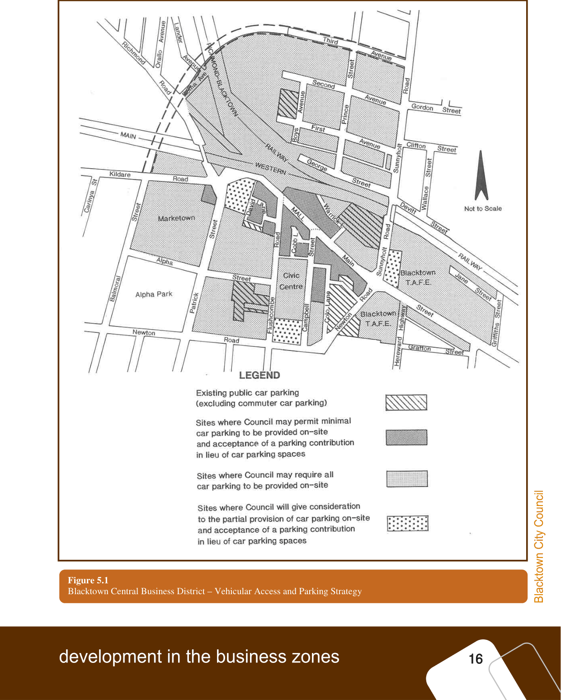
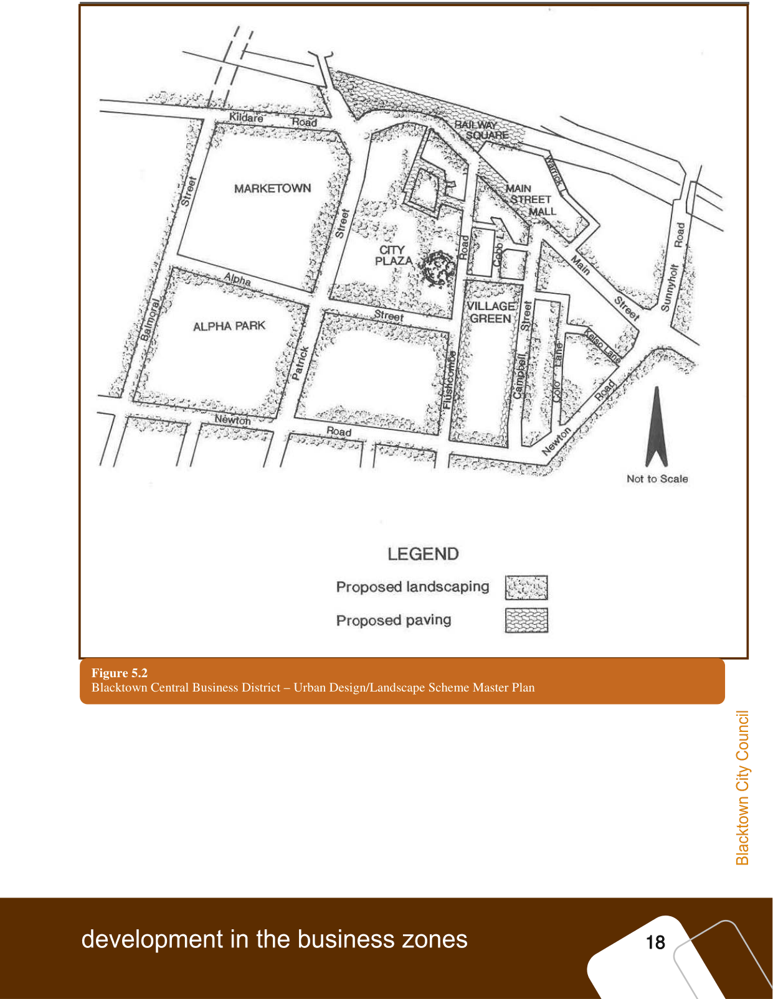
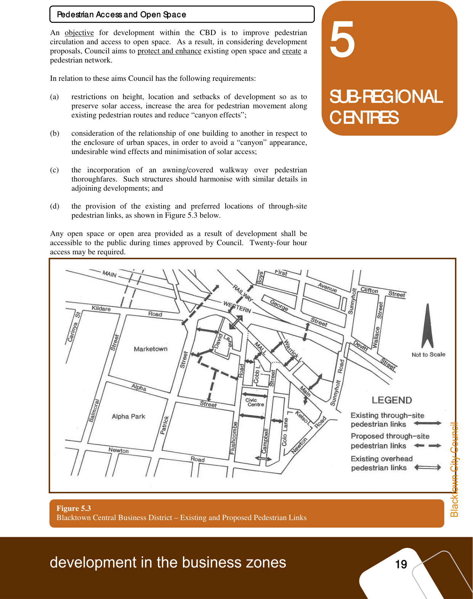
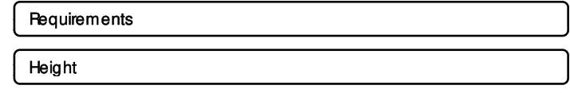
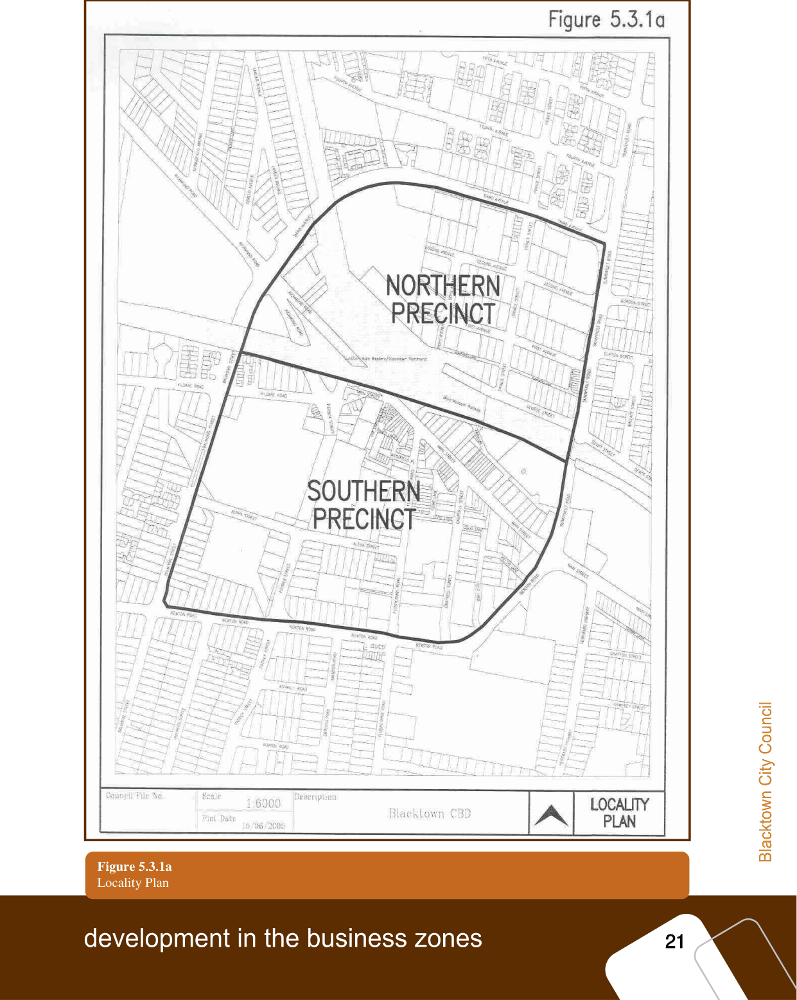
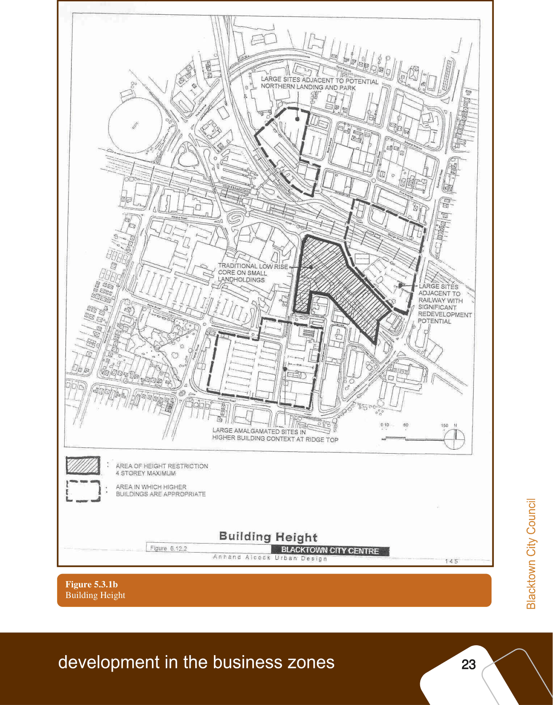
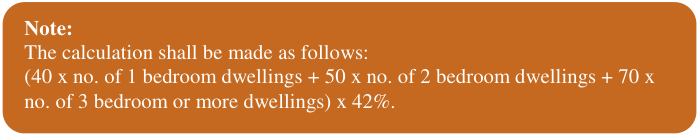

### 5.3 Blacktown Central Business District – General

requirements

#### Blacktown Central Business District – General Requirements

#### Objectives

Objectives

> [Picture on page 20: a picture, saved as a picture (images/part-d-development-in-the-business-zones-page-20-7.gif, 150 dpi).]

### 5

### SUB-REGIONAL

### CENTRES

The purpose of these specific development guidelines for the Blacktown CBD is

to enable Council to effectively control the character and quality of development

in the centre so as to achieve the concept of a compact, viable and attractive city

centre so as to achieve the concept of a compact, viable and attractive city centre

connected by a convenient pedestrian system linking the various uses and

activities.

Council’s objectives in relation to development in the Blacktown CBD are to:

(a) promote the Blacktown CBD as a retail, commercial and community

focus for the City of Blacktown;

(b) improve the pedestrian circulation system and the general amenity of the

pedestrian environment, through attention to solar access and the

development of landscaped urban spaces;

(c) improve the character of the centre by promoting aesthetically pleasing

and architecturally interesting development which is sympathetic to

adjacent developments; and

(d) ensure that adequate car parking facilities are provided, vehicular traffic

conflicts and hazards are minimised and pedestrians and vehicles are

adequately separated.

#### Car Parking Strategy

Car Parking Strategy Council has adopted a parking strategy which limits the amount of on-site

parking to be provided on land in certain locations within the CBD and requires

all car parking to be provided on-site in other locations.  This strategy aims to

minimise the impact of traffic in the highly pedestrianised  “heart” of the centre,

maximise accessibility of developments to car parking and enhance efficiency of

the proposed ring road system.

The car parking strategy designates locations where:

(a) Council may allow only minimal car parking to be provided on-site - an

upper limit of 25% of the total car parking requirement.  The balance of

the car parking is to be provided by way of a monetary contribution for

car parking;

(b) Council may give consideration to the partial provision of car parking on-

site and acceptance of a parking contribution in lieu of car parking spaces

not provided.  The exact mix of on-site and off-site parking will be

determined by consideration of the traffic impact of the proposed

development.  As a guide, Council may permit 50% of car parking to be

provided on-site in designated locations; and

(c) Council may require all car parking to be provided on-site.

The location of the designated “restricted” on-site parking provision areas is

shown in Figure 5.1 (refer page 15).

> [Picture on page 21: a picture, saved as a picture (images/part-d-development-in-the-business-zones-page-21-1.gif, 150 dpi).]

#### Figure 5.1

Blacktown Central Business District – Vehicular Access and Parking Strategy

### 5

### SUB-REGIONAL

### CENTRES

In determining the amount of car parking to be provided in the CBD Council

will consider each Development Application on its merits having specific regard

to the following:

(a) the size of the development;

(b) the demand for parking in the locality generally;

(c) the general flow of traffic in the area;

(d) any potential traffic and/or pedestrian conflicts;

(e) any site constraints; and

(f) times of peak parking demand for the proposed development compared to

that of existing development in the Centre and specifically on adjoining

land.

Applicants will be required to provide information on the above matters to

justify their proposed car parking provision.

#### Design Guidelines

Design Guidelines

All development should take into account the general development guidelines

detailed in section 4 of this Part of the DCP and the provisions of Council’s

Urban Design/Landscape Scheme for the Blacktown CBD, particularly the

Master Plan adopted by Council.  The Master Plan is reproduced in Figure 5.2

(refer page 17).

Council will be particularly concerned with the height, scale and appearance of

any development propose for sites in the following locations:

(a) sites located on the fringe of the CBD and which are the “gateways” to

the City and/or to adjoining residential areas;

(b) land in Main Street, in the vicinity of the Mall, where Council intends to

preserve the amenity and character of the Mall; and

(c) land on exposed corner sites where setbacks from street corners would be

desirable in order to reduce the obtrusive appearance of any buildings.

Such locations include the corners of Flushcombe Road and Alpha Street,

Alpha and Patrick Streets and Sunnyholt Road and Main Street.

> [Picture on page 23: a picture, saved as a picture (images/part-d-development-in-the-business-zones-page-23-1.gif, 150 dpi).]

Figure 5.2

Blacktown Central Business District – Urban Design/Landscape Scheme Master Plan

#### Pedestrian Access and Open Space

Pedestrian Access and Open Space

> [Picture on page 24: a picture, saved as a picture (images/part-d-development-in-the-business-zones-page-24-3.gif, 150 dpi).]

### 5

### SUB-REGIONAL

### CENTRES

An objective for development within the CBD is to improve pedestrian

circulation and access to open space.  As a result, in considering development

proposals, Council aims to protect and enhance existing open space and create a

pedestrian network.

In relation to these aims Council has the following requirements:

(a) restrictions on height, location and setbacks of development so as to

preserve solar access, increase the area for pedestrian movement along

existing pedestrian routes and reduce “canyon effects”;

(b) consideration of the relationship of one building to another in respect to

the enclosure of urban spaces, in order to avoid a “canyon” appearance,

undesirable wind effects and minimisation of solar access;

(c) the incorporation of an awning/covered walkway over pedestrian

thoroughfares.  Such structures should harmonise with similar details in

adjoining developments; and

(d) the provision of the existing and preferred locations of through-site

pedestrian links, as shown in Figure 5.3 below.

Any open space or open area provided as a result of development shall be

accessible to the public during times approved by Council.  Twenty-four hour

access may be required.

Figure 5.3

Blacktown Central Business District – Existing and Proposed Pedestrian Links

#### 5.3.1

#### 5.3.1 Residential/Mixed Use Development – Specific Controls

### 5

### SUB-REGIONAL

### CENTRES

#### Residential/Mixed-use Development – Specific Controls

Residential development is permitted with consent in the 3(a) and 3(b) Business

zones in conjunction with retail/commercial development.  In addition to the

other requirements detailed in sections 4 and 5 of this Part of the DCP, all

Development Applications that propose a residential component are required to

comply with the provisions of this sub-section.

The Objectives of these provisions are to:

(1) Provide a pleasant living and working environment for the residents of

the building.

(2) Ensure that development sites have sufficient frontage to achieve a good

relationship to adjoining sites.

(3) Ensure that the siting of buildings provides for adequate separation

between buildings for the amenity of the development and adjoining

properties to provide equitable access for sunlight and to minimise the

overshadowing of adjoining properties.

(4) Ensure developments promote a positive relationship and ‘human scale’

with the public domain and maintain solar access to public places and

footpaths.

(5) Maintain the amenity of any adjoining residential land in terms of

building bulk and solar access.

(6) Provide attractive, usable and accessible landscaped areas of open space

for the residents of the development.

(7) Minimise the overlooking of living spaces in dwellings and private open

space.

(8) Ensure the adequate provision of service facilities in the development and

that such facilities are integrated with the design of the development and

are conveniently located for use by residents.

> [Picture on page 25: a picture, saved as a picture (images/part-d-development-in-the-business-zones-page-25-34.gif, 150 dpi).]
> Words printed on the picture (copied from the PDF):
> Requirements
> Height

#### Requirements

#### Height

#### Northern Precinct

Northern Precinct

The Northern Precinct of the Blacktown CBD is that part of the City to the north

of the railway line bounded by the Main Western Railway line, Sunnyholt Road

and Third Avenue.  See Figure 5.3.1a (refer page 20)

In order to achieve a transition in the height of development within the Precinct

so that lower height development occurs along the Precinct’s fringe (in

proximity to the lower density zones adjacent to the CBD) and higher building

forms occur closer to the centre of the CBD, the following provisions apply:

> [Picture on page 26: a picture, saved as a picture (images/part-d-development-in-the-business-zones-page-26-1.gif, 150 dpi).]

> Words printed on the picture (copied from the PDF):
> Locality Plan

Figure 5.3.1a

### 5

#### In the 3(b) Special Business zone:

• For land directly fronting onto the southern side of Third Avenue -

maximum of 10 storeys.

• For land on the northern and southern side of Second Avenue - maximum

of 20 storeys.

#### In the 3(a) General Business zone:

For land on the northern side of First Avenue and all relevantly zoned land to

the south down to the railway line - more than 20 storeys is permissible.

#### Southern Precinct

### SUB-REGIONAL

### CENTRES

Southern Precinct

The Southern Precinct of the Blacktown CBD is that part of the City to the south

of the railway line bounded by the Main Western Railway line, Sunnyholt Road,

Newton Road and Balmoral Street.  See Figure 5.3.1a (refer page 20)

Generally, mixed-use developments within this Precinct will be determined on

their merits having regard to issues such as the size of the site, the local context

and potential impacts on the Main Street Area (particularly overshadowing and

bulk and scale).  Proposals will also be required to have regard to the principles

shown on Figure 6.12.2, ‘Building Height’ of the Blacktown City Centre Urban

Design Master Plan.  See Figure 5.3.1b (refer page 22).

It should be noted that some peripheral sites, such as key gateway sites into the

City Centre, will justify higher building forms.

#### Building Quality and Design

Building Quality and Design

The design of buildings is to have regard to the provisions of State

Environmental Planning Policy No. 65 – Design Quality of Residential Flat

Development, in particular Principles 1 – 10, and the provisions of the

Residential Flat Design Code.

When viewed from nearby or distant vantage points, new development should

provide visual interest through architectural design elements, including material

selection, finishes and colour and should complement and enhance existing

streetscapes.  Blank facades should be avoided where possible and where

unavoidable should be articulated in some way.

Additionally, the built form of new development should be designed to be of a

scale which is sensitive to pedestrian activity and which provides a safe and user

friendly environment. It should complement the character of the area and create

good pedestrian environments and an attractive streetscape.

> [Picture on page 28: a picture, saved as a picture (images/part-d-development-in-the-business-zones-page-28-1.gif, 150 dpi).]

#### Figure 5.3.1b

Building Height

#### Front Setbacks

Front Setbacks

### 5

### SUB-REGIONAL

### CENTRES

A zero setback to the front boundary is permissible for the ground floor and the

1 - 2 levels above, i.e. the podium.

However, levels above the podium should be setback in order to create a

comfortable street scale, reduce building bulk and provide greater solar access.

Courtyards and balconies may encroach into the setback area to a sufficient

extent to allow articulation of the facade.

In accordance with the recommendations of the Master Plan, buildings will be

required to provide weather protection for and improve the amenity of

pedestrians by the provision of an awning for the full frontage of the site.

#### Side and Rear Setbacks

Side and Rear Setbacks

A zero setback to the side and rear boundaries is permitted for the ground floor

and the 1 - 2 levels above, i.e. the podium.

For the levels of the building above the podium, each development site shall be

examined on its individual merits with the absolute minimum setback being 6

metres.  However, in order to ensure a quality environment, especially in regard

to solar access and privacy for the future residents of the CBD, setbacks greater

than 6 metres are highly desirable and are advocated by Council.

Balcony encroachments into any building setback area which is not to a street

frontage will not necessarily be accepted but will be assessed on their merits.  In

this respect, Council will have regard to matters such as privacy, overviewing

and articulation of the façade.

#### Minimum Allotment Size or Width of Sites

Minimum Allotment Size or Width of Sites

The minimum site width at the street shall be 30m.  Notwithstanding this,

development must have regard to existing, adjacent sites which could become

isolated as a consequence  of that development.  In these instances the developer

will need to demonstrate how those sites not incorporated in the Development

Application could be re-developed successfully on their own in compliance with

the provisions of the DCP.

#### Common Open Space

Common Open Space

Common Open Space for the use of all residents of the development shall be

provided at the minimum rate of 42% of the sum of the following:

(a) 40sqm for each 1 bedroom dwelling;

(b) 50sqm for each 2 bedroom dwelling; and

(c) 70 sqm for each 3 or more bedroom dwelling.

> [Picture on page 29: a picture, saved as a picture (images/part-d-development-in-the-business-zones-page-29-44.gif, 150 dpi).]

#### Note:

The calculation shall be made as follows:

(40 x no. of 1 bedroom dwellings + 50 x no. of 2 bedroom dwellings + 70 x

no. of 3 bedroom or more dwellings) x 42%.

### 5

### SUB-REGIONAL

### CENTRES

A “bedroom” is a room designated or intended for use as a bedroom or any

room capable of being adapted to be used as a separate bedroom. Dwelling and room sizes shall comply with the requirements of the Building

Code of Australia. The total required Common Open Space shall not include as part of the above

calculation:

(a) parking areas and vehicular accessways, but may include communal facilities such as:

(a) gymnasiums

(b) swimming pools

(c) common rooms, community facilities and the like.

Additionally, there is no objection to roof space in the CBD being used as part

of the Common Open Space subject to appropriate design, including

landscaping, shade structures etc. In order to provide usable open space for individual dwellings, the area of

balconies or terraces may be included as part of the required Common Open

Space provision.  However, no more than 30% of the above-ground open space

(balconies or terrace areas) may be included in the total.

#### Private Open Space

Private Open Space

In order to ensure an adequate level of amenity and usefulness to residents, each

unit is to be provided with a private balcony/courtyard or terrace area with

minimum dimensions of 3m x 2.5m.

#### Natural Cross Ventilation and Solar Access

Natural Cross Ventilation and Solar Access

Developments will be required to comply with the provisions of  SEPP 65 and

the Residential Flat Design Code in regard to cross ventilation and solar access.

#### Lifts

Lifts

All development will be required to be serviced by stretcher sized lifts.

#### Site Waste Management and Minimisation

Site Waste Management and Minimisation

Developments will be required to comply with the provisions of Blacktown

Development Control Plan 1992 Part O – “Site Waste Management and

Minimisation” in regard to minimisation of waste generated and disposed of

during the construction and demolition phase of the development, maximising

reuse and recycling of building and construction materials, household generated

waste and industrial and industrial/commercial waste.

#### Design of Waste Facilities and On-going Management Practices

Design of Waste Facilities and On-going Management Practices Details of the proposed waste management system to be implemented as part of

the ongoing use of the development are to be provided to Council for

assessment.  While a number of alternative solutions are available (and will be

considered by Council) to service the waste requirements of mixed-use

### 5

### SUB-REGIONAL

### CENTRES

developments, the following points will guide you to an understanding of

Council’s requirements.

The waste (garbage & recycling) requirements of the residential and the

commercial portions of the development must be considered separately.  The

waste management infrastructure and collection systems used by the residential

and the commercial portions of the development must be independent of each

other and physically separated. Commercial tenants in mixed development

should be actively discouraged from using the residential waste facilities.

The plans and accompanying documents (including the Waste Management

Plan) should include details of:

(1) Bin type, number, size.

(2) Location and design of waste storage areas / rooms (residential and

commercial).

(3) Method and frequency of collection.

(4) Garbage chutes (to be considered for all buildings over 4 storeys).

(5) Where garbage chutes are provided, recycling storage areas are to be

provided on each floor.

(6) Compaction equipment (if proposed).

(7) Location of collection points for bin servicing.

(8) Responsibility for movement of bins from storage areas to collection

points and retrieval after collection.

(9) Responsibility for ensuring the system is maintained in a clean condition

free of odour and vermin.

(10) Details on how contamination of the recyclables will be minimised.

The waste management system (including location of storage areas, bin rooms,

chutes etc) should be designed and located to minimise aesthetic, odour and

noise impacts on residents.

#### Residential requirements

Residential Requirements

Council’s standard waste services include:

(1) Garbage collected weekly in 240L mobile garbage bins.  The use of

1.5m3, 3m3 and 4.5m3 bulk bins is allowed in consultation with Council’s

Waste Management Services staff.

(2) Co-mingled recycling collected fortnightly in 240L mobile garbage bins.

(3) Mobile garbage bins are collected at the street kerb, and 1 lineal meter

should be allowed for the presentation and collection of bins.  Where

large numbers of bins are involved, streetscape and the visual amenity of

the area should be considered in determining the type of system to be

used.

(4) Council may consider entering private property to service bins.

Should the development require that Council’s or its contractor’s vehicles be

required to enter the property for the purpose of gaining access to garbage or

recycling containers:

### 5

### 5

### SUB-REGIONAL

### CENTRES

### SUB-REGIONAL

### CENTRES

(a) Roads, driveways, loading docks and footpath kerb crossings or

other areas accessed for waste and recycling servicing must be

designed and constructed to the standard required for a 11m large

rigid truck with a turning circle of 25m to withstand a load of 25.5

tonnes to accommodate garbage trucks.

(b) Trucks must enter and exit the site in a forward direction.

(c) An indemnity must be provided releasing and indemnifying

Council and/or their contractors for any damage to land or

improvements on the land that may occur as a result of collecting

waste and recycling from the property.   This will need to

undertaken by way of a bylaw in the strata management statement

and Section 88B notation.

(5) Mobile garbage bins are serviced by Council using a truck with a left

hand side lift. The travel height of the truck is 3.6m with 4m clearance

required for bin lifts.

(6) Bulk bins are serviced by Council using a front lift truck. The travel

height of the truck is 3.8m with 6m clearance required for bin lifts.

(7) When calculating the volume required for the waste and recycling

requirement for the residential portion of the development:

(a) For developments with 1 - 8 dwellings provide 1x 240L MGB per

unit (collected weekly) for garbage and 1x 240L MGB per unit

(collected fortnightly) for recycling.

(b) For development with over 8 dwellings allow a minimum of 110L

per unit (collected weekly) for garbage and 90L per unit (collected

fortnightly) for recycling.

#### Commercial Requirements

Commercial Requirements

The commercial tenants must have a dedicated area/room for the storage of

waste (garbage and recycling). Adequate area must be provided to store waste

and recycling bins meet the generation needs of “the anticipated” commercial

tenants.

Council may consider servicing the garbage requirements of the commercial

tenants, depending on the waste management system proposed and its

compatibility with Council’s standard service.

#### Development Consents

Development Consents

All development consents issued for mixed-use development in the Blacktown

CBD, i.e. development to which this sub-section applies, will be valid for a

period of only 2 years from the date of issue of the consent.

#### 5.4
