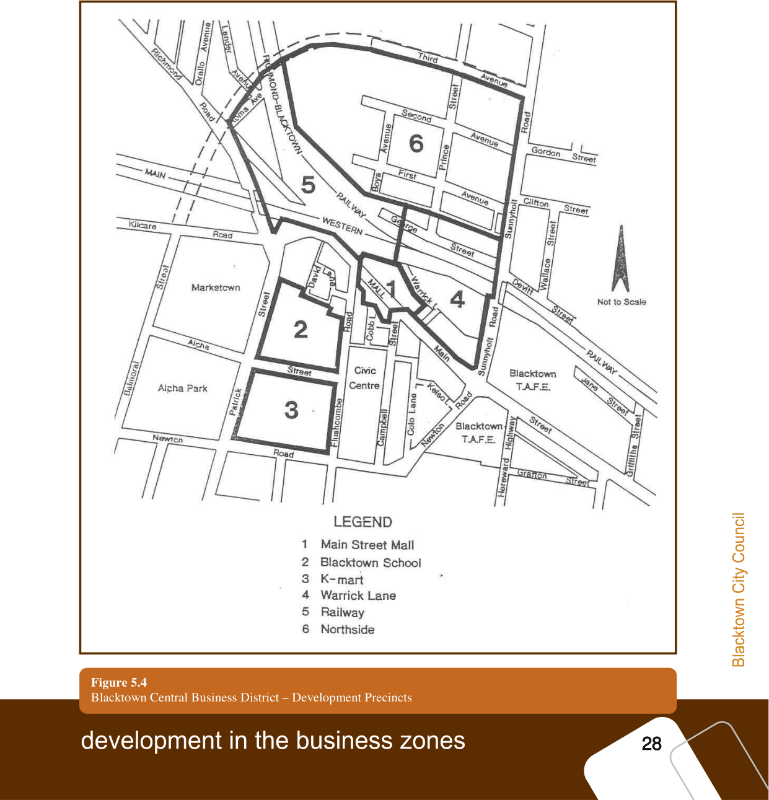
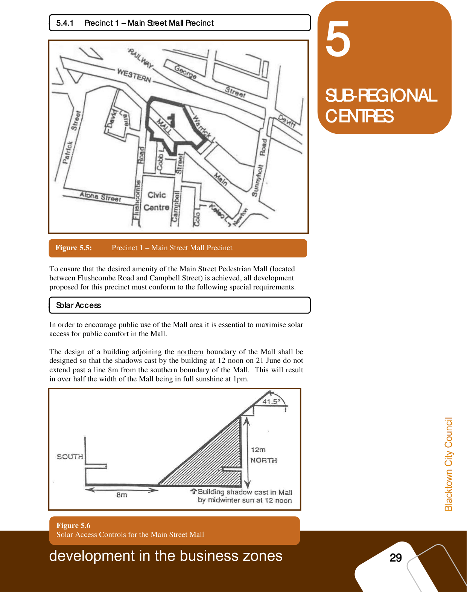
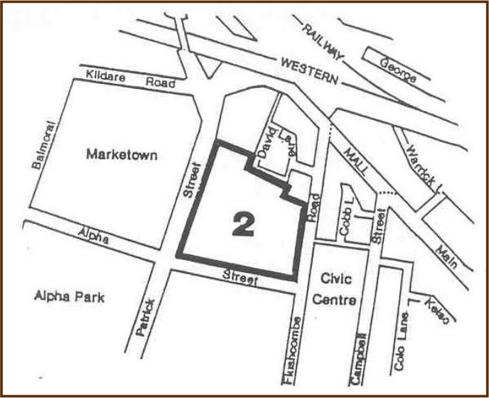
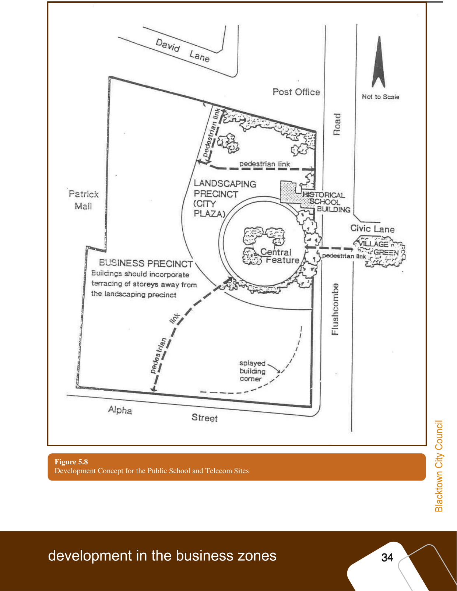
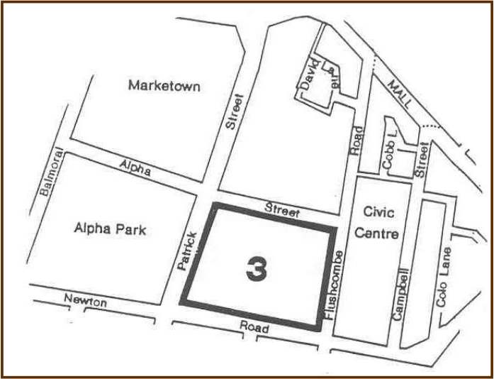
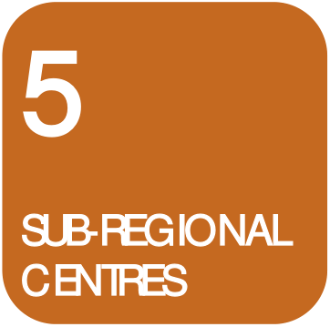
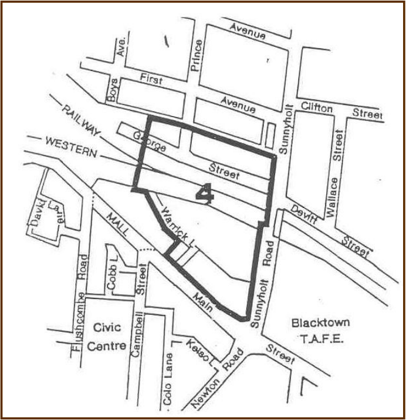
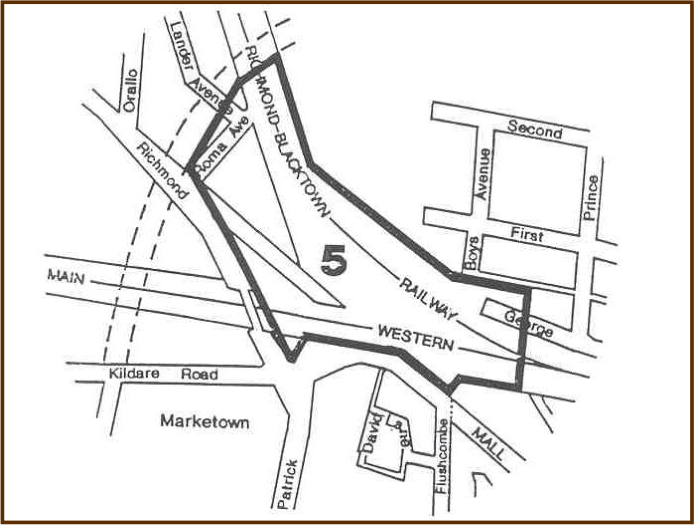
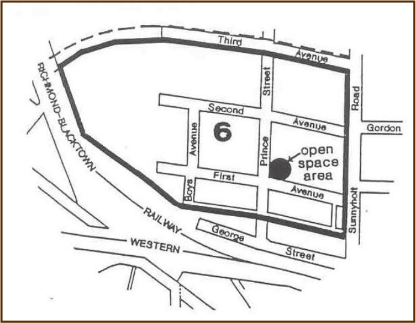

### 5.4 Blacktown Central Business District – Detailed Precinct

Plans

#### Blacktown Central Business District – Detailed Precinct Plans

To control and guide development in the Blacktown CBD, specific design

guidelines have been formulated and are applicable for development within

various precincts within the CBD.  These precincts are designated in Figure 5.4

below.

> [Picture on page 33: a picture, saved as a picture (images/part-d-development-in-the-business-zones-page-33-9.gif, 150 dpi).]

Figure 5.4

Blacktown Central Business District – Development Precincts

#### 5.4.1

#### 5.4.1 Precinct 1 – Main Street Mall Precinct

> [Picture on page 34: a picture, saved as a picture (images/part-d-development-in-the-business-zones-page-34-3.gif, 150 dpi).]

### 5

### SUB-REGIONAL

### CENTRES

Figure 5.5: Precinct 1 – Main Street Mall Precinct

#### Precinct 1 – Main Street Mall Precinct

To ensure that the desired amenity of the Main Street Pedestrian Mall (located

between Flushcombe Road and Campbell Street) is achieved, all development

proposed for this precinct must conform to the following special requirements.

#### Solar Access

Solar Access

In order to encourage public use of the Mall area it is essential to maximise solar

access for public comfort in the Mall.

The design of a building adjoining the northern boundary of the Mall shall be

designed so that the shadows cast by the building at 12 noon on 21 June do not

extend past a line 8m from the southern boundary of the Mall.  This will result

in over half the width of the Mall being in full sunshine at 1pm.

Figure 5.6

Solar Access Controls for the Main Street Mall

As an example, this solar access control generally permits a building to be

erected up to a height of 12m abutting the northern Mall boundary, with building

setbacks required above this height within an angle of 41.5 degrees.  However,

this building height plane may vary depending upon building and slope

orientation.  This concept is illustrated below.

### 5

Any proposed development to the north of the Mall, but without direct frontage

to this area, will be assessed in relation to its shadow on the Mall.

#### Scale of Development

Scale of Development

### SUB-REGIONAL

### CENTRES

Council may impose building setbacks or height restrictions so as to reduce the

scale of the development if considered necessary.  In this regard such

restrictions are intended to prevent a “tunnel” of “canyon” effect from occurring

and ensure that a “human” scale is maintained.

#### Pedestrian Areas and Open Space

Pedestrian Areas and Open Space

Variations in the building line of facades is desirable in order to improve the

amenity of the Mall by enlarging the open space area available.

Existing through-site pedestrian links fronting the Mall, which are identified in

Figure 5.3 on page 18, are to be retained in the event of redevelopment where

they form an important link between the Mall, parking areas and other

retail/commercial destinations in the CBD.

Pedestrian areas are to meet the design objective of an integrated landscape

theme for the CBD.  Pedestrian pavements should be similar in style and colour

to the Main Street Mall.

#### Landscaping

Landscaping

Details of all proposed landscaping and proposed hard paved areas shall be

submitted to Council for approval with the Development Application and shall

be consistent with Council’s landscaping programme for the Mall.  In this regard

Council will advise of the suitability of paving and landscaping treatments.

#### Vehicular Access and Parking

Vehicular Access and Parking

Council may permit only minimal car parking to be provided on-site for

development within this precinct.  Loading facilities and possibly courier or

service vehicle car spaces may be required by Council depending upon the scale

and location of the development proposed.  Rear lane access is to be utilised for

development fronting Main Street, wherever possible.

#### Advertising Signs

Advertising Signs

All signs should be sympathetic with the Mall’s streetscape.  Signs should be:

(a) located below awning/first floor level as visibility above the first floor

may be restricted by landscaping and associated structures erected in the

Mall; and

(b) in accordance with Council’s standard format. Further information on this

matter can be obtained from Council’s Planning and Development

Services staff.

#### 5.4.2

#### 5.4.2 Precinct 2 – Blacktown School Precinct

### 5

### SUB-REGIONAL

### CENTRES

Figure 5.7 Precinct 2 – Blacktown School Precinct

#### Precinct 2 – Blacktown School Precinct

> [Picture on page 36: a picture, saved as a picture (images/part-d-development-in-the-business-zones-page-36-12.gif, 150 dpi).]

This precinct comprises land bounded by Patrick Street, Alpha Street,

Flushcombe Road and David Lane.  It includes the Telecom site, the Blacktown

Public School site and the existing retail developments known as Patrick Mall

and Central Plaza.  These large, relatively under-developed sites comprise the

geographical centre of the CBD and are, at present, a barrier to pedestrian

movement between the retail/commercial nodes of the Centre.  Any

redevelopment of this precinct should:

(a) provide an accessible and usable City Plaza located on the Blacktown

Public School site;

(b) provide major through-site pedestrian links;

(c) retain all significant stands of trees; and

(d) retain the original school building on the Blacktown Public School site, it

being listed in Schedule 2 of Blacktown LEP 1988 as an “item of the

environmental heritage”.

More specifically, development in this precinct must comply with the following

requirements.

#### City Plaza

City Plaza

### 5

The Urban Design/Landscaping Scheme has identified that a City Plaza fronting

Flushcombe Road shall be the focus of development on the Blacktown Public

School site, due to its central location and existing undeveloped, open character.

The Plaza should visually extend across Flushcombe Road to include the

“Village Green” adjoining the Civic Centre.  The City Plaza shall generally be

of the size indicated on the Development Consent Plan for the Telecom and

Public School sites (refer to Figure 5.8 on page 33).  It shall be designed for use

for public relaxation and entertainment.

#### Telecom Site

Telecom Site

### SUB-REGIONAL

### CENTRES

The Telecom site, on the corner of Alpha and Flushcombe Road, may be

developed as a “stand-alone” development in isolation to the Blacktown Public

School site, however, such development must integrate and be in harmony with

the City Plaza and the development on the adjoining site.  As an example, a

building with a blank wall on the development side facing the City Plaza would

not be appropriate.

#### Historical School Building

Historical School Building

The historical school building on the Public School site is to be retained and

reused for a suitable purpose, such as a café or restaurant.  The incorporation of

this building and its use into the City Plaza is required.

#### Design of Buildings

Design of Buildings The design of any building within this precinct should be sympathetic to the

City Plaza in terms of scale, bulk, height, solar access and wind effects.

Buildings should be orientated towards the City Plaza but should also have

interesting and complementary facades to any street frontage.  Buildings should

incorporate terracing of storeys away from the City Plaza.

Development on the site should be designed to respect and fit in with the

historical school building.  Development should not dominate but be

sympathetic to the building’s architectural character and the uses which may

occur within the building.

Special attention should be given to the design and siting of any building on the

Telecom site, to give strong definition and identity to this major street corner.

Development on the Telecom site should incorporate a splayed building setback

at the corner of Flushcombe Road and Alpha Street, to increase the area

available for pedestrian movement and to open up and improve sight distance at

this intersection.

The materials, colour and finish of the buildings should be chosen to

complement each other and to present a fitting backdrop to the City Plaza.

#### Treatment of the North Side of the Public School Site

Treatment of the North Side of the Public School Site

Consideration should be given to treatments to minimise the impact of the blank

wall of the Post Office building facing the Public School site.  Council will

consider built development adjoining the Post Office building if such

development is consistent with the theme of the City Plaza and assists in

softening the impact of the Post Office building.

The northern side of the Public School site is overshadowed by the existing Post

Office building. Landscaping in this section of the site, and plant species

selection, should have regard to this overshadowing.

#### Pedestrian Links

Pedestrian Links

### 5

Pedestrian through-site links shall be provided connecting with Alpha Street,

Flushcombe Road, Civic Lane, David Lane, Patrick Mall and Patrick Street.

Such links may take the form of footpaths, enclosed arcades and lanes.

Consideration should also be given to providing pedestrian shelters in the form

of canopies, awnings and verandahs.

### SUB-REGIONAL

### CENTRES

#### Landscaping

Landscaping This precinct will be a focal point of the Blacktown CBD.  It is also intended to

be a place for the public.  Its significance and function should be expressed by

the landscaping approach.

An appropriate landscape plan for any development within the precinct should

be based on a detailed analysis of the microclimate (wind, glare and sun), likely

uses, pedestrian desire lines, the design and use of the existing and proposed

buildings and the architecture of the historical school building.

Tree planting should relate in scale to the surrounding buildings.  Paving,

structures (such as pergolas, gazebos and rotunda) and street furniture (such as

seating, planters, lighting and signage) should form a theme directed towards

accomplishing both aesthetic and functional objectives.

#### Solar Access

Solar Access

Buildings should be oriented, and of a bulk, height and scale, to ensure that the

City Plaza benefits form maximum solar access, particularly in the winter

months.  Shadow diagrams indicating the extent of overshadowing on the City

Plaza during both the winter and summer solstices must be submitted with any

Development Application.

#### Vehicular Access and Parking

Vehicular Access and Parking

All vehicular access shall be preferred from Alpha Street and, as a second but

less desirable option, from Patrick Street.  No vehicular access will be permitted

from Flushcombe Road.  Council may require all parking to be provided on-site.

#### Development Concept Plan

Development Concept Plan

The general development strategy, specific to the Public School and Telecom

sites, as described above, is illustrated in the Development Concept Plan at

Figure 5.8 (refer page 33).  Development of this part of the precinct must

generally comply with all the elements identified on this Concept Plan.

> [Picture on page 39: a picture, saved as a picture (images/part-d-development-in-the-business-zones-page-39-1.gif, 150 dpi).]

#### Figure 5.8

Development Concept for the Public School and Telecom Sites

#### 5.4.3

#### 5.4.3 Precinct 3 – K-Mart Precinct

### 5

### SUB-REGIONAL

### CENTRES

Figure 5.9 Precinct 3 – K-Mart Precinct

#### Precinct 3 – K-Mart Precinct

> [Picture on page 40: a picture, saved as a picture (images/part-d-development-in-the-business-zones-page-40-9.gif, 150 dpi).]

This precinct comprises land on the periphery of the CBD bounded by

Flushcombe and Newton Roads and Alpha and Patrick Streets.  At present it

serves an important role as a retail/office centre and car park.  Development in

this precinct should comply with the following requirements.

#### Design

Design

Any redevelopment of the K-mart retail centre and car park should be orientated

towards the centre of the CBD, northwards to Alpha Street.

Due to the exposure of this site from all aspects, any proposed building facades

should be of visual interest and be sympathetic in terms of bulk scale with

adjacent residential areas.  Screen planting in vacant areas and along the

perimeter of the site would help achieve this aim.

#### Solar Access

Solar Access

Any redevelopment shall ensure that buildings are designed so that Alpha Park

retains its existing level of soar access.  In this respect shadow diagrams are to

be submitted with any Development Application.

#### Vehicular Access and Parking

Vehicular Access and Parking

All car parking required to be provided for development within this precinct

shall be accommodated on-site and advantage should be taken of the slope of the

land to provide multi-deck car parking.

#### Pedestrian Areas

Pedestrian Areas Major pedestrian activities should be focussed towards Alpha Street.  Vehicular

and pedestrian movements shall be segregated as far as possible so that

vehicular access does not impede upon pedestrian routes within and between

precincts in the CBD.

> [Picture on page 41: a picture, saved as a picture (images/part-d-development-in-the-business-zones-page-41-7.gif, 150 dpi).]

### 5

#### Landscaping

Landscaping Landscaping should aim primarily to enhance the appearance of the

development from the street with substantial perimeter planting.

### SUB-REGIONAL

### CENTRES

#### 5.4.4

#### 5.4.4 Precinct 4 – Warrick Lane Precinct

Figure 5.10 Precinct 4 – Warrick Lane Precinct

#### Precinct 4 – Warrick Lane Precinct

> [Picture on page 41: a picture, saved as a picture (images/part-d-development-in-the-business-zones-page-41-19.gif, 150 dpi).]

This precinct fronts Warrick Lane, the railway line and Sunnyholt Road.  It is a

prominent site visible from the railway and north of the City Centre.  This site is

of major importance as a potential commercial/retail centre in conjunction with

transport interchange facilities. Development in this precinct must comply with

the following requirements.

#### Pedestrian Areas

Pedestrian Areas

### 5

Any development should incorporate pedestrian links to the Main Street Mall,

linking up with existing arcades on the northern side of the Mall.  The design of

any development within this precinct should provide a pedestrian link to the

adjacent railway land (to the north and west) to enable future development over

the railway land to integrate with this precinct.

#### Solar Access

Solar Access

### SUB-REGIONAL

### CENTRES

Shadow diagrams are to be submitted where Council is of the opinion that any

development may affect solar access within the Mall.  This should be discussed

with Council prior to the submission of any Development Application.

#### Design and Landscaping

Design and Landscaping

Due to the high exposure of this site to the north and east particular attention

should be given to minimising the bulk and scale of the development and

designing facades with visual interest.

Landscaping and paving of pedestrian areas shall complement Council’s

landscaping programme for the City Centre.

#### Vehicular Access and Parking

Vehicular Access and Parking

All car parking required as a result of development must be accommodated on-

site, in addition to the number of existing public car parking spaces on the site of

the existing Warrick Lane Car Park.  Warrick Lane is to remain open for limited

rear vehicular access for properties fronting Main Street.

#### 5.4.5

#### 5.4.5 Precinct 5 – Railway Precinct

#### Precinct 5 – Railway Precinct

> [Picture on page 42: a picture, saved as a picture (images/part-d-development-in-the-business-zones-page-42-33.gif, 150 dpi).]

Figure 5.11 Precinct 5 – Railway Precinct

### 5

This precinct comprises land zoned for railway purposes and is generally

bounded by Roma Avenue, Precinct 4 and Main Street.  The site has

redevelopment potential in terms of development of the air space over the

railway line.

This precinct is of major importance in terms of providing pedestrian links

between the existing retail/commercial development of the CBD and future

development on land to the north of the railway line.

#### Design

Design

### SUB-REGIONAL

### CENTRES

As the site is the main arrival and departure point in the CBD for shoppers and

commuters, substantial public facilities need to be provided as part of any

development, including:

(a) eating facilities, such as restaurants and kiosks;

(b) public toilets and baby feed and change rooms;

(c) open public areas for rest and relaxation; and

(d) a community information centre.

Given the exposure and size of this precinct and its visual prominence, any

development should be of pleasing architectural appearance from all elevations.

#### Pedestrian Areas and Open Space

Pedestrian Areas and Open Space

Any development should incorporate through-site pedestrian routes, linking the

northern and southern sides of the railway line.  These routes should link with

Main Street, Flushcombe Road, the Warrick Lane Precinct, David Lane and the

Marketown Shopping Centre.

#### Solar Access

Solar Access

Shadow diagrams are to submitted which illustrate the effect of any proposed

development on neighbouring land.  This should be discussed with Council’s

Planning and Development Service staff prior to preparation of any

Development Application.  Solar access must be maintained to Railway Square

to Council’s satisfaction.

#### Vehicular Access and Parking

Vehicular Access and Parking

Council may require all car parking generated by development within this

precinct to be provided on-site, with designated parking areas for commuters,

shoppers and Centre workers.

Council will require all vehicular access to the site to be restricted to the

northern side of the Main Western Railway Line only, via George Street and

Richmond Road.  Warrick Lane is to remain open for limited rear vehicular

access for properties fronting Main Street.

#### 5.4.6

#### 5.4.6 Precinct 6 – Northside Precinct

### 5

### SUB-REGIONAL

### CENTRES

Figure 5.12 Precinct 6 – Northside Precinct

#### Precinct 6 – Northside Precinct

> [Picture on page 44: a picture, saved as a picture (images/part-d-development-in-the-business-zones-page-44-9.gif, 150 dpi).]

This precinct comprises all land on the northern side of the railway line, north of

the laneway between First Avenue and George Street and up to the Third

Avenue inner ring road (being the northern boundary of the Blacktown CBD).  It

incorporates underdeveloped 3(a) and 3(b) zoned land, a 6(a) Public Recreation

area, the Blacktown RSL Club site and commuter parking areas.

As detailed in section 2 of this Part of the DCP, the purpose of the 3(b) Special

Business zone, located on the northern outskirts of the CBD, is to cater for the

expansion of the Centre by providing land for support development.  This zone

is designated to accommodate uses such as commercial offices, light industrial

activities and business support services.

This precinct is regarded as the logical future extension of the CBD, retained

within the boundaries of the inner ring road.  The precinct is physically isolated

from the bulk of the CBD by the railway line, hence the incorporation in any

development of functional pedestrian and visual links with the established CBD

area is important.  Any future development of the precinct should therefore give

particular emphasis to:

(a) the provision of pedestrian links within the precinct and with the

established CBD area to the south;

(b) the landscaping and paving of pedestrian areas and open space

complementary to the established CBD area;

### 5

(c) the long-term need for public transport and commuter parking facilities;

and

(d) the provision of adequate vehicular access and on-site parking to cater for

each development’s general needs and to avoid conflict with commuter

parking needs.

To give effect to the abovementioned objectives and development strategy,

proposed development within this precinct must comply with the following

requirements.

#### Development in the Vicinity of the 6(a) Public Recreation Zone

Development in the Vicinity of the 6(a) Public Recreation Zone

### SUB-REGIONAL

### CENTRES

The centrally located open space area will be a significant focal point for public

relaxation and visual relief within the precinct.  In order to enhance the public

utilisation and amenity of this area and ensure that solar access is maintained,

the design of any building located on the eastern and northern boundaries of the

6(a) Public Recreation area in First Avenue shall:

(a) have a landscaped 3m setback from the 6(a) zone boundary.  Buildings

over 12m in height shall have terraced storeys or an additional setback as

determined by Council, in order to ensure that a “human scale” is

maintained by reducing the scale of the development, its visual impact

and any canyoning or wind effects;

(b) be designed so that shadows cast by the proposed development between

11am and 3pm on 21 June ensure that 50% of the open space area is in

full sunshine;

(c) provide an interesting facade to the open space boundary.  Blank wall

facades will not be permitted.  Developers are encouraged to utilise the

advantages of the adjacent open space area in their building design; and

(d) provide pedestrian links from the development and between

developments for public access to the open space.

All proposed development within this precinct without direct frontage to the

open space shall be assessed for their shadowing and visual amenity impacts on

this area.

#### Visual Amenity

Visual Amenity

Pedestrian areas must be landscaped to complement Council’s CBD landscaping

programme.

A 3m landscaped front setback shall be provided on all developments along

Sunnyholt Road.

Buildings located along the southern boundary laneway and the railway line

should ensure an interesting southern facade to the adjacent Railway and

Warrick Lane Precincts upon which pedestrian links will focus.

#### Vehicular Access and Parking

Vehicular Access and Parking

Due to the anticipated large traffic volumes along the Third Avenue inner ring

road and Sunnyholt Road and increasing commuter parking in this precinct:

### 5

(a) no access shall be permitted from proposed developments to Sunnyholt

Road;

(b) service road access only shall be permitted from developments to Third

Avenue and shall be constructed and dedicated at no cost to Council; and

(c) all developments within the precinct must provide all car parking on-site.

#### 5.5
