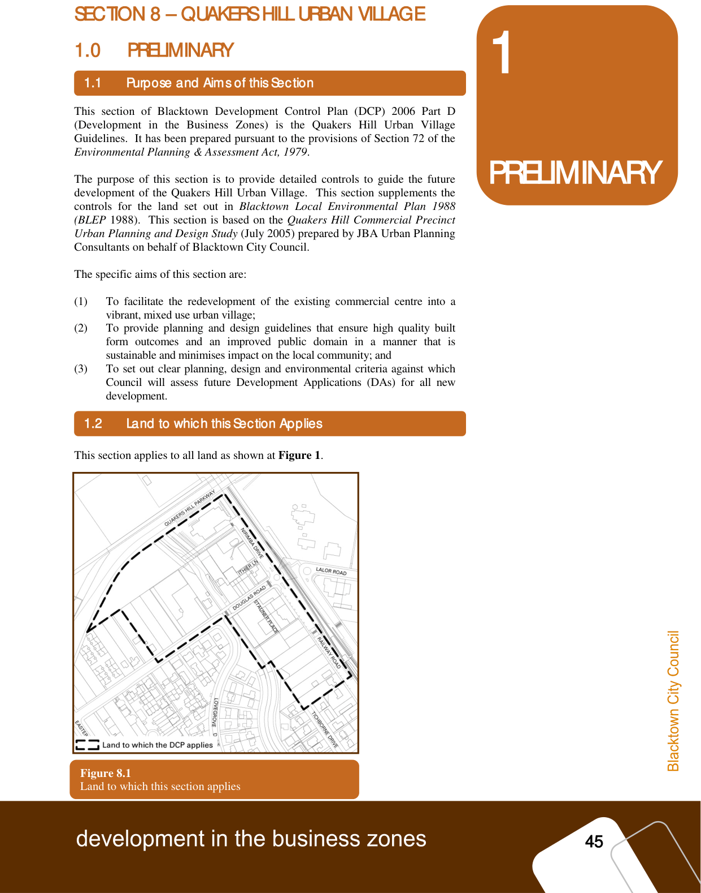

### 1.0 PRELIMINARY

#### 1.1

### 1.1 Purpose and Aims of this Section

> [Picture on page 50: a picture, saved as a picture (images/part-d-development-in-the-business-zones-page-50-5.gif, 150 dpi).]

### 1

### PRELIMINARY

#### Purpose and Aims of this Section

This section of Blacktown Development Control Plan (DCP) 2006 Part D

(Development in the Business Zones) is the Quakers Hill Urban Village

Guidelines.  It has been prepared pursuant to the provisions of Section 72 of the

Environmental Planning & Assessment Act, 1979.

The purpose of this section is to provide detailed controls to guide the future

development of the Quakers Hill Urban Village.  This section supplements the

controls for the land set out in Blacktown Local Environmental Plan 1988

(BLEP 1988).  This section is based on the Quakers Hill Commercial Precinct

Urban Planning and Design Study (July 2005) prepared by JBA Urban Planning

Consultants on behalf of Blacktown City Council.

The specific aims of this section are:

(1) To facilitate the redevelopment of the existing commercial centre into a

vibrant, mixed use urban village;

(2) To provide planning and design guidelines that ensure high quality built

form outcomes and an improved public domain in a manner that is

sustainable and minimises impact on the local community; and

(3) To set out clear planning, design and environmental criteria against which

Council will assess future Development Applications (DAs) for all new

development.

#### 1.2
