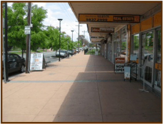
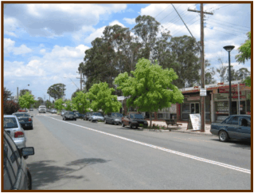
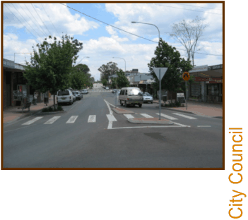

### 2.0 CONTEXT AND VISION

#### 2.1

### 2.1 Context

### 2

### CONTEXT AND

### VISION

> [Picture on page 54: a picture, saved as a picture (images/part-d-development-in-the-business-zones-page-54-8.gif, 150 dpi).]

> [Picture on page 54: a picture, saved as a picture (images/part-d-development-in-the-business-zones-page-54-9.gif, 150 dpi).]

> [Picture on page 54: a picture, saved as a picture (images/part-d-development-in-the-business-zones-page-54-10.gif, 150 dpi).]

#### Context

Quakers Hill Centre is located 4km north-west of Blacktown CBD.  The centre

is bounded by the railway line to the east, Quakers Hill Parkway to the north,

residential areas and a stormwater channel to the west and south.  Surrounding

the Centre is the suburb of Quakers Hill which generally comprises single

dwellings with a mix of infill townhouse and villa style housing.  The Nirimba

Education Precinct is located within walking distance of the Centre.  The

precinct includes the Blacktown TAFE College and the University of Western

Sydney – Blacktown Campus.

Quakers Hill is serviced by the Quakers Hill Railway Station which provides

daily rail services to the Sydney CBD via Blacktown.  The completion of the

M7 Motorway will also enhance the accessibility of the Centre to the broader

Sydney Region by road.

Quakers Hill Centre has been identified as a ‘future District Centre’ under

Council’s retail hierarchy.  Development within the Centre however, has been

limited.  In 2004, there were approximately 40 retail shops and some 4,500m2 of

retail and commercial floor space.  Approximately 50% of the Centre comprises

vacant land.  The achievement of District Centre status is restricted by excellent

access to competing centres, and the fact the Quakers Hill Parkway bypasses the

centre.

#### 2.2
